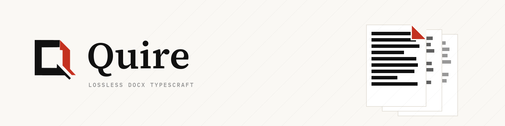

# Quire — Office document engine in Rust: unmodified parts stay byte-identical on save

[English](README.md) · [繁體中文](README.zh-TW.md)



**Quire is a Rust engine for opening, laying out, rendering, and losslessly saving Office documents.** Not a wrapper around a desktop office suite, and not a parser that rebuilds files from its own object model: when Quire saves a package, only parts the engine is instructed to change are rewritten; every other part—including parts it does not recognize—goes back into the archive byte-for-byte, preserving the original compressed stream, ZIP64 structures, extra fields, comments, and entry order. Across a 400-document real-world corpus with no parts modified, 399 of 399 files are byte-identical after a save round-trip (1 isolated due to upstream CRC corruption), re-checked by CI on Linux and Windows on every push.

Most open-source document libraries parse a file into their own model and write it back from scratch, so whatever they didn't model silently disappears: custom XML parts, digital signature payloads, vendor-specific formatting. If your product stores and outputs user documents, silent omission of unmodeled parts on save is unacceptable — so preserving unmodified parts byte-for-byte is the property Quire guarantees first and gates in CI. Quire is a library plus thin demo shells: a document engine you embed, not a word processor you install.

## See it in three minutes

**In the browser** — [quireoffice.dev/playground](https://quireoffice.dev/playground): drop in any `.docx`. Decompression, parsing, layout and painting all run in that tab as WebAssembly; the file never leaves your machine. Read-only preview today — editing is the next engine milestone.

**From source**

```bash
cargo test --workspace                          # the engine test suite
cargo run -p quire-cli -- render fixtures/sample.docx --out out/quire-sample
                                                # one SVG per page + break points
cargo run -p quire-cli -- roundtrip corpus --check
                                                # the lossless gate, 399/399
```

## What is actually done, and what is not

**Done** — DOCX lossless open/save (ZIP64, extra fields, comments); Knuth-Plass line breaking with UAX#14 and real font metrics; incremental pagination (p95 < 8 ms on a 500-page document); tables that slice across pages with repeated headers; headers/footers with field substitution; the full style cascade; multi-column sections (`w:cols`); revision-mark rendering (`w:ins`/`w:del`); floating images, table shading, duotone.

**In progress** — the document editing API (the next engine milestone). XLSX shares the same lossless container today: `core/xlsx` round-trips its 80-file real-world corpus (POI 40 + LibreOffice QA 40) byte-identically at the container level, with a read-only workbook model, cell projection (five value types over sharedStrings) and the style cascade (fonts/fills/borders/number formats) resolved to effective styles; the formula engine is next.

**Planned** — ODF family, ODT first; the CRDT collaboration layer; browser editor, Tauri desktop app, self-hostable collaboration backend. No dates attached; see [quireoffice.dev/roadmap](https://quireoffice.dev/roadmap).

**Known gaps** — visual fidelity versus LibreOffice is still converging, and complex drawing families are tracked as corpus failure clusters. Rendering is a display-list contract, not a pixel-for-pixel clone of any office suite.

## Built to open files you don't trust

A document engine that only handles friendly files is a demo. Quire treats malformed input as hostile by default: per-entry and whole-package decompression caps (a zip bomb is refused before it inflates), CRC-32 verification of every extracted part, image pixel budgets with checked arithmetic on 32-bit wasm, and a fuzz-lite regression gate asserting that mutated and truncated archives return errors instead of panicking. `overflow-checks` stay on in the release profile of the parsing crate. See [SECURITY.md](SECURITY.md).

## Why it writes its own ZIP and layout layers

Off-the-shelf ZIP libraries recompress streams, reorder directory records, and drop unknown extra fields — each of those makes byte-identical round-tripping impossible, so the container layer is ours. Layout has the same argument from the other direction: browser layout engines differ per platform and can't run headless, so line breaking and pagination are deterministic Rust that produces the same display list on a server, in a CLI, and in a browser tab.

Two boundaries are enforced by a script rather than by convention: `core/` never imports `shells/`, and shells enter the core only through `engine-api` (`bash scripts/check-layering.sh`). Every crate under `core/` builds for `wasm32-unknown-unknown`. CI runs fmt / clippy / test / roundtrip / wasm on Ubuntu and Windows.

## Repository layout

    core/ooxml         DOCX container + parts (lossless read/write, styles, tables)
    core/xlsx          XLSX workbook + sheet model (same lossless container)
    core/layout        line breaking + pagination (incremental, budgeted)
    core/render-trait  display-list contract
    core/crdt          collaboration adapter slot (planned)
    core/engine-api    the single entry point the shells use
    shells/native      CLI head (info / render / roundtrip)
    shells/web         browser shell (wasm32-unknown-unknown)
    scripts/           corpus collector, LibreOffice render-lab, gate scripts

Documentation lives at [docs.quireoffice.dev](https://docs.quireoffice.dev) — architecture notes, CLI reference, the render-lab workflow, and the playground guide. Brand assets (logo, lockups, banner, usage rules): [`brand/`](brand/).

## License

Source code: **Apache License 2.0** (`LICENSE-APACHE`). The Noto Sans TC subsets under `core/layout/assets/` keep the upstream **SIL Open Font License 1.1** (`OFL.txt` there); `corpus/` holds test corpora whose per-file licensing is tracked in `corpus/manifest.json`.
