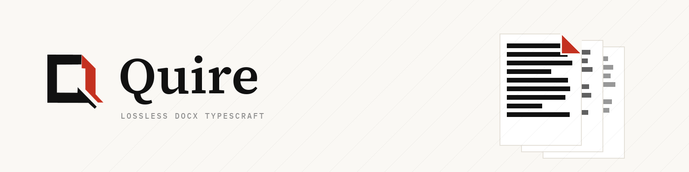

# Quire — Rust 無損 Office 文件引擎

[English](README.md) · [繁體中文](README.zh-TW.md)

**現行出貨：DOCX。** XLSX 與 PPTX 將以平級 format crate 進駐同一核心（見[後續規劃](#後續規劃)）。

**無損是結構性的。** Quire 未觸碰的 part 位元組級原樣寫回（CI 對 130 份真實
corpus 檔案做 byte-identical round-trip 閘門——含 ZIP64 與未知 extension），
排版管線——Knuth-Plass 最佳化斷行、UAX#14 斷字規則、增量分頁、真實字型度量——
輸出顯示列表，供原生與瀏覽器渲染器共同消費。

## 倉庫分層（CI 鎖死）

排版引擎是單一 Rust 核心、編譯雙目標（native 與 `wasm32-unknown-unknown`）；
殼——桌面 CLI 頭（`shells/native`）與瀏覽器殼（`shells/web`）——只是薄薄一層
平台適配。邊界由機器執行，不是靠慣例：

    shells/native ─┐                 ┌─ core/ooxml（DOCX zip+XML，lossless part 保留）
                   ├─ engine-api ────┼─ core/layout（斷行+分頁；★增量/預算制重排的演進點）
    shells/web ────┘  （唯一入口）    ├─ core/render-trait（顯示列表契約）
                                     └─ core/crdt（loro 適配位，Phase 4）

- `bash scripts/check-layering.sh`：core↛shells、shells 只能走 engine
- CI 鐵律：全部 core 必須可編譯 `wasm32-unknown-unknown`（雙目標=一起做的前提）

### CI 矩陣（三 OS × 雙 target）

`.github/workflows/ci.yml` 的 `cross-platform` job 在 ubuntu / macOS / Windows 三個
runner 上各跑同一組閘門，`ci-green` 是匯總項（branch protection 只綁它一個，
矩陣之後增減 OS 都不用重設 required check）：

| 閘門 | ubuntu | macOS | Windows |
|---|---|---|---|
| `cargo fmt --check` | ✅ 基準 | —（格式化不該隨 OS 變） | — |
| `cargo clippy -D warnings`（host target） | ✅ | ✅ arm64 + amd64 | ✅ |
| `cargo test --workspace` | ✅ | ✅ | ✅ |
| ★ round-trip 零失真（fixtures + corpus 130 檔） | ✅ | ✅ | ✅ |
| ★ core + web 殼編譯 `wasm32-unknown-unknown` | ✅ | ✅ | ✅ |
| wasm 殼實際連結出 `.wasm` | ✅ | ✅ | ✅ |
| 分層檢查 | ✅ | ✅ | ✅ |

`macos-latest` 是 Apple Silicon（host = `aarch64-apple-darwin`），故該平台另補一格
`x86_64-apple-darwin` 的 clippy 覆蓋，amd64/arm64 都咬合。
`.gitattributes` 把文字檔鎖成 LF、`.docx` 等鎖成 binary——否則 Windows runner 的
`core.autocrlf=true` 會讓 `cargo fmt --check` 假性紅燈，且 git 的換行正規化會破壞
round-trip 的位元組級斷言。

## 快速開始

    cargo test --workspace                    # 引擎測試（含真實 docx fixture）
    cargo run -p quire-cli -- info fixtures/sample.docx
    cargo run -p quire-cli -- render fixtures/sample.docx --out out/render-lab/quire-sample   # 每頁 SVG＋分頁斷點
    python3 scripts/render_lab.py --n 10        # LO 基線 vs 我方：corpus 前 10 檔差異報告
    python3 scripts/verify_corpus.py          # corpus 閘門（≥100 檔/manifest/覆蓋率統計）
    python3 scripts/corpus_parse_smoke.py     # corpus 綠燈率（目前 130/130）
    cargo run -p quire-cli -- roundtrip <file|dir> --check   # 無損 round-trip 閘門
    cd shells/web && npm install && npm run demo   # 瀏覽器渲染 demo
    cd shells/web && npm run build:wasm && npm run build:collab && npm run size  # 拆包＋體積閘門

## 目前狀態（骨架）

| 項目 | 狀態 |
|---|---|
| DOCX 解析（段落/run/粗斜體/樣式/實體/&、lossless part 保留） | ✅ 骨架 |
| 無損 round-trip（zip 結構自寫：未觸碰 entry 位元組級原樣搬運＋ZIP64＋extra/comment） | ✅ |
| roundtrip --check 對照器（結構級、允許差異白名單）＋ CI 閘門 | ✅ |
| 斷行（Latin 空白斷+CJK 任意斷，寬度約束）、分頁 | ✅ 骨架（貪心法） |
| 顯示列表 JSON 契約 + CLI 渲染頭 | ✅ 骨架 |
| render-lab（headless docx→SVG＋LO 基線差異報告） | ✅ 骨架 scripts/render_lab.py |
| wasm32 雙目標 CI 閘門（三 OS × amd64/arm64 + wasm32 矩陣） | ✅ |
| wasm 拆包＋首包體積閘門（CRDT 延遲分塊；首包 gzip≈54KB） | ✅ scripts/check-wasm-size.mjs |
| 真實 docx corpus（130 份+manifest+特徵覆蓋率） | ✅ scripts/corpus/collect.sh |
| 真字型度量 shaping（swash＋內建 Noto Sans TC 子集）＋golden 斷點快照 | ✅ core/layout/src/shaping.rs |
| 頁面幾何讀 sectPr（pgSz/pgMar/type；Letter/橫向/多 section 逐頁老實回報） | ✅ core/ooxml/src/sectpr.rs |
| Knuth-Plass 最佳化斷行＋UAX#14 斷字規則 | ✅ core/layout/src/kp.rs |
| 段落級快取＋增量分頁＋預算制軟分頁/背景重排（增量≡整篇重建，p95<8ms） | ✅ core/layout/src/lib.rs＋examples/p6_bench.rs |
| 表格、頁首頁尾、欄位、修訂追蹤 | ⏳ Phase 3–4（corpus 綠燈率驅動） |

## 後續規劃

Quire 是 Office 格式引擎家族，不是單一格式專案。賭注在於 DOCX/XLSX/PPTX 共用大部分
困難面——OPC 容器（zip+XML、位元組級無損）、OOXML part/model 機制、同一套無損紀律——
所以每種新格式是複用這層而不是另起爐灶，版面模型則各格式各別（DOCX 流式、XLSX
網格、PPTX 畫布）：

| 里程碑 | 範圍 |
|---|---|
| **現行** | DOCX：無損 round-trip ＋ 排版/分頁骨架（本 repo） |
| **Phase 3–4** | DOCX 深度：表格、頁首頁尾、欄位、修訂追蹤——由 corpus 綠燈率驅動；CRDT 協作層（loro 適配位） |
| **接著：XLSX** | `core/xlsx` 平級 format crate，掛同一 OPC/無損核心：活頁簿模型、公式引擎、試算表顯示列表（圖表較後） |
| **接著：PPTX** | `core/pptx`：投影片/圖形模型，複用 layout＋shaping；簡報顯示列表 |
| **殼的拆分** | 殼留在 repo 內，直到某殼要自行發行版本（安裝檔/部署上線）、授權分岔、或貢獻者族群分岔——層級閘門就是讓那次拆分保持便宜的最後一道保險 |

## 品牌資產

標誌、lockup、banner、favicon 與使用規則見 [`brand/`](brand/)。

## 授權

原始碼以 **Apache License 2.0** 授權發布，全文見 `LICENSE-APACHE`。

例外：`core/layout/assets/` 下的 Noto Sans TC 子集字型依其上游
**SIL Open Font License 1.1** 授權（見同目錄 `OFL.txt`）；`corpus/` 為測試
語料，各檔授權追蹤於 `corpus/manifest.json`。
