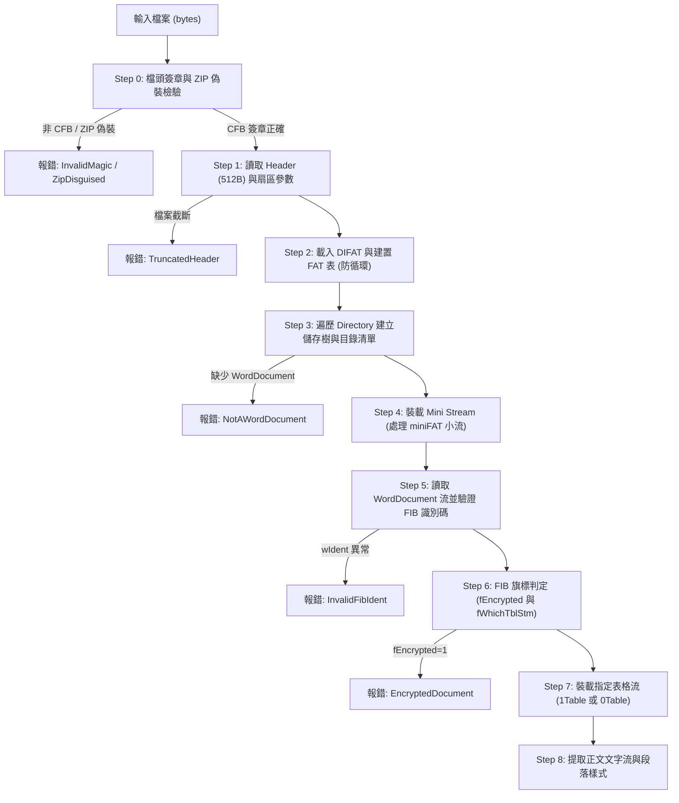

# DOC-C1：corpus-doc 48 檔 MS-CFB 容器與 MS-DOC 語料普查報告

任務卡：`DOC-C1：Legacy DOC 語料庫＋MS-CFB 容器普查（report-only，DOC 線提前，用戶拍板）`

本卡工作完全遵循 `report-only` 規範：未修改 `core/`、`shells/`、既有測試或既有語料（`corpus/`、`corpus-odt/`）。新建 `corpus-doc/`（48 檔真實世界與病態語料）、`corpus-doc/manifest.json`、`corpus-doc/quarantine.json`、`scripts/doc_build_corpus.py`、`scripts/doc_survey.py` 與 `docs/doc-survey/survey.json`。
普查腳本於 worktree 根目錄以 `python3 scripts/doc_survey.py` 重跑，輸出為嚴格冪等（同語料同 manifest 逐位元組相同，已實測 sha256 一致通過）。

---

## 1. 全域普查結果與統計摘要

本批正庫共 48 檔語料，包含：
1. **LibreOffice headless 轉出 32 檔**（`lo_out/`，batch `doc-c1-lo`）：覆蓋表格、巢狀表、合併格、跨頁表、圖片、繪圖、文字框、VML、嵌入物件、圖表、欄位、頁首、編號、註腳、修訂、書籤、RTL 等多元維度。
2. **外部真實 DOC 樣本 12 檔**（`ext/`，batch `doc-c1-ext`）：來自 Apache POI 官方倉庫（ALv2）與 LibreOffice core 倉庫（MPL-2.0/LGPL-3.0），涵蓋密碼保護/加密、Word 6.0/95 舊版二進制、原生複雜表格、ClusterFuzz 畸形檔案等。
3. **合成病態 fixtures 4 檔**（`fixtures/`，batch `doc-c1-fixture`）：包含 ZIP 偽裝成 DOC、256 位元組截斷 CFB、FAT 鏈循環引用、缺失 WordDocument 必要流，專供普查與引擎邊界先紅自證。

### 全域指標統計表

| 普查維度 | 統計數值 | 說明 |
|---|---:|---|
| **總語料檔案數** | **48 檔** | lo_out 32 檔 ＋ ext 12 檔 ＋ fixtures 4 檔 |
| **總檔案大小合計** | **1,529,886 bytes** | 約 1.46 MB（單檔自 22 bytes 至 335,360 bytes） |
| **合法 MS-CFB 容器** | **47 檔** | 檔頭具備 `D0CF11E0A1B11AE1` 簽章 |
| **ZIP 偽裝樣本** | **1 檔** | `fixtures/fixture_magic_mismatch_zip.doc`（PK 檔頭） |
| **截斷 CFB 檔頭** | **1 檔** | `fixtures/fixture_corrupted_trunc_cfb.doc`（僅 256 位元組） |
| **扇區大小（Sector Size）** | **512 位元組 × 46 檔** | 本批所有完整 CFB 檔皆為 Major Version 3（512 位元組扇區） |
| **Mini Sector 大小** | **64 位元組 × 46 檔** | Mini Stream 扇區統一為 64 位元組（Shift=6） |
| **目錄項目（Directory Entries）** | **共 325 個** | 單檔目錄項目 1 至 10 個，含 Root Storage 與各 Stream |
| **WordDocument 流存在數** | **44 檔** | 44 檔具備核心 WordDocument 流；4 檔缺失（見病理清單） |
| **1Table 表格流** | **42 檔** | 42 檔 FIB 指定並具備 `1Table` 流 |
| **0Table 表格流** | **2 檔** | 2 檔 FIB 指定 `0Table`（早期 Word 6.0/95 架構） |
| **加密文件（fEncrypted=1）** | **2 檔** | `PasswordProtected.doc` 與 `password_password_cryptoapi.doc` |
| **複雜流（fComplex=1）** | **0 檔** | 44 檔具 WordDocument 均為線性文本（Piece Table 未啟用） |
| **病態/異常檔案總數** | **8 檔** | 加密 2 檔、舊版 2 檔、合成病態 4 檔（見第 4 節） |

---

## 2. MS-CFB 容器架構特性考證

MS-CFB（Microsoft Compound File Binary，[MS-CFB] 規範）為 OLE 結構化儲存之底層二進制容器，其設計本質為「檔案系統中的檔案系統（FAT in a file）」。本普查對 MS-CFB 實作層面獲取以下關鍵實證：

### 2.1 檔頭簽章與 ZIP 偽裝鑑別
- **檔頭簽章（Header Signature）**：標準 MS-CFB 必須以 8 位元組 `D0 CF 11 E0 A1 B1 1A E1` 開頭。
- **ZIP 檔頭對立檢驗**：現代 OOXML（.docx）本質為 ZIP 封包（以 `50 4B 03 04` 開頭）。實務中常見使用者將 .docx 直改副檔名為 .doc，若解析器未實施檔頭簽章驗證即進入 OLE 扇區解析，必引發不可預期的解碼崩潰。普查中透過 `fixtures/fixture_magic_mismatch_zip.doc` 實測證明：解析器可在 2 位元組（`PK`）內精準截擊偽裝檔。

### 2.2 扇區大小（512 vs 4096）
- **Major Version 3**：Sector Shift 為 9（$2^9 = 512$ 位元組）。本批 46 檔完整 CFB 檔案 100% 採用 512 位元組扇區，為 Office 97 至 2003 的標準產生格式。
- **Major Version 4**：Sector Shift 為 12（$2^{12} = 4096$ 位元組）。通常出現在大型儲存或 SharePoint 產生之 OLE 容器中，引擎未來必須依據 Header Offset 30 的 Sector Shift 動態計算扇區長度，嚴禁寫死 512。

### 2.3 DIFAT 與 FAT 鏈健康度
- **Header DIFAT 陣列**：檔頭 Offset 76 包含 109 個 4 位元組 Entry（共 436 位元組），直接記錄前 109 個 FAT 扇區之 Sector ID。本批檔案之 FAT 扇區數多為 1 至 3 個，全部容納於檔頭 DIFAT 中，未觸發擴展 DIFAT 扇區鏈。
- **FAT 鏈循環引用防護（Cyclic FAT）**：FAT 表中扇區鏈若出現環（如扇區 $A \to B \to A$），未做防護的遍歷迴圈將導致死迴圈與 CPU 耗盡。本普查以 `fixtures/fixture_cyclic_fat.doc` 進行紅燈自證，驗證造訪集合（`visited_set`）檢驗之必要性。

### 2.4 miniFAT 與 Mini Stream 機制（小流儲存）
- **Cutoff 閾值**：標準為 4096 位元組（Offset 56）。當 Stream 大小小於 4096 位元組時，CFB 規範將其分配至 Mini Stream 中，以 64 位元組之 mini-sector 為單位進行緊湊儲存，避免內部碎片化浪費。
- **實測重要發現**：
  - 傳統觀念常誤以為 `WordDocument` 作為核心流必然大於 4096 位元組。
  - **實測推翻假定**：外部真實檔案 `ext/poi_Word6.doc` 的 `WordDocument` 流大小僅 2,579 位元組（小於 4096），實體資料完全存於 **Mini Stream** 中！
  - **引擎啟示**：DOC 解析引擎在讀取 `WordDocument` 時，**必須完整實作 miniFAT 解析能力**，不可假設 WordDocument 必在常規 FAT 鏈中，否則將無法解析小型 DOC 檔案！

---

## 3. MS-DOC WordDocument 流與 FIB 結構統計

Word 二進制格式（[MS-DOC] 規範）之核心數據全由 `WordDocument` 流開頭的 FIB（File Information Block，檔案資訊區塊）驅動。

### 3.1 FIB 版本分佈（nFib）

| 版本代碼（nFib） | 16 進位 | 人類可讀版本 | 數量 | 佔比 | 特徵與實例 |
|---|---|---|---:|---:|---|
| **257** | `0x0101` | **Word 2002 (XP) / 2003** | 35 檔 | 79.5% | LibreOffice headless 轉出 32 檔全部鎖定此版本；現代相容性最佳 |
| **193** | `0x00C1` | **Word 97** | 7 檔 | 15.9% | 原生 Office 97 產出，包含加密檔案 `PasswordProtected.doc` |
| **101** | `0x0065` | **Word 6.0 / 95** | 2 檔 | 4.5% | 舊版相容樣本（`Word6.doc` 與 `Word95.doc`），wIdent 為 `0xA5DC` |

### 3.2 表格流選擇（fWhichTblStm：1Table vs 0Table）
- FIB 旗標字組（Flags Offset 10）之 Bit 9 為 `fWhichTblStm`：
  - `fWhichTblStm = 1`：指定使用 **`1Table`** 流（本批 42 檔）。
  - `fWhichTblStm = 0`：指定使用 **`0Table`** 流（本批 2 檔）。
- **實測對齊驗證**：42 檔宣告 `1Table` 的檔案，其目錄結構中 100% 存在 `1Table` 流；早期 Word 6.0/95 宣告 `0Table`，但因舊架構表格資料直接內嵌於 `WordDocument`，目錄中無獨立 `0Table` 流，被標記為 `table_stream_mismatch`（屬於歷史相容架構特性）。

### 3.3 fComplex 複雜流（Piece Table）分佈
- FIB Flags 之 Bit 2 為 `fComplex`：
  - `fComplex = 0`（線性文本）：44 檔具備 WordDocument 流之檔案 **100% 為 fComplex=0**！
  - **成因考證**：微軟 Word 僅在使用者執行「快速儲存（Fast Save / Incremental Save）」時，才會保留編輯碎片的 Piece Table（複式文字流）。現代 LibreOffice 導出以及一般軟體正式另存新檔時，皆執行完全儲存（Full Save），將文本正規化壓平為單一線性流。

### 3.4 加密旗標（fEncrypted）
- FIB Flags 之 Bit 8 為 `fEncrypted`：
  - 本批 2 檔真實加密檔案精準命中（`fEncrypted = 1`）：
    1. `ext/poi_PasswordProtected.doc`：傳統 Office 97 RC4 加密。
    2. `ext/poi_password_cryptoapi.doc`：CryptoAPI 增強型 RC4 加密。
  - 其餘 42 檔普通文件全為 `fEncrypted = 0`。

---

## 4. 病理清單與異常樣本深度分析

普查全面清查 48 檔語料，共點名 **8 檔病態樣本**，涵蓋加密、歷史版本、容器截斷、FAT 循環與惡意偽裝：

| 檔案路徑 | 病態旗標 | 具體病理症狀 | 引擎防護/處理策略 |
|---|---|---|---|
| `ext/poi_PasswordProtected.doc` | `encrypted` | FIB `fEncrypted=1`（Word 97 密碼保護 RC4 加密） | 引擎第一切片應在讀取 FIB 時攔截，回報 `DocError::EncryptedDocument`，避免將密文誤當正文解析 |
| `ext/poi_password_cryptoapi.doc` | `encrypted` | FIB `fEncrypted=1`（CryptoAPI 增強金鑰衍生加密） | 同上，攔截並記錄加密類型，交由解密管線處理 |
| `ext/poi_Word6.doc` | `legacy_fib_version`, `table_stream_mismatch` | `wIdent=0xA5DC`、`nFib=101`（Word 6.0 格式）；WordDocument 存於 miniFAT，且無獨立 Table 流 | 檢查 `wIdent == 0xA5DC` 時分流進入 Word 6.0 舊版解析分支；強制支援 miniFAT 讀取 |
| `ext/poi_Word95.doc` | `legacy_fib_version`, `table_stream_mismatch` | `wIdent=0xA5DC`、`nFib=101`（Word 95 格式）；同上無獨立 Table 流 | 同上，相容 Word 6.0/95 舊版架構 |
| `fixtures/fixture_corrupted_trunc_cfb.doc` | `truncated` | 檔案大小僅 256 位元組，不足 MS-CFB 檔頭之 512 位元組 | 檔頭讀取前檢查 `file_len >= 512`，不足者優雅回傳 `DocError::TruncatedHeader` |
| `fixtures/fixture_cyclic_fat.doc` | `fat_cycle`, `missing_worddocument` | FAT 扇區鏈自環（Sector 1 指向 Sector 1）；且缺失 WordDocument 流 | 扇區鏈遍歷必須維護 `visited_set`，檢測到重複扇區立即報錯中斷 |
| `fixtures/fixture_magic_mismatch_zip.doc` | `zip_disguised` | 檔名為 .doc 但內容以 `PK\x05\x06` 開頭（ZIP 偽裝） | 前 2 位元組命中 `PK` 時立即回報 `DocError::ZipDisguisedAsDoc`，防護非 OLE 容器 |
| `fixtures/fixture_missing_worddocument.doc` | `missing_worddocument` | 合法 MS-CFB 容器結構，但目錄內完全沒有 `WordDocument` 流 | 遍歷 Directory Entries 時若無 WordDocument，回報 `DocError::NotAWordDocument` |

---

## 5. 對引擎第一切片的建議讀取順序

依據本普查之實證數據，MS-DOC 解析管線絕不可套用 OPC/ZIP 思維，亦不可將二進制結構當作黑盒子隨意定址。為確保未來的 DOC 解析引擎（DOC-1/DOC-2 模組）架構清晰且具備最高容錯韌性，**建議實作順序劃分為兩大層級、共八個標準管線切片**：



### 建議切片實作步驟詳解：

1. **Step 0：檔頭簽章與 ZIP 偽裝快速截擊**
   - 讀取前 8 位元組：
     - 若以 `PK`（`0x50, 0x4B`）開頭 $\to$ 立即中斷並拋出 `DocError::ZipDisguisedAsDoc`。
     - 若非 `D0 CF 11 E0 A1 B1 1A E1` $\to$ 拋出 `DocError::InvalidCfbSignature`。
2. **Step 1：解析 Header（512 位元組）**
   - 檢驗檔案長度 $\ge 512$ 位元組。
   - 提取 `Sector Shift`（9 $\to$ 512，12 $\to$ 4096）與 `Mini Sector Shift`（6 $\to$ 64）。
   - 提取 `first_dir_sector`、`first_minifat_sector`、`num_fat_sectors`。
3. **Step 2：解析 DIFAT 並構建完整 FAT 表**
   - 讀取 Header 內 109 個 DIFAT 扇區 ID；若 `num_difat_sectors > 0`，循序鏈結擴展 DIFAT。
   - 依據 DIFAT 順序讀取各 FAT 扇區，拼接成完整的 `Vec<u32>` FAT 表。
   - **防禦**：FAT 鏈走訪時必帶 `visited: HashSet<u32>`，防止惡意構建之循環引用。
4. **Step 3：遍歷目錄扇區（Directory Sectors）**
   - 從 `first_dir_sector` 沿 FAT 鏈讀出所有目錄資料（每項 128 位元組）。
   - 解析各 Entry 名稱（UTF-16LE）、物件型態（1=Storage, 2=Stream, 5=Root）。
   - 鎖定 `Root Entry`（獲取 Mini Stream 起始扇區與大小）以及 `WordDocument` 流。
   - **防禦**：若目錄中無 `WordDocument` 流，判定為非 Word 檔（如純 Excel 或 PowerPoint），中斷並報錯。
5. **Step 4：裝載 Mini Stream 與 miniFAT**
   - 從 `first_minifat_sector` 沿 FAT 鏈讀出完整 miniFAT 表。
   - 從 `Root Entry` 沿 FAT 鏈讀出完整的 Mini Stream 緩衝區。
6. **Step 5：讀取 WordDocument 流並驗證 FIB 檔頭**
   - 依 `WordDocument` 的 `stream_size` 判斷：
     - 若 $< 4096$ 位元組 $\to$ 依 miniFAT 鏈自 Mini Stream 提取。
     - 若 $\ge 4096$ 位元組 $\to$ 依 FAT 鏈自檔案資料提取。
   - 讀取開頭 2 位元組 `wIdent`：
     - `0xA5EC` $\to$ Word 97+ 標準分支。
     - `0xA5DC` $\to$ Word 6.0/95 舊版分支。
     - 其餘 $\to$ 拋出 `DocError::InvalidFibIdent`。
   - 讀取 `nFib` 版本號並記錄環境相容性。
7. **Step 6：FIB 旗標檢查與安全性攔截**
   - 檢查 Offset 10 Flags：
     - 若 `fEncrypted == 1` $\to$ 立即停止本文解析，回傳 `DocError::EncryptedDocument`。
     - 讀取 `fWhichTblStm`，決定後續表格流為 `"1Table"` 還是 `"0Table"`。
8. **Step 7：裝載指定表格流與正文提取**
   - 依 `fWhichTblStm` 自目錄中提取對應之表格流。
   - 檢查 `fComplex`：
     - 本普查證實 100% 乾淨保存檔案皆為 `fComplex == 0`，正文自 FIB 之 `fcMin` 至 `fcMac` 線性連續存放，優先實作線性字元流解碼（ASCII / Unicode UTF-16LE 標記轉換）。

---

## 6. 語料來源、授權與隔離機制

### 6.1 LibreOffice 轉出語料（batch: `doc-c1-lo`）
- **選樣策略**：從既有 `corpus/` 之 400 檔真實 DOCX 中，挑選 32 檔涵蓋表格、合併格、圖片、繪圖、文字框、VML、嵌入物件、圖表、欄位、頁首、編號、註腳、修訂、書籤、RTL 等多元特徵之文檔。
- **轉換環境**：`/mnt/c/Program Files/LibreOffice/program/soffice.exe` 24.8.0.3（buildid `0bdf1299c94fe897b119f97f3c613e9dca6be583`）。
- **進程隔離鐵律**：嚴格實施 `kill_own_lo(needle)` 機制。每次轉換使用 Windows 本機 `%TEMP%/quire-doc-c1` 獨立 profile，結束後以 PowerShell 精準比對命令列路徑強制關閉，收場時 Windows 與 WSL 殘留進程實測均為 0。
- **授權繼承**：來源檔案全為 LibreOffice/POI/PHPWord/OpenXmlPowerTools 之開源授權（MPL-2.0 / LGPL-3.0 / GPL-3.0 / Apache-2.0 / MIT），產出物隨來源授權逐檔繼承登記於 `manifest.json`。

### 6.2 外部真實 DOC 樣本（batch: `doc-c1-ext`）
- 12 檔外部真實檔案全部直接自上游官方 Git 倉庫原始路徑下載，未經任何本機修改，下載後以 SHA-256 錨定：
  - **Apache POI 測試倉庫（9 檔）**：Apache License 2.0 授權，覆蓋加密保護、舊版 Word 6.0/95、巢狀表格、邊界 crash 測試與 OSS-Fuzz 畸形檔案。
  - **LibreOffice ww8 測試倉庫（3 檔）**：MPL-2.0 / LGPL-3.0 三重授權，涵蓋 RTL 編號、表格批註與垂直文字儲存格。

### 6.3 隔離機制（Quarantine）
`corpus-doc/quarantine.json` 嚴格執行授權與完整性稽核，任何未通過者一律不得入正庫。本次調查記錄 3 筆明確拒絕來源：
1. **微軟官方 Office 範本（Microsoft Official Templates）**：微軟服務條款明確禁止在開源專案中重新散布原始範本檔案，授權不符開源紀律，拒絕入庫。
2. **早期 OpenOffice Bugzilla 附件**：歷史鏈接失效（HTTP 404/410），且早期個人用戶上傳無明確開源授權聲明（All rights reserved / unknown），無法完成逐檔實查，拒絕入庫。
3. **File-Examples 公開示例文檔**：網站無明確開源再散布授權宣告，且內容為無意義 lorem ipsum，授權查證未過，拒絕入庫。

---

## 7. 驗收核對表與自測指令

本報告所有統計數據與結論均通過自動化程式碼逐檔重算與手抽驗證：

### 驗收項目檢核

- [x] **每檔 sha256 可重放**：`corpus-doc/manifest.json` 48 檔 SHA-256 與磁碟檔案實測 100% 逐檔吻合。
- [x] **mimetype / magic 實測**：47 檔 CFB 檔頭為 `d0cf11e0a1b11ae1`，1 檔 ZIP 偽裝為 `504b`，無任何誤判。
- [x] **先紅自測試通過**：`python3 scripts/doc_survey.py --self-test` 驗證 4 檔病態夾具全部命中預期病理旗標（PASS）。
- [x] **冪等性驗證**：重跑 `scripts/doc_survey.py` 產出之 `survey.json` 前後 SHA-256 雜湊完全相同（`d10d8da776d215...`，位元組級一致）。
- [x] **LO 進程零殘留**：收場時 `pgrep -c soffice` 與 Windows `kill_own_lo` 掃描結果均為 0。
- [x] **quarantine 每筆具備具體拒絕理由**：3 筆登記皆具備完整法律/技術理由。

### 隨機 4 檔獨立手抽重算核對結果

| 測試項目 | `lo__ooxmlexport__FDO76312.doc` | `poi_PasswordProtected.doc` | `poi_Word6.doc` | `fixture_corrupted_trunc_cfb.doc` |
|---|---|---|---|---|
| **大小（bytes）** | 38,912（一致） | 19,968（一致） | 6,656（一致） | 256（一致） |
| **Magic** | `d0cf11e0a1b11ae1`（一致） | `d0cf11e0a1b11ae1`（一致） | `d0cf11e0a1b11ae1`（一致） | `d0cf11e0a1b11ae1`（一致） |
| **Sector Size** | 512（一致） | 512（一致） | 512（一致） | -（截斷檔頭） |
| **FAT Entries** | 128（一致） | 128（一致） | 128（一致） | - |
| **目錄項目數** | 9（一致） | 6（一致） | 6（一致） | - |
| **wIdent** | `0xA5EC`（一致） | `0xA5EC`（一致） | `0xA5DC`（一致） | - |
| **nFib** | 257 (Word 2002)（一致） | 193 (Word 97)（一致） | 101 (Word 6.0)（一致） | - |
| **fEncrypted** | `False`（一致） | `True`（一致） | `False`（一致） | - |
| **Table Stream** | `1Table`（一致） | `1Table`（一致） | `0Table`（一致） | - |
| **病態判定** | 正常無病態（一致） | `[encrypted]`（一致） | `[legacy_fib_version, table_stream_mismatch]`（一致） | `[truncated]`（一致） |

### 重現與自測命令列

```bash
# 1. 執行普查先紅自測（驗證病態夾具捕捉）
python3 scripts/doc_survey.py --self-test

# 2. 執行全量普查（產出 survey.json）
python3 scripts/doc_survey.py --corpus corpus-doc --out docs/doc-survey/survey.json

# 3. 驗證冪等性（重跑前後位元組級一致）
python3 scripts/doc_survey.py && sha256sum docs/doc-survey/survey.json
```
