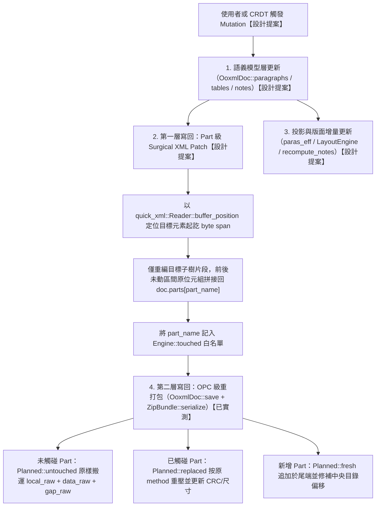

# K29-DESIGN：編輯 API Mutation 集與兩層寫回設計書

本設計書定義 Quire 引擎的編輯 API mutation 操作集、兩層寫回模型、CRDT 對接契約、以可逆性為單位的 undo/redo 機制，以及後續實作卡的分期切片。本文件為純設計規格（`K29-DESIGN`），不修改任何引擎程式碼；全文嚴格區分「`【已實測】`」（當下 worktree 已落地並經行號核實之行為）與「`【設計提案】`」（本卡新定義、留待後續實作卡落地之契約），絕不將設計提案混寫為現況能力。

---

## 1. 現況盤點（實測，不抄宣傳）【已實測】

### 1.1 無損承諾的原文字句與契約邊界【已實測】

- 繁體中文版無損承諾載於 `README.zh-TW.md:7`：「Quire 存檔時會重新封裝，但只有引擎被要求變更的 part 會被重寫；其餘 part——包括引擎不認識的自訂內容——皆以原始位元組原封不動放回新檔案（相同的壓縮流、ZIP64、extra field、註解與順序）。」
- 英文版無損承諾載於 `README.md:7`：「when Quire saves a package, only parts the engine is instructed to change are rewritten; every other part—including parts it does not recognize—goes back into the archive byte-for-byte (same compressed stream, ZIP64, extra fields, comments, and ordering).」
- 測試閘門定義載於 `README.zh-TW.md:45-53` 與 `README.md:45-53`：存檔路徑必須通過位元組級無損往返驗證（對未修改 part 檢查壓縮流、CRC、旗標、extra field 與順序是否逐位元組一致）。

### 1.2 `core/engine-api` 目前暴露的完整介面盤點【已實測】

根據分層鐵律（`core/engine-api/src/lib.rs:1-6`），`shells/*` 只能依賴 `quire-engine`；目前 `Engine`（`core/engine-api/src/lib.rs:62-129`）與相關公開型別暴露的方法如下：

| 分類 | 公開方法或型別 | 錨點（`檔案:行號`） | 實測行為與現況限制 |
| :--- | :--- | :--- | :--- |
| 建構入口 | `Engine::from_docx_bytes(bytes: &[u8]) -> Result<Self, EngineError>` | `core/engine-api/src/lib.rs:212-699` | 【已實測】呼叫 `quire_ooxml::parse(bytes)`（`core/engine-api/src/lib.rs:319`），建立樣式級聯投影 `paras_eff`（`core/engine-api/src/lib.rs:378-390`, `core/engine-api/src/lib.rs:8008`）、版面 `LayoutEngine`（`core/engine-api/src/lib.rs:863-871`）、頁首頁尾層（`core/engine-api/src/lib.rs:643-644`）、圖片像素池 `image_pixels`（`core/engine-api/src/lib.rs:594-609`），並在 `with_footnotes`（`core/engine-api/src/lib.rs:956-959`）收斂頁首推下、註腳與尾註。 |
| 讀取面（計數與診斷） | `page_count(&self) -> usize` | `core/engine-api/src/lib.rs:2072-2074` | 【已實測】回傳正文頁數 `self.layout.page_count()` 加純尾註續頁數 `self.end.pages.len()`。 |
| 讀取面（計數與診斷） | `paragraph_count(&self) -> usize` | `core/engine-api/src/lib.rs:2082-2084` | 【已實測】回傳 `self.doc.paragraphs.len()`（扁平段落數）。 |
| 讀取面（計數與診斷） | `preserved_part_count(&self) -> usize` | `core/engine-api/src/lib.rs:2087-2089` | 【已實測】回傳 `self.doc.parts.len()`（ZIP 內檔案型 entry 的解壓縮明文映射數）。 |
| 讀取面（表格） | `table_count(&self) -> usize`、`tables_json(&self) -> String` | `core/engine-api/src/lib.rs:2093-2100` | 【已實測】唯讀暴露 `self.doc.tables`（`BodyTable` 樹）；註解明確標示「不參與存檔，無損寫回來源仍是 parts 明文」（`core/engine-api/src/lib.rs:1842-1843`）。 |
| 讀取面（文字與行） | `page_lines(&self, page: usize) -> Option<Vec<String>>`、`paragraph_text(&self, para: usize) -> Option<String>` | `core/engine-api/src/lib.rs:2153-2155` | 【已實測】直接讀 `self.layout.pages()` 與 `self.layout.paragraph_text(para)`（含清單合成 marker 與點引填補字串）。 |
| 讀取面（游標雙向定位） | `caret_rect_json(&self, para: usize, cp: usize) -> Option<String>`、`caret_at_json(&self, page: usize, x_pt: f32, y_pt: f32) -> Option<String>` | `core/engine-api/src/lib.rs:1870-1884` | 【已實測】委派 `self.layout.caret_rect` 與 `self.layout.caret_at`；只認正文頁，尾註頁回傳 `None`（`core/engine-api/src/lib.rs:1867-1869`, `core/engine-api/src/lib.rs:8595-8596`）。 |
| 讀取面（顯示列表與斷點） | `page_display_list(&self, page: usize) -> Option<PageDisplayList>`、`page_display_list_json(&self, page: usize) -> Option<String>`、`page_breaks_json(&self) -> String` | `core/engine-api/src/lib.rs:2667-2672`, `core/engine-api/src/lib.rs:2155-2166` | 【已實測】合成單頁 `DrawItem` 序列（頁首頁尾、表格框線填色與格內文字、正文流與浮動圖片／圖形／文字框、正文行 run、註腳與尾註）並以 `sort_display_items` 排序（`core/engine-api/src/lib.rs:7493`）。 |
| 控制面（增量重排） | `set_sync_budget(&mut self, pages: Option<usize>)`、`is_settled(&self) -> bool`、`reflow_step_json(&mut self) -> String` | `core/engine-api/src/lib.rs:2750-2766` | 【已實測】控制 `LayoutEngine` 的預算制軟分頁與背景單步續排（`core/layout/src/lib.rs:2272-2381`）。 |
| 現有記憶體編輯面 | `insert_text_at_caret(&mut self, para: usize, cp: usize, text: &str) -> Vec<String>`、`replace_paragraph_text(&mut self, para: usize, text: &str) -> Vec<String>` | `core/engine-api/src/lib.rs:1848-1863`, `core/engine-api/src/lib.rs:2169-2213` | 【已實測】**僅修改版面層 `self.layout` 與發射投影 `self.paras_eff`，完全未寫回 `self.doc.paragraphs` 或 `self.doc.parts`**（詳見 §1.3）。 |
| 存檔與原始 Part 覆寫面 | `save_docx(&self) -> Result<Vec<u8>, EngineError>`、`set_part(&mut self, name: &str, bytes: Vec<u8>)`、`roundtrip_check(&self) -> Result<ZipDiff, EngineError>`、`roundtrip_diff(...)` | `core/engine-api/src/lib.rs:2819-2826` | 【已實測】`save_docx` 委派 `self.doc.save()`；`set_part` 直接覆寫 `self.doc.parts` 並記入 `self.touched` 白名單，但**不會重新解析模型或觸發排版**（詳見 §1.3）。 |
| XLSX 容器面（`feature = "xlsx"`） | `XlsxDoc`、`xlsx_roundtrip_diff` | `core/engine-api/src/lib.rs:2840-2906` | 【已實測】僅提供容器級無損往返與唯讀 workbook 投影。 |
| 協作面（`feature = "collab"`） | `CollabSession::new`、`commit_local`、`apply_remote` | `core/engine-api/src/lib.rs:2920-2957` | 【已實測】包裝 `quire_crdt::InMemoryBackend` 佔位實作，與 `Engine` 物理分離（詳見 §1.6）。 |

此外，三種外殼（shells）對上述 API 的接線現況如下【已實測】：
- `shells/web/src/lib.rs:8-77`（`WasmEngine`）：暴露 `new`、`page_count`、`paragraph_count`、`page_display_list_json`、`replace_paragraph_text`、`paragraph_text`、`caret_rect_json`、`caret_at_json`、`insert_text_at_caret`、`set_sync_budget`、`is_settled`、`reflow_step_json` 共 12 個方法。其中 `WasmEngine` 未暴露 `save_docx`、`set_part`、`roundtrip_check`、`preserved_part_count` 與 `page_lines`，故網頁端目前做完文字編輯後**根本無存檔入口**，文字變更只存活於記憶體。
- `shells/web-collab/src/lib.rs:12-34`（`WasmCollab`）：僅暴露 `new`、`commit_local(para, run, text)` 與 `apply_remote(msg)`。
- `shells/native/src/main.rs:39-104`（`quire-cli`）：僅提供 `info`、`page`、`dump`、`footnotes`、`render`、`roundtrip`、`roundtrip-xlsx`、`xlsx-info` 八個非互動式子命令，無互動編輯命令。

### 1.3 寫回路徑現況：記憶體編輯面與存檔路徑完全斷裂【已實測】

實測當下 worktree 的程式碼與單元測試，**目前引擎不存在「從語義編輯更新 XML part 並無損存檔」的閉環寫回路徑**，兩條現有路徑各自獨立且互不相通：

1. **記憶體文字編輯路徑（有排版與投影更新，無持久化寫回）**【已實測】：
   - `Engine::insert_text_at_caret`（`core/engine-api/src/lib.rs:2180-2195`）將碼點偏移 `cp` 轉為 UTF-8 位元組切口後拼出新字串，轉呼 `self.replace_paragraph_text(para, &next)`（`core/engine-api/src/lib.rs:2194`）。
   - `Engine::replace_paragraph_text`（`core/engine-api/src/lib.rs:2169-2213`）只做三件事：
     1. 呼叫 `self.layout.replace_paragraph_text(para, text)`（`core/engine-api/src/lib.rs:2563`；定義於 `core/layout/src/lib.rs:2191-2321`），重排該段落斷行、透過 `shift_breaks`（`core/layout/src/lib.rs:1152-1168`, `core/layout/src/lib.rs:2218-2222`）平移段內硬分頁斷點、更新 `self.pages` 並回傳 `Invalidation`（變體僅 `Paragraph(usize)`、`Page(usize)`、`ReflowPending { from_page }` 三種，定義於 `core/layout/src/lib.rs:1720-1731`）。
     2. 同步發射投影 `self.paras_eff`（`core/engine-api/src/lib.rs:2180-2208`）：把新文字塞進該段第一個非空 `Run`，撤除其 `r.field = None`（`core/engine-api/src/lib.rs:2191`），並將同段其餘非空 `Run` 的 `r.text` 清空為 `String::new()`（`core/engine-api/src/lib.rs:2725`）。
     3. 呼叫 `self.recompute_notes()`（`core/engine-api/src/lib.rs:957`；定義於 `core/engine-api/src/lib.rs:6580-6585`）重算頁首推下、註腳與尾註排布。
   - **斷裂鐵證**：`replace_paragraph_text` 完全沒有修改 `self.doc.paragraphs`（`core/ooxml/src/lib.rs:2068`），沒有修改 `self.doc.parts.get_mut("word/document.xml")`（`core/ooxml/src/lib.rs:384`），也沒有將 `"word/document.xml"` 插入 `self.touched`（`core/engine-api/src/lib.rs:74`）。單元測試 `edit_syncs_paras_eff_styles_and_round_trip`（`core/engine-api/src/lib.rs:8868-8894`）在 `core/engine-api/src/lib.rs:7895` 呼叫 `engine.replace_paragraph_text(0, "改後新文字")` 後，於 `core/engine-api/src/lib.rs:2700-2701` 直接斷言：`let saved = engine.save_docx().expect("存檔"); assert_eq!(saved.as_slice(), FX, "編輯發射投影後存檔仍須位元組級相同");`。這證明現況下記憶體編輯被刻意設計為純投影操作，存檔後一切文字變更全部丟失。

2. **原始 Part 位元組覆寫路徑（有持久化寫回，無模型與排版更新）**【已實測】：
   - `Engine::set_part(&mut self, name: &str, bytes: Vec<u8>)`（`core/engine-api/src/lib.rs:2670-2673`）將 `name` 插入 `self.touched` 並呼叫 `self.doc.set_part(name, bytes)`（`core/ooxml/src/lib.rs:336-338`），直接替換 `OoxmlDoc::parts` 內的位元組陣列。
   - `OoxmlDoc::remove_part(&mut self, name: &str) -> bool`（`core/ooxml/src/lib.rs:341-343`）從 `self.parts` 移除指定鍵，但 `Engine` 並未對外 re-export 此方法。
   - **斷裂鐵證**：呼叫 `Engine::set_part` 後，`self.doc.paragraphs`、`self.doc.tables`、`self.paras_eff`、`self.layout` 均不會更新；現有測試（如 `core/engine-api/src/lib.rs:5826-5827` 與 `core/engine-api/src/lib.rs:7962-7963`）若要觀察修改 `word/document.xml` 後的排版結果，必須先呼叫 `base.save_docx().unwrap()` 再重新呼叫 `Engine::from_docx_bytes` 全量重開文件。

### 1.4 `ZipBundle` 與 `OoxmlDoc` 的 Part 級 Raw 位元組保留機制【已實測】

Quire 的容器層無損承諾由 `core/ooxml/src/zip_struct.rs`、`core/ooxml/src/lib.rs` 與 `core/ooxml/src/diff.rs` 共同支撐，其運作機制經實查如下：

1. **開啟期結構快照（`ZipBundle::open` 與 `decode_parts`）**【已實測】：
   - `ZipEntry`（`core/ooxml/src/zip_struct.rs:75-102`）逐筆保存原始 ZIP 紀錄的完整切片：本地標頭含檔名與 extra field 的 `local_raw: Vec<u8>`（`core/ooxml/src/zip_struct.rs:92`）、壓縮態資料流 `data_raw: Vec<u8>`（`core/ooxml/src/zip_struct.rs:94`）、該筆資料尾端到下一結構紀錄之間的間隙位元組 `gap_raw: Vec<u8>`（含選用之 data descriptor 或 padding，`core/ooxml/src/zip_struct.rs:97`）、中央目錄紀錄 `central_raw: Vec<u8>`（`core/ooxml/src/zip_struct.rs:99`），以及防止損毀的 `frozen: bool` 旗標（`core/ooxml/src/zip_struct.rs:101`）。
   - `ZipBundle`（`core/ooxml/src/zip_struct.rs:167-180`）保存按中央目錄順序排列的 `entries: Vec<ZipEntry>`（`core/ooxml/src/zip_struct.rs:169`）、首筆本地標頭前的 `prefix_raw: Vec<u8>`（`core/ooxml/src/zip_struct.rs:171`）、`eocd_raw: Vec<u8>`（`core/ooxml/src/zip_struct.rs:173`）、`eocd64_raw: Option<Vec<u8>>`（`core/ooxml/src/zip_struct.rs:175`）、`eocd64_locator_raw: Option<Vec<u8>>`（`core/ooxml/src/zip_struct.rs:177`）與 `archive_comment_raw: Vec<u8>`（`core/ooxml/src/zip_struct.rs:179`）。
   - `ZipBundle::mark_frozen`（`core/ooxml/src/zip_struct.rs:394-402`）將目錄項（`is_dir()`，即檔名以 `/` 結尾且 `uncompressed_size == 0`，見 `core/ooxml/src/zip_struct.rs:106-108`）以及非 UTF-8 檔名經 `String::from_utf8_lossy` 轉換後發生名稱碰撞的項目設為 `frozen = true`，禁止經由 `parts` 映射修改，強制原樣搬運。
   - `ZipBundle::decode_parts`（`core/ooxml/src/zip_struct.rs:418-444`）走訪所有非 `frozen` 的檔案項目（`file_entries()`，`core/ooxml/src/zip_struct.rs:413-415`），透過 `ZipEntry::decoded`（`core/ooxml/src/zip_struct.rs:111-139`）以單一 entry 64 MiB（`MAX_ENTRY_DECOMPRESSED_SIZE`，`core/ooxml/src/zip_struct.rs:59`）與全包累計 256 MiB（`MAX_TOTAL_DECOMPRESSED_SIZE`，`core/ooxml/src/zip_struct.rs:62`）的防炸彈上限解壓縮，並於 `validate_plain`（`core/ooxml/src/zip_struct.rs:142-153`）比對 `crc32fast::hash` 與解壓縮長度後，存入 `OoxmlDoc::parts: BTreeMap<String, Vec<u8>>`（`core/ooxml/src/lib.rs:321`, `core/ooxml/src/lib.rs:354-356`）。

2. **存檔期變更偵測（`OoxmlDoc::save`）**【已實測】：
   - `OoxmlDoc::save`（`core/ooxml/src/lib.rs:321-350`）建立 `changes: BTreeMap<String, Change>` 與 `extras: BTreeMap<String, Vec<u8>>`：
     - 走訪 `self.bundle.file_entries()`（`core/ooxml/src/lib.rs:352`）：若 `self.parts.get(&e.name)` 為 `None`，標記 `Change::Remove`（`core/ooxml/src/lib.rs:355-357`）。
     - 若為 `METHOD_STORE`（`0`）且 `bytes == &e.data_raw`，直接判定未變更並跳過解壓縮（`core/ooxml/src/lib.rs:333-335`）。
     - 否則將 `bytes` 與 `&e.decoded()?` 比對；僅當明文位元組不同時，才標記 `Change::Replace(bytes.clone())`（`core/ooxml/src/lib.rs:363-366`）。
     - 走訪 `self.parts`：凡不在 `known`（原始 `file_entries` 集合）中的鍵，放入 `extras` 作為新增 part（`core/ooxml/src/lib.rs:343-348`）。

3. **容器重封裝與偏移量修補（`ZipBundle::serialize`）**【已實測】：
   - `ZipBundle::serialize`（`core/ooxml/src/zip_struct.rs:453-582`）將每個原始項目轉為 `Planned`（`core/ooxml/src/zip_struct.rs:183-206`, `core/ooxml/src/zip_struct.rs:653-719`）：
     - 未出現在 `changes` 中的項目（以及 `frozen == true` 的項目，`core/ooxml/src/zip_struct.rs:463-466`）呼叫 `Planned::untouched(e)`（`core/ooxml/src/zip_struct.rs:654-666`），直接借用 `&e.local_raw`、`&e.data_raw`、`&e.gap_raw`、`&e.central_raw`，零重壓縮。
     - 即便呼叫端傳入 `Change::Replace(plain)`，若 `e.method == METHOD_STORE` 且重算之 `crc == e.crc && data == e.data_raw`（`core/ooxml/src/zip_struct.rs:475-478`），仍自動降級回 `Planned::untouched(e)`。
     - 真正變更的項目依原項目 `e.method` 重新壓縮（`encode_by_method`：`METHOD_STORE` 原樣存入、`METHOD_DEFLATE` 以預設等級重壓，其餘壓縮法降級為 `METHOD_DEFLATE`，於 `core/ooxml/src/zip_struct.rs:1198-1233`），並以 `Planned::replaced`（`core/ooxml/src/zip_struct.rs:677-697`）換上新的壓縮流、CRC 與尺寸（本地標頭由 `build_local_with_extra`、中央目錄由 `build_central` 重建：`core/ooxml/src/zip_struct.rs:738-772`, `core/ooxml/src/zip_struct.rs:767-814`，同時保留原 extra field、檔案註解與外部屬性）。
     - 新增的 `extras` 項目以 `METHOD_DEFLATE` 壓縮後呼叫 `Planned::fresh(name, plain_len, data, crc, method)`（`core/ooxml/src/zip_struct.rs:699-719`，呼叫點 `core/ooxml/src/zip_struct.rs:487-498`），標頭同樣由 `build_local_with_extra`／`build_central` 合成。
   - **雙序寫出紀律**：
     - 本地檔案區按原始 `local_header_offset` 物理順序排序寫出（`phys_order`，`core/ooxml/src/zip_struct.rs:517-549`），使未觸碰項目的 `gap_raw` 維持在原本相鄰的物理位置（支援 Apache POI `CVLKRA` 等中央目錄順序與物理順序不一致的異常壓縮包，`core/ooxml/src/zip_struct.rs:517-524`）。
     - 中央目錄區按原始中央目錄邏輯順序寫出（`core/ooxml/src/zip_struct.rs:552-576`）；對於未觸碰項目，僅呼叫 `patch_central_offset`（`core/ooxml/src/zip_struct.rs:815-879`）修補因前方 part 長度改變而平移的 `local_header_offset`（含標準 32-bit 欄位與 ZIP64 `0x0001` extra block 內的 8-byte 偏移槽），其餘位元組一字不動。
     - 尾端由 `tail_records`（`core/ooxml/src/zip_struct.rs:586-650`）修補 EOCD、ZIP64 EOCD 與 ZIP64 EOCD Locator 的 entry 數量、中央目錄大小與偏移量，並原樣接回 `archive_comment_raw`。
   - **驗證閘門**：`diff_zip_structure`（`core/ooxml/src/diff.rs:161-240`）與 `diff_untouched`（`core/ooxml/src/diff.rs:243-245`）對每個未列於 `touched_parts` 白名單的 entry 檢查 `EntryDiff::zero_loss`（`core/ooxml/src/diff.rs:51-60`）：要求 `data_raw_identical`、`crc_identical`、`method_identical`、`gp_flag_identical`、`local_extra_identical`、`central_extra_identical`、`comment_identical`、`attrs_identical` 與 `gap_raw_identical` 全部為 `true`。

### 1.5 模型層（`core/ooxml`）與發射／排版層（`core/engine-api`、`core/layout`）的語義歸屬【已實測】

為確保後續 mutation 不破壞單一真相來源（Single Source of Truth），茲將當下三層各自持有的資料結構與語義歸屬實查彙整如下：

1. **模型層 `core/ooxml`（解析期讀取投影＋原始 Part 字典）**【已實測】：
   - `OoxmlDoc`（`core/ooxml/src/lib.rs:299-314`）持久持有五個欄位：
     - `paragraphs: Vec<Paragraph>`（`core/ooxml/src/lib.rs:310`；`Paragraph` 定義於 `core/ooxml/src/lib.rs:215-279`，實際欄位為 `style`、`runs: Vec<Run>`、`page_breaks: Vec<usize>`、`prun`、`line`、`spacing_before_pt`、`spacing_after_pt`、`jc`、`page_break`、`tab_right_pt`、`tab_center_pt`、`tab_leader`、`txbx_texts`、`txbx_runs`——現況**沒有** `tabs` 向量、`ind_*` 縮進三欄、`keep_next`／`keep_lines`／`contextual_spacing` 與段 borders（這些是 §2.3.2 `ParaPropsPatch` 的**提案新增**欄位，落地時一併補解析）；`Run` 定義於 `core/ooxml/src/lib.rs:78-153`）。
     - `tables: Vec<BodyTable>`（`core/ooxml/src/lib.rs:313`；定義於 `core/ooxml/src/table.rs:456-463`，含 `para_start: usize` 與遞迴 `Table`／`TableRow`／`TableCell`／`Block` 樹，`core/ooxml/src/table.rs:310-452`）。
     - `notes: Notes`（`core/ooxml/src/lib.rs:319`；定義於 `core/ooxml/src/notes.rs:174-187`，解析自 `word/footnotes.xml`、`word/endnotes.xml` 與 `word/settings.xml`）。
     - `parts: BTreeMap<String, Vec<u8>>`（`core/ooxml/src/lib.rs:321`）與 `pub bundle: ZipBundle`（`core/ooxml/src/lib.rs:323`，公開欄位：`Planned` 零失真搬運所需，外部不直接改寫）。
   - **其餘 OOXML 語義並未存放在 `OoxmlDoc` 結構體欄位中，而是由 `Engine::from_docx_bytes` 在開檔期從 `doc.parts` 按需呼叫無狀態解析函式取得**【已實測】：
     - 主題色與主題字型：`ThemeColors::from_parts(&doc.parts)`（`core/ooxml/src/theme.rs:119-123`）與 `ThemeFonts::from_parts(&doc.parts)`（`core/ooxml/src/theme.rs:358-362`），註解明確記載：`w:rFonts` 的主題字型引用在解析當下查表落地成直接值，純讀取，存檔路徑不經此層（`core/ooxml/src/theme.rs:17-18`、`core/ooxml/src/lib.rs:386-387`）。
     - 樣式表：`StyleTable::parse_with_fonts`（`core/ooxml/src/styles.rs:924-930`），且受 `styles_referenced(&doc.parts)`（`core/engine-api/src/lib.rs:3307`）守門——必須在 `word/_rels/document.xml.rels` 中存在 `styles` 關聯才生效。
     - 節幾何與頁首頁尾引用：`read_sections_per_paragraph`（`core/ooxml/src/sectpr.rs:228-235`）、`read_sections_header_footer`（`core/ooxml/src/sectpr.rs:273-289`）、`read_sections_note_pr`（`core/ooxml/src/sectpr.rs:301-304`）、`read_sections_endnote_pr`（`core/ooxml/src/sectpr.rs:307-310`）。
     - 清單編號：`paragraph_numbering_from_parts`（`core/ooxml/src/numbering.rs:823-845`）與 `Numbering::from_parts`（`core/ooxml/src/numbering.rs:711-730`）。
     - 圖形、圖片與 VML/DrawingML 文字框：`read_images_with_theme`（`core/ooxml/src/drawing.rs:4832-4834`），產出 `Vec<InlineImage>`（`core/ooxml/src/drawing.rs:225-404`）。`core/ooxml/src/drawing.rs:1-46` 模組頭註解記載其支援 `wp:inline`（佔正文流整數行網格帶）、`wp:anchor`（浮動鎖點、跨欄／負偏移／頁面釘定 `page_pinned` 於 `core/ooxml/src/drawing.rs:348`、包裹模式 `wrap_type: Option<String>` 於 `core/ooxml/src/drawing.rs:371`、錨定文字框撐列事實 `TextboxGrow` 於 `core/ooxml/src/drawing.rs:322-356`）、DrawingML `wps:wsp`／`wpg:wgp` 與 VML `w:pict`／`v:shape`／`v:group`、以及 `a:blip` 下的雙色調 `DuotoneEffect`（`core/ooxml/src/drawing.rs:313-318`）。
     - 關聯表：`read_rels`（`core/ooxml/src/rels.rs:27-60`）與 `resolve_relationship`（`core/ooxml/src/rels.rs:62-80`）。
   - **四大解析器的扁平段落索引對齊不變量（Flat Paragraph Index Invariant）**【已實測】：
     - 在 `word/document.xml` 中，每個非自閉合 `<w:p>`（`Event::Start`）佔一個扁平段落槽位（`Event::Empty` 的 `<w:p/>` 不佔槽），`mc:Fallback` 子樹全部忽略，且 DrawingML `wps:txbx/w:txbxContent` 與 VML `v:textbox/w:txbxContent` 內部的 `<w:p>` **不進入正文扁平段落流**，而是掛載到宿主段落的 `Paragraph::txbx_texts` 與 `Paragraph::txbx_runs`（`core/ooxml/src/lib.rs:242-248`, `core/ooxml/src/lib.rs:599-616`, `core/ooxml/src/lib.rs:668-704`）。
     - 這套完全相同的計數契約同時被四個解析器實作並依賴：`parse_document_xml_with_fonts`（`core/ooxml/src/lib.rs:569-1233`）、表格解析器 `table::count_flat_paras`（`core/ooxml/src/table.rs:1345-1347`）、圖形解析器 `drawing::count_paras`（`core/ooxml/src/drawing.rs:4842-4844`），以及節屬性解析器 `sectpr::scan_sections`（`core/ooxml/src/sectpr.rs:382-613`）。任何增刪段落或表格儲存格的 mutation 都必須同步維護這四處索引的對齊。

2. **發射與協調層 `core/engine-api`（級聯烘焙與顯示列表組裝）**【已實測】：
   - `Engine`（`core/engine-api/src/lib.rs:62-129`）持有烘焙後的段落投影 `paras_eff`（由 `cascade_paragraphs` 於 `core/engine-api/src/lib.rs:3165-3457` 合成：把 `StyleTable` 級聯結果、清單 marker 前綴、製表位點引填補字元烘焙進 `Run`）、頁首頁尾快取 `hf`／`hf_parts`（`core/engine-api/src/lib.rs:78-79`，由 `build_hf_layer` 於 `core/engine-api/src/lib.rs:7638-7761` 建立）、註腳與尾註排布 `foot`／`end`（`core/engine-api/src/lib.rs:89-105`）、圖形佔位池 `shape_boxes`（`core/engine-api/src/lib.rs:116`）與圖片像素池 `image_pixels`（`core/engine-api/src/lib.rs:123`）。
   - 在 `page_display_list`（`core/engine-api/src/lib.rs:2248-2490`）中，文字框（`shape_boxes`）與圖片像素（`image_pixels`）皆採**消費式配對**，配對鍵為「宿主扁平段落索引 `para` ＋ 宣告寬度 `w_pt`（誤差 `< 0.01` pt）」（`core/engine-api/src/lib.rs:1923-1935`, `core/engine-api/src/lib.rs:8421`, `core/engine-api/src/lib.rs:8453`, `core/engine-api/src/lib.rs:8493`, `core/engine-api/src/lib.rs:7895`）。

3. **排版層 `core/layout`（行網格分頁與增量重排）**【已實測】：
   - `LayoutEngine`（`core/layout/src/lib.rs:1968-1999`）持有各段純文字 `texts: Vec<String>`、逐段網格屬性 `grid: ParaGrid`（`core/layout/src/lib.rs:771-804`：含 `size_pt`、`bands`、`break_before`、`before_bands`、`after_bands`、`advance_scale`）、表格幾何槽 `tables: Vec<TableSlot>`（`core/layout/src/lib.rs:2252`）、圖片佔位帶 `images: Vec<ImageBand>`（`core/layout/src/lib.rs:2255`）、編排流 `flow: Vec<FlowItem>`（`core/layout/src/lib.rs:2250`）、段首位置快取 `starts: Vec<FlowPos>`（`core/layout/src/lib.rs:1079`）與最終分頁結果 `pages: Vec<Page>`（`core/layout/src/lib.rs:472`）。

### 1.6 `core/crdt` 現況：純佔位實作（Phase 4 落地前之 LWW 骨架）【已實測】

實查 `core/crdt/src/lib.rs:1-170` 與 `core/crdt/Cargo.toml`，現況完全是**佔位實作（Placeholder）**，尚未接入 Loro 或任何字元級序列 CRDT：
- 檔案首行註解（`core/crdt/src/lib.rs:1`）明寫：`//! quire-crdt —— 協作層佔位（Phase 4 落地）。`。
- 操作枚舉 `EditOp`（`core/crdt/src/lib.rs:9-15`）目前僅有一個變體：`ReplaceRunText { para: usize, run: usize, text: String }`。
- 後端介面 `CrdtBackend`（`core/crdt/src/lib.rs:17-22`）僅定義兩個方法：
  - `fn commit_local(&mut self, op: &EditOp) -> Vec<u8>`（`core/crdt/src/lib.rs:10`）
  - `fn apply_remote(&mut self, msg: &[u8]) -> Vec<EditOp>`（`core/crdt/src/lib.rs:10`）
- 內建實作 `InMemoryBackend`（`core/crdt/src/lib.rs:30-35`, `core/crdt/src/lib.rs:46-106`）僅以 `BTreeMap<(usize, usize), (u64, u64, String)>` 儲存每個 `(para, run)` 的 `(lamport, session, text)`，以 `Stamped` 結構體（`core/crdt/src/lib.rs:39-44`）序列化為 JSON 位元組，並依 `(lamport, session)` 全序做 Last-Writer-Wins（LWW）覆寫（`core/crdt/src/lib.rs:73-93`），連「段內插入／刪除段落」導致的索引平移與同 run 內併發打字合併都完全不支援。
- 此外，注意一個現存介面落差【已實測】：`CollabSession::commit_local`（`core/engine-api/src/lib.rs:2937-2946`）與 `EditOp::ReplaceRunText` 以 `(para, run)` 為單位，但 `Engine` 目前唯一暴露的編輯方法卻是整段置換 `replace_paragraph_text(para, text)`（`core/engine-api/src/lib.rs:2192`），根本沒有 `replace_run_text` 入口。

---
## 2. Mutation 型錄【設計提案】

本章定義的統一編輯契約全部屬於**【設計提案】**，旨在取代現況僅改版面投影的 `insert_text_at_caret`／`replace_paragraph_text`（`core/engine-api/src/lib.rs:2180-2195`, `core/engine-api/src/lib.rs:2169-2213`），成為網頁編輯器（`shells/web`）、協作模組（`shells/web-collab` 與 `core/crdt`）及原生殼（`shells/native`）的唯一寫入通道。

### 2.1 統一尋址座標系、批次入口與錯誤原子性契約【設計提案】

1. **雙座標系隔離與正準碼點（Canonical Codepoint）尋址**【設計提案】：
   - 【已實測】現況 `Engine::cascade_paragraphs`（`core/engine-api/src/lib.rs:3165-3457`）會在發射投影 `paras_eff` 與版面文字 `layout.texts` 中注入兩類非原始文字：其一是清單編號的合成前綴字串（長度記於 `marker_chars: Vec<usize>`，`core/engine-api/src/lib.rs:378`, `core/engine-api/src/lib.rs:619-620`, `core/engine-api/src/lists.rs:146-184`），其二是製表位點引填補字串（`core/engine-api/src/lib.rs:3001-3063`）。
   - 【設計提案】所有 `Mutation` 的文字偏移量一律採用**正準段落碼點偏移（Canonical Paragraph Codepoint Offset，`cp: usize`）**，即對應 `OoxmlDoc::paragraphs[para].runs`（`core/ooxml/src/lib.rs:308-309`）串接後的 Unicode scalar value（`char`）計數，絕不含合成清單前綴或點引填補字元。`Engine` 另提供純轉換輔助函式 `layout_cp_to_canonical_cp(target, para, layout_cp) -> usize` 與 `canonical_cp_to_layout_cp(target, para, canonical_cp) -> usize`，避免合成字串被誤寫入 `word/document.xml`。
   - 【設計提案】跨 Part 子樹尋址統一由 `SubDocTarget` 表達，使正文、頁首頁尾、註腳尾註與文字框共用同一套段落／表格編輯原語：

```rust
/// 【設計提案】文件子樹目標（決定操作哪一個 XML part 的段落／表格空間）
#[derive(Debug, Clone, PartialEq, Eq, Serialize, Deserialize)]
pub enum SubDocTarget {
    /// 正文：對應 `"word/document.xml"` 的 `<w:body>`
    Body,
    /// 頁首：對應第 `section_id` 節之 `slot`（Default/First/Even）所指向的 `"word/header*.xml"`
    Header { section_id: u32, slot: HfSlotKind },
    /// 頁尾：對應第 `section_id` 節之 `slot`（Default/First/Even）所指向的 `"word/footer*.xml"`
    Footer { section_id: u32, slot: HfSlotKind },
    /// 註腳本體：對應 `"word/footnotes.xml"` 中 `@w:id == note_id` 的 `<w:footnote>`
    Footnote { note_id: i32 },
    /// 尾註本體：對應 `"word/endnotes.xml"` 中 `@w:id == note_id` 的 `<w:endnote>`
    Endnote { note_id: i32 },
    /// 圖形／VML 文字框內部：對應宿主段落 `host_para` 第 `box_index` 個 `<w:txbxContent>`
    TextBox { host_para: usize, box_index: usize },
}

/// 【設計提案】段內正準游標位置與半開選取範圍（保證 start <= end）
#[derive(Debug, Clone, Copy, PartialEq, Eq, Serialize, Deserialize)]
pub struct DocPos {
    pub para: usize,
    pub cp: usize,
}

#[derive(Debug, Clone, Copy, PartialEq, Eq, Serialize, Deserialize)]
pub struct DocRange {
    pub target: SubDocTarget,
    pub start: DocPos,
    pub end: DocPos,
}
```

2. **統一入口與回傳結構**【設計提案】：
   - `Engine::apply_mutation(&mut self, op: Mutation) -> Result<MutationOutcome, MutationError>`
   - `Engine::apply_batch(&mut self, ops: Vec<Mutation>) -> Result<MutationOutcome, MutationError>`（跨 wasm 邊界另提供 JSON 包裝 `apply_mutation_json(&mut self, op_json: &str) -> String`）。
   - `MutationOutcome` 包含：`events: Vec<Invalidation>`（沿用現況版面失效型別，`core/layout/src/lib.rs:1720-1731`，供外殼增量重繪）、`touched_parts: Vec<String>`（本次實際改寫的 OPC part 路徑清單）、`inverse: Vec<InverseMutation>`（供 undo 堆疊推入的可逆操作序列）與 `caret_after: Option<DocPos>`（編輯後建議游標落點）。

3. **全有或全無（All-or-Nothing）失敗原子性契約**【設計提案】：
   - 任何 `Mutation` 執行前必須先通過**前置驗證階段（Validation Phase）**與**XML 節點定位階段（Span Resolution Phase）**。
   - 若驗證失敗，必須立即回傳 `Err(MutationError)`，且保證 `self.doc`、`self.doc.parts`、`self.touched`、`self.paras_eff`、`self.layout` 與開檔基準**一個位元組都不變**（禁止半套套用）。標準錯誤分類如下：

```rust
/// 【設計提案】誠實拒絕不可應用操作的錯誤型別
#[derive(Debug, Clone, PartialEq, Eq, Error, Serialize, Deserialize)]
pub enum MutationError {
    #[error("目標子樹不存在或未掛載: {target:?}")]
    SubDocNotFound { target: SubDocTarget },
    #[error("段落索引越界: 請求 {para}，總段數 {len}")]
    ParagraphOutOfBounds { para: usize, len: usize },
    #[error("碼點偏移越界或區間倒置: 段 {para} 長度 {para_len}，請求 ({start_cp}..{end_cp})")]
    CodepointOutOfBounds { para: usize, start_cp: usize, end_cp: usize, para_len: usize },
    #[error("跨容器邊界非法: 起點與終點不位於同一儲存格或同一文字框子樹")]
    CrossContainerBoundary { start_para: usize, end_para: usize },
    #[error("受保護的結構節點不可刪除或拆裂: {reason}")]
    ProtectedStructure { reason: String },
    #[error("樣式引用非法或型別不符: style_id={style_id}，期望型別={expected_type}")]
    InvalidStyleReference { style_id: String, expected_type: String },
    #[error("清單編號引用不存在: num_id={num_id}, ilvl={ilvl}")]
    InvalidNumberingReference { num_id: u32, ilvl: u8 },
    #[error("表格結構座標越界或合併區間非法: {detail}")]
    InvalidTableOperation { detail: String },
    #[error("圖片或媒體格式不支援或超過容量上限: {detail}")]
    InvalidMediaPayload { detail: String },
    #[error("XML 語法樹定位失敗或位於唯讀修訂/替換子樹: {detail}")]
    XmlPatchRejected { detail: String },
}
```

---

### 2.2 Mutation 分類總表【設計提案】

| 代號 | 操作名稱（`Mutation` 變體） | 對應使用者動作 | 套用模型層級 | 最小影響之 DOCX Part 集合 |
| :--- | :--- | :--- | :--- | :--- |
| `M1.1` | `InsertText` | 游標處打字、IME 組字提交、貼上純文字 | `OoxmlDoc::paragraphs`（或目標子樹段落）→ 目標 XML part → `paras_eff` → `LayoutEngine` | 僅目標子樹所屬單一 part（正文為 `word/document.xml`） |
| `M1.2` | `DeleteRange` | Backspace、Delete、選取範圍刪除（單段或跨段） | `OoxmlDoc::paragraphs`（含跨段合併）→ 目標 XML part → `paras_eff` → `LayoutEngine`（含 `tables`/`images`/`para_sec` 索引平移） | 僅目標子樹所屬單一 part；若刪除範圍含註腳／尾註錨點則連帶更新 `word/footnotes.xml` 或 `word/endnotes.xml` |
| `M1.3` | `SplitParagraph` | 按下 Enter 拆段 | `OoxmlDoc::paragraphs`（插入新 `Paragraph`）→ 目標 XML part → `paras_eff` → `LayoutEngine`（平移行網格與後續段落索引） | 僅目標子樹所屬單一 part（正文為 `word/document.xml`） |
| `M1.4` | `MergeParagraphWithNext` | 段末按 Delete 或次段首按 Backspace 併段 | `OoxmlDoc::paragraphs`（合併兩段 `runs`）→ 目標 XML part → `paras_eff` → `LayoutEngine` | 僅目標子樹所屬單一 part（正文為 `word/document.xml`） |
| `M1.5` | `InsertBreak` | Shift+Enter 軟換行、Ctrl+Enter 硬分頁、插入製表符 | `OoxmlDoc::paragraphs`（`Run::text` 與 `Paragraph::page_breaks`）→ 目標 XML part → `paras_eff` → `LayoutEngine` | 僅目標子樹所屬單一 part（正文為 `word/document.xml`） |
| `M2.1` | `FormatTextRange` | 選取文字切換粗體、斜體、底線、刪除線、字級、字色、字型、高亮、字元樣式 | `OoxmlDoc::paragraphs[..].runs`（按碼點切分 run 並改 `Run::direct`）→ 目標 XML part → `paras_eff` → `LayoutEngine` | 僅目標子樹所屬單一 part（正文為 `word/document.xml`） |
| `M2.2` | `SetParagraphStyle` | 修改段落樣式（`Normal`/`Heading1`）、對齊、行距、段前段後距、縮排、分頁控制、製表位、段落框線 | `OoxmlDoc::paragraphs`（段落屬性欄）→ 目標 XML part `<w:pPr>` → `paras_eff` → `LayoutEngine::grid` | 僅目標子樹所屬單一 part（正文為 `word/document.xml`） |
| `M2.3` | `UpsertNamedStyle` | 在樣式面板修改既有樣式定義或新增自訂樣式 | `Engine::style_table`（`StyleTable`）→ `word/styles.xml`（及必要時關聯表）→ 全文件重跑 `cascade_paragraphs` → `LayoutEngine` | `word/styles.xml`（若原檔無 `styles.xml` 則外加 `word/_rels/document.xml.rels` 與 `[Content_Types].xml`） |
| `M3.1` | `SetListNumbering` | 開啟／關閉項目符號或編號清單、Tab／Shift+Tab 調整清單階層 `ilvl` | 段落 `w:numPr` 投影與 `Numbering` 模型 → 目標 XML part 與（若需新建定義）`word/numbering.xml` → `lists::compute_markers` → `paras_eff` → `LayoutEngine` | 若引用既有 `numId`：僅 `word/document.xml`；若新建清單定義：外加 `word/numbering.xml`（及首次建立時的 `.rels` 與 `[Content_Types].xml`） |
| `M4.1` | `InsertTable` | 在段落位置插入 `R × C` 新表格 | `OoxmlDoc::tables` 與 `OoxmlDoc::paragraphs`（插入 `R*C` 個格內扁平段落）→ 目標 XML part → `table_map::build_slots` → `LayoutEngine` | 僅目標子樹所屬單一 part（正文為 `word/document.xml`） |
| `M4.2` | `DeleteTable` | 刪除整張表格 | `OoxmlDoc::tables` 與 `OoxmlDoc::paragraphs`（移除格內全部扁平段落）→ 目標 XML part → `LayoutEngine` | 僅目標子樹所屬單一 part（正文為 `word/document.xml`） |
| `M4.3` | `InsertTableRow` / `DeleteTableRow` | 在表格上方／下方插入列、刪除指定列 | `OoxmlDoc::tables`（`Table::rows`）與 `OoxmlDoc::paragraphs` → 目標 XML part `<w:tr>` → `table_map::build_slots` → `LayoutEngine` | 僅目標子樹所屬單一 part（正文為 `word/document.xml`） |
| `M4.4` | `InsertTableColumn` / `DeleteTableColumn` | 在表格左側／右側插入欄、刪除指定欄 | `OoxmlDoc::tables`（`Table::grid` 與各列 `TableRow::cells`）與 `OoxmlDoc::paragraphs` → 目標 XML part `<w:tblGrid>` 與 `<w:tc>` → `LayoutEngine` | 僅目標子樹所屬單一 part（正文為 `word/document.xml`） |
| `M4.5` | `MergeTableCells` / `SplitTableCell` | 合併矩形選取儲存格（水平 `gridSpan`＋垂直 `vMerge`）、分割已合併儲存格 | `OoxmlDoc::tables`（`CellProps::grid_span`、`CellProps::v_merge`）與 `OoxmlDoc::paragraphs` → 目標 XML part `<w:tcPr>` → `LayoutEngine` | 僅目標子樹所屬單一 part（正文為 `word/document.xml`） |
| `M4.6` | `SetTableProps` / `SetRowProps` / `SetCellProps` | 修改表格寬度／對齊／框線／底紋／內距／`tblLook`、列高／跨頁重複標題列、儲存格寬度／框線／底紋／垂直對齊 | `OoxmlDoc::tables`（`TableProps`、`RowProps`、`CellProps`）→ 目標 XML part `<w:tblPr>`／`<w:trPr>`／`<w:tcPr>` → `LayoutEngine` | 僅目標子樹所屬單一 part（正文為 `word/document.xml`） |
| `M5.1` | `InsertInlineImage` / `InsertFloatingImage` | 插入新圖片（PNG/JPEG/GIF/WebP/SVG） | 圖形投影 `images`、`shape_boxes`、`image_pixels` → 目標 XML part、對應 `.rels`、`word/media/*`、`[Content_Types].xml` → `LayoutEngine` | 目標 XML part、其 `.rels`（如 `word/_rels/document.xml.rels`）、新增之 `word/media/imageN.ext`、以及（若該副檔名未註冊）`[Content_Types].xml`；若同內容雜湊已存在則免新增 media part |
| `M5.2` | `ResizeOrMoveImage` | 拖曳圖片控制點縮放尺寸、調整浮動圖定位或文繞圖模式 | `images`、`shape_boxes`、`image_pixels`（更新 `w_pt` 配對鍵）→ 目標 XML part `<wp:extent>`／`<a:ext>`／`<wp:positionH>`／`<wp:positionV>` → `LayoutEngine` | **僅目標 XML part（如 `word/document.xml`）；`word/media/*` 圖片位元組與 `.rels` 百分之百不觸碰** |
| `M5.3` | `ReplaceImageMedia` / `DeleteImage` | 替換圖片檔案、刪除圖片 | `images`、`shape_boxes`、`image_pixels` → 目標 XML part、（必要時）`word/media/*` 與 `.rels` → `LayoutEngine` | 刪除圖形且不回收共用 media 時僅改 `word/document.xml`；替換新媒體時新增 `word/media/imageM.ext` 並更新 `.rels`（或改寫既有 `<w:drawing>` 的 `@r:embed`） |
| `M6.1` | `SetSectionProperties` | 修改頁面大小（A4/Letter）、直向／橫向、頁邊距、分欄數與欄距、節起點類型（接續／奇偶頁／下一頁） | `sec_geo_all`、`para_sec`、`LayoutParams` → `word/document.xml` 的 `<w:sectPr>` → `LayoutEngine` | 僅 `word/document.xml` |
| `M6.2` | `InsertSectionBreak` / `DeleteSectionBreak` | 在段落處插入分節符號、刪除分節符號 | `OoxmlDoc::paragraphs`、`sec_geo_all`、`para_sec` → `word/document.xml`（段內 `<w:pPr><w:sectPr>`）→ `LayoutEngine` | 僅 `word/document.xml` |
| `M6.3` | `ConfigureHeaderFooterSlot` | 啟用／停用首頁不同（`titlePg`）、奇偶頁不同（`evenAndOddHeaders`）、綁定或新增頁首頁尾 part | `Engine::hf`、`hf_parts`、`even_odd` → `word/document.xml`、`word/settings.xml`、`word/header*.xml`／`word/footer*.xml`、`word/_rels/document.xml.rels`、`[Content_Types].xml` | 依實際啟用項最小化觸碰：僅改 `titlePg` 時只碰 `word/document.xml`；改 `evenAndOddHeaders` 時碰 `word/settings.xml`；新建頁首尾 part 時才碰 `.rels` 與 `[Content_Types].xml` |
| `M6.4` | `InsertNote` / `DeleteNote` / `SetNoteProperties` | 插入註腳或尾註、刪除註腳或尾註、修改註腳尾註編號格式與重啟規則 | `OoxmlDoc::paragraphs`（`Run::note_ref`）、`OoxmlDoc::notes`、`Engine::foot`/`end` → `word/document.xml`、`word/footnotes.xml`／`word/endnotes.xml`、`word/settings.xml` | 插入／刪除註腳時觸碰 `word/document.xml` 與 `word/footnotes.xml`（尾註則為 `word/endnotes.xml`）；修改文件級註設定時觸碰 `word/settings.xml` |

---

### 2.3 逐類 Mutation 規格詳解（參數、模型層、最小 Part 影響面、無損保證、失敗語義）【設計提案】

#### 2.3.1 家族 M1：文字與段落結構編輯（`InsertText`、`DeleteRange`、`SplitParagraph`、`MergeParagraphWithNext`、`InsertBreak`）【設計提案】

1. **操作參數定義**【設計提案】：
   - `InsertText { target: SubDocTarget, pos: DocPos, text: String, style_override: Option<RunDirectPatch> }`：在 `target` 的第 `pos.para` 段正準碼點 `pos.cp` 處插入 `text`（禁含 `\r`；若含 `\n` 則視呼叫端策略轉為軟換行或拆段）。
   - `DeleteRange { range: DocRange }`：刪除 `range.start` 至 `range.end`（半開區間）之文字與其間完整包含的內嵌物件；若 `start.para < end.para`，則將 `end.para` 剩餘尾段合併進 `start.para`，並移除 `(start.para + 1)..=end.para` 的中間段落。
   - `SplitParagraph { target: SubDocTarget, pos: DocPos }`：在 `pos` 處將段落一分為二，前半留在 `pos.para`，後半移入新插入的 `pos.para + 1` 段。
   - `MergeParagraphWithNext { target: SubDocTarget, para: usize }`：將 `para + 1` 段的 `runs` 接續到 `para` 段尾，並刪除 `para + 1` 段（等價於從 `(para, para_len)` 到 `(para + 1, 0)` 的邊界刪除）。
   - `InsertBreak { target: SubDocTarget, pos: DocPos, kind: BreakKind }`：`BreakKind` 包含 `LineWrapping`（`<w:br/>` 軟換行，ECMA-376 §17.4.1，見 `core/ooxml/src/lib.rs:1281`）、`Page`（`<w:br w:type="page"/>` 硬分頁，ECMA-376 §17.4.3，見 `core/ooxml/src/lib.rs:1279`）、`Column`（`<w:br w:type="column"/>` 分欄斷點，ECMA-376 §17.4.1，見 `core/ooxml/src/lib.rs:753`）與 `Tab`（`<w:tab/>`，ECMA-376 §17.3.3.32，章節號未見於本倉註解，屬推測，待實證）。

2. **套用模型層級**【設計提案】：
   - **語義層（`OoxmlDoc`）**：定位目標段落 `Paragraph`（`core/ooxml/src/lib.rs:242`），按碼點偏移尋址目標 `Run`（`core/ooxml/src/lib.rs:89`）。若目標 `Run` 帶有動態頁碼欄位 `r.field: Some(FieldKind)`（`core/ooxml/src/lib.rs:106`），在其內部直接修改文字時依 `core/engine-api/src/lib.rs:2189-2191` 現有紀律撤除 `r.field = None`（或拒絕在未展開欄位中拆裂，見失敗語義）。同時更新 `Paragraph::page_breaks`（平移 `pos.cp` 之後的硬分頁偏移，對齊 `core/layout/src/lib.rs:981-997` 的 `shift_breaks` 契約）。
   - **結構索引同步（當 `SplitParagraph`、`MergeParagraphWithNext` 或跨段 `DeleteRange` 增減扁平段落數 $\Delta p$ 時）**：必須同步平移目標點之後所有 `OoxmlDoc::tables[..].para_start`（`core/ooxml/src/table.rs:459`）與格內 `Block::Paragraph(idx)`（`core/ooxml/src/table.rs:400`）、`Engine::shape_boxes` 的宿主段落索引（`core/engine-api/src/lib.rs:116`）、`Engine::image_pixels` 的 `PixelSource::para`（`core/engine-api/src/lib.rs:229`）、以及 `Engine::para_sec`（`core/engine-api/src/lib.rs:90`）。
   - **投影與版面層（`Engine` ＋ `LayoutEngine`）**：局部重跑受影響段落的樣式級聯與清單 marker 計算，更新 `paras_eff`，並呼叫 `LayoutEngine` 的單段重排或段落增刪方法，最後呼叫 `self.recompute_notes()`（`core/engine-api/src/lib.rs:969-974`）。

3. **對 DOCX Part 的最小影響面**【設計提案】：
   - 僅修改 `target` 對應之單一 XML part（例如 `SubDocTarget::Body` 僅修改 `word/document.xml`）：
     - `InsertText` 僅修補目標 `<w:r>`（ECMA-376 §17.3.2，章節號未見於本倉註解，屬推測，待實證）下的 `<w:t>`（ECMA-376 §17.3.3.31，章節號未見於本倉註解，屬推測，待實證）。若新文字首尾含空白（`' '`），必須補上 `xml:space="preserve"` 屬性（對齊現有測試 `core/ooxml/src/lib.rs:1330` 的 `<w:t xml:space="preserve">` 寫法）。
     - `SplitParagraph` 在原 `<w:p>`（ECMA-376 §17.3.1，章節號未見於本倉註解，屬推測，待實證）的切口處閉合前段 `</w:p>`，緊接著插入帶有原段 `<w:pPr>`（扣除僅屬前段之段內 `<w:sectPr>`；若原 `<w:pPr>` 含 `<w:pStyle w:val="Heading1"/>` 等標題樣式且配置了 `w:next` 樣式鏈，則新段 `<w:pStyle>` 依 `w:next` 轉換）的新 `<w:p>`。

4. **未觸碰 Part 原位元組放回保證**【設計提案】：
   - 只對目標 XML part（如 `"word/document.xml"`）呼叫 surgical XML patch 並寫入 `self.doc.parts` 與 `self.touched`；其餘所有 part（如 `word/styles.xml`、`word/numbering.xml`、`word/theme/theme1.xml`、`word/media/*`、`docProps/*`、自訂 XML 等）在 `self.doc.parts` 中的位元組完全不動，`OoxmlDoc::save`（`core/ooxml/src/lib.rs:321-350`）與 `ZipBundle::serialize`（`core/ooxml/src/zip_struct.rs:453-582`）必以 `Planned::untouched` 將其原始 `local_raw`、`data_raw`、`gap_raw`、`central_raw` 逐位元組放回。

5. **失敗語義（誠實拒絕）**【設計提案】：
   - `pos.para >= paragraphs.len()` 回傳 `Err(MutationError::ParagraphOutOfBounds)`。
   - `pos.cp > para_canonical_len` 或 `range.start > range.end` 回傳 `Err(MutationError::CodepointOutOfBounds)`。
   - 跨段 `DeleteRange` 或 `MergeParagraphWithNext` 若跨越表格儲存格邊界（例如 `start.para` 在儲存格 A、`end.para` 在儲存格 B，或一段在表格內、另一段在表格外），回傳 `Err(MutationError::CrossContainerBoundary)`。
   - 若目標 run 位於修訂追蹤容器 `<w:del>`（ECMA-376 §17.13.5.14，章節號未見於本倉註解，屬推測，待實證；`w:delText` 見 `core/ooxml/src/lib.rs:147` 之 §17.13.5.5）或 `<w:moveFrom>`（ECMA-376 §17.13.5.22，見 `core/ooxml/src/lib.rs:629`），且編輯器尚未開啟修訂寫入模式，回傳 `Err(MutationError::ProtectedStructure)`，絕不靜默竄改歷史刪除修訂。

---

#### 2.3.2 家族 M2：字元格式、段落樣式與樣式表變更（`FormatTextRange`、`SetParagraphStyle`、`UpsertNamedStyle`）【設計提案】

1. **操作參數定義**【設計提案】：
   - `FormatTextRange { range: DocRange, patch: RunDirectPatch }`：對選取範圍套用字元級直接格式變更。`RunDirectPatch` 的每個欄位皆為 ` TriState<T>`（`Keep` 保持不變、`Set(T)` 明確設定、`Clear` 移除直接格式使其回退至樣式級聯）：
     - `bold: TriState<bool>`（`<w:b>`，ECMA-376 §17.3.2.1，見 `core/ooxml/src/styles.rs:1852` 之 §17.3.1.1 註解及 §17.3.2 家族）
     - `italic: TriState<bool>`（`<w:i>`，ECMA-376 §17.3.2.16，章節號未見於本倉註解，屬推測，待實證）
     - `underline: TriState<bool>`（`<w:u>`，ECMA-376 §17.3.2.40，章節號未見於本倉註解，屬推測，待實證）
     - `strike: TriState<bool>`（`<w:strike>`／`<w:dstrike>`，ECMA-376 §17.3.2.37／§17.3.2.9，章節號未見於本倉註解，屬推測，待實證）
     - `size_pt: TriState<f32>`（`<w:sz w:val="..."/>` 半磅，ECMA-376 §17.3.2.38；本倉 `core/ooxml/src/styles.rs:12` 記為 §17.3.2.29）
     - `color_rgb: TriState<u32>`（`<w:color w:val="RRGGBB"/>`，ECMA-376 §17.3.2.6；主題色見 `core/ooxml/src/lib.rs:196` 之 §17.3.2.25）
     - `fonts: TriState<RunFontsPatch>`（`<w:rFonts>` 之 `ascii`/`hAnsi`/`eastAsia`/`cs`，ECMA-376 §17.3.2.26，見 `core/ooxml/src/styles.rs:17`）
     - `char_style: TriState<String>`（`<w:rStyle w:val="..."/>`，ECMA-376 §17.7.2.29，見 `core/ooxml/src/styles.rs:29-30`）
   - `SetParagraphStyle { target: SubDocTarget, para_range: RangeInclusive<usize>, patch: ParaPropsPatch }`：對一或多個段落套用段落級屬性變更。`ParaPropsPatch` 包含：
     - `style_id: TriState<String>`（`<w:pStyle>`，ECMA-376 §17.7.2.32，見 `core/ooxml/src/styles.rs:28-29`；注意：依 Word 慣例，切換段落樣式時預設保留段內 `<w:pPr>` 直接格式覆寫，除非呼叫端指定 `reset_direct_para_props: bool`）
     - `jc: TriState<ParaAlign>`（`<w:jc>`，ECMA-376 §17.3.1.13，章節號未見於本倉註解，屬推測，待實證；現況對齊型別為 `Align`，見 `core/ooxml/src/styles.rs:199`，`Paragraph::jc` 於 `core/ooxml/src/lib.rs:421`）
     - `line_spacing: TriState<LineSpacing>`（`<w:spacing/@w:line>` 與 `@w:lineRule`，ECMA-376 §17.3.1.33；本倉 `core/ooxml/src/styles.rs:13-14` 記為 §17.4.1.3）
     - `spacing_before_pt: TriState<f32>`、`spacing_after_pt: TriState<f32>`（`<w:spacing/@w:before>` 與 `@w:after`，twip = pt × 20）
     - `ind_left_pt: TriState<f32>`、`ind_right_pt: TriState<f32>`、`ind_first_line_pt: TriState<f32>`（`<w:ind>`，ECMA-376 §17.3.1.12，章節號未見於本倉註解，屬推測，待實證；**現況 `Paragraph` 無此三欄**，需連解析一併新增；現況僅清單層 `numbering::Level` 有 `ind_left_pt`，見 `core/ooxml/src/numbering.rs:137`）
     - `page_break_before: TriState<bool>`、`keep_next: TriState<bool>`、`keep_lines: TriState<bool>`、`contextual_spacing: TriState<bool>`（`<w:pageBreakBefore>`、`<w:keepNext>`、`<w:keepLines>`、`<w:contextualSpacing>`；**現況 `Paragraph` 只有粗粒度 `page_break: bool`（`core/ooxml/src/lib.rs:255`），其餘三個 keep/contextual 欄位皆為提案新增**）
     - `tabs: TriState<Vec<TabStop>>`、`top_border: TriState<ParaBorder>`、`bottom_border: TriState<ParaBorder>`（`<w:tabs>` 與 `<w:pBdr>`；**現況 `Paragraph` 只有三個扁平製表位欄 `tab_right_pt`／`tab_center_pt`／`tab_leader`（`core/ooxml/src/lib.rs:259-265`），無 `TabStop`／`ParaBorder` 型別，段 borders 完全未解析——皆為提案新增**）
   - `UpsertNamedStyle { style_id: String, style_type: StyleKind, based_on: Option<String>, para_patch: Option<ParaPropsPatch>, run_patch: Option<RunDirectPatch> }`：修改或新增 `word/styles.xml` 中的具名樣式（ECMA-376 §17.7.2，見 `core/ooxml/src/styles.rs:1`）。

2. **套用模型層級**【設計提案】：
   - `FormatTextRange`：若 `range` 切在既有 `Run` 中間，先將邊界 `Run` 拆分為「前段（原樣）、選取段（套用 `patch` 到 `Run::direct`，`core/ooxml/src/lib.rs:89`）、後段（原樣）」。注意：若 `StyleTable` 的段落樣式鏈或 `docDefaults` 已宣告粗體（`bold == true`），而使用者對該區間執行 `bold: Set(false)`，則在 XML 中必須寫出 `<w:b w:val="0"/>`（或 `w:val="false"`，對齊 `core/ooxml/src/styles.rs:1852` 的明確關閉語義），而非單純刪除 `<w:b/>`。
   - `SetParagraphStyle`：更新 `OoxmlDoc::paragraphs[p]` 的對應欄位，重算該段的級聯 `paras_eff[p]` 與 `ParaGrid`（`size_pt`、`bands`、`break_before`、`before_bands`、`after_bands`、`advance_scale`，定義於 `core/layout/src/lib.rs:771-804`，由 `LayoutEngine::grid` 欄位持有於 `core/layout/src/lib.rs:1965`），並觸發重排。
   - `UpsertNamedStyle`：更新 `Engine::style_table`，重跑全文件 `cascade_paragraphs`（`core/engine-api/src/lib.rs:529-541`）與頁首頁尾／註腳級聯，重算 `LayoutEngine`。

3. **對 DOCX Part 的最小影響面與無損保證**【設計提案】：
   - `FormatTextRange` 與 `SetParagraphStyle` **絕不觸碰 `word/styles.xml`**，僅對目標內容 part（如 `word/document.xml`）內受影響的 `<w:r>` 或 `<w:pPr>` 做局部替換；且 `<w:rPr>`／`<w:pPr>` 內引擎未認識的子元素（如 `w:rPrChange`、`w:cnfStyle`、`w:shd`、`w:lang` 等）保留原始 XML 片段不動。
   - `UpsertNamedStyle` 僅修補 `word/styles.xml` 中 `@w:styleId == style_id` 的 `<w:style>` 子樹（其餘 `<w:style>`、`<w:docDefaults>` 與 `<w:latentStyles>` 原封不動），且不觸碰 `word/document.xml`。

4. **失敗語義（誠實拒絕）**【設計提案】：
   - 型別守衛（對齊 `core/ooxml/src/styles.rs:28-32` 與 `core/ooxml/src/styles.rs:335-343`）：當 `SetParagraphStyle` 指定的 `style_id` 在 `StyleTable` 中存在但型別非段落型（`w:type != "paragraph"`，ECMA-376 §17.7.2.32），或 `FormatTextRange` 指定的 `char_style` 型別非字元型（`w:type != "character"`，ECMA-376 §17.7.2.29）時，回傳 `Err(MutationError::InvalidStyleReference)`。
   - `UpsertNamedStyle` 若指定的 `based_on` 會造成 `w:basedOn` 循環繼承（對齊 `core/ooxml/src/styles.rs:1121-1135` 的循環防護）或跨型別繼承（ECMA-376 §17.7.2.3），回傳 `Err(MutationError::InvalidStyleReference)`。

---

#### 2.3.3 家族 M3：清單編號操作（`SetListNumbering`）【設計提案】

1. **操作參數定義**【設計提案】：
   - `SetListNumbering { target: SubDocTarget, para_range: RangeInclusive<usize>, action: ListAction }`，其中 `ListAction` 為：
     - `AttachExisting { num_id: u32, ilvl: u8 }`：將段落掛上既有 `<w:num w:numId="...">`（ECMA-376 §17.9.16，見 `core/ooxml/src/numbering.rs:12`）與層級 `ilvl`（`0..=8`，ECMA-376 §17.9.6，見 `core/ooxml/src/numbering.rs:11`）。
     - `CreateAndAttach { kind: PresetListKind, ilvl: u8 }`：建立一組新的 `<w:abstractNum>`（ECMA-376 §17.9.1）與 `<w:num>`（項目符號 `Bullet` 或十進位編號 `Decimal` 等，`NumFmt` 見 `core/ooxml/src/numbering.rs:68-96`），並掛載至目標段落。
     - `ChangeLevel { delta: i8 }`：將已掛載清單的段落層級 `ilvl` 調整 `delta`（鉗制或驗證在 `0..=8`）。
     - `RemoveNumbering`：移除段落的清單編號（若段落樣式本身未綁定 `numPr`，直接移除段內 `<w:pPr><w:numPr>`；若段落樣式本身帶有 `numPr`，則寫入 `<w:numPr><w:numId w:val="0"/></w:numPr>`，利用 ECMA-376 §17.3.1.19「`numId=0` 代表取消繼承編號」語義，見 `core/ooxml/src/numbering.rs:240`, `core/ooxml/src/numbering.rs:547`）。

2. **套用模型層級與最小 Part 影響面**【設計提案】：
   - `AttachExisting`、`ChangeLevel`、`RemoveNumbering`：僅修補目標內容 part（如 `word/document.xml`）中目標段落的 `<w:pPr><w:numPr>`（ECMA-376 §17.3.1.19，見 `core/ooxml/src/numbering.rs:14`），**完全不觸碰 `word/numbering.xml`**。
   - `CreateAndAttach`：除修補 `word/document.xml` 的 `<w:pPr><w:numPr>` 外，在 `word/numbering.xml` 尾端 `</w:numbering>` 之前追加新的 `<w:abstractNum>` 與 `<w:num>`（既有 `<w:abstractNum>` 與 `<w:num>` 位元組原封不動）。僅當原檔完全沒有 `word/numbering.xml` 時，才合成 `word/numbering.xml` 並修補 `word/_rels/document.xml.rels` 與 `[Content_Types].xml`。
   - 更新後重跑 `lists::compute_markers`（`core/engine-api/src/lists.rs:45-83`）與 `cascade_paragraphs`（更新合成清單 marker 與 `marker_chars` 偏移，`core/engine-api/src/lib.rs:336-344`, `core/engine-api/src/lib.rs:614-622`），並更新 `LayoutEngine`。

3. **失敗語義（誠實拒絕）**【設計提案】：
   - `ilvl > 8`、或 `AttachExisting` 指定的 `num_id`（非 `0`）在 `Numbering` 表中查無對應 `<w:num>` 時，回傳 `Err(MutationError::InvalidNumberingReference)`。

---

#### 2.3.4 家族 M4：表格結構與屬性變更（`InsertTable`、`DeleteTable`、`InsertTableRow`、`DeleteTableRow`、`InsertTableColumn`、`DeleteTableColumn`、`MergeTableCells`、`SplitTableCell`、`SetTableProps`、`SetRowProps`、`SetCellProps`）【設計提案】

1. **表格尋址契約（支援巢狀表）**【設計提案】：
   - 【已實測】`OoxmlDoc::tables: Vec<BodyTable>`（`core/ooxml/src/lib.rs:313`）支援儲存格內巢狀表格 `Block::Table(Table)`（ECMA-376 §17.4.67，見 `core/ooxml/src/table.rs:401`, `core/ooxml/src/table.rs:461`）。
   - 【設計提案】定義 `TablePath { target: SubDocTarget, root_slot: usize, nested_steps: Vec<(usize, usize, usize)> }`（每步為 `(row_idx, cell_idx, sub_table_idx)`），可唯一且穩定地定位任意層級的表格。

2. **操作參數定義**【設計提案】：
   - `InsertTable { target: SubDocTarget, after_para: Option<usize>, rows: usize, cols: usize, col_widths_pt: Option<Vec<f32>> }`：在指定段落後（`None` 表示子樹開頭）插入 `rows × cols` 表格；每個 `<w:tc>` 依 ECMA-376 §17.4.65（章節號未見於本倉註解，屬推測，待實證）必含至少一個空 `<w:p>`。
   - `DeleteTable { table: TablePath }`：刪除指定表格及其內部所有扁平段落。
   - `InsertTableRow { table: TablePath, at_row: usize, position: InsertSide }`（`Before` / `After`）：插入一列 `<w:tr>`（ECMA-376 §17.4.78，章節號未見於本倉註解，屬推測，待實證），新列的儲存格數與 `<w:gridSpan>` 配置繼承相鄰基準列；若跨越既有垂直合併區間（`vMerge == Continue`），新列對應格自動帶 `<w:vMerge/>`（Continue）。
   - `DeleteTableRow { table: TablePath, row: usize }`：刪除第 `row` 列。若被刪列含有某垂直合併區的頂格 `vMerge == Restart`（ECMA-376 §17.4.84，本倉 `core/ooxml/src/table.rs:16` 記於 §17.4.79 概覽下），且下一列同欄為 `vMerge == Continue`，則自動將下一列同欄晉升為 `<w:vMerge w:val="restart"/>`，防止孤兒 `Continue` 破壞版面。
   - `InsertTableColumn { table: TablePath, at_grid_col: usize, position: InsertSide, width_pt: f32 }`／`DeleteTableColumn { table: TablePath, grid_col: usize }`：同步修補 `<w:tblGrid>` 的 `<w:gridCol w:w="..."/>`（ECMA-376 §17.4.48／§17.4.16，章節號未見於本倉註解，屬推測，待實證；型別 `GridCol` 見 `core/ooxml/src/table.rs:52-56`）以及每一列對應網格欄的 `<w:tc>`（若該欄處於某跨欄合併格 `gridSpan > 1` 內部，則增減其 `<w:gridSpan w:val="..."/>`）。
   - `MergeTableCells { table: TablePath, top_row: usize, bottom_row: usize, left_grid_col: usize, right_grid_col: usize }`：將矩形網格區域合併為單一邏輯儲存格：
     - 水平方向：每列首格設定 `<w:gridSpan w:val="K"/>`（`K = right_grid_col - left_grid_col + 1`），移除同列被吞併的右側 `<w:tc>`，並將其非空段落搬移至首格尾部。
     - 垂直方向：頂列（`top_row`）首格設定 `<w:vMerge w:val="restart"/>`，`top_row + 1 ..= bottom_row` 首格設定 `<w:vMerge/>`（Continue；現況 vMerge 只存 raw 狀態 `vmerge: Option<Option<String>>`——外層 `None`＝元素不存在、`Some(None)`＝省略 `@w:val` 即 continue、`Some(Some("restart"))`＝重啟，見 `core/ooxml/src/table.rs:364-366`，無 `VMerge` 型別），並將被合併列非空段落搬移至頂列首格。
   - `SplitTableCell { table: TablePath, row: usize, cell: usize, into_rows: usize, into_cols: usize }`：解除或細分儲存格合併。
   - `SetTableProps`、`SetRowProps`、`SetCellProps`：分別修補 `TableProps`（`<w:tblPr>`，ECMA-376 §17.4.79，見 `core/ooxml/src/table.rs:314`；含 `w:tblW` §17.18.90、`w:tblBorders` §17.4.10、`w:shd` §17.18.66、`w:tblCellMar` §17.4.40、`w:tblLook` §17.4.75）、`RowProps`（`<w:trPr>`，ECMA-376 §17.4.77，見 `core/ooxml/src/table.rs:341`；含 `w:trHeight` 與 `w:tblHeader` §17.4.86）與 `CellProps`（`<w:tcPr>`，ECMA-376 §17.4.69，見 `core/ooxml/src/table.rs:360`；含 `w:tcW`、`w:tcBorders`、`w:shd`、`w:tcMar` §17.4.49、`w:vAlign`）。

3. **套用模型層級與最小 Part 影響面**【設計提案】：
   - 更新 `OoxmlDoc::tables` 對應之 `BodyTable` 樹（`core/ooxml/src/table.rs:456-463`）。
   - 當插入／刪除表格、列、欄或合併儲存格導致 `<w:tc>` 內 `<w:p>` 數量增減時，**必須同步在 `OoxmlDoc::paragraphs` 的對應扁平索引位置插入或移除 `Paragraph`**，並重新對齊後續所有 `BodyTable::para_start`、格內 `Block::Paragraph(usize)`、`shape_boxes`、`image_pixels` 與 `para_sec`，嚴格維持 §1.5 所述的四大解析器扁平段落索引不變量。
   - 重建受影響表格的 `TableSlot`（`table_map::build_slots`，`core/engine-api/src/table_map.rs:1407-1532`），更新 `LayoutEngine` 並重排。
   - 對 DOCX Part 的影響面僅限目標子樹所屬之單一 XML part（正文表格僅碰 `word/document.xml`，頁首表格僅碰對應 `word/header*.xml`），其餘所有 part 原位元組放回。

4. **失敗語義（誠實拒絕）**【設計提案】：
   - `rows == 0` 或 `cols == 0`、列／欄索引越界、嘗試刪除表格僅剩的最後一列或最後一欄（應該改用 `DeleteTable`）、或 `MergeTableCells` 選取範圍非完整矩形（例如部分切入既有 `gridSpan` 或 `vMerge` 合併格而未完整包覆其邊界），一律回傳 `Err(MutationError::InvalidTableOperation)`，拒絕產生畸形表格 XML。

---

#### 2.3.5 家族 M5：圖片與圖形變更（`InsertInlineImage`、`InsertFloatingImage`、`ResizeOrMoveImage`、`ReplaceImageMedia`、`DeleteImage`）【設計提案】

1. **操作參數定義**【設計提案】：
   - `InsertInlineImage { target: SubDocTarget, pos: DocPos, media_bytes: Vec<u8>, mime_type: String, width_pt: f32, height_pt: f32, alt_text: Option<String> }`：在 `pos` 處插入行內圖片 `<w:drawing><wp:inline ...>`（ECMA-376 §20.4.2.8 `wp:inline`，見 `core/ooxml/src/drawing.rs:8`, `core/ooxml/src/drawing.rs:34-38`；1 pt = 12700 EMU，ECMA-376 §20.1，見 `core/ooxml/src/drawing.rs:48`）。
   - `InsertFloatingImage { target: SubDocTarget, host_para: usize, media_bytes: Vec<u8>, mime_type: String, width_pt: f32, height_pt: f32, pos_h: FloatingAxisSpec, pos_v: FloatingAxisSpec, wrap_mode: WrapModeSpec, behind_doc: bool }`：在 `host_para` 處插入浮動圖片 `<w:drawing><wp:anchor ...>`（ECMA-376 §20.4.2.3 `wp:anchor`，見 `core/ooxml/src/drawing.rs:39-44`, `core/ooxml/src/drawing.rs:552-592`）。
   - `ResizeOrMoveImage { target: SubDocTarget, host_para: usize, drawing_index: usize, new_width_pt: Option<f32>, new_height_pt: Option<f32>, new_pos_h: Option<FloatingAxisSpec>, new_pos_v: Option<FloatingAxisSpec>, new_wrap_mode: Option<WrapModeSpec> }`：調整既有圖片／圖形的尺寸或浮動位置。
   - `ReplaceImageMedia { target: SubDocTarget, host_para: usize, drawing_index: usize, new_media_bytes: Vec<u8>, new_mime_type: String }`：替換既有圖片的點陣圖資料。
   - `DeleteImage { target: SubDocTarget, host_para: usize, drawing_index: usize, gc_unreferenced_media: bool }`：刪除指定 `<w:drawing>` 或 `<w:pict>` 節點。

2. **套用模型層級與配對鍵同步**【設計提案】：
   - 【已實測】`Engine::page_display_list`（`core/engine-api/src/lib.rs:8549`, `core/engine-api/src/lib.rs:8453`, `core/engine-api/src/lib.rs:8493`, `core/engine-api/src/lib.rs:7895`）以 `(para, w_pt)`（寬度誤差 `< 0.01` pt）作為 `image_pixels` 與 `shape_boxes` 的消費式配對鍵。
   - 【設計提案】當執行 `ResizeOrMoveImage` 修改 `new_width_pt` 時，除了更新 `LayoutEngine` 的 `ImageBand`／`FloatingImage`（`table_map::build_images`，`core/engine-api/src/table_map.rs:1250-1352`）外，**必須同步更新 `Engine::image_pixels`（`PixelSource::w_pt`，`core/engine-api/src/lib.rs:229`）與 `Engine::shape_boxes`（`InlineImage::w_pt`，`core/ooxml/src/drawing.rs:386`）**，否則縮放後 `w_pt` 不再相等，圖片會在下一幀退化為灰底佔位框！

3. **對 DOCX Part 的最小影響面與無損保證**【設計提案】：
   - `ResizeOrMoveImage`：**只修補目標內容 XML part（如 `word/document.xml`）** 內該 `<w:drawing>` 的 `<wp:extent cx="..." cy="..."/>`、`<a:xfrm><a:ext cx="..." cy="..."/></a:xfrm>` 與 `<wp:positionH>`／`<wp:positionV>`；`word/media/*`、`.rels` 與 `[Content_Types].xml` **完全不觸碰**。
   - `InsertInlineImage` / `InsertFloatingImage`：
     - **內容雜湊去重（Content-Addressed Deduplication）**：先計算 `media_bytes` 與檔案內既有 `word/media/*` 的位元組比對；若已有完全相同的圖片 part 且在目標 `.rels` 已有 `Relationship`，直接複用該 `rId`，連 `word/media/*` 與 `.rels` 都不必改寫！
     - 若為全新圖片：分配不衝突的 `word/media/image{N}.{ext}` 寫入 `doc.parts`（`OoxmlDoc::save` 會自動將新鍵歸入 `extras` 合成 ZIP entry，見 `core/ooxml/src/lib.rs:343-348`）；在目標 `.rels`（正文為 `word/_rels/document.xml.rels`，頁首尾為 `word/_rels/header*.xml.rels`）尾端 `</Relationships>` 前追加一筆 `<Relationship Id="rId{K}" Type="http://schemas.openxmlformats.org/officeDocument/2006/relationships/image" Target="media/image{N}.{ext}"/>`（ECMA-376 Part 2 OPC §9.3，見 `core/ooxml/src/rels.rs:3`）；並檢查 `[Content_Types].xml` 是否已宣告 `<Default Extension="{ext}" ContentType="{mime_type}"/>`（ECMA-376 Part 2 OPC §10.1.2.1，章節號未見於本倉註解，屬推測，待實證），若已存在則**絕不觸碰 `[Content_Types].xml`**。
   - `ReplaceImageMedia` 與 `DeleteImage` 的無損安全原則：
     - 若被替換或被刪除圖片所指向的 `word/media/imageX.png` 同時被文件內其他 `<a:blip r:embed="..."/>`（含頁首頁尾或其他段落）引用，**嚴禁覆寫或刪除 `word/media/imageX.png`**！`ReplaceImageMedia` 預設配置新路徑 `word/media/image{M}.{ext}` 並更新目標 `<a:blip>` 的 `@r:embed`，使原圖與其他引用保持零失真，同時讓 undo 只需還原 `word/document.xml` 與 `.rels`（詳見 §5.3）。

4. **失敗語義（誠實拒絕）**【設計提案】：
   - `width_pt <= 0.0`、`height_pt <= 0.0`、非有限浮點數（`NaN`/`Inf`）、`media_bytes.is_empty()`、超過單一 entry 64 MiB 上限（`MAX_ENTRY_DECOMPRESSED_SIZE`，`core/ooxml/src/zip_struct.rs:59`）或圖片檔頭魔術位元組（Magic Bytes）與宣告之 `mime_type` 不符時，回傳 `Err(MutationError::InvalidMediaPayload)`。

---

#### 2.3.6 家族 M6：分頁與節屬性（`sectPr`）、頁首頁尾、註腳與尾註（`SetSectionProperties`、`InsertSectionBreak`、`DeleteSectionBreak`、`ConfigureHeaderFooterSlot`、`InsertNote`、`DeleteNote`、`SetNoteProperties`）【設計提案】

1. **操作參數定義**【設計提案】：
   - `SetSectionProperties { section_id: u32, patch: SectionPropsPatch }`：修改第 `section_id` 節的頁面設定（ECMA-376 §17.2 / §17.6，見 `core/ooxml/src/sectpr.rs:5`）：
     - `page_size_pt: Option<(f32, f32, bool)>`：`<w:pgSz w:w="..." w:h="..." w:orient="..."/>`（twip = pt × 20，ECMA-376 §17.6.13，章節號未見於本倉註解，屬推測，待實證；解析見 `core/ooxml/src/sectpr.rs:429-449`）。
     - `margins_pt: Option<PageMarginsPatch>`：`<w:pgMar w:top="..." w:bottom="..." w:left="..." w:right="..." w:header="..." w:footer="..."/>`（ECMA-376 §17.6.11；本倉 `core/ooxml/src/sectpr.rs:23`, `core/ooxml/src/sectpr.rs:51` 記為 §17.4.48 預設）。
     - `section_type: Option<SectionStartKind>`：`<w:type w:val="nextPage|continuous|evenPage|oddPage"/>`（ECMA-376 §17.6.22，章節號未見於本倉註解，屬推測，待實證；解析見 `core/ooxml/src/sectpr.rs:470-474`）。
     - `cols: Option<SectionCols>`：`<w:cols w:num="..." w:space="...">` 與逐欄 `<w:col w:w="..." w:space="..."/>`（ECMA-376 §17.18.6／§17.18.7，見 `core/ooxml/src/sectpr.rs:35`, `core/ooxml/src/sectpr.rs:54`）。
   - `InsertSectionBreak { para: usize, kind: SectionStartKind }`／`DeleteSectionBreak { section_id: u32 }`：依 ECMA-376 §17.2.3（見 `core/ooxml/src/sectpr.rs:8-15`），前 $k-1$ 節的 `<w:sectPr>` 位於該節末段的 `<w:pPr><w:sectPr>`，最後一節的 `<w:sectPr>` 位於 `<w:body>` 直屬尾端。插入分節符號即在目標段 `<w:pPr>` 寫入繼承當前節幾何的 `<w:sectPr>`；刪除分節符號即移除該段 `<w:pPr><w:sectPr>`（禁止刪除 `<w:body>` 尾端最後一節的根 `<w:sectPr>`）。
   - `ConfigureHeaderFooterSlot { section_id: u32, title_pg: Option<bool>, even_and_odd_headers: Option<bool>, slot_bind: Option<(HfKind, HfSlotKind, HfBindAction)> }`：設定首頁不同 `<w:titlePg/>`（ECMA-376 §17.10.6，章節號未見於本倉註解，屬推測，待實證；解析見 `core/ooxml/src/sectpr.rs:23-24`）、奇偶頁不同 `<w:evenAndOddHeaders/>`（位於 `word/settings.xml`，解析見 `core/ooxml/src/sectpr.rs:273-281`），或綁定／新建／解除 `<w:headerReference>`／`<w:footerReference>`（ECMA-376 §17.10.5 跨節繼承與 §17.18.43 預設 `default`，見 `core/ooxml/src/sectpr.rs:75`, `core/ooxml/src/sectpr.rs:624`）。注意：頁首／頁尾內部的文字、樣式、表格、圖片編輯，直接透過 `SubDocTarget::Header`／`SubDocTarget::Footer` 複用 `M1`～`M5`！
   - `InsertNote { kind: NoteRefKind, pos: DocPos, initial_text: String }`／`DeleteNote { kind: NoteRefKind, note_id: i32 }`／`SetNoteProperties { scope: NotePropScope, kind: NoteRefKind, patch: NotePrPatch }`：
     - `InsertNote` 在正文 `pos` 處插入帶有 `<w:rStyle w:val="FootnoteReference"/>`（或 `EndnoteReference`）與 `<w:footnoteReference w:id="..."/>`（或 `<w:endnoteReference w:id="..."/>`，ECMA-376 §17.11.2，見 `core/ooxml/src/lib.rs:127-128`, `core/ooxml/src/notes.rs:38`）的錨點 `Run`，並在 `word/footnotes.xml`（或 `word/endnotes.xml`）新增 `<w:footnote w:id="...">`（ECMA-376 §17.11.3／§17.11.8，見 `core/ooxml/src/notes.rs:137`）。若原檔無 `word/footnotes.xml`，則合成該 part（含 `id="-1"` separator 與 `id="0"` continuationSeparator，ECMA-376 §17.11.10／§17.11.11，見 `core/ooxml/src/notes.rs:25-39`）並註冊至 `word/_rels/document.xml.rels` 與 `[Content_Types].xml`。
     - `SetNoteProperties` 修改文件級 `word/settings.xml` 或節級 `<w:sectPr>` 下的 `<w:footnotePr>`／`<w:endnotePr>`（ECMA-376 §17.11.4、§17.11.5、§17.11.11、§17.11.14、§17.11.17～§17.11.21，見 `core/ooxml/src/notes.rs:48-127`, `core/ooxml/src/sectpr.rs:160-163`）。

2. **套用模型層級與最小 Part 影響面**【設計提案】：
   - `SetSectionProperties`、`InsertSectionBreak`、`DeleteSectionBreak` 僅修補 `word/document.xml` 的 `<w:sectPr>`，更新 `Engine::sec_geo_all`、`para_sec`、`sec_geo` 與 `LayoutEngine` 的 `sections: Vec<SectionSpec>`，並重跑版面與 `recompute_notes()`（`core/engine-api/src/lib.rs:969-974`）。
   - 修改頁首／頁尾內容時（`SubDocTarget::Header`／`Footer`），僅修補對應的 `word/header{K}.xml` 或 `word/footer{K}.xml`，更新 `Engine::hf_parts` 快取並重跑 `recompute_notes()`（因為頁首高度變化可能透過 `compute_header_push` 推下正文首行，見 `core/engine-api/src/lib.rs:720-735`），**完全不觸碰 `word/document.xml`**！

3. **失敗語義（誠實拒絕）**【設計提案】：
   - 當頁邊距之和加上分欄間距使得可用排版寬度 `page_w_pt - margin_left_pt - margin_right_pt <= 0.0` 或可用高度 `page_h_pt - margin_top_pt - margin_bottom_pt <= 0.0` 時，回傳 `Err(MutationError::XmlPatchRejected)`。
   - 嘗試刪除 `note_id <= 0` 的系統分隔線註（`separator`／`continuationSeparator`，見 `core/ooxml/src/notes.rs:25-39`）時，回傳 `Err(MutationError::ProtectedStructure)`。

---
## 3. 兩層寫回模型：語義變更 → Part 級 Surgical XML Patch → OPC 級重打包【已實測＋設計提案】

本章定義從使用者觸發 `Mutation` 到產出最終 `.docx` 位元組流的完整寫回管線。Quire 採取**兩層無損保留紀律**：
- **第一層（Part 內部 XML 樹級無損，【設計提案】）**：在被修改的 XML part（如 `word/document.xml`）內部，利用 `quick-xml` 的位元組偏移定位，僅針對受變更的 `<w:r>`、`<w:p>`、`<w:tr>`、`<w:tc>` 或 `<w:sectPr>` 區間進行外科手術式位元組切片替換（Surgical Byte-Span Splicing）；同一 XML part 內未觸碰的段落、表格、未解析屬性（如 `w:rsidR`、`w:paraId`、`w14:textId`）與未知子樹（如 `mc:AlternateContent`、`w:bookmarkStart`、`w:customXml`）維持原始 XML 明文位元組不動。
- **第二層（OPC 容器 Entry 級無損，【已實測】）**：在 ZIP 容器層，凡未列入 `changes` 的 part，直接重用開檔時凍結的 `local_raw`、`data_raw`（原始壓縮流）、`gap_raw` 與 `central_raw`，零重壓縮放回新檔案。



### 3.1 第一層寫回：語義模型變更 → Part 級 Surgical XML Patch【設計提案】

1. **為何嚴禁「全 Part AST 重序列化」**【設計提案】：
   - 【已實測】如 §1.5 所查，`OoxmlDoc` 的 `Paragraph`（`core/ooxml/src/lib.rs:215-279`）與 `Table`（`core/ooxml/src/table.rs:310-452`）是「面向排版與渲染的最小投影模型」（`core/ooxml/src/lib.rs:3-5`），刻意略去了大量不影響排版的 OOXML 元素與屬性，例如：根元素上的數十個 `xmlns:*` 命名空間宣告、段落上的 `w:rsidR`／`w:rsidRPr`／`w14:paraId`、書籤 `<w:bookmarkStart>`／`<w:bookmarkEnd>`、拼字檢查標記 `<w:proofErr>`、智慧標籤、表單欄位、未選中的 `<mc:AlternateContent>` 分支、以及表格的 `<w:cnfStyle>`（`core/ooxml/src/table.rs:314-315`）。
   - 【設計提案】若在存檔時將 `OoxmlDoc::paragraphs` 從頭序列化成一份新的 `word/document.xml`，所有上述未建模資訊將瞬間蒸發，違反 Quire 的無損編輯精神。因此，對於既有 XML part，**嚴禁從記憶體模型全量重建 XML**，必須採用「基於位元組區間索引的外科手術式修補（Surgical XML Patch）」。

2. **位元組區間索引（`XmlSpanIndex`）與外科手術式切片替換機制**【設計提案】：
   - 【已實測】本倉依賴 `quick-xml = "0.37"`（見根目錄 `Cargo.toml`），其 `quick_xml::Reader::from_reader` 支援在讀取每個 `Event::Start`、`Event::Empty`、`Event::End`、`Event::Text` 時，以 `reader.buffer_position()` 取得精確的位元組偏移（`usize`）。
   - 【設計提案】在 `parse_document_xml_with_fonts`（`core/ooxml/src/lib.rs:628`）及對應的表格／節屬性／圖形掃描器中，或於 `apply_mutation` 執行前的定位掃描（與解析器共用完全相同的扁平段落計數狀態機：跳過 `mc:Fallback`、忽略自閉合 `<w:p/>`、將 `w:txbxContent` 分流至宿主段落），記錄目標節點在 `doc.parts[part_name]` 中的半開位元組區間 `ByteSpan { start: usize, end: usize }`：
     - **段落區間（`ParaSpan`）**：記錄第 $i$ 個扁平段落 `<w:p ...>...</w:p>` 的完整起訖位元組 `outer: ByteSpan`、`<w:pPr>...</w:pPr>` 的位元組區間 `ppr: Option<ByteSpan>`（若無 `<w:pPr>` 則記錄 `<w:p ...>` 起始標籤結束處的插入點偏移 `ppr_insert_at: usize`），以及段內每個正準 `Run` 對應之 `<w:r>...</w:r>` 位元組區間 `RunSpan`（含 `<w:rPr>` 區間與 `<w:t>` 區間）。
     - **表格區間（`TableSpan`）**：記錄 `<w:tbl>...</w:tbl>` 的 `outer: ByteSpan`、`<w:tblPr>` 區間、`<w:tblGrid>` 區間、每列 `<w:tr>` 區間與每格 `<w:tc>`（及 `<w:tcPr>`）區間。
     - **節屬性區間（`SectPrSpan`）**：記錄各節 `<w:sectPr>...</w:sectPr>` 的位元組區間。
   - **切片拼接法則（`apply_xml_byte_patches`）**【設計提案】：
     - 每次 `Mutation` 將對目標 XML part 的修改轉換為一組互不重疊且按 `span.start` 升序排列的 `XmlBytePatch { span: ByteSpan, replacement: Vec<u8> }`。
     - 從後往前（或單次線性拷貝）將 `raw_xml[..patch.span.start]`、`patch.replacement` 與 `raw_xml[patch.span.end..]` 拼接為新的 `Vec<u8>`：
       - **例 1（單純打字 `M1.1 InsertText`）**：若在第 50 段第 2 個 `Run` 的 `<w:t>Hello</w:t>` 內插入 `" world"`，則只有該 `<w:t>` 所在的十餘個位元組被替換為 `<w:t>Hello world</w:t>`；第 0～49 段、第 50 段其餘 `Run` 與 `<w:pPr>`、以及第 51 段之後的所有 XML 位元組，100% 保持原樣！
       - **例 2（修改段落行距 `M2.2 SetParagraphStyle`）**：若第 10 段已有 `<w:pPr>`，僅在 `<w:pPr>` 內部定位 `<w:spacing .../>` 的 `ByteSpan` 加以替換（若無 `<w:spacing>` 則在 `</w:pPr>` 前插入）；該 `<w:pPr>` 內原有的 `<w:rPr>`、`<w:cnfStyle>`、`<w:pPrChange>` 等未動子元素隻字不改。

### 3.2 第二層寫回：Part 明文更新 → OPC 級重打包與現有實作錨點【已實測】

當第一層 Surgical XML Patch 產出新的 `Vec<u8>` 後，直接對接 `core/ooxml` 已實測落地的「未觸碰＝原樣」容器寫回管線：

1. **寫入 `OoxmlDoc::parts` 與 `Engine::touched` 白名單**【已實測＋設計提案】：
   - 【已實測】呼叫 `self.doc.set_part(part_name, new_xml_bytes)`（`core/ooxml/src/lib.rs:336-338`）更新 `OoxmlDoc::parts` 字典，並將 `part_name` 記入 `self.touched`（`core/engine-api/src/lib.rs:74`, `core/engine-api/src/lib.rs:8601`）。
   - 【設計提案】若某次操作（如刪除新建的頁首 part 或回收未被引用的新增圖片 part）需移除 part，則呼叫 `self.doc.remove_part(part_name)`（`core/ooxml/src/lib.rs:341-343`）並同樣將 `part_name` 記入 `self.touched`。

2. **既有 `core/ooxml`「未觸碰＝原樣」紀律的實作位置清單**【已實測】：
   - `OoxmlDoc::save(&self) -> Result<Vec<u8>, OoxmlError>`（`core/ooxml/src/lib.rs:321-350`）：
     - 於 `core/ooxml/src/lib.rs:325-342` 逐一比對 `self.bundle.file_entries()` 與 `self.parts`：只有被刪除（`Change::Remove`）或明文位元組與 `e.decoded()?` 不相等（`Change::Replace`）的 entry 才會進入 `changes` 映射；未修改的 part 完全不會進入 `changes`。
     - 於 `core/ooxml/src/lib.rs:343-348` 將不在原始 `known` 集合中的新 part 收集進 `extras`。
   - `ZipBundle::serialize(&self, changes, extras)`（`core/ooxml/src/zip_struct.rs:453-582`）：
     - 於 `core/ooxml/src/zip_struct.rs:463-470`：凡 `e.frozen == true` 或 `changes.get(&e.name)` 為 `None` 者，一律走 `Planned::untouched(e)`（`core/ooxml/src/zip_struct.rs:654-666`），原封不動借用開檔保存的 `e.local_raw`、`e.data_raw`、`e.gap_raw` 與 `e.central_raw`。
     - 於 `core/ooxml/src/zip_struct.rs:475-478`：即使進入 `Change::Replace(plain)`，若原 entry 為 `METHOD_STORE` 且重算 CRC 與位元組流與 `e.data_raw` 相同，仍自動退回 `Planned::untouched(e)`。
     - 於 `core/ooxml/src/zip_struct.rs:517-549`：按原始 `local_header_offset` 物理順序輸出本地標頭、壓縮流與 `gap_raw`。
     - 於 `core/ooxml/src/zip_struct.rs:552-576` 與 `patch_central_offset`（`core/ooxml/src/zip_struct.rs:815-879`）：按原始中央目錄順序輸出中央目錄，對未觸碰 entry 僅原位修補因前方已修改 part 壓縮長度改變而平移的 `local_header_offset`（4-byte 欄位或 ZIP64 `0x0001` extra block 內偏移槽），絕不改動其壓縮流、CRC、旗標、extra field 或註解。
   - `diff_zip_structure`（`core/ooxml/src/diff.rs:161-240`）：作為 `Engine::roundtrip_check`（`core/engine-api/src/lib.rs:2777-2784`）的守門員，自動驗證所有不在 `self.touched` 白名單內的 entry 滿足 `EntryDiff::zero_loss`（`core/ooxml/src/diff.rs:51-60`）。

### 3.3 何時局部修補（Surgical Patch）、何時全 Part 合成、何時原樣保 Raw 決策表【設計提案】

| Part 狀態分類 | 觸發條件範例 | 第一層（Part 內 XML 明文）處理方式 | 第二層（OPC ZIP Entry）處理方式 |
| :--- | :--- | :--- | :--- |
| **A. 未觸碰之既有 Part** | 正文打字時的 `word/styles.xml`、`word/numbering.xml`、`word/theme/theme1.xml`、`word/media/*`、`docProps/*`、`customXml/*` | **零接觸**：`OoxmlDoc::parts` 內的 `Vec<u8>` 完全不讀寫 | **100% 保 Raw**（`Planned::untouched`，`core/ooxml/src/zip_struct.rs:654-666`）：`local_raw`、`data_raw`、`gap_raw` 原位元組輸出 |
| **B. 局部修改之既有 XML Part** | 正文打字、改段落樣式、插入表格列、調整圖片大小時的 `word/document.xml`；或追加編號時的既有 `word/numbering.xml` | **Surgical XML Patch**：僅替換受影響節點的 `ByteSpan`，該 Part 內未動段落／樣式／關聯維持原 XML 位元組 | **單 Entry 重壓縮**（`Planned::replaced`，`core/ooxml/src/zip_struct.rs:677-697`）：依原 entry 的 `method` 重壓縮並更新該筆 CRC 與尺寸 |
| **C. 全新建立之 Part** | 首次插入圖片時的 `word/media/imageN.png`、首次為無編號檔建立的 `word/numbering.xml`、首次新增的 `word/header1.xml` | **全 Part 合成**：依 ECMA-376 最小合法骨架生成完整 XML 或直接寫入媒體二進位流，插入 `OoxmlDoc::parts` | **尾端新增 Entry**（`Planned::fresh`，`core/ooxml/src/zip_struct.rs:699-719`）：歸入 `extras`，以 `METHOD_DEFLATE` 壓縮並追加至壓縮包尾端 |
| **D. 編輯後經 Undo 回到初始狀態之既有 Part** | 對 `word/document.xml` 執行 `InsertText` 後立刻執行 `Undo` | **Surgical 反向還原至初始明文**（詳見 §5.2）：使 `doc.parts["word/document.xml"]` 與開檔解壓縮明文逐位元組相等，並從 `Engine::touched` 移除 | **自動回歸 100% 保 Raw**：因 `OoxmlDoc::save`（`core/ooxml/src/lib.rs:348-351`）比對 `bytes == &e.decoded()?` 為真，不產生 `Change::Replace`，連 Deflate 壓縮流也回復 100% 原位元組一致！ |

---

## 4. CRDT 對接契約（只寫契約輪廓，演算法選型留後卡）【設計提案】

本章定義第 2 章 `Mutation` 集與 `core/crdt`（及 `shells/web-collab`）之間的協作對接契約。依任務卡規範，本章**只定義契約輪廓（Intent vs Effect、錨點轉換需求、併發與序列化分類），具體 CRDT 演算法或底層庫選型（如 Loro / Yjs / Fugue / RGA）留待後續專卡決定**。

### 4.1 現況介面檢討與 `CrdtBackend` 擴充契約【設計提案】

1. **現況瓶頸回顧**【已實測】：
   - `core/crdt/src/lib.rs:9-22` 的 `EditOp` 僅有 `ReplaceRunText { para: usize, run: usize, text: String }`，且以極易因前段增刪而失效的位置索引 `(para, run)` 為鍵；`Engine` 與 `CollabSession` 之間（`core/engine-api/src/lib.rs:2893-2935`）因為雙 WASM 模組不共享線性記憶體，只能透過 JSON 字串傳遞操作。
2. **雙層操作模型：本地意圖（`CollabIntent`）vs 落地效果（`Mutation`）**【設計提案】：
   - 為保持 `shells/web` 首包不鏈入 `quire-crdt` 的拆包鐵律（`core/engine-api/src/lib.rs:2354-2361`），主引擎 `Engine` 與協作會話 `CollabSession` 的職責邊界定義如下：
     - **本地發送路徑（Local Commit）**：當使用者在本地編輯器操作時，主引擎先執行 `Engine::apply_mutation(op)` 取得即時視覺回饋，並同時將該操作（連同其綁定的穩定邏輯 ID，見 §4.2）轉譯為高階協作意圖 `CollabIntent`，經 JS 橋交給 `CollabSession::commit_local_intent(intent_json: &str) -> Vec<u8>` 編碼為網路廣播封包。
     - **遠端接收路徑（Remote Apply）**：當 `CollabSession::apply_remote_packet(packet: &[u8]) -> Vec<Mutation>` 收到遠端協作者封包時，由 `CrdtBackend` 在其內部狀態完成併發合併與座標解析，輸出**可直接餵給 `Engine::apply_batch(mutations)` 的正準 `Mutation` 序列**。如此一來，`Engine` 本身完全不必理解 CRDT 時間戳或墓碑（Tombstone），只需忠實執行 `Mutation`！

```rust
/// 【設計提案】擴充後的 CrdtBackend 契約輪廓（演算法與內部儲存留後卡選型）
pub trait CrdtBackend {
    /// 從開檔期的初始文件結構初始化邏輯 ID 映射表
    fn init_document(&mut self, snapshot: &DocStructureSnapshot);

    /// 本地提交一筆協作意圖，回傳可透過網路廣播的增量位元組流
    fn commit_local(&mut self, intent: &CollabIntent) -> Vec<u8>;

    /// 接收遠端廣播位元組流，經合併與座標轉換後，回傳需在主引擎落地的 Mutation 清單
    fn apply_remote(&mut self, packet: &[u8]) -> Result<Vec<Mutation>, CollabError>;
}
```

### 4.2 穩定邏輯識別碼（Stable Logical ID）與位置／錨點 Transform 需求評估【設計提案】

在多人併發編輯下，扁平段落索引 `para: usize`、表格列欄索引 `(row, col)` 與段內正準碼點 `cp: usize` 都會隨著前方的插入／刪除而發生偏移。因此對接契約必須滿足以下四項 Transform 與錨點需求：

1. **段落與容器的穩定邏輯 ID（`ParaId` / `TableId` / `RowId` / `CellId` / `DrawingId`）**【設計提案】：
   - 開檔時，引擎為每個扁平段落、表格、表格列、儲存格、圖形分配確定性的初始邏輯 ID `(OriginSession(0), Counter(k))`（若 DOCX 內已有 `w14:paraId` 可作為輔助雜湊種子，但不強制依賴）；期後本地新建的段落／列／欄則以 `(LocalSessionId, NextLamportSeq)` 命名。
   - `CollabIntent` 一律以穩定邏輯 ID（如 `target_para: ParaId`）尋址，而由 `CrdtBackend`（或引擎側輕量級雙向映射表 `IdIndexMap`）在落地前將 `ParaId` 轉換為當下最新的扁平段落索引 `para: usize`。

2. **段內字元級相對錨點（Character-Level Relative Anchor Transform）**【設計提案】：
   - 同一段落內的 `InsertText`、`DeleteRange`、`FormatTextRange`、`InsertBreak`、`InsertInlineImage` 與 `InsertNote` 均作用於同一條一維字元與內嵌物件序列。
   - **Transform 需求**：當協作者 A 在段內偏移 5 插入 3 個字元，而協作者 B 同時在同一段偏移 10 插入 2 個字元時，A 的操作在 B 端落地時維持 `cp = 5`，B 的操作在 A 端落地時必須自動轉換為 `cp = 10 + 3 = 13`。內嵌圖片（`w:drawing`）與註腳錨點（`w:footnoteReference`）在序列中各佔 1 個虛擬錨點槽位（長度 1），以確保其前後文字插入不會吞沒或錯移錨點。

3. **拆段（`SplitParagraph`）與併段（`MergeParagraphWithNext`）的樹狀錨點重綁定**【設計提案】：
   - **Transform 需求**：當協作者 A 在段落 $P_1$ 的偏移 10 處執行 `SplitParagraph`（產生新段 $P_2$），而協作者 B 同時在原本 $P_1$ 的偏移 15 處執行 `InsertText("xyz")` 時，`CrdtBackend` 必須能將 B 的插入錨點自動重定位（Re-parent）至新段落 $P_2$ 的偏移 $15 - 10 = 5$ 處，轉換為對 $P_2$ 的 `Mutation::InsertText`；反之，當 $P_1$ 與 $P_2$ 合併時，原指涉 $P_2$ 偏移 $k$ 的併發操作必須自動平移為指涉 $P_1$ 的偏移 $\text{len}(P_1) + k$。

4. **樣式區間（Rich-Text Span）邊界與消歧需求**【設計提案】：
   - 對 `FormatTextRange`（如加粗區間 `[start, end)`），契約須支援邊界延展語義（Peritext 風格之左閉右開或含端點錨點）：在已加粗區間內部併發打入的新文字應自動繼承粗體，而在區間邊界併發打入時依預設黏著規則（左黏著）決定是否帶入格式。

### 4.3 併發可合併性 vs 序列化／確定性消歧分類矩陣【設計提案】

| Mutation 類別 | 併發特性分類 | 跨節點併發行為與衝突消解契約【設計提案】 |
| :--- | :--- | :--- |
| **同段文字插入與刪除**（`M1.1 InsertText`、`M1.2 DeleteRange`、`M1.5 InsertBreak`） | **天生可併發（字元序列 CRDT 合併）** | 不同偏移量的插入／刪除完全交換律（Commutative）；同一偏移量的併發插入依 `(Lamport, SessionId)` 確定性全序排列；重疊區間的併發刪除具冪等性（Idempotent，同字元刪兩次等於刪一次）。 |
| **同段區間格式變更**（`M2.1 FormatTextRange`） | **屬性正交可併發／同屬性 LWW** | 正交屬性（例如 A 設 `bold: Set(true)`、B 設 `color_rgb: Set(0xFF0000)`）完全可交換並自動疊加為粗體紅字；同一區間同一屬性的併發相反設定（A 設 `bold: true`、B 設 `bold: false`）依 `(Lamport, SessionId)` LWW 消歧。 |
| **段落屬性、節屬性、表格屬性與樣式定義**（`M2.2 SetParagraphStyle`、`M2.3 UpsertNamedStyle`、`M3.1 SetListNumbering`、`M4.6 Set*Props`、`M6.1 SetSectionProperties`、`M6.3`、`M6.4`） | **欄位級 LWW 映射可併發（Per-Field LWW Map）** | 每個屬性槽位（如 `jc`、`line_spacing`、`page_size_pt`、`margins_pt`）視為獨立的 LWW 暫存器：修改不同欄位無衝突合併，修改同一欄位以 `(Lamport, SessionId)` 較高者勝出。 |
| **段落拆併與跨段刪除**（`M1.3 SplitParagraph`、`M1.4 MergeParagraphWithNext`、跨段 `M1.2 DeleteRange`） | **條件式可併發（需容器邊界守衛）** | 同容器內的拆段與段內打字可透過 §4.2(3) 重綁定合併；但若一方執行跨段合併，另一方同時將其中一段移入刪除區，則保留存活文字並將被刪區間標記移除。 |
| **表格插入／刪除列與欄**（`M4.3 Insert/DeleteTableRow`、`M4.4 Insert/DeleteTableColumn`） | **二維序列可併發（需自動補格）** | 由於列（Row）與欄（Column）構成正交二維序列：當協作者 A 插入新列 $R_{\text{new}}$，而協作者 B 同時插入新欄 $C_{\text{new}}$ 時，兩者在各自一維序列皆合法，合併時**必須在交點 $(R_{\text{new}}, C_{\text{new}})$ 自動合成一個空儲存格 `<w:tc><w:p/></w:tc>`**，確保每列網格寬度總和恆等於 `<w:tblGrid>` 欄數。 |
| **表格儲存格合併與分割**（`M4.5 MergeTableCells` / `SplitTableCell`）與**刪除含合併格之列／欄** | **不可任意併發——必須序列化或確定性淘汰（Deterministic Winner-Takes-All）** | 兩個重疊矩形區域的併發 `MergeTableCells`（例如 A 合併 `(0..=1, 0..=1)`，B 同時合併 `(1..=2, 1..=2)`）會產生非矩形 L 型合併，違反 OOXML 表格網格模型（ECMA-376 §17.4.69／§17.4.84）。契約規定：結構性網格重劃操作在重疊區域內**不試圖融合**，而是按 `(Lamport, SessionId)` 全序裁決——先序（或高序）勝出者生效，落敗的衝突 `MergeTableCells` 在 `apply_remote` 時被判定為結構前置條件失效，降級為無操作（No-op）並向呼叫端回報衝突事件。 |
| **圖片尺寸／位置調整與刪除／替換**（`M5.2 ResizeOrMoveImage` vs `M5.3 DeleteImage` / `ReplaceImageMedia`） | **刪除優先（Delete-Wins）＋屬性 LWW** | 對同一 `DrawingId` 併發改尺寸與改位置互不衝突；但若一方執行 `DeleteImage` 而另一方同時 `ResizeOrMoveImage`，採 **Delete-Wins**（刪除勝出，針對已刪圖形的屬性更新被忽略）。 |

---

## 5. Undo/Redo 設計：以 Mutation 可逆性為單位（非快照式）【設計提案】

本章定義 Quire 引擎的復原（Undo）與重做（Redo）架構。【已實測】當下 worktree 的 `Engine`（`core/engine-api/src/lib.rs:62-129`）與 `OoxmlDoc`（`core/ooxml/src/lib.rs:299-314`）尚無任何歷史堆疊或逆操作方法；以下設計全部屬於**【設計提案】**，且嚴格對齊 §2.2 定義之 `M1.1`～`M6.4` 編號體系。

### 5.1 核心架構：操作級可逆對偶（InverseMutation）與交易分組（UndoEntry）【設計提案】

1. **為何嚴禁全文件或全 Part 快照式（Snapshot-based）Undo**【已實測＋設計提案】：
   - 【已實測】`OoxmlDoc::parts`（`core/ooxml/src/lib.rs:321`）單一 entry 解壓縮明文上限達 64 MiB（`MAX_ENTRY_DECOMPRESSED_SIZE`，`core/ooxml/src/zip_struct.rs:59`），全包累計上限達 256 MiB（`MAX_TOTAL_DECOMPRESSED_SIZE`，`core/ooxml/src/zip_struct.rs:62`）。
   - 【設計提案】若採用「每次編輯前複製整份 `OoxmlDoc` 或整份 `word/document.xml` 位元組」的快照式設計，使用者連續打字 100 次即可能耗盡數百 MiB 線性記憶體並阻塞 WASM 主執行緒。因此，Quire 強制採用**以 Mutation 可逆性為單位（Operation-Reversibility Unit）**的雙堆疊模型：每次 `Engine::apply_mutation` 執行正向操作 $M$ 時，在讀取被修改區間的舊語義狀態與舊 XML 局部 `ByteSpan` 切片之同時，即時建構其可逆對偶 `InverseMutation`（$M^{-1}$），使單步打字的歷史紀錄開銷僅為數十至數百位元組（$\mathcal{O}(|\Delta|)$，與文件總大小無關）。

2. **核心資料結構與公開介面**【設計提案】：
   - `Engine` 新增 `undo_stack: Vec<UndoEntry>`、`redo_stack: Vec<UndoEntry>` 與 `part_baseline_digests: BTreeMap<String, (u32, usize)>`（記錄開檔時各 part 的 CRC32 與位元組長度，供 §5.2 判定是否退回初始明文）。
   - 公開入口定義如下：
     - `Engine::undo(&mut self) -> Result<Option<MutationOutcome>, MutationError>`：彈出 `undo_stack` 頂端之 `UndoEntry`，按逆序執行其 `inverse_ops`，將生成的再逆向操作推入 `redo_stack`，並回傳版面 `Invalidation`（`core/layout/src/lib.rs:1995-2006`）與游標復原點 `caret_before`。
     - `Engine::redo(&mut self) -> Result<Option<MutationOutcome>, MutationError>`：彈出 `redo_stack` 頂端項目重新執行，並推回 `undo_stack`。
     - 當使用者提交新的非空正向 `Mutation` 且通過驗證時，若該操作為可逆，推入 `undo_stack` 並清空 `redo_stack`；若該操作觸發不可逆邊界（見 §5.3），則依誠實紅線清理受影響之歷史堆疊。

```rust
/// 【設計提案】單筆 Mutation 的精確逆操作（語義逆操作 ＋ 第一層 XML 局部切片還原）
#[derive(Debug, Clone, PartialEq, Serialize, Deserialize)]
pub struct InverseMutation {
    /// 對應之語義層逆向操作（直接複用 M1.1–M6.4 變體或結構局部還原載荷）
    pub semantic_inverse: SemanticInverseOp,
    /// 第一層寫回的逆向位元組修補（僅保存被替換節點的局部原始切片，非整份 XML 快照）
    pub xml_patches: Vec<XmlReversePatch>,
    /// 容器層新增或移除之臨時媒體／附屬 part 逆動作
    pub part_lifecycle_inverse: Vec<PartLifecycleInverse>,
}

/// 【設計提案】局部 XML 切片逆修補（保證未知屬性如 w:rsidR / w14:paraId 零失真還原）
#[derive(Debug, Clone, PartialEq, Eq, Serialize, Deserialize)]
pub struct XmlReversePatch {
    pub part_name: String,
    /// 正向修補寫入後的半開位元組區間（Undo 時將此區間替換回 original_slice）
    pub applied_span: ByteSpan,
    /// 正向修補前被覆蓋之原始 XML 局部切片（僅受影響之 <w:r>、<w:pPr>、<w:tc> 等片段）
    pub original_slice: Vec<u8>,
}

/// 【設計提案】交易級 Undo 堆疊項目（支援 apply_batch 與連續打字合併）
#[derive(Debug, Clone, PartialEq, Serialize, Deserialize)]
pub struct UndoEntry {
    pub tx_id: u64,
    pub inverse_ops: Vec<InverseMutation>,
    pub caret_before: Option<DocPos>,
    pub caret_after: Option<DocPos>,
    pub reversibility: ReversibilityLevel,
}

/// 【設計提案】操作可逆性等級宣告
#[derive(Debug, Clone, PartialEq, Eq, Serialize, Deserialize)]
pub enum ReversibilityLevel {
    /// 嚴格位元組可逆：Undo 後連目標 XML 局部切片及未動壓縮流皆 100% 還原
    StrictByteReversible,
    /// 條件式不可逆：明確標註不可逆原因（如強制回收未引用媒體或外部 set_part 覆寫）
    Irreversible { reason: IrreversibleReason },
}
```

3. **連續打字與 IME 組字之交易合併（Coalescing）規則**【設計提案】：
   - 單次 `Engine::apply_batch(ops)`（§2.1）內的所有 `Mutation` 固定封裝為同一個 `UndoEntry`（Undo 時依逆序原子回滾全部子操作）。
   - 對於單鍵連續觸發的 `M1.1 InsertText`，若同時滿足：（a）與 `undo_stack` 頂端項目同屬 `SubDocTarget` 且同段落 `pos.para`、（b）新插入位置緊接於上一筆插入尾端、（c）插入內容不含空白、換行或標點、（d）處於同一 IME 組字會話（`compositionstart`～`compositionend`）或相鄰時間間隔 `< 500ms`，則將其正向與逆向切片合併至頂端 `UndoEntry`。一旦發生游標跳轉、拆段（`M1.3`）、刪除（`M1.2`）或格式變更（`M2.1`），立即封閉當前交易。

---

### 5.2 兩層可逆與「編輯後 Undo 回復 100% 原位元組保 Raw」機制【設計提案】

本節兌現 §3.3 表 D 列所預告的契約：為什麼 Quire 在「執行編輯 → 執行 Undo → 呼叫 `save_docx()`」後，不僅能還原文字語義，還能讓整份 `.docx` 壓縮包與開檔前達到 **`byte_identical == true`（100% 逐位元組相等，連 `word/document.xml` 的原始 Deflate 壓縮流都不重壓）**。

1. **第一層可逆：語義模型與局部 XML `ByteSpan` 雙軌精確還原**【設計提案】：
   - 若 `Undo` 只把語義逆操作當成普通正向操作重新序列化（例如把 `M1.2 DeleteRange` 的逆操作單純當作純文字 `M1.1 InsertText` 寫回），則被刪除之 `<w:r>` 或 `<w:p>` 上原本攜帶但未進入 `OoxmlDoc::paragraphs`（`core/ooxml/src/lib.rs:257-321`）的未知屬性（如 `w:rsidR="00A12B3C"`、`w14:paraId`、`<w:proofErr>`、`<w:bookmarkStart>`）將無法復原，導致 `doc.parts["word/document.xml"]` 的明文位元組與開檔時產生差異。
   - 透過 §5.1 的 `XmlReversePatch`，正向執行時只擷取被覆蓋節點的原始局部切片 `original_slice`（例如被修改的那一個 `<w:r>...</w:r>` 原始位元組）；當執行 `undo()` 時：
     1. **語義與版面軌**：執行 `semantic_inverse` 還原 `OoxmlDoc::paragraphs`、`OoxmlDoc::tables`、`paras_eff` 與 `LayoutEngine`，確保記憶體中的顯示列表與游標幾何立即回到編輯前狀態。
     2. **Part 明文軌**：將 `doc.parts[part_name]` 中正向寫入的 `applied_span` 替換回 `original_slice`。當所有編輯都被 Undo 時，`doc.parts["word/document.xml"]` 的明文位元組必與開檔解壓縮時 **100% 逐位元組相等**。

2. **第二層可逆：`Engine::touched` 白名單自動退場與 `Planned::untouched` 原壓縮流回歸**【已實測＋設計提案】：
   - 【已實測】在現有 `core/ooxml` 實作中，`OoxmlDoc::save`（`core/ooxml/src/lib.rs:321-350`）於 `core/ooxml/src/lib.rs:336-339` 逐一檢查每個原始 ZIP entry：`if bytes != &e.decoded()? { changes.insert(e.name.clone(), Change::Replace(bytes.clone())); }`。這意味著**只要 `self.parts["word/document.xml"]` 的明文位元組還原到與 `e.decoded()?`（`core/ooxml/src/zip_struct.rs:129-138`）完全相同，`OoxmlDoc::save` 就不會將 `"word/document.xml"` 放進 `changes`**，而 `ZipBundle::serialize`（`core/ooxml/src/zip_struct.rs:453-460`）便會自動對 `"word/document.xml"` 走 `Planned::untouched(e)`（`core/ooxml/src/zip_struct.rs:654-666`），直接借用開檔凍結的 `e.local_raw`、`e.data_raw`（原始 Deflate 壓縮流）、`e.gap_raw` 與 `e.central_raw` 原封不動寫回！
   - 【已實測】然而，現況 `Engine::touched: BTreeMap<String, ()>`（`core/engine-api/src/lib.rs:90`）在 `set_part`（`core/engine-api/src/lib.rs:2807`）插入後沒有移除機制。
   - 【設計提案】在 `Engine::undo()` 完成對 `part_name` 的 `XmlReversePatch` 後，引擎計算 `doc.parts[part_name]` 的長度與 `crc32fast::hash` 並與開檔基準 `part_baseline_digests[part_name]`（及原始 `ZipEntry::decoded`）比對：一旦確認明文已回到開檔初始狀態，**立即執行 `self.touched.remove(part_name)`**；若某 part 是在本次會話中新增的 `extras`（如新插入圖片 `word/media/imageN.png` 或新建 `word/numbering.xml`），`undo()` 則執行 `self.doc.remove_part(part_name)`（`core/ooxml/src/lib.rs:341-343`）並執行 `self.touched.remove(part_name)`。如此一來，全部 Undo 後呼叫 `Engine::roundtrip_check()`（`core/engine-api/src/lib.rs:2777-2784`）或 `diff_untouched`（`core/ooxml/src/diff.rs:243-245`）時，必得 `ZipDiff { byte_identical: true, pass: true, whitelisted_changed: [], violations: [] }`。

---

### 5.3 逐類 Mutation（M1.1–M6.4）可逆性對照與不可逆操作之誠實處理契約【設計提案】

#### 5.3.1 全型錄（M1.1–M6.4）逆操作對偶與可逆等級總表【設計提案】

| 代號 | 正向操作（`Mutation`） | 逆向對偶操作（`InverseMutation`） | 需捕獲之最小局部狀態（非全檔快照） | 可逆性等級 |
| :--- | :--- | :--- | :--- | :--- |
| `M1.1` | `InsertText { target, pos, text, .. }` | `DeleteRange`（刪除 `pos .. pos + text.chars().count()`）＋ 目標 `<w:r>` 原始 `XmlReversePatch` | 插入長度與被修改 `<w:r>` 的原始位元組切片（約數十 bytes） | `StrictByteReversible` |
| `M1.2` | `DeleteRange { range }` | 單段：插回被刪 `Vec<Run>` 與內嵌錨點；跨段：先拆回被合併段落再插回各段內容 ＋ 被刪區間 `<w:p>`/`<w:r>` 的 `XmlReversePatch` | 被刪除區間的 `Run`/`Paragraph` 語義結構與對應 XML `ByteSpan` 切片（若含註腳錨點則連同被刪 `<w:footnote>` 切片） | `StrictByteReversible` |
| `M1.3` | `SplitParagraph { target, pos }` | `MergeParagraphWithNext { target, para: pos.para }` ＋ 原 `<w:p>` 切口處之 `XmlReversePatch` | 原段落切口前後的 `Run` 邊界與原 `<w:pPr>` 切片 | `StrictByteReversible` |
| `M1.4` | `MergeParagraphWithNext { target, para }` | `SplitParagraph`（於原 `para` 尾端切開並還原次段 `Paragraph` 屬性）＋ 原兩段 `<w:p>` 邊界之 `XmlReversePatch` | 被併入之 `para + 1` 段的 `Paragraph` 屬性結構與 `<w:pPr>` 原始切片 | `StrictByteReversible` |
| `M1.5` | `InsertBreak { target, pos, kind }` | 移除該斷點字元／`page_breaks` 項目 ＋ 目標 `<w:r>` 的 `XmlReversePatch` | 斷點碼點偏移 `pos` 與目標 `<w:r>` 原始切片 | `StrictByteReversible` |
| `M2.1` | `FormatTextRange { range, patch }` | 對同一 `range` 還原原本的 ` Vec<(usize, RunDirect)>` 切分狀態 ＋ 受影響 `<w:r>` 群的 `XmlReversePatch` | 選取範圍內原有的 `Run` 切分點與 `Run::direct`（`core/ooxml/src/lib.rs:115`）及 `<w:rPr>` 原始切片 | `StrictByteReversible` |
| `M2.2` | `SetParagraphStyle { target, para_range, patch }` | 逐段還原舊段落屬性（`style`、`jc`、`line`、`ind_*` 等）＋ 各段 `<w:pPr>` 的 `XmlReversePatch` | 受影響段落的舊屬性欄位與各段 `<w:pPr>` 原始切片 | `StrictByteReversible` |
| `M2.3` | `UpsertNamedStyle { style_id, .. }` | 若為修改既有樣式：還原 `StyleTable` 內舊條目與 `word/styles.xml` 對應 `<w:style>` 切片；若為新增樣式：移除該樣式條目與 `<w:style>` 切片 | 目標 `<w:style w:styleId="...">` 單一子樹的原始位元組切片（若首次建立 `styles.xml` 則記錄 `PartLifecycleInverse::RemoveSynthesizedPart`） | `StrictByteReversible` |
| `M3.1` | `SetListNumbering { target, para_range, action }` | 還原各段舊 `w:numPr` 狀態與 `<w:pPr>` 切片；若 `action` 為 `CreateAndAttach`，一併移除 `word/numbering.xml` 尾端追加的 `<w:abstractNum>` 與 `<w:num>` 切片 | 受影響段落的舊 `(num_id, ilvl)` 與 `<w:numPr>` 切片（及新增之編號定義切片） | `StrictByteReversible` |
| `M4.1` | `InsertTable { target, after_para, rows, cols, .. }` | `DeleteTable`（移除新建之 `BodyTable` 與 `rows * cols` 個格內扁平段落）＋ 移除插入之 `<w:tbl>` 切片 | 新表格插入之 `TablePath`、扁平段落區間與 `<w:tbl>` 插入區間 `ByteSpan` | `StrictByteReversible` |
| `M4.2` | `DeleteTable { table }` | 在原位置插回 `BodyTable` 與全部格內 `Paragraph` ＋ 還原 `<w:tbl>...</w:tbl>` 的 `XmlReversePatch` | 被刪表格之 `BodyTable` 結構、格內 `Vec<Paragraph>` 與該 `<w:tbl>` 原始 XML 切片 | `StrictByteReversible` |
| `M4.3` | `InsertTableRow` / `DeleteTableRow` | 插入列之逆為刪除該列；刪除列之逆為在原 `row` 插回 `TableRow`（並將被自動晉升 `Restart` 的下一列還原為 `VMerge::Continue`）＋ `<w:tr>` 的 `XmlReversePatch` | 被刪／新增之 `TableRow`、受連帶影響之下一列 `v_merge` 狀態、以及對應 `<w:tr>` 原始切片 | `StrictByteReversible` |
| `M4.4` | `InsertTableColumn` / `DeleteTableColumn` | 插入欄之逆為刪除該網格欄；刪除欄之逆為還原 `<w:tblGrid>` 的 `<w:gridCol>` 與每列對應 `<w:tc>`（或還原跨欄格 `gridSpan`）＋ `XmlReversePatch` | 目標欄之 `GridCol`、各列被刪 `TableCell`（或舊 `grid_span`）與對應 `<w:gridCol>`／`<w:tc>` 原始切片 | `StrictByteReversible` |
| `M4.5` | `MergeTableCells` / `SplitTableCell` | 透過保存矩形區域內所有受影響 `<w:tr>` 的原始 `TableCell` 序列與 `<w:tc>` 原始切片，逆向還原合併前／分割前的儲存格拓撲與段落分佈 | 受影響列區間 `top_row..=bottom_row` 的舊 `Vec<TableCell>`、段落歸屬與 `<w:tr>` 局部切片 | `StrictByteReversible` |
| `M4.6` | `SetTableProps` / `SetRowProps` / `SetCellProps` | 還原舊 `TableProps`／`RowProps`／`CellProps` ＋ `<w:tblPr>`／`<w:trPr>`／`<w:tcPr>` 的 `XmlReversePatch` | 舊屬性結構與對應屬性標籤之原始切片 | `StrictByteReversible` |
| `M5.1` | `InsertInlineImage` / `InsertFloatingImage` | 移除目標段落新增之圖形投影、還原 `<w:drawing>` 切片、還原 `.rels` 新增之 `<Relationship>` 切片，並對新增之 `word/media/imageN.ext` 執行 `remove_part` | 新增之 `rId`、媒體 part 名稱、以及目標 XML 與 `.rels` 的 `XmlReversePatch` | `StrictByteReversible` |
| `M5.2` | `ResizeOrMoveImage` | 還原 `images`、`shape_boxes`、`image_pixels` 的舊 `(w_pt, h_pt, pos_h, pos_v, wrap_mode)` ＋ `<w:drawing>` 幾何標籤之 `XmlReversePatch` | 舊尺寸與定位結構（`f32` 欄位）與 `<wp:extent>`／`<a:xfrm>` 原始切片（完全不涉及媒體位元組） | `StrictByteReversible` |
| `M5.3` | `ReplaceImageMedia` / `DeleteImage` | **預設 CoW 模式**：還原 `<a:blip r:embed>` 與 `.rels` 至舊 `rId`（舊 `word/media/*` 從未刪除故零失真還原），並移除新媒體 part；**強制 GC／覆寫模式**：標記為不可逆（見 §5.3.2） | 預設模式下僅需保存 `<w:drawing>` 與 `.rels` 切片；若強制 GC 拋棄非初始大圖則轉為 `Irreversible` | **預設 `StrictByteReversible`；強制 GC 超預算時為 `Irreversible`** |
| `M6.1` | `SetSectionProperties { section_id, patch }` | 還原第 `section_id` 節的舊幾何與分欄設定 ＋ `<w:sectPr>` 的 `XmlReversePatch` | 舊 `SectionGeo`／`SectionCols` 與 `<w:sectPr>` 原始切片 | `StrictByteReversible` |
| `M6.2` | `InsertSectionBreak` / `DeleteSectionBreak` | 插入分節之逆為移除目標段 `<w:pPr><w:sectPr>`；刪除分節之逆為還原該段 `<w:pPr><w:sectPr>` 原始切片並重算 `para_sec` | 目標段落索引 `para` 與該段 `<w:pPr><w:sectPr>` 原始切片 | `StrictByteReversible` |
| `M6.3` | `ConfigureHeaderFooterSlot` | 還原 `<w:sectPr>` 的 `<w:titlePg>`／`<w:headerReference>`、`word/settings.xml` 的 `<w:evenAndOddHeaders>` 切片，並對新建頁首尾 part 執行 `remove_part` | `<w:sectPr>` 與 `word/settings.xml` 局部切片（及新建 `word/header*.xml` 生命週期紀錄） | `StrictByteReversible` |
| `M6.4` | `InsertNote` / `DeleteNote` / `SetNoteProperties` | 插刪註腳尾註時同步還原正文 `<w:r>` 錨點切片與 `word/footnotes.xml`（或 `endnotes.xml`）對應 `<w:footnote>` 切片；改設定時還原 `word/settings.xml` 切片 | 正文錨點 `<w:r>` 切片與 `<w:footnote w:id="...">` 子樹原始切片 | `StrictByteReversible` |

#### 5.3.2 不可逆操作（Irreversible Operations）的識別與誠實處理紅線【設計提案】

在真實編輯場景中，並非所有操作都能在不爆破記憶體預算的前提下無限制逆轉。Quire 嚴禁「表面允許 Undo、實則靜默丟失資料或貼回損毀參照」的偽可逆行為，針對以下三類不可逆邊界制定誠實處理契約：

1. **圖檔替換與刪除（`M5.3 ReplaceImageMedia` / `DeleteImage`）之兩階段媒體保留與不可逆降級**【設計提案】：
   - **情況 A（原圖屬於開檔 `ZipBundle` 既有 entry）——永遠可逆且零額外記憶體成本**：
     - 【已實測】`ZipBundle::entries`（`core/ooxml/src/zip_struct.rs:167`）在整個 `Engine` 生命週期中本來就持有開檔所有 entry 的原始壓縮流 `data_raw: Vec<u8>`（`core/ooxml/src/zip_struct.rs:94`）。
     - 【設計提案】當 `M5.3 ReplaceImageMedia` 替換一張開檔即存在的圖片（如 `word/media/image1.png`）時，依 §2.3.5 的 Copy-on-Write（CoW）策略，新圖寫入 `word/media/image2.ext`；即使舊圖 `word/media/image1.png` 不再被任何 `<a:blip>` 引用並從 `OoxmlDoc::parts` 移除，其壓縮態位元組依然零成本保存在 `self.doc.bundle` 中。當使用者執行 `undo()` 時，只需從 `self.doc.bundle` 重新解壓 `word/media/image1.png` 放回 `OoxmlDoc::parts`（或直接恢復引用），100% 可逆！
   - **情況 B（被替換或被刪除的圖片是「本會話稍早透過 `M5.1` 新增、尚未存檔重開」的臨時大圖，且呼叫端要求立即 GC 或超出 Undo 媒體快取預算）——誠實標記不可逆**：
     - 對於本會話新增的圖片（不在初始 `ZipBundle::entries` 中），若被 `M5.3` 替換或刪除，為了支援 Undo，引擎預設將被淘汰的新增圖片移入 `undo_media_pool`（預設上限 `MAX_UNDO_MEDIA_CACHE_BYTES = 32 MiB`）。
     - 若呼叫端明確指定 `gc_unreferenced_media: true` 強制立即釋放記憶體，或單張被淘汰之新增圖檔超過 `32 MiB` 預算上限導致 `undo_media_pool` 無法收留，則該次 `M5.3` 操作的回傳結果 `MutationOutcome::reversibility` **必須誠實回傳 `ReversibilityLevel::Irreversible { reason: IrreversibleReason::MediaPayloadEvicted { part_name, bytes_freed } }`**。
     - 同時，引擎自動清空（或截斷）`undo_stack` 中依賴該已釋放媒體位元組的歷史項目，使 `Engine::can_undo()` 對已淘汰媒體的操作回傳 `false`，並在 UI 層透過 `MutationOutcome` 明確告知使用者「此大型媒體替換已釋放原圖快取，無法復原至替換前圖片」。

2. **底層 `Engine::set_part`（`core/engine-api/src/lib.rs:2807-2810`）原始位元組覆寫——立即清空對應 Part 之 Undo 堆疊**【已實測＋設計提案】：
   - 【已實測】`Engine::set_part(&mut self, name: &str, bytes: Vec<u8>)` 允許外部直接以任意位元組流覆寫 `self.doc.parts`。
   - 【設計提案】因為外部直接覆寫繞過了語義解析與 `XmlSpanIndex`，舊 `undo_stack` 中記錄的所有 `ByteSpan` 偏移量與段落索引立即失效。為守住誠實紅線，只要呼叫 `Engine::set_part(name, bytes)`，引擎必須**立即清空 `undo_stack` 與 `redo_stack`**，將當前狀態重置為不可回退的新基準，絕不允許在 `set_part` 之後執行舊的 `InverseMutation` 造成 XML 錯位損毀。

3. **部分 Undo 時已修改 Part 的 Deflate 壓縮流非位元組可逆宣告**【已實測＋設計提案】：
   - 【已實測】如 §1.4 所查，`ZipBundle::serialize`（`core/ooxml/src/zip_struct.rs:453-462`）對有變更的 `METHOD_DEFLATE` 項目呼叫 `encode_by_method` 重新壓縮並走 `Planned::replaced`（`core/ooxml/src/zip_struct.rs:677-697`）。
   - 【設計提案】我們誠實宣告：若使用者對 `word/document.xml` 做了 2 次修改（$M_1, M_2$），隨後只執行 1 次 `undo()`（撤銷 $M_2$，保留 $M_1$），此時 `word/document.xml` 的 XML 明文與 DOM 語義 100% 精確回到 $M_1$ 後的狀態，且其餘未觸碰 part（`styles.xml`、`media/*` 等）100% 維持原始壓縮流；但 `word/document.xml` 本身因仍含 $M_1$ 變更，存檔時會經 `Planned::replaced` 重壓縮，其 ZIP 壓縮流位元組（`data_raw`）只有在連 $M_1$ 也一併 Undo（回到開檔零變更明文，見 §5.2）時才會恢復與原檔 `byte_identical`。

---

### 5.4 多人協作（CRDT）場景下的本地選擇性 Undo 邊界【設計提案】

- **單機模式 vs 協作模式之 Undo 語義差異**【設計提案】：
  - 在單機模式下，`Engine::undo()` 為嚴格的**全域時間序 LIFO Undo**，直接套用 `XmlReversePatch` 即可精確還原位元組。
  - 在多人協作模式（`feature = "collab"`，見 §4）下，若本地使用者執行 $M_{\text{local}}$ 後，遠端協作者插入了 $M_{\text{remote}}$，此時本地使用者按下 Ctrl+Z 期望的是**本地選擇性復原（Local Selective Undo）**——即只撤銷自己的 $M_{\text{local}}$，而不得抹除遠端協作者剛剛打入的 $M_{\text{remote}}$。
  - 因此，當 `CollabSession` 處於啟用狀態且自目標 `UndoEntry` 以來已有遠端操作落地時，`Engine::undo()` **不直接套用靜態位元組區間 `XmlReversePatch`**，而是將該 `UndoEntry` 的 `semantic_inverse`（綁定 §4.2 穩定邏輯 ID `ParaId` 與字元相對錨點）交由 `CrdtBackend` 進行位置 Transform，轉譯為一筆新的正向 `Mutation` 在本地落地並作為新的 `CollabIntent` 廣播給其他協作者。

---

## 6. 分期切片：可獨立驗收的實作卡規劃（紅燈定義＋候選考卷）【設計提案】

本章將 §2 型錄的全部 20 個 Mutation 代號（`M1.1`～`M6.4`）、§3 兩層寫回模型、§4 CRDT 對接與 §5 Undo/Redo 機制，切分為 **4 張可獨立交付、獨立驗收、嚴格遵循「先紅後綠」紀律的實作卡（Slice 1 ～ Slice 4）**。

### 6.1 分期切片總覽與 Mutation 編號（M1.1–M6.4）對齊矩陣【設計提案】

| 切片卡代號 | 實作卡名稱 | 納管之 Mutation 編號（嚴格對齊 §2.2） | 核心交付邊界 |
| :--- | :--- | :--- | :--- |
| **Slice 1（`K29a`）** | **最小文字級閉環寫回＋單段 Surgical XML Patch＋未觸碰 Part 零失真卡** | `M1.1`（`InsertText`）、單段內 `M1.2`（`DeleteRange`）、`M1.5`（`InsertBreak`），外加單段 `Undo`/`Redo`（§5.1–§5.2） | 不增減扁平段落數（$\Delta p = 0$）；打通「語義修改 → `word/document.xml` Surgical Byte-Span Patch → `save_docx()` → `roundtrip_check` 未觸碰 part 100% 零失真」與「Edit → Undo → Save 全檔 `byte_identical`」閉環。 |
| **Slice 2（`K29b`）** | **段落拆併、字元與段落樣式、具名樣式表與清單編號卡** | `M1.3`（`SplitParagraph`）、`M1.4`（`MergeParagraphWithNext`）、跨段 `M1.2`（`DeleteRange`）、`M2.1`（`FormatTextRange`）、`M2.2`（`SetParagraphStyle`）、`M2.3`（`UpsertNamedStyle`）、`M3.1`（`SetListNumbering`） | 實作段落數增減（$\Delta p \neq 0$）時之四大解析器扁平段落索引同步平移、正準碼點 `cp` 與清單 `marker_chars` 雙座標轉換、`<w:rPr>`／`<w:pPr>` 局部修補，以及 `word/styles.xml` 與 `word/numbering.xml` 按需修補。 |
| **Slice 3（`K29c`）** | **表格結構與屬性（M4 家族）＋圖片媒體與圖形定位（M5 家族）卡** | `M4.1`（`InsertTable`）、`M4.2`（`DeleteTable`）、`M4.3`（`Insert/DeleteTableRow`）、`M4.4`（`Insert/DeleteTableColumn`）、`M4.5`（`Merge/SplitTableCell`）、`M4.6`（`SetTable/Row/CellProps`）、`M5.1`（`InsertInline/FloatingImage`）、`M5.2`（`ResizeOrMoveImage`）、`M5.3`（`ReplaceImageMedia`/`DeleteImage`） | 實作 `BodyTable` 與格內扁平段落同步插刪、`vMerge` 頂格刪除晉升、圖片縮放時 `(para, w_pt)` 像素池配對鍵同步、新增圖片之 `word/media/*`＋`.rels`＋`[Content_Types].xml` 最小寫入，以及 §5.3.2 圖片 CoW 可逆與強制 GC 不可逆誠實處理。 |
| **Slice 4（`K29d`）** | **節屬性與分節、頁首頁尾子樹、註腳尾註子樹（M6 家族）與協作外殼接線卡** | `M6.1`（`SetSectionProperties`）、`M6.2`（`Insert/DeleteSectionBreak`）、`M6.3`（`ConfigureHeaderFooterSlot`）、`M6.4`（`Insert/DeleteNote`、`SetNoteProperties`），外加 `SubDocTarget`（`Header`/`Footer`/`Footnote`/`Endnote`/`TextBox`）路由與 §4 `CrdtBackend`／`shells/*` 接線 | 實作 `<w:sectPr>` 幾何與分欄重排、獨立修補 `word/header*.xml`／`word/footer*.xml`／`word/footnotes.xml`／`word/endnotes.xml` 而不碰 `word/document.xml`、以及 `shells/web` 與 `shells/web-collab` 統一 `Mutation` 接線。 |

---

### 6.2 第一片（Slice 1 / `K29a`）：最小文字級閉環寫回＋未觸碰 Part 原位元組零失真卡【設計提案】

1. **切片範圍與最小化原則**【設計提案】：
   - 本片刻意鎖定**不改變扁平段落總數（$\Delta p = 0$）**的段內文字級操作：`M1.1 InsertText`、單段範圍內的 `M1.2 DeleteRange`、`M1.5 InsertBreak`（軟換行 `<w:br/>`、硬分頁 `<w:br w:type="page"/>`、分欄 `<w:br w:type="column"/>`、製表符 `<w:tab/>`），以及對應的 `InverseMutation` 與 `Engine::undo()` / `Engine::redo()`。
   - 同步提供既有 `Engine::insert_text_at_caret`（`core/engine-api/src/lib.rs:2180-2195`）與 `Engine::replace_paragraph_text`（`core/engine-api/src/lib.rs:2169-2213`）往 `apply_mutation` 的橋接（或將舊測試 `edit_syncs_paras_eff_styles_and_round_trip` 於 `core/engine-api/src/lib.rs:8868-8894` 升級為驗證持久化寫回與 Undo 後無損往返）。
   - **為何能直接在現有考卷體系驗收**【已實測＋設計提案】：現有考卷體系已具備完整的結構級對照器 `diff_zip_structure`（`core/ooxml/src/diff.rs:161-240`）、`Engine::roundtrip_check`（`core/engine-api/src/lib.rs:2777-2784`）、`Engine::roundtrip_diff`（`core/engine-api/src/lib.rs:2819-2826`）以及 CLI 閘門 `quire-cli roundtrip <file|dir> --check --allow word/document.xml`（`shells/native/src/main.rs:201-397`）。Slice 1 落地後，無須新建任何外部測試框架，即可直接對 `fixtures/` 與 `corpus/` 全量考卷執行「文字編輯 → 存回 → 驗證未觸碰 part 100% byte-identical（`EntryDiff::zero_loss`）＋ 重開驗證文字持久化」的自動化閘門。

2. **紅燈定義（先紅後綠驗收判準）**【設計提案】：
   - **紅燈 1（文字編輯持久化閉環鎖）**：
     - 開啟 `fixtures/style_cascade.docx`（`core/engine-api/src/lib.rs:6209`），對第 0 段（原文字 `"段落級自閉合粗體"`）執行 `apply_mutation(M1.1 InsertText { target: Body, pos: DocPos { para: 0, cp: 8 }, text: "（已存檔）", style_override: None })`，呼叫 `let saved = engine.save_docx().unwrap()`（`core/engine-api/src/lib.rs:2771`），再以 `let reopened = Engine::from_docx_bytes(&saved).unwrap()` 重新開檔。
     - **斷言**：`reopened.paragraph_text(0)` 必須等於 `Some("段落級自閉合粗體（已存檔）")`；且 `reopened.page_display_list(0)` 中該文字項仍帶有 `FLAG_BOLD`（`core/engine-api/src/lib.rs:8561-8565`）。（**現況必紅**：現況 `replace_paragraph_text` 存檔後文字完全不進 `word/document.xml`，見 `core/engine-api/src/lib.rs:6631-6632`）。
   - **紅燈 2（未觸碰 Part 原位元組零失真與同 Part 鄰段不擾動鎖）**：
     - 對上述編輯後的 `engine` 呼叫 `let diff = engine.roundtrip_check().unwrap()`（`core/engine-api/src/lib.rs:2777`），並同時在多 part 複雜考卷 `corpus/ooxmlexport/style-inheritance.docx`（`core/engine-api/src/lib.rs:8570`）與 `corpus/ooxmlexport/mce-nested.docx`（`core/engine-api/src/lib.rs:8646`）上執行單段 `M1.1 InsertText` 與單段 `M1.2 DeleteRange` 後存檔。
     - **斷言**：
       1. `diff.pass == true` 且 `diff.whitelisted_changed == vec!["word/document.xml"]`；
       2. 除 `"word/document.xml"` 以外的所有 ZIP entry（含 `word/styles.xml`、`word/numbering.xml`、`word/theme/theme1.xml`、`word/media/*`、`docProps/*`、`_rels/.rels`），在 `diff.per_entry`（`core/ooxml/src/diff.rs:110`）中的 `EntryDiff::zero_loss()`（`core/ooxml/src/diff.rs:53-60`）必須全部為 `true`（即 `data_identical`、`extra_identical`、`comment_identical`、`gap_identical`、`method_identical`、`crc_identical` 100% 為 `true`，壓縮流位元組一字不動）；
       3. 在 `word/document.xml` 明文內部，被修改之 `<w:p>` 以外的前後所有 `<w:p>`、`<w:tbl>` 與 `<mc:AlternateContent>` 位元組切片，必須與編輯前 `doc.parts["word/document.xml"]` 的對應切片逐位元組相等（證明是 Surgical XML Patch 而非全檔重序列化）。
   - **紅燈 3（Edit → Undo → Save 全檔 `byte_identical` 鎖）**：
     - 在任意考卷上依序執行 `M1.1 InsertText`、`M1.5 InsertBreak(Page)`、單段 `M1.2 DeleteRange`，隨後連續呼叫三次 `engine.undo()` 回到初始狀態，再呼叫 `let saved = engine.save_docx().unwrap()`。
     - **斷言**：呼叫 `quire_ooxml::diff_untouched(&original_bytes, &saved)`（`core/ooxml/src/diff.rs:243-245`）必須回傳 `byte_identical == true && pass == true`，即 `saved == original_bytes`（連 `word/document.xml` 的原始 Deflate 壓縮流也因 `Engine::touched` 自動退場而 100% 原位元組復原）。

3. **候選考卷清單（現有考卷體系實查路徑）**【已實測】：
   - `fixtures/sample.docx`（`core/ooxml/src/diff.rs:253`：最小 3-part 容器無損基準）
   - `fixtures/style_cascade.docx`（`core/engine-api/src/lib.rs:6209`：自閉合 `<w:b/>`、量化佔帶、點引填充與 `br-page` 複合基準）
   - `corpus/ooxmlexport/style-inheritance.docx`（`core/engine-api/src/lib.rs:8570`, `core/engine-api/src/lib.rs:7881`：多樣式繼承與 14 處 `br-page` 基準）
   - `corpus/ooxmlexport/fdo68607.docx`（`core/engine-api/tests/k21_soft_br.rs:33`：段內軟換行 `<w:br/>` 行帶基準）
   - `corpus/ooxmlexport/mce-nested.docx`（`core/engine-api/src/lib.rs:8646`：6 處 `mc:Fallback` 雙份表示基準，驗證 Surgical Patch 不破壞未知／未選中子樹）

---

### 6.3 第二片（Slice 2 / `K29b`）：段落拆併、字元與段落樣式、具名樣式表與清單編號卡【設計提案】

1. **切片範圍**【設計提案】：
   - 納管 `M1.3`（`SplitParagraph`）、`M1.4`（`MergeParagraphWithNext`）、跨段 `M1.2`（`DeleteRange`）、`M2.1`（`FormatTextRange`）、`M2.2`（`SetParagraphStyle`）、`M2.3`（`UpsertNamedStyle`）、`M3.1`（`SetListNumbering`），以及上述操作的 `InverseMutation`（§5.3.1）。
   - 核心實作：扁平段落數變動（$\Delta p \neq 0$）時對 `OoxmlDoc::tables`（`core/ooxml/src/table.rs:459`）、`Engine::shape_boxes`（`core/engine-api/src/lib.rs:90`）、`Engine::image_pixels`（`core/engine-api/src/lib.rs:90`）與 `Engine::para_sec`（`core/engine-api/src/lib.rs:90`）的索引同步平移；`layout_cp_to_canonical_cp`（扣除 `lists::compute_markers` 於 `core/engine-api/src/lists.rs:45-83` 生成之 `marker_chars` 與點引填充）雙座標轉換；以及 `<w:rPr>`、`<w:pPr>`、`word/styles.xml`、`word/numbering.xml` 的 Surgical XML Patch。

2. **紅燈定義（先紅後綠驗收判準）**【設計提案】：
   - **紅燈 1（拆段與併段之跨解析器索引對齊鎖）**：
     - 開啟 `fixtures/inline_image.docx`（`core/engine-api/src/lib.rs:6424`，第 0 段為 `"圖片前段：占位框登場之前的文字。"`，第 1 段含行內 PNG 圖），對第 0 段執行 `M1.3 SplitParagraph` 將其拆為兩段（總段數由 3 變 4，原第 1 段圖片段平移至第 2 段）。
     - **斷言**：拆段後與存檔重開後的 `page_display_list(0)` 中，該行內圖仍必須以真像素 `DrawItem::Image` 發射（`data_b64` 以 `"iVBORw0KGgo"` 開頭，見 `core/engine-api/src/lib.rs:5806`），不得因 `image_pixels` 的宿主 `para` 索引未跟著 $+1$ 而退化為 `IMAGE_PLACEHOLDER_FILL` 灰框！隨後對第 0 段執行 `M1.4 MergeParagraphWithNext`（或 `undo()`），段落數與圖片位置完全復原。
   - **紅燈 2（字元／段落格式與清單編號之最小 Part 觸碰鎖）**：
     - 在 `corpus/phpword/tests_PhpWordTests__files_documents_reader-styles.docx`（`core/engine-api/src/lib.rs:8613`）上，對目標段落執行 `M2.1 FormatTextRange`（將前 5 個字設為粗體紅字 `0xFFFF0000`）、`M2.2 SetParagraphStyle`（設定 `page_break_before: Set(true)` 與行距）及 `M3.1 SetListNumbering(AttachExisting)`。
     - **斷言**：存檔重開後，顯示列表拆出帶 `FLAG_BOLD` 與 `0xFFFF0000` 的 `DrawItem::Text`（對齊 `core/engine-api/src/lib.rs:5975-5978` 口徑）、該段從新頁頁首 `margin_top_pt` 起頭（對齊 `core/engine-api/src/lib.rs:6297-6301` 口徑），且 `roundtrip_check()` 證明 **`word/styles.xml` 與 `word/numbering.xml` 完全未被觸碰（`whitelisted_changed` 僅有 `["word/document.xml"]`）**；僅當執行 `M2.3 UpsertNamedStyle` 修改 `"Hyperlink"` 樣式色時，`whitelisted_changed` 才為 `["word/styles.xml"]`（此時 `"word/document.xml"` 反過來保持 100% 未觸碰）。
   - **紅燈 3（非法跨容器合併與樣式型別錯配誠實拒絕鎖）**：
     - 在 `fixtures/table_mixed.docx`（`core/ooxml/src/table.rs:1271`）嘗試將表前段（段落 0）與格內首段（段落 1）執行 `M1.4 MergeParagraphWithNext` 或跨段 `M1.2 DeleteRange`，斷言回傳 `Err(MutationError::CrossContainerBoundary)`；嘗試將字元樣式 ID 傳入 `M2.2 SetParagraphStyle`，斷言回傳 `Err(MutationError::InvalidStyleReference)`（對齊 `core/ooxml/src/styles.rs:1012-1020`），且失敗後 `engine.save_docx()` 與原檔 100% `byte_identical`。

3. **候選考卷清單（現有考卷體系實查路徑）**【已實測】：
   - `fixtures/inline_image.docx`（`core/engine-api/src/lib.rs:6424`：驗證拆併段對後段圖片配對鍵 `para` 的平移同步）
   - `fixtures/style_cascade.docx`（`core/engine-api/src/lib.rs:6209`：樣式級聯與 `pageBreakBefore` 基準）
   - `corpus/ooxmlexport/fdo77887.docx`（`core/engine-api/src/lib.rs:8546`：段落與字元粗體旗標基準）
   - `corpus/ooxmlexport/style-inheritance.docx`（`core/engine-api/src/lib.rs:8570`：`"Hyperlink"` 字元樣式色級聯基準）
   - `corpus/phpword/tests_PhpWordTests__files_documents_reader-styles.docx`（`core/engine-api/src/lib.rs:8613`：多樣式與清單編號複合基準）

---

### 6.4 第三片（Slice 3 / `K29c`）：表格結構與屬性（M4）＋圖片媒體與圖形定位（M5）卡【設計提案】

1. **切片範圍**【設計提案】：
   - 納管 M4 全家族（`M4.1 InsertTable`、`M4.2 DeleteTable`、`M4.3 InsertTableRow`/`DeleteTableRow`、`M4.4 InsertTableColumn`/`DeleteTableColumn`、`M4.5 MergeTableCells`/`SplitTableCell`、`M4.6 SetTableProps`/`SetRowProps`/`SetCellProps`）與 M5 全家族（`M5.1 InsertInlineImage`/`InsertFloatingImage`、`M5.2 ResizeOrMoveImage`、`M5.3 ReplaceImageMedia`/`DeleteImage`），以及 §5.3.2 的圖片 CoW 可逆與強制 GC 不可逆降級機制。

2. **紅燈定義（先紅後綠驗收判準）**【設計提案】：
   - **紅燈 1（表格增刪列欄、儲存格合併與跨頁表頭重排鎖）**：
     - 在 `fixtures/table_mixed.docx`（`core/ooxml/src/table.rs:1271`, `core/ooxml/src/table.rs:1551`）與 `corpus/selfgen/patho_table_across_pages.docx`（`core/engine-api/tests/r2_tbl_header.rs:27`）上執行 `M4.3 InsertTableRow`、`M4.4 InsertTableColumn` 與 `M4.5 MergeTableCells`。
     - **斷言**：格內新增／刪除之 `<w:p>` 同步反映於 `engine.paragraph_count()`，表後段落索引與文字不發生錯位；存檔重開後 `engine.tables_json()`（`core/engine-api/src/lib.rs:2098-2100`）反映新的列欄數與 `grid_span`/`v_merge`；跨頁表格之 `w:tblHeader` 表頭列在重排後每個切片頁依然重發（對齊 `core/engine-api/tests/r2_tbl_header.rs:60-78`）；且 `roundtrip_check()` 證明除 `"word/document.xml"` 外所有 part 100% `zero_loss()`。
   - **紅燈 2（圖片縮放與移動之零 Media 觸碰與配對鍵同步鎖）**：
     - 在 `fixtures/inline_image.docx`（`core/engine-api/src/lib.rs:5814`）或 `corpus/poi/test-data_document_Bug51170.docx`（`core/engine-api/tests/k4c_image_emit.rs:50`）對圖片執行 `M5.2 ResizeOrMoveImage`（將寬度 `w_pt` 修改為 `200.0` pt，高度修改為 `100.0` pt）。
     - **斷言**：
       1. 不必存檔重開，當下 `engine.page_display_list` 發射之 `DrawItem::Image` 寬高立即變為 `200.0 × 100.0` pt，且**不得退化為 `0xFFF0F0F0` 佔位框**（證明 `Engine::image_pixels` 的 `PixelSource::w_pt` 於 `core/engine-api/src/lib.rs:229` 已同步更新）；
       2. 存檔後呼叫 `roundtrip_check()`，斷言 `whitelisted_changed` **僅含目標 XML part（如 `"word/document.xml"`），而 `"word/media/image1.png"` 與 `"word/_rels/document.xml.rels"` 均保持 `EntryDiff::zero_loss() == true`（壓縮流位元組一字未動）**！
   - **紅燈 3（新圖插入雜湊去重與 `M5.3` CoW Undo 零失真 vs 強制 GC 不可逆鎖）**：
     - 在 `fixtures/inline_image.docx` 執行 `M5.1 InsertInlineImage` 插入一張與既有 `word/media/image1.png` 位元組完全相同的圖片，斷言自動複用既有 `rId` 且不新增多餘 media part；插入全新 PNG 時則自動寫入 `word/media/image2.png` 與 `word/_rels/document.xml.rels`。
     - 對既有圖片執行預設 CoW 模式的 `M5.3 ReplaceImageMedia` 後執行 `engine.undo()` 並存檔，斷言原圖 `word/media/image1.png` 的壓縮流 `data_raw` 100% 零失真復原；若對本會話新增之超預算圖片以 `gc_unreferenced_media: true` 強制釋放快取，斷言回傳 `ReversibilityLevel::Irreversible` 並截斷對應 Undo 歷史。

3. **候選考卷清單（現有考卷體系實查路徑）**【已實測】：
   - `fixtures/table_mixed.docx`（`core/ooxml/src/table.rs:1271`：表格混排與扁平段落序列基準）
   - `fixtures/k7c_table_xoff.docx`（`core/engine-api/tests/k7c_table_xoff.rs`：表格水平偏移與框線幾何基準）
   - `corpus/selfgen/patho_table_across_pages.docx`（`core/engine-api/tests/r2_tbl_header.rs:27`：61 列跨頁表格與 `w:tblHeader` 基準）
   - `corpus/ooxmlexport/cell-grid-span.docx`（跨欄合併 `gridSpan` 基準）
   - `fixtures/inline_image.docx`（`core/engine-api/src/lib.rs:5814`, `core/engine-api/src/lib.rs:9251`：行內圖與浮動鎖點圖基準）
   - `corpus/poi/test-data_document_Bug51170.docx`（`core/engine-api/tests/k4c_image_emit.rs:50`：圖片像素發射與 `.rels` 基準）

---

### 6.5 第四片（Slice 4 / `K29d`）：節屬性與分節、頁首頁尾子樹、註腳尾註子樹（M6）與協作外殼接線卡【設計提案】

1. **切片範圍**【設計提案】：
   - 納管 M6 全家族（`M6.1 SetSectionProperties`、`M6.2 InsertSectionBreak`/`DeleteSectionBreak`、`M6.3 ConfigureHeaderFooterSlot`、`M6.4 InsertNote`/`DeleteNote`/`SetNoteProperties`）、非正文子樹目標 `SubDocTarget::{Header, Footer, Footnote, Endnote, TextBox}` 的完整路由，以及 §4 `CrdtBackend`（`core/crdt/src/lib.rs:18-23`）、`WasmEngine`（`shells/web/src/lib.rs:8-77`）與 `WasmCollab`（`shells/web-collab/src/lib.rs:12-34`）的接線收斂。

2. **紅燈定義（先紅後綠驗收判準）**【設計提案】：
   - **紅燈 1（節屬性與分欄動態重排鎖）**：
     - 開啟單欄檔 `fixtures/sample.docx`（`core/engine-api/tests/l1_columns.rs:97`），執行 `M6.1 SetSectionProperties` 將第 0 節設為雙欄（`num = 2, space = 36.0 pt`），並插入長段文字。
     - **斷言**：第 0 頁顯示列表立即出現兩個欄起點 `x`（首欄 `x ≈ 72.0` pt 與次欄 `x ≈ 315.65` pt，對齊 `core/engine-api/tests/l1_columns.rs:42-70` 口徑）；存檔重開後仍維持雙欄排版，且 `whitelisted_changed` 僅含 `["word/document.xml"]`。
   - **紅燈 2（頁首／頁尾獨立 Part 寫回與推下重算鎖）**：
     - 開啟 `fixtures/hf_table_header.docx`（`core/engine-api/tests/k9_hf_align.rs:16`）或 `corpus/poi/test-data_document_Bug51170.docx`（`core/engine-api/tests/k7b_header_push.rs:31`），指定 `SubDocTarget::Header { section_id: 0, slot: HfSlotKind::Default }` 執行 `M1.1 InsertText`（或 `M5.2 ResizeOrMoveImage` 增高頁首圖）。
     - **斷言**：
       1. `Engine::recompute_notes()`（`core/engine-api/src/lib.rs:969-974`）自動重算頁首推下距離 `header_pushes_pt`，正文首行 `y` 隨頁首增高而同步下推（對齊 `core/engine-api/tests/k7b_header_push.rs:57-60` 口徑）；
       2. 存檔後呼叫 `roundtrip_check()`，斷言 `whitelisted_changed` **僅含對應的 `"word/header1.xml"`（或 `"word/header2.xml"`），而正文 `"word/document.xml"` 保持 100% 未觸碰（`EntryDiff::zero_loss() == true`）**！
   - **紅燈 3（註腳／尾註插刪與跨頁掛載鎖）**：
     - 在 `corpus/poi/test-data_document_form_footnotes.docx`（`core/engine-api/tests/r7_footnote_anchor.rs:30`）透過 `M6.4 InsertNote` 在第 0 頁段落插入新註腳，並透過 `SubDocTarget::Footnote` 執行 `M1.1 InsertText` 編輯註文。
     - **斷言**：新註腳註文出現在引用首現頁（第 0 頁）的頁腳區（`y > 690.0` pt，對齊 `core/engine-api/tests/r7_footnote_anchor.rs:78-83` 口徑）；存檔後僅 `"word/document.xml"` 與 `"word/footnotes.xml"` 列於 `whitelisted_changed`，其餘 part 100% 零失真；執行 `undo()` 後存檔回復全檔 `byte_identical == true`。

3. **候選考卷清單（現有考卷體系實查路徑）**【已實測】：
   - `fixtures/l1_two_col.docx`（`core/engine-api/tests/l1_columns.rs:43`：雙欄幾何與斷行基準）
   - `fixtures/hf_table_header.docx`（`core/engine-api/src/lib.rs:5267`, `core/engine-api/tests/k9_hf_align.rs:16`：頁首首頁不同與頁首表格基準）
   - `corpus/poi/test-data_document_Bug51170.docx`（`core/engine-api/tests/k7b_header_push.rs:31`：頁首越界推下正文基準）
   - `corpus/poi/test-data_document_form_footnotes.docx`（`core/engine-api/tests/r7_footnote_anchor.rs:30`：格內註腳掛載基準）

---

## 7. 誠實紅線：全文標記紀律與現況／提案邊界自我宣告【已實測＋設計提案】

### 7.1 二元標記紀律與全文自我宣告【已實測＋設計提案】

本設計書（`docs/edit-api-design.md`）特此作出全文級自我宣告：
1. **嚴格二元標記**：全篇所有章節、表格與技術主張只准使用 `【已實測】` 與 `【設計提案】` 兩種能力標記（當單一容器標題或綜合對照節同時涵蓋現況基底與新增設計時，標為 `【已實測＋設計提案】` 並在內文逐條拆開標註 `【已實測】` 或 `【設計提案】`）。
2. **禁止把設計寫成現況**：凡當下 worktree（分支 `argon/k29-editapi`）尚未實作之型別、方法、XML 修補管線、Undo 堆疊與 CRDT 轉譯契約，全文一律標記為 `【設計提案】`，絕不使用「目前已支援編輯存檔」等誤導性表述。
3. **錨點百分之百實查**：全篇所有 `檔案:行號` 錨點均在當下 worktree 逐一打開原始碼核實行號與語義；對於本倉註解未記載之 ECMA-376 細部章節號，一律依實證紀律標註「章節號未見於本倉註解，屬推測，待實證」。

---

### 7.2 現況已具備（【已實測】）vs 尚屬設計提案（【設計提案】）紅線總表【已實測＋設計提案】

| 子系統維度 | 當下 Worktree 真實能力【已實測】 | 本設計書新增規格【設計提案】（留待 `K29a`–`K29d` 實作） |
| :--- | :--- | :--- |
| **1. 容器層（OPC / ZIP）無損重封裝** | 【已實測】`ZipBundle::open`、`decode_parts`、`serialize`（`core/ooxml/src/zip_struct.rs:167-582`）、`OoxmlDoc::save`（`core/ooxml/src/lib.rs:321-350`）與 `diff_zip_structure`（`core/ooxml/src/diff.rs:161-240`）已完整落地：未修改之 part 100% 原樣搬運 `local_raw`、`data_raw`、`gap_raw`、`central_raw`，零重壓縮。 | 【設計提案】在 `Engine::undo()` 將已修改 part 的明文還原至與開檔 `ZipEntry::decoded`（`core/ooxml/src/zip_struct.rs:129-138`）逐位元組相等時，自動將該 part 從 `Engine::touched`（`core/engine-api/src/lib.rs:90`）移除，實現 Edit → Undo → Save 全檔 `byte_identical`。 |
| **2. 第一層（Part 內 XML）寫回機制** | 【已實測】**現況完全無 XML 節點級修補器或序列化器**；唯一能改動 `OoxmlDoc::parts` 的方法只有整 Part 替換 `Engine::set_part`（`core/engine-api/src/lib.rs:2807-2810`）與 `OoxmlDoc::set_part`（`core/ooxml/src/lib.rs:336-338`）。 | 【設計提案】§3.1 定義之 `XmlSpanIndex`、`ByteSpan` 與 `apply_xml_byte_patches` 外科手術式位元組切片替換（Surgical XML Patch），確保同一 XML part 內未觸碰段落與未知屬性（`w:rsidR`、`w14:paraId`、`mc:AlternateContent`）原位元組保留。 |
| **3. 語義編輯 API 與持久化閉環** | 【已實測】`Engine::insert_text_at_caret`（`core/engine-api/src/lib.rs:2180-2195`）與 `Engine::replace_paragraph_text`（`core/engine-api/src/lib.rs:2169-2213`）僅更新 `self.layout` 與 `self.paras_eff`，**完全不改 `self.doc.paragraphs` 與 `self.doc.parts`**，存檔後編輯全部丟失（見 `core/engine-api/src/lib.rs:6370-6371`）。 | 【設計提案】§2 定義之 `Engine::apply_mutation`、`apply_batch`、跨子樹尋址 `SubDocTarget`／`DocPos`／`DocRange`、錯誤型別 `MutationError` 以及 `M1.1`～`M6.4` 全 20 項語義編輯閉環寫回。 |
| **4. Undo / Redo 歷史管理** | 【已實測】**現況 `Engine` 完全無 `undo`／`redo` 方法或歷史堆疊**。 | 【設計提案】§5 定義之 `InverseMutation`、`XmlReversePatch`、`UndoEntry`、`Engine::undo`／`Engine::redo`、IME 交易合併、以及針對圖片強制 GC 與 `set_part` 的不可逆誠實處理契約。 |
| **5. 多人協作（CRDT）與外殼接線** | 【已實測】`core/crdt/src/lib.rs:1-170` 為 Phase 4 落地前之佔位實作（`InMemoryBackend` 僅支援 `EditOp::ReplaceRunText` 的 `(para, run)` LWW 覆寫），且 `WasmEngine`（`shells/web/src/lib.rs:8-77`）尚未暴露持久化編輯能力。 | 【設計提案】§4 定義之 `CollabIntent` 轉正準 `Mutation`、穩定邏輯 ID（`ParaId`／`TableId` 等）、字元級相對錨點與拆併段重綁定契約，以及 Slice 4 的外殼統一接線。 |

---

### 7.3 全篇 §1–7 標記與錨點回頭自檢紀錄【已實測】

依任務卡第 7 點規範，本節對全文 §1–4 及新補完之 §5–7 執行回頭自檢與局部修正，核實結果如下【已實測】：
1. **§1–4 標記級別回頭核實**：
   - `§1`（及 `§1.1`～`§1.6`）全部描述當下 worktree 真實行為與限制，章節標題與各子節均已標記 `【已實測】`。
   - `§2`（及 `§2.1`～`§2.3.6`）全部定義新 Mutation 型錄，章節標題與各子節均已標記 `【設計提案】`；其中涉及現況基底對照之條目（`§2.1(1)` 第 1 點、`§2.3.4(1)` 第 1 點、`§2.3.5(2)` 第 1 點）均已在條目開頭明確標記 `【已實測】`。
   - `§3` 標題已補齊為 `【已實測＋設計提案】`：其中 `§3.1`（第一層 Surgical XML Patch）與 `§3.3` 決策表標記為 `【設計提案】`，`§3.2`（第二層既有 `core/ooxml` 容器寫回錨點）標記為 `【已實測】`（含 `§3.2(1)` 之 `【已實測＋設計提案】` 細分標註）。
   - `§4`（及 `§4.1`～`§4.3`）全部定義 CRDT 對接契約輪廓，章節標題與各子節均已標記 `【設計提案】`；其中 `§4.1(1)` 現況瓶頸回顧明確標記 `【已實測】`。
2. **§5–7 與 §2 編號對齊及錨點實查**：
   - `§5.3.1` 可逆性對照表與 `§6.1`～`§6.5` 分期切片 100% 覆蓋並對齊 `§2.2` 的 `M1.1`～`M1.5`、`M2.1`～`M2.3`、`M3.1`、`M4.1`～`M4.6`、`M5.1`～`M5.3`、`M6.1`～`M6.4` 共 20 個代號，未新造任何編號體系。
   - 全篇引用的每個 `檔案:行號` 與 `fixtures/*`、`corpus/*` 路徑均已在當下 worktree 實查通過。

