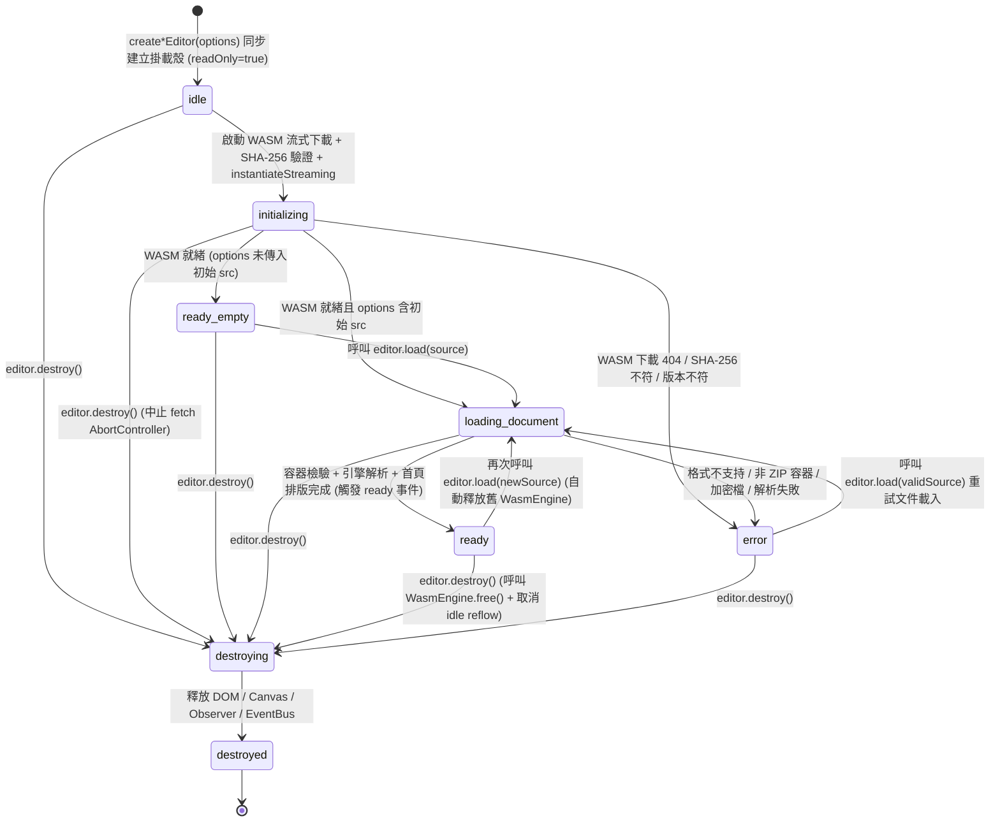
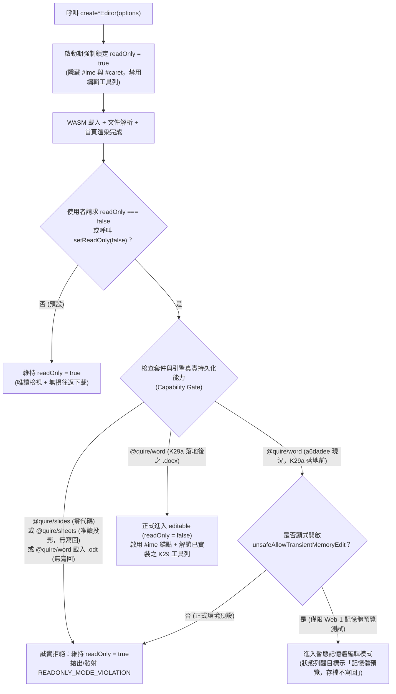
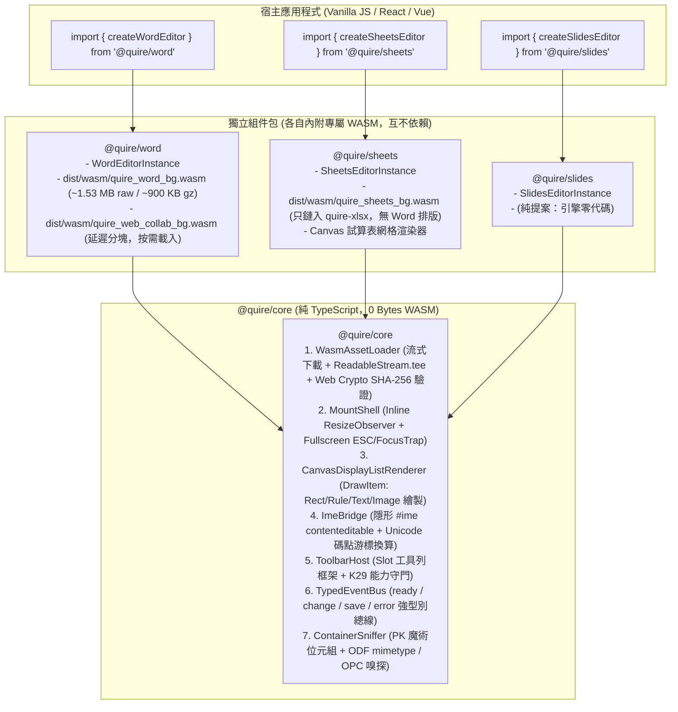
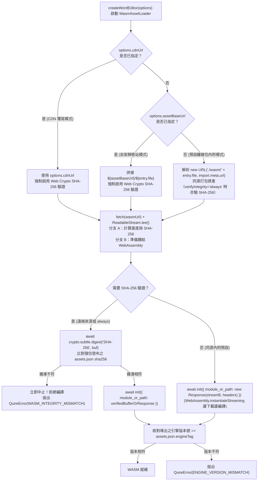
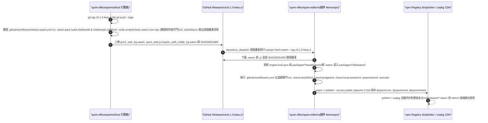

# EDITOR-SDK-DESIGN：`@quire/word`·`@quire/sheets`·`@quire/slides` 組件契約設計書

> **定位**：本文件為 Quire 瀏覽器端組件 SDK（`@quire/core`、`@quire/word`、`@quire/sheets`、`@quire/slides` 及後續薄殼框架適配器）的唯一架構與介面規格依據。本卡為純設計規格（`EDITOR-SDK-DESIGN`），不修改任何引擎或外殼實作碼。
> **上游契約依據**：文字與結構編輯之 Mutation 型錄、兩層無損寫回、CRDT 意圖轉譯與操作級 Undo/Redo 一律以 [`docs/edit-api-design.md`](../docs/edit-api-design.md#L1-L831)（`K29-DESIGN`）為唯一上游權威，本文直接引用其 `docs/edit-api-design.md §x.y` 章節號與 `M1.1`～`M6.4` 代號，絕不重寫或分叉第二套編輯契約；多格式容器（OPC 與 ODF `ZipBundle` 復用）對齊 [`docs/odf-design.md`](../docs/odf-design.md#L11-L162) §1 與 [`docs/xlsx-styles-design.md`](../docs/xlsx-styles-design.md#L1-L115) §1–§2；瀏覽器端流式 WASM 載入、SHA-256 資產清單驗證與 Canvas2D 顯示列表繪製則以現行 [`shells/web`](../shells/web/src/lib.rs#L1-L77)、[`shells/web-collab`](../shells/web-collab/src/lib.rs#L1-L34) 與官網展示殼 `quire-www/public/playground/`（`playground.js`、`renderer.js`、`playground.assets.json`、`scripts/fetch-wasm.mjs`）為事實雛形。
> **三態誠實標記紀律**：全文所有章節、型別、表格與功能主張嚴格區分三種狀態——`【已實測】`（當下 worktree `a6dadee` 或 `quire-www` 已落地且經行號核實之行為）、`【上游契約已有但未實裝】`（`docs/edit-api-design.md`、`docs/odf-design.md` 或 `docs/xlsx-styles-design.md` 已定義規格但尚未落地程式碼）、以及 `【純提案】`（本設計書新定義之組件 SDK 契約，或上游尚未涵蓋而標註「本卡新提，待 K29 補」／引擎零代碼之規格）。

---

## 0. 已拍板的產品前提與無損承諾邊界（寫進契約，不得改寫）【已實測＋純提案】

### 0.1 四項已拍板產品前提【已實測＋純提案】

1. **授權全鏈 Apache-2.0（使用者 2026-11-03 拍板）**`【已實測＋純提案】`：
   - 引擎層（`core/*` 與 `shells/*`，見 [`Cargo.toml`](../Cargo.toml#L17-L20)、[`README.md`](../README.md#L59-L61)、[`README.zh-TW.md`](../README.zh-TW.md#L59-L60)）與組件 SDK 層（`@quire/core`、`@quire/word`、`@quire/sheets`、`@quire/slides` 及 `@quire/react`、`@quire/vue` 薄殼）全鏈統一採用 **Apache License 2.0**（`LICENSE-APACHE`），不做 open-core 雙軌授權，亦不設商業版專屬之編輯或匯出功能鎖。
   - 唯一例外為隨附於 [`core/layout`](../core/layout/src/lib.rs#L1-L23) `assets/` 下之 Noto Sans TC 字型子集，依上游規定保留 **SIL Open Font License 1.1**（見 [`README.md`](../README.md#L61) 與 [`README.zh-TW.md`](../README.zh-TW.md#L60)）；若組件包內附該字型子集，必須於 npm 套件根目錄隨附 `OFL.txt` 聲明。
2. **WASM 混合分發（使用者拍板）**`【已實測＋純提案】`：
   - **預設內附、離線可用**：每個組件 npm 套件（`@quire/word`、`@quire/sheets`、`@quire/slides`）在發布時於包內 `dist/wasm/` 目錄直接內附對應版本的 `.wasm` 二進位檔與 `wasm-bindgen` ESM 膠水層，預設走打包器同源靜態資產解析（`new URL('./wasm/...', import.meta.url)`），無須連外網即可在企業內網或離線環境運作（對齊 `quire-www/scripts/check-local-assets.mjs:1-81` 的零外部執行期依賴原則）。
   - **支援遠端覆寫（兼顧 CDN 族與自架族）**：組件初始化選項提供 `assetBaseUrl`（指向自架靜態站目錄）與 `cdnUrl`（指向公共或私有 CDN 完整覆寫網址）兩項配置。
   - **遠端 SHA-256 錨定鐵律**：凡經由 `cdnUrl` 或 `assetBaseUrl` 拉取遠端 `.wasm` 資產，載入器必須沿用 `quire-www/playground.assets.json:1-19` 與 `quire-www/scripts/fetch-wasm.mjs:78-137` 的「版本號＋逐檔 SHA-256 雜湊清單」紀律，在瀏覽器端透過 Web Crypto API（`crypto.subtle.digest('SHA-256', bytes)`）校驗位元組雜湊與隨包發布的 `assets.json` 完全相符後，始得送入 `WebAssembly.instantiate`；雜湊不符立即攔截並拋出 `WASM_INTEGRITY_MISMATCH`。
3. **三包分別可引用與物理隔離（使用者需求）**`【已實測＋純提案】`：
   - `@quire/word`、`@quire/sheets`、`@quire/slides` 為三個獨立發布之 npm 套件。
   - 宿主應用程式執行 `import { createWordEditor } from '@quire/word'` 時，物理上不得拉入 `@quire/sheets`（對應 [`quire-xlsx`](../core/xlsx/src/lib.rs#L1-L24)）或 `@quire/slides` 的任何 JS 與 WASM 負載；此原則直接延伸自引擎層 [`core/engine-api/Cargo.toml`](../core/engine-api/Cargo.toml#L15-L32) 與 [`scripts/check-layering.sh`](../scripts/check-layering.sh#L20-L36) 的 feature 拆包鐵律（主包 [`quire-web`](../shells/web/Cargo.toml#L1-L14) 不得依賴 `quire-xlsx` 或 `quire-crdt`）。
   - 三包共享之純前端底座（WASM 流式載入與 SHA-256 驗證器、容器與全螢幕掛載殼、可組合 slot 工具列框架、強型別事件總線、Canvas2D 顯示列表基礎渲染器與隱形 IME 錨點橋接器）統一收斂於零 WASM 負載的 `@quire/core`。
4. **雙掛載形態與唯讀誠實預設（使用者需求）**`【已實測＋純提案】`：
   - 支援指定 DOM 容器內聯掛載（`mount: HTMLElement | string`, `mode: 'inline'`，預設）與全螢幕掛載（`mode: 'fullscreen'`）兩式。
   - **唯讀誠實預設**：組件配置之 `readOnly` 預設值恆為 `true`；且在 WASM 引擎完成初始化與文件排版就緒前，或當載入之套件／檔案格式尚未實裝持久化寫回閉環時，強制鎖定於 `readOnly: true`（對齊 [`README.md`](../README.md#L13)、[`README.zh-TW.md`](../README.zh-TW.md#L13) 與 [`docs/edit-api-design.md`](../docs/edit-api-design.md#L40-L56) §1.3）。

### 0.2 組件層無損承諾與視覺再現之文案紅線【已實測】

組件 SDK 的 API 註解、錯誤訊息、README 與官網宣傳文案，必須嚴格受限於 [`README.md`](../README.md#L7-L34) 與 [`README.zh-TW.md`](../README.zh-TW.md#L7-L34)（亦引述於 [`docs/edit-api-design.md`](../docs/edit-api-design.md#L9-L14) §1.1）所確立的契約字句，不得誇大：

1. **容器與 Part 級無損承諾原文**`【已實測】`：
   - 繁體中文版（[`README.zh-TW.md`](../README.zh-TW.md#L7)）：「Quire 存檔時會重新封裝，但只有引擎被要求變更的 part 會被重寫；其餘 part——包括引擎不認識的自訂內容——皆以原始位元組原封不動放回新檔案（相同的壓縮流、ZIP64、extra field、註解與順序）。」
   - 英文版（[`README.md`](../README.md#L7)）：「when Quire saves a package, only parts the engine is instructed to change are rewritten; every other part—including parts it does not recognize—goes back into the archive byte-for-byte, preserving the original compressed stream, ZIP64 structures, extra fields, comments, and entry order.」
2. **視覺再現之誠實邊界原文**`【已實測】`：
   - 繁體中文版（[`README.zh-TW.md`](../README.zh-TW.md#L33)）：「對比 LibreOffice 的視覺再現仍在收斂，複雜繪圖族以語料失敗叢集追蹤。渲染是一份顯示列表（display list）契約，不是對任何辦公室軟體的像素級複製。」
   - 英文版（[`README.md`](../README.md#L32-L33)）：「visual fidelity versus LibreOffice is still converging, and complex drawing families are tracked as corpus failure clusters. Rendering is a display-list contract, not a pixel-for-pixel clone of any office suite.」
3. **組件層禁用語紅線**：
   - 嚴禁宣稱「100% 像素級還原 Microsoft Word / Excel / PowerPoint」；必須表述為「基於決定性 Rust 排版與顯示列表（Display List）契約渲染」。
   - 在 `K29a`～`K29d`（[`docs/edit-api-design.md`](../docs/edit-api-design.md#L673-L794) §6）持久化寫回落地前，嚴禁在 `@quire/word` 預設開啟編輯或宣稱「已支援瀏覽器端無損編輯存檔」；在試算表寫回專卡與簡報引擎立項前，嚴禁宣稱 `@quire/sheets` 可編輯或 `@quire/slides` 已有可用引擎。

---

## 1. 組件生命週期契約（Component Lifecycle Contract）【純提案】

本章定義 `@quire/core` 與三大套件（`@quire/word`、`@quire/sheets`、`@quire/slides`）共用的生命週期狀態機、文件載入來源、結構化錯誤語義，以及可直接作為 `.d.ts` 實作規格的完整 TypeScript 型錄。

### 1.1 生命週期狀態機（`create` → `load` → `ready` → `destroy`）【純提案】

組件實例自建立至銷毀遵循單向收斂之有限狀態機（`EditorLifecycleState`），嚴禁在未就緒或已銷毀狀態下執行非法操作：



1. **`create*Editor(options)`（同步建立掛載殼，非阻塞啟動）**`【純提案】`：
   - 呼叫 `createWordEditor(options)`、`createSheetsEditor(options)` 或 `createSlidesEditor(options)` 時，立即同步驗證 `options.mount` 容器並掛載 DOM 骨架（含工具列插槽、載入進度條、Canvas 畫布區、錯誤面板與狀態列，演進自 `quire-www/public/playground/playground.js:52-68`），並同步回傳組件實例 `EditorInstance`。
   - 此時 `editor.getState()` 為 `'initializing'`，且 **`editor.isReadOnly()` 強制為 `true`**。
   - 背景自動啟動 WASM 流式載入管線（`loadWasm`，對齊 `quire-www/public/playground/playground.js:111-190` 與 [`shells/web/demo/main.js`](../shells/web/demo/main.js#L33-L58)）。若 `options.src` 已指定初始文件，則在 WASM 初始化完成後自動接續執行 `load(options.src)`。
2. **`editor.ready()`（Promise 就緒屏障）**`【純提案】`：
   - 回傳 `Promise<ReadyEventPayload>`。
   - 若 `options.src` 未提供，`ready()` 在 WASM 引擎編譯完成且驗證完引擎版本號後 resolve（狀態進入 `'ready_empty'`）；若 `options.src` 已提供，則待初始文件完成解析、首頁顯示列表繪製完畢後 resolve（狀態進入 `'ready'`），同時向事件總線發射 `ready` 事件。
   - 若初始化過程發生致命錯誤（如 WASM 404 或 SHA-256 雜湊不符），`ready()` 以結構化 `QuireError` reject，同時發射 `error` 事件。
3. **`editor.load(source, loadOptions?)`（載入或切換文件）**`【已實測＋純提案】`：
   - 支援在 `'ready_empty'`、`'ready'` 或 `'error'`（若 WASM 已就緒）狀態下呼叫。
   - 若當前已持有舊文件的 WASM 實例（例如 [`WasmEngine`](../shells/web/src/lib.rs#L17-L19)），在開啟新文件成功替換前或替換當下，必須明確呼叫 wasm-bindgen 生成之 `oldEngine.free()` 釋放 Rust 線性記憶體，並取消排程中的 `requestIdleCallback` 背景續排（對齊 `quire-www/public/playground/playground.js:195-213` 與 [`Engine::reflow_step_json`](../core/engine-api/src/lib.rs#L2800-L2805)），防止多次開檔造成 WASM heap 洩漏。
   - 若指定了 `loadOptions.syncBudgetPages`（預設對長文件設為 `Some(5)`，對齊 [`Engine::set_sync_budget`](../core/engine-api/src/lib.rs#L2789-L2791) 與 [`shells/web/src/lib.rs`](../shells/web/src/lib.rs#L64-L66)），首屏同步排完前 5 頁即觸發首繪並進入 `'ready'`，尾段由組件殼在瀏覽器空檔自動迴圈呼叫 [`reflow_step_json`](../shells/web/src/lib.rs#L115-L117) 直至 [`is_settled`](../shells/web/src/lib.rs#L110-L112) 為 `true`。
4. **`editor.destroy()`（決定性資源回收與記憶體歸零）**`【純提案】`：
   - 冪等方法（重複呼叫第二次為 no-op）。
   - 執行順序：
     1. 將狀態設為 `'destroying'`，透過 `AbortController.abort()` 中止任何進行中的 WASM 或遠端文件 `fetch`；
     2. 取消 `cancelIdleCallback` / `clearTimeout` 背景續排計時器（`reflowScheduled = false`）；
     3. 若已進入 `'fullscreen'` 模式，自動退出全螢幕並將焦點還原至進入前的宿主元素；
     4. 呼叫底層 `wasmEngine.free()`（以及若已載入協作分塊則呼叫 `wasmCollab.free()`，對應 [`WasmCollab`](../shells/web-collab/src/lib.rs#L12-L14)），立即釋放 WASM 線性記憶體內的 `Engine` / `OoxmlDoc` / `ZipBundle` 緩衝區；
     5. 斷開 `ResizeObserver`、移除 `window` 級別鍵盤監聽器（翻頁與 ESC 快捷鍵，見 `quire-www/public/playground/playground.js:444-453`）及隱形 `#ime` 錨點事件（[`shells/web/demo/main.js`](../shells/web/demo/main.js#L198-L294)）；
     6. 將 `<canvas>` 寬高歸零（`canvas.width = 0; canvas.height = 0`）釋放 GPU 紋理緩衝，清空掛載容器 DOM，並清空事件總線所有訂閱者，狀態轉為 `'destroyed'`。

---

### 1.2 文件載入來源契約（`DocumentSource`：File／ArrayBuffer／URL）【已實測＋純提案】

組件 `load(source, loadOptions?)` 與初始化 `options.src` 統一接受以下四種來源形態，並在進入 WASM 前執行兩階段前置檢驗（演進自 `quire-www/public/playground/playground.js:276-308` 與 `quire-www/public/playground/renderer.js:41-83` 的 `validateDocxFile`）：

| 來源型別 | 輸入形態 | 轉換與前置校驗流程 | 實測基底與擴充規格 |
| :--- | :--- | :--- | :--- |
| **1. 本地檔案物件** | `File` 或 `Blob` | 呼叫 `await file.arrayBuffer()` 轉為 `Uint8Array`；若為 `File` 則自動提取 `file.name` 與 `file.type` 供副檔名與容器魔術位元組檢驗。 | `【已實測】` 載於 `quire-www/public/playground/playground.js:284-292` |
| **2. 記憶體二進位緩衝區** | `ArrayBuffer` 或 `Uint8Array` | 零拷貝建立 `new Uint8Array(buffer)` 視圖（若已是 `Uint8Array` 則直接使用），直接執行 ZIP/PK 魔術位元組與容器格式嗅探。 | `【已實測】` 載於 [`WasmEngine::new`](../shells/web/src/lib.rs#L24-L28) 與 [`shells/web/demo/main.js`](../shells/web/demo/main.js#L112-L113) |
| **3. 遠端 URL 字串** | `string`（`https://...` 或相對路徑 `/docs/sample.docx`） | 以 `fetch(url, { signal })` 下載位元組流，支援透過 `Content-Length` 回報下載進度，下載後轉為 `Uint8Array`。 | `【純提案】`（本卡新增，對齊 WASM 流式下載進度模型） |
| **4. 帶驗證之遠端描述符** | `UrlDocumentSource`（含 `url`、`headers`、`credentials`、`expectedSha256`、`fileName`） | 除支援自訂 `RequestInit`（如帶 Bearer Token 拉取企業內部文件）外，若提供 `expectedSha256`，強制在送入引擎前以 Web Crypto API 驗證文件 SHA-256。 | `【純提案】`（本卡新增，供高安全企業內網校驗文件完整性） |

#### 容器魔術位元組與多格式嗅探規則（對齊 `renderer.js` 與 `docs/odf-design.md §1`）【已實測＋上游契約已有但未實裝】

1. **空檔攔截（`FILE_EMPTY`）**`【已實測】`：`bytes.byteLength === 0` 時立即拒絕（對齊 `quire-www/public/playground/renderer.js:42-49`）。
2. **長度下限攔截（`TOO_SHORT`）**`【已實測】`：`bytes.byteLength < 4` 時立即拒絕（對齊 `quire-www/public/playground/renderer.js:65-71`）。
3. **ZIP PK 魔術位元組攔截（`NOT_ZIP_CONTAINER`）**`【已實測】`：檢查 `bytes[0] === 0x50 && bytes[1] === 0x4b`（`PK`）；若為舊版二進位 OLE2 複合文件（`0xD0 0xCF 0x11 0xE0`，即 `.doc`／`.xls`／`.ppt`）或純文字檔，立即回報 `FORMAT_UNSUPPORTED`（原因碼 `NOT_ZIP_CONTAINER` 或 `LEGACY_BINARY_FORMAT`，對齊 `quire-www/public/playground/renderer.js:73-80`）。
4. **套件與容器格式路由**`【已實測＋上游契約已有但未實裝】`：
   - `@quire/word`：接受 `.docx`（OPC 容器，含 `[Content_Types].xml` 與 `word/document.xml`，[`Engine::from_docx_bytes`](../core/engine-api/src/lib.rs#L212-L699) `【已實測】`）與 `.odt`（ODF 容器，偏移量 `38..77` 為 `application/vnd.oasis.opendocument.text` 或 `META-INF/manifest.xml` 根媒體型別相符，對齊 [`docs/odf-design.md`](../docs/odf-design.md#L14-L48) §1.1 `【上游契約已有但未實裝】`）。若在 `ODF-2` 落地前傳入 `.odt`，誠實回報 `FORMAT_UNSUPPORTED`（原因碼 `ENGINE_FEATURE_NOT_IMPLEMENTED`，附具體說明「ODT 解析器規格已定案於 ODF-DESIGN，待 ODF-2 實裝」）。
   - `@quire/sheets`：接受 `.xlsx`／`.xlsm`（OPC 容器，含 `[Content_Types].xml` 與 `xl/workbook.xml`，[`XlsxDoc::from_xlsx_bytes`](../core/engine-api/src/lib.rs#L2902-L2908) `【已實測】`）。若使用者誤將 `.xlsx` 傳給 `@quire/word`（或反之），前置嗅探器根據副檔名與封裝內頂層目錄（`word/` vs `xl/` vs `ppt/`）精確提示「此檔案為試算表（.xlsx），請改用 `@quire/sheets` 開啟」。
   - `@quire/slides`：目標格式為 `.pptx`／`.odp`，因目前引擎零代碼，呼叫 `load()` 一律回傳 `FORMAT_UNSUPPORTED`（原因碼 `ENGINE_FEATURE_NOT_IMPLEMENTED`）`【純提案】`。

---

### 1.3 錯誤語義契約（載入失敗、格式不支持、引擎版本不符、Mutation 拒絕）【已實測＋上游契約已有但未實裝＋純提案】

組件層嚴禁向宿主拋出未包裝的字串錯誤或模糊的 `JsError`；所有非預期狀態一律封裝為具備可枚舉 `code`、`reason`、`recoverable` 與上游對映欄位的 `QuireError`：

| 錯誤大類（`QuireErrorCode`） | 細部原因碼（`QuireErrorReason`） | 觸發條件與底層來源 | 是否可重試（`recoverable`） | 上游契約或實測錨點 |
| :--- | :--- | :--- | :--- | :--- |
| `'WASM_FETCH_FAILED'` | `'ASSET_HTTP_404'` \| `'ASSET_NETWORK_ERROR'` \| `'ASSET_ABORTED'` | WASM 或膠水 JS 下載失敗（如 HTTP 404 或斷網）。當狀態為 404 時，錯誤訊息明確提示檢查打包器靜態資產配置、`assetBaseUrl` 或執行 `fetch:wasm`。 | `false`（需修正資產配置或網路後重建實例） | `【已實測】` 對齊 `quire-www/public/playground/playground.js:121-133` |
| `'WASM_INTEGRITY_MISMATCH'` | `'SHA256_MISMATCH'` \| `'MANIFEST_MISSING_ENTRY'` | 遠端（`cdnUrl`／`assetBaseUrl`）下載之 `.wasm` 經 Web Crypto API 計算之 SHA-256 與套件內建 `assets.json` 記載之雜湊不符。 | `false`（供應鏈安全紅線，禁止降級執行） | `【已實測＋純提案】` 對齊 `quire-www/scripts/fetch-wasm.mjs:88-96`, `123-131` |
| `'ENGINE_VERSION_MISMATCH'` | `'ABI_VERSION_MISMATCH'` \| `'TAG_VERSION_MISMATCH'` | 遠端載入之 WASM 模組導出的引擎版本號與當前 JS SDK 綁定的 `assets.json` `engineTag` 不一致（例如混用了舊版自架 `.wasm` 與新版 npm 包）。 | `false`（必須同步更新自架 `.wasm` 資產） | `【已實測＋純提案】` 對齊 `quire-www/public/playground/playground.js:170-177` |
| `'DOCUMENT_FETCH_FAILED'` | `'DOC_HTTP_ERROR'` \| `'DOC_CORS_BLOCKED'` \| `'DOC_READ_ERROR'` | 遠端文件 URL 下載失敗或 `File.arrayBuffer()` 讀取失敗。 | `true`（可再次呼叫 `editor.load()`） | `【已實測＋純提案】` 對齊 `quire-www/public/playground/playground.js:286-289` |
| `'FORMAT_UNSUPPORTED'` | `'FILE_EMPTY'` \| `'INVALID_EXTENSION'` \| `'TOO_SHORT'` \| `'NOT_ZIP_CONTAINER'` \| `'WRONG_PACKAGE_FAMILY'` \| `'ENCRYPTED_ARCHIVE'` \| `'ENGINE_FEATURE_NOT_IMPLEMENTED'` | 0 位元組、副檔名不符、缺少 `PK` 標頭、加密封裝（`ZipError::Encrypted`（`core/ooxml/src/zip_struct.rs:44-55`） 或 ODF `<manifest:encryption-data>` 之 `OdfError::EncryptedEntry`）、或目標引擎尚未實裝（如 `@quire/slides`）。 | `true`（使用者可改選合法檔案重新呼叫 `editor.load()`） | `【已實測】` `quire-www/public/playground/renderer.js:41-83`；`【上游契約已有但未實裝】` [`docs/odf-design.md`](../docs/odf-design.md#L458-L473) §5.1 |
| `'DOCUMENT_PARSE_FAILED'` | `'ZIP_CORRUPTED'` \| `'MISSING_REQUIRED_PART'` \| `'XML_MALFORMED'` \| `'ZERO_PAGES_PRODUCED'` | 底層 [`Engine::from_docx_bytes`](../core/engine-api/src/lib.rs#L212-L699) 回傳 [`EngineError`](../core/engine-api/src/lib.rs#L64-L73)（含 CRC32 失敗、超出 64 MiB/256 MiB 解壓上限 [`MAX_ENTRY_DECOMPRESSED_SIZE`](../core/ooxml/src/zip_struct.rs#L59)／[`MAX_TOTAL_DECOMPRESSED_SIZE`](../core/ooxml/src/zip_struct.rs#L62)）、[`XlsxError`](../core/xlsx/src/lib.rs#L51-L56) 或分頁數為 0。 | `true`（原舊文件若未銷毀可保持或重載新檔） | `【已實測】` 對齊 `quire-www/public/playground/playground.js:324-351` 與 [`core/ooxml/src/zip_struct.rs`](../core/ooxml/src/zip_struct.rs#L44-L69) |
| `'READONLY_MODE_VIOLATION'` | `'EDITOR_IS_READONLY'` \| `'EDIT_API_NOT_LANDED'` \| `'FORMAT_READONLY_ONLY'` | 在 `isReadOnly() === true` 時呼叫 `applyMutation()`，或在持久化寫回尚未實裝的套件（如現行 `@quire/sheets` 或 `K29a` 前的 `@quire/word`）嘗試呼叫 `setReadOnly(false)`。 | `true`（不影響當前已載入之唯讀檢視狀態） | `【純提案】` 對齊 [`docs/edit-api-design.md`](../docs/edit-api-design.md#L40-L56) §1.3 誠實預設 |
| `'MUTATION_REJECTED'` | `'SUB_DOC_NOT_FOUND'` \| `'PARAGRAPH_OUT_OF_BOUNDS'` \| `'CODEPOINT_OUT_OF_BOUNDS'` \| `'CROSS_CONTAINER_BOUNDARY'` \| `'PROTECTED_STRUCTURE'` \| `'INVALID_STYLE_REFERENCE'` \| `'INVALID_NUMBERING_REFERENCE'` \| `'INVALID_TABLE_OPERATION'` \| `'INVALID_MEDIA_PAYLOAD'` \| `'XML_PATCH_REJECTED'` | 一對一映射上游 `K29-DESIGN` 的 10 種 `MutationError` 變體；依全有或全無（All-or-Nothing）失敗原子性契約，失敗時文件模型與 XML 位元組百分之百不變。 | `true`（文件狀態完好無損，可繼續後續操作） | `【上游契約已有但未實裝】` 載於 [`docs/edit-api-design.md`](../docs/edit-api-design.md#L175-L204) §2.1 |
| `'LIFECYCLE_INVALID_STATE'` | `'ALREADY_DESTROYED'` \| `'DOCUMENT_NOT_LOADED'` | 在 `destroy()` 之後呼叫任何操作方法，或在尚未 `load()` 文件時呼叫 `save()`／`applyMutation()`。 | `false`（若已銷毀須重新 `create*Editor`） | `【純提案】`（本卡新增，組件層狀態機守衛） |

---

### 1.4 完整 TypeScript 型錄規格（`.d.ts` 級別，可直接當實作規格）【上游契約已有但未實裝＋純提案】

以下型錄嚴格遵循 TypeScript `strict: true` 編譯標準，將 `@quire/core`、`@quire/word`、`@quire/sheets`、`@quire/slides` 的公開契約一次定義到位，其中所有編輯相關型別百分之百對齊 [`docs/edit-api-design.md`](../docs/edit-api-design.md#L130-L670) §2、§4、§5：

```typescript
// ============================================================================
// @quire/core — 共享核心型錄 (packages/core/src/index.d.ts)
// 授權：Apache-2.0
// ============================================================================

/** 組件生命週期狀態機狀態 【純提案】 */
export type EditorLifecycleState =
  | 'idle'
  | 'initializing'
  | 'ready_empty'
  | 'loading_document'
  | 'ready'
  | 'error'
  | 'destroying'
  | 'destroyed';

/** 組件套件家族識別碼 【純提案】 */
export type QuirePackageKind = 'word' | 'sheets' | 'slides';

/** 掛載顯示模式 【純提案】 */
export type MountMode = 'inline' | 'fullscreen';

/** 遠端 URL 文件載入描述符 【純提案】 */
export interface UrlDocumentSource {
  readonly url: string;
  readonly fileName?: string;
  readonly fetchInit?: RequestInit;
  /** 若提供，載入器在餵入引擎前強制驗證文件之 SHA-256 十六進位字串（小寫 64 碼） */
  readonly expectedSha256?: string;
}

/** 統一文件載入來源（支援瀏覽器 File/Blob、記憶體 ArrayBuffer/Uint8Array、URL 字串或描述符） 【已實測＋純提案】 */
export type DocumentSource =
  | File
  | Blob
  | ArrayBuffer
  | Uint8Array
  | string
  | UrlDocumentSource;

/** 單次文件載入選項 【已實測＋純提案】 */
export interface LoadDocumentOptions {
  /** 覆寫檔名（當輸入為 ArrayBuffer / Uint8Array 時供副檔名檢驗與下載預設檔名使用） */
  readonly fileName?: string;
  /** 外部中止訊號 */
  readonly signal?: AbortSignal;
  /**
   * 預算制軟分頁同步頁數上限（對應 Engine::set_sync_budget，core/engine-api/src/lib.rs:2219-2221）。
   * 傳入 number（如 5）代表同步最多排 5 頁即首繪，尾段於 requestIdleCallback 續排；
   * 傳入 null 代表全速同步排完。
   */
  readonly syncBudgetPages?: number | null;
}

/** 存檔匯出選項 【已實測＋純提案】 */
export interface SaveDocumentOptions {
  /**
   * 是否在存檔時一併執行結構級無損對照（對應 Engine::roundtrip_check，core/engine-api/src/lib.rs:2246-2253）。
   * 預設為 false（直接輸出位元組流）；設為 true 時 SaveEventPayload 會附帶 roundtripDiff 診斷報告。
   */
  readonly verifyRoundtrip?: boolean;
}

/** WASM 單一資產雜湊項目（對齊 quire-www/playground.assets.json:7-18） 【已實測＋純提案】 */
export interface WasmAssetEntry {
  readonly file: string;
  readonly sha256: string;
  readonly sizeBytes: number;
  readonly note?: string;
}

/** 隨包發布之 WASM 資產錨定清單（對齊 quire-www/playground.assets.json:1-19） 【已實測＋純提案】 */
export interface WasmAssetManifest {
  readonly $schema: string;
  readonly sdkVersion: string;
  /** 對應 quire-office/quire 倉庫之 Git Release Tag（如 "v0.1.0-beta.3"） */
  readonly engineTag: string;
  /** 建置該 WASM 時之引擎 Git Commit SHA（如 "a6dadee"） */
  readonly engineCommit: string;
  readonly releaseUrlTemplate: string;
  readonly assets: Readonly<Record<string, WasmAssetEntry>>;
}

/** WASM 下載與初始化進度回報載荷（對齊 quire-www/public/playground/playground.js:135-164） 【已實測＋純提案】 */
export interface WasmLoadProgress {
  readonly phase: 'fetching' | 'verifying_sha256' | 'compiling' | 'ready';
  readonly assetFile: string;
  readonly receivedBytes: number;
  readonly totalBytes: number | null;
  readonly percent: number | null;
}

/** 錯誤主分類碼 【已實測＋上游契約已有但未實裝＋純提案】 */
export type QuireErrorCode =
  | 'WASM_FETCH_FAILED'
  | 'WASM_INTEGRITY_MISMATCH'
  | 'ENGINE_VERSION_MISMATCH'
  | 'DOCUMENT_FETCH_FAILED'
  | 'FORMAT_UNSUPPORTED'
  | 'DOCUMENT_PARSE_FAILED'
  | 'READONLY_MODE_VIOLATION'
  | 'MUTATION_REJECTED'
  | 'LIFECYCLE_INVALID_STATE';

/** 錯誤細部原因碼 【已實測＋上游契約已有但未實裝＋純提案】 */
export type QuireErrorReason =
  | 'ASSET_HTTP_404'
  | 'ASSET_NETWORK_ERROR'
  | 'ASSET_ABORTED'
  | 'SHA256_MISMATCH'
  | 'MANIFEST_MISSING_ENTRY'
  | 'ABI_VERSION_MISMATCH'
  | 'TAG_VERSION_MISMATCH'
  | 'DOC_HTTP_ERROR'
  | 'DOC_CORS_BLOCKED'
  | 'DOC_READ_ERROR'
  | 'FILE_EMPTY'
  | 'INVALID_EXTENSION'
  | 'TOO_SHORT'
  | 'NOT_ZIP_CONTAINER'
  | 'WRONG_PACKAGE_FAMILY'
  | 'ENCRYPTED_ARCHIVE'
  | 'ENGINE_FEATURE_NOT_IMPLEMENTED'
  | 'ZIP_CORRUPTED'
  | 'MISSING_REQUIRED_PART'
  | 'XML_MALFORMED'
  | 'ZERO_PAGES_PRODUCED'
  | 'EDITOR_IS_READONLY'
  | 'EDIT_API_NOT_LANDED'
  | 'FORMAT_READONLY_ONLY'
  | 'SUB_DOC_NOT_FOUND'
  | 'PARAGRAPH_OUT_OF_BOUNDS'
  | 'CODEPOINT_OUT_OF_BOUNDS'
  | 'CROSS_CONTAINER_BOUNDARY'
  | 'PROTECTED_STRUCTURE'
  | 'INVALID_STYLE_REFERENCE'
  | 'INVALID_NUMBERING_REFERENCE'
  | 'INVALID_TABLE_OPERATION'
  | 'INVALID_MEDIA_PAYLOAD'
  | 'XML_PATCH_REJECTED'
  | 'ALREADY_DESTROYED'
  | 'DOCUMENT_NOT_LOADED';

/**
 * 上游 K29 MutationError 結構化映射（嚴格對齊 docs/edit-api-design.md §2.1 L180-L203）
 * 【上游契約已有但未實裝】
 */
export type K29MutationError =
  | { readonly kind: 'SubDocNotFound'; readonly target: SubDocTarget }
  | { readonly kind: 'ParagraphOutOfBounds'; readonly para: number; readonly len: number }
  | {
      readonly kind: 'CodepointOutOfBounds';
      readonly para: number;
      readonly startCp: number;
      readonly endCp: number;
      readonly paraLen: number;
    }
  | { readonly kind: 'CrossContainerBoundary'; readonly startPara: number; readonly endPara: number }
  | { readonly kind: 'ProtectedStructure'; readonly reason: string }
  | { readonly kind: 'InvalidStyleReference'; readonly styleId: string; readonly expectedType: string }
  | { readonly kind: 'InvalidNumberingReference'; readonly numId: number; readonly ilvl: number }
  | { readonly kind: 'InvalidTableOperation'; readonly detail: string }
  | { readonly kind: 'InvalidMediaPayload'; readonly detail: string }
  | { readonly kind: 'XmlPatchRejected'; readonly detail: string };

/** 統一結構化錯誤類別 【純提案】 */
export declare class QuireError extends Error {
  readonly name: 'QuireError';
  readonly code: QuireErrorCode;
  readonly reason: QuireErrorReason;
  readonly recoverable: boolean;
  readonly fileName?: string;
  readonly expectedSha256?: string;
  readonly actualSha256?: string;
  readonly mutationError?: K29MutationError;
  readonly cause?: unknown;
  constructor(init: {
    code: QuireErrorCode;
    reason: QuireErrorReason;
    message: string;
    recoverable: boolean;
    fileName?: string;
    expectedSha256?: string;
    actualSha256?: string;
    mutationError?: K29MutationError;
    cause?: unknown;
  });
}

// ----------------------------------------------------------------------------
// K29-DESIGN 尋址、Mutation 與逆操作型錄映射（嚴格對齊 docs/edit-api-design.md §2 & §5）
// ----------------------------------------------------------------------------

/** 頁首頁尾槽位種類（對齊 docs/edit-api-design.md §2.1 L144-L146） 【上游契約已有但未實裝】 */
export type HfSlotKind = 'Default' | 'First' | 'Even';

/** 頁首或頁尾分類（對齊 docs/edit-api-design.md §2.3.6 L389） 【上游契約已有但未實裝】 */
export type HfKind = 'Header' | 'Footer';

/** 文件子樹目標（嚴格對齊 docs/edit-api-design.md §2.1 L139-L153 SubDocTarget） 【上游契約已有但未實裝】 */
export type SubDocTarget =
  | { readonly kind: 'Body' }
  | { readonly kind: 'Header'; readonly sectionId: number; readonly slot: HfSlotKind }
  | { readonly kind: 'Footer'; readonly sectionId: number; readonly slot: HfSlotKind }
  | { readonly kind: 'Footnote'; readonly noteId: number }
  | { readonly kind: 'Endnote'; readonly noteId: number }
  | { readonly kind: 'TextBox'; readonly hostPara: number; readonly boxIndex: number };

/** 段內正準游標位置（對齊 docs/edit-api-design.md §2.1 L156-L160 DocPos 及 core/layout/src/lib.rs:1928-1931 CaretPos） 【已實測＋上游契約已有但未實裝】 */
export interface DocPos {
  readonly para: number;
  /** 正準段落 Unicode scalar value（codepoint）偏移，不含合成清單 marker 或點引填充 */
  readonly cp: number;
}

/** 游標在頁面上的幾何矩形（對齊 core/layout/src/lib.rs:1935-1940 CaretRect） 【已實測】 */
export interface CaretRect {
  readonly page: number;
  readonly xPt: number;
  readonly yPt: number;
  readonly heightPt: number;
}

/** 半開選取範圍（對齊 docs/edit-api-design.md §2.1 L162-L167 DocRange，保證 start <= end） 【上游契約已有但未實裝】 */
export interface DocRange {
  readonly target: SubDocTarget;
  readonly start: DocPos;
  readonly end: DocPos;
}

/** 三態屬性修補包裝（對齊 docs/edit-api-design.md §2.3.2 L272 TriState<T>） 【上游契約已有但未實裝】 */
export type TriState<T> =
  | { readonly state: 'Keep' }
  | { readonly state: 'Set'; readonly value: T }
  | { readonly state: 'Clear' };

/** 斷點種類（對齊 docs/edit-api-design.md §2.3.1 L246 BreakKind） 【上游契約已有但未實裝】 */
export type BreakKind = 'LineWrapping' | 'Page' | 'Column' | 'Tab';

/** 段落對齊方式（對齊 docs/edit-api-design.md §2.3.2 L283 與 core/ooxml/src/lib.rs:42-51 ParaAlign） 【已實測＋上游契約已有但未實裝】 */
export type ParaAlign = 'Left' | 'Center' | 'Right' | 'Both';

/** 行距規格（對齊 docs/edit-api-design.md §2.3.2 L284 與 core/ooxml/src/lib.rs:55-61 LineSpacing） 【已實測＋上游契約已有但未實裝】 */
export type LineSpacingSpec =
  | { readonly rule: 'Auto'; readonly multiple: number }
  | { readonly rule: 'Exact'; readonly pt: number }
  | { readonly rule: 'AtLeast'; readonly pt: number };

/** 字型族修補（對齊 docs/edit-api-design.md §2.3.2 L279 RunFontsPatch） 【上游契約已有但未實裝】 */
export interface RunFontsPatch {
  readonly ascii?: string | null;
  readonly hAnsi?: string | null;
  readonly eastAsia?: string | null;
  readonly cs?: string | null;
}

/** 字元級直接格式修補（對齊 docs/edit-api-design.md §2.3.2 L272-L280 RunDirectPatch） 【上游契約已有但未實裝】 */
export interface RunDirectPatch {
  readonly bold?: TriState<boolean>;
  readonly italic?: TriState<boolean>;
  readonly underline?: TriState<boolean>;
  readonly strike?: TriState<boolean>;
  readonly sizePt?: TriState<number>;
  readonly colorRgb?: TriState<number>;
  readonly fonts?: TriState<RunFontsPatch>;
  readonly charStyle?: TriState<string>;
}

/** 製表位與段落框線規格（對齊 docs/edit-api-design.md §2.3.2 L288） 【上游契約已有但未實裝】 */
export interface TabStopSpec {
  readonly posPt: number;
  readonly align: 'Left' | 'Center' | 'Right' | 'Decimal';
  readonly leader?: string | null;
}

export interface ParaBorderSpec {
  readonly widthPt: number;
  readonly spacePt: number;
  readonly colorRgb: number;
  readonly isDouble?: boolean;
}

/** 段落級屬性修補（對齊 docs/edit-api-design.md §2.3.2 L281-L288 ParaPropsPatch） 【上游契約已有但未實裝】 */
export interface ParaPropsPatch {
  readonly styleId?: TriState<string>;
  readonly resetDirectParaProps?: boolean;
  readonly jc?: TriState<ParaAlign>;
  readonly lineSpacing?: TriState<LineSpacingSpec>;
  readonly spacingBeforePt?: TriState<number>;
  readonly spacingAfterPt?: TriState<number>;
  readonly indLeftPt?: TriState<number>;
  readonly indRightPt?: TriState<number>;
  readonly indFirstLinePt?: TriState<number>;
  readonly pageBreakBefore?: TriState<boolean>;
  readonly keepNext?: TriState<boolean>;
  readonly keepLines?: TriState<boolean>;
  readonly contextualSpacing?: TriState<boolean>;
  readonly tabs?: TriState<ReadonlyArray<TabStopSpec>>;
  readonly topBorder?: TriState<ParaBorderSpec>;
  readonly bottomBorder?: TriState<ParaBorderSpec>;
}

/** 清單編號動作（對齊 docs/edit-api-design.md §2.3.3 L309-L313 ListAction） 【上游契約已有但未實裝】 */
export type ListAction =
  | { readonly kind: 'AttachExisting'; readonly numId: number; readonly ilvl: number }
  | {
      readonly kind: 'CreateAndAttach';
      readonly preset: 'Bullet' | 'Decimal' | 'LowerLetter' | 'LowerRoman';
      readonly ilvl: number;
    }
  | { readonly kind: 'ChangeLevel'; readonly delta: number }
  | { readonly kind: 'RemoveNumbering' };

/** 表格尋址路徑（支援巢狀表，對齊 docs/edit-api-design.md §2.3.4 L329 TablePath） 【上游契約已有但未實裝】 */
export interface TablePath {
  readonly target: SubDocTarget;
  readonly rootSlot: number;
  /** 每步為 [rowIdx, cellIdx, subTableIdx] */
  readonly nestedSteps: ReadonlyArray<readonly [number, number, number]>;
}

/** 表格、列、儲存格屬性修補（對齊 docs/edit-api-design.md §2.3.4 L341） 【上游契約已有但未實裝】 */
export interface TablePropsPatch {
  readonly widthPt?: TriState<number>;
  readonly align?: TriState<'Left' | 'Center' | 'Right'>;
  readonly indentPt?: TriState<number>;
  readonly shadingRgb?: TriState<number>;
}

export interface RowPropsPatch {
  readonly heightPt?: TriState<number>;
  readonly heightExact?: TriState<boolean>;
  readonly header?: TriState<boolean>;
  readonly cantSplit?: TriState<boolean>;
}

export interface CellPropsPatch {
  readonly widthPt?: TriState<number>;
  readonly shadingRgb?: TriState<number>;
  readonly vAlign?: TriState<'Top' | 'Center' | 'Bottom'>;
}

/** 浮動圖片座標與文繞圖規格（對齊 docs/edit-api-design.md §2.3.5 L358-L359） 【上游契約已有但未實裝】 */
export interface FloatingAxisSpec {
  readonly relativeFrom: 'Page' | 'Margin' | 'Column' | 'Paragraph' | 'Line';
  readonly offsetPt: number;
}

export type WrapModeSpec = 'Inline' | 'Square' | 'Tight' | 'TopBottom' | 'None';

/** 節屬性與邊距修補（對齊 docs/edit-api-design.md §2.3.6 L383-L387 SectionPropsPatch） 【上游契約已有但未實裝】 */
export interface PageMarginsPatch {
  readonly topPt?: number;
  readonly bottomPt?: number;
  readonly leftPt?: number;
  readonly rightPt?: number;
  readonly headerPt?: number;
  readonly footerPt?: number;
}

export interface SectionColsSpec {
  readonly num: number;
  readonly spacePt: number;
  readonly equalWidth: boolean;
  readonly cols?: ReadonlyArray<{ readonly widthPt: number; readonly spacePt: number }>;
}

export type SectionStartKind = 'NextPage' | 'Continuous' | 'EvenPage' | 'OddPage';

export interface SectionPropsPatch {
  readonly pageSizePt?: { readonly widthPt: number; readonly heightPt: number; readonly landscape: boolean };
  readonly marginsPt?: PageMarginsPatch;
  readonly sectionType?: SectionStartKind;
  readonly cols?: SectionColsSpec;
}

/** 頁首頁尾綁定動作與註腳屬性修補（對齊 docs/edit-api-design.md §2.3.6 L389-L392） 【上游契約已有但未實裝】 */
export type HfBindAction =
  | { readonly action: 'BindExisting'; readonly partName: string }
  | { readonly action: 'CreateNew' }
  | { readonly action: 'Unbind' };

export type NoteRefKind = 'Footnote' | 'Endnote';

export interface NotePrPatch {
  readonly numFmt?: string;
  readonly numStart?: number;
  readonly numRestart?: 'Continuous' | 'EachSect' | 'EachPage';
}

/**
 * K29 全部 20 個代號對應之正準 Mutation 聯集型別（嚴格映射 docs/edit-api-design.md §2.2 L208-L234）
 * 禁止組件層自創第二套操作名稱！
 * 【上游契約已有但未實裝】
 */
export type K29Mutation =
  // M1.1 InsertText (docs/edit-api-design.md §2.3.1)
  | {
      readonly code: 'M1.1';
      readonly kind: 'InsertText';
      readonly target: SubDocTarget;
      readonly pos: DocPos;
      readonly text: string;
      readonly styleOverride?: RunDirectPatch | null;
    }
  // M1.2 DeleteRange (docs/edit-api-design.md §2.3.1)
  | {
      readonly code: 'M1.2';
      readonly kind: 'DeleteRange';
      readonly range: DocRange;
    }
  // M1.3 SplitParagraph (docs/edit-api-design.md §2.3.1)
  | {
      readonly code: 'M1.3';
      readonly kind: 'SplitParagraph';
      readonly target: SubDocTarget;
      readonly pos: DocPos;
    }
  // M1.4 MergeParagraphWithNext (docs/edit-api-design.md §2.3.1)
  | {
      readonly code: 'M1.4';
      readonly kind: 'MergeParagraphWithNext';
      readonly target: SubDocTarget;
      readonly para: number;
    }
  // M1.5 InsertBreak (docs/edit-api-design.md §2.3.1)
  | {
      readonly code: 'M1.5';
      readonly kind: 'InsertBreak';
      readonly target: SubDocTarget;
      readonly pos: DocPos;
      readonly breakKind: BreakKind;
    }
  // M2.1 FormatTextRange (docs/edit-api-design.md §2.3.2)
  | {
      readonly code: 'M2.1';
      readonly kind: 'FormatTextRange';
      readonly range: DocRange;
      readonly patch: RunDirectPatch;
    }
  // M2.2 SetParagraphStyle (docs/edit-api-design.md §2.3.2)
  | {
      readonly code: 'M2.2';
      readonly kind: 'SetParagraphStyle';
      readonly target: SubDocTarget;
      readonly paraStart: number;
      readonly paraEndInclusive: number;
      readonly patch: ParaPropsPatch;
    }
  // M2.3 UpsertNamedStyle (docs/edit-api-design.md §2.3.2)
  | {
      readonly code: 'M2.3';
      readonly kind: 'UpsertNamedStyle';
      readonly styleId: string;
      readonly styleType: 'Paragraph' | 'Character';
      readonly basedOn?: string | null;
      readonly paraPatch?: ParaPropsPatch | null;
      readonly runPatch?: RunDirectPatch | null;
    }
  // M3.1 SetListNumbering (docs/edit-api-design.md §2.3.3)
  | {
      readonly code: 'M3.1';
      readonly kind: 'SetListNumbering';
      readonly target: SubDocTarget;
      readonly paraStart: number;
      readonly paraEndInclusive: number;
      readonly action: ListAction;
    }
  // M4.1 InsertTable (docs/edit-api-design.md §2.3.4)
  | {
      readonly code: 'M4.1';
      readonly kind: 'InsertTable';
      readonly target: SubDocTarget;
      readonly afterPara: number | null;
      readonly rows: number;
      readonly cols: number;
      readonly colWidthsPt?: ReadonlyArray<number> | null;
    }
  // M4.2 DeleteTable (docs/edit-api-design.md §2.3.4)
  | {
      readonly code: 'M4.2';
      readonly kind: 'DeleteTable';
      readonly table: TablePath;
    }
  // M4.3 InsertTableRow / DeleteTableRow (docs/edit-api-design.md §2.3.4)
  | {
      readonly code: 'M4.3';
      readonly kind: 'InsertTableRow';
      readonly table: TablePath;
      readonly atRow: number;
      readonly position: 'Before' | 'After';
    }
  | {
      readonly code: 'M4.3';
      readonly kind: 'DeleteTableRow';
      readonly table: TablePath;
      readonly row: number;
    }
  // M4.4 InsertTableColumn / DeleteTableColumn (docs/edit-api-design.md §2.3.4)
  | {
      readonly code: 'M4.4';
      readonly kind: 'InsertTableColumn';
      readonly table: TablePath;
      readonly atGridCol: number;
      readonly position: 'Before' | 'After';
      readonly widthPt: number;
    }
  | {
      readonly code: 'M4.4';
      readonly kind: 'DeleteTableColumn';
      readonly table: TablePath;
      readonly gridCol: number;
    }
  // M4.5 MergeTableCells / SplitTableCell (docs/edit-api-design.md §2.3.4)
  | {
      readonly code: 'M4.5';
      readonly kind: 'MergeTableCells';
      readonly table: TablePath;
      readonly topRow: number;
      readonly bottomRow: number;
      readonly leftGridCol: number;
      readonly rightGridCol: number;
    }
  | {
      readonly code: 'M4.5';
      readonly kind: 'SplitTableCell';
      readonly table: TablePath;
      readonly row: number;
      readonly cell: number;
      readonly intoRows: number;
      readonly intoCols: number;
    }
  // M4.6 SetTableProps / SetRowProps / SetCellProps (docs/edit-api-design.md §2.3.4)
  | {
      readonly code: 'M4.6';
      readonly kind: 'SetTableProps';
      readonly table: TablePath;
      readonly patch: TablePropsPatch;
    }
  | {
      readonly code: 'M4.6';
      readonly kind: 'SetRowProps';
      readonly table: TablePath;
      readonly row: number;
      readonly patch: RowPropsPatch;
    }
  | {
      readonly code: 'M4.6';
      readonly kind: 'SetCellProps';
      readonly table: TablePath;
      readonly row: number;
      readonly cell: number;
      readonly patch: CellPropsPatch;
    }
  // M5.1 InsertInlineImage / InsertFloatingImage (docs/edit-api-design.md §2.3.5)
  | {
      readonly code: 'M5.1';
      readonly kind: 'InsertInlineImage';
      readonly target: SubDocTarget;
      readonly pos: DocPos;
      readonly mediaBytes: Uint8Array;
      readonly mimeType: string;
      readonly widthPt: number;
      readonly heightPt: number;
      readonly altText?: string | null;
    }
  | {
      readonly code: 'M5.1';
      readonly kind: 'InsertFloatingImage';
      readonly target: SubDocTarget;
      readonly hostPara: number;
      readonly mediaBytes: Uint8Array;
      readonly mimeType: string;
      readonly widthPt: number;
      readonly heightPt: number;
      readonly posH: FloatingAxisSpec;
      readonly posV: FloatingAxisSpec;
      readonly wrapMode: WrapModeSpec;
      readonly behindDoc: boolean;
    }
  // M5.2 ResizeOrMoveImage (docs/edit-api-design.md §2.3.5)
  | {
      readonly code: 'M5.2';
      readonly kind: 'ResizeOrMoveImage';
      readonly target: SubDocTarget;
      readonly hostPara: number;
      readonly drawingIndex: number;
      readonly newWidthPt?: number | null;
      readonly newHeightPt?: number | null;
      readonly newPosH?: FloatingAxisSpec | null;
      readonly newPosV?: FloatingAxisSpec | null;
      readonly newWrapMode?: WrapModeSpec | null;
    }
  // M5.3 ReplaceImageMedia / DeleteImage (docs/edit-api-design.md §2.3.5)
  | {
      readonly code: 'M5.3';
      readonly kind: 'ReplaceImageMedia';
      readonly target: SubDocTarget;
      readonly hostPara: number;
      readonly drawingIndex: number;
      readonly newMediaBytes: Uint8Array;
      readonly newMimeType: string;
    }
  | {
      readonly code: 'M5.3';
      readonly kind: 'DeleteImage';
      readonly target: SubDocTarget;
      readonly hostPara: number;
      readonly drawingIndex: number;
      readonly gcUnreferencedMedia: boolean;
    }
  // M6.1 SetSectionProperties (docs/edit-api-design.md §2.3.6)
  | {
      readonly code: 'M6.1';
      readonly kind: 'SetSectionProperties';
      readonly sectionId: number;
      readonly patch: SectionPropsPatch;
    }
  // M6.2 InsertSectionBreak / DeleteSectionBreak (docs/edit-api-design.md §2.3.6)
  | {
      readonly code: 'M6.2';
      readonly kind: 'InsertSectionBreak';
      readonly para: number;
      readonly sectionKind: SectionStartKind;
    }
  | {
      readonly code: 'M6.2';
      readonly kind: 'DeleteSectionBreak';
      readonly sectionId: number;
    }
  // M6.3 ConfigureHeaderFooterSlot (docs/edit-api-design.md §2.3.6)
  | {
      readonly code: 'M6.3';
      readonly kind: 'ConfigureHeaderFooterSlot';
      readonly sectionId: number;
      readonly titlePg?: boolean | null;
      readonly evenAndOddHeaders?: boolean | null;
      readonly slotBind?: {
        readonly hfKind: HfKind;
        readonly slot: HfSlotKind;
        readonly action: HfBindAction;
      } | null;
    }
  // M6.4 InsertNote / DeleteNote / SetNoteProperties (docs/edit-api-design.md §2.3.6)
  | {
      readonly code: 'M6.4';
      readonly kind: 'InsertNote';
      readonly noteKind: NoteRefKind;
      readonly pos: DocPos;
      readonly initialText: string;
    }
  | {
      readonly code: 'M6.4';
      readonly kind: 'DeleteNote';
      readonly noteKind: NoteRefKind;
      readonly noteId: number;
    }
  | {
      readonly code: 'M6.4';
      readonly kind: 'SetNoteProperties';
      readonly scope: { readonly kind: 'Document' } | { readonly kind: 'Section'; readonly sectionId: number };
      readonly noteKind: NoteRefKind;
      readonly patch: NotePrPatch;
    };

/** K29 Mutation 變體名稱字面量型別 【上游契約已有但未實裝】 */
export type K29MutationKind = K29Mutation['kind'];

/** K29 Mutation 代號字面量型別（M1.1 ~ M6.4） 【上游契約已有但未實裝】 */
export type K29MutationCode = K29Mutation['code'];

/** 版面失效事件（對齊 core/layout/src/lib.rs:1720-1731 Invalidation） 【已實測】 */
export type LayoutInvalidation =
  | { readonly type: 'Paragraph'; readonly para: number }
  | { readonly type: 'Page'; readonly page: number }
  | { readonly type: 'ReflowPending'; readonly fromPage: number };

/** 操作可逆性等級（對齊 docs/edit-api-design.md §5.1 L580-L586 ReversibilityLevel & §5.3.2） 【上游契約已有但未實裝】 */
export type ReversibilityLevel =
  | { readonly kind: 'StrictByteReversible' }
  | {
      readonly kind: 'Irreversible';
      readonly reason:
        | { readonly type: 'MediaPayloadEvicted'; readonly partName: string; readonly bytesFreed: number }
        | { readonly type: 'RawSetPartOverride'; readonly partName: string };
    };

/** Mutation 執行結果（對齊 docs/edit-api-design.md §2.1 L170-L174 MutationOutcome & §5.1） 【上游契約已有但未實裝】 */
export interface K29MutationOutcome {
  readonly events: ReadonlyArray<LayoutInvalidation>;
  readonly touchedParts: ReadonlyArray<string>;
  readonly caretAfter: DocPos | null;
  readonly reversibility: ReversibilityLevel;
  readonly canUndo: boolean;
  readonly canRedo: boolean;
}

// ----------------------------------------------------------------------------
// 事件總線與工具列配置型錄（詳見 §5）
// ----------------------------------------------------------------------------

/** 文件基本統計元資料（對齊 core/engine-api/src/lib.rs:1823-1851, 2224） 【已實測】 */
export interface WordDocumentMeta {
  readonly kind: 'word';
  readonly format: 'docx' | 'odt';
  readonly fileName: string;
  readonly pageCount: number;
  readonly paragraphCount: number;
  readonly tableCount: number;
  readonly preservedPartCount: number;
  readonly isSettled: boolean;
}

/** 試算表基本統計元資料（對齊 core/xlsx/src/lib.rs:93-127, core/engine-api/src/lib.rs:2307-2327） 【已實測】 */
export interface SheetsDocumentMeta {
  readonly kind: 'sheets';
  readonly format: 'xlsx' | 'xlsm' | 'ods';
  readonly fileName: string;
  readonly sheetCount: number;
  readonly sheetNames: ReadonlyArray<string>;
  readonly preservedPartCount: number;
}

/** 簡報基本統計元資料 【純提案】 */
export interface SlidesDocumentMeta {
  readonly kind: 'slides';
  readonly format: 'pptx' | 'odp';
  readonly fileName: string;
  readonly slideCount: number;
  readonly preservedPartCount: number;
}

export type DocumentMeta = WordDocumentMeta | SheetsDocumentMeta | SlidesDocumentMeta;

/** 容器級無損往返對照摘要（對齊 core/ooxml/src/diff.rs:97-115 ZipDiff） 【已實測】 */
export interface ZipDiffSummary {
  readonly byteIdentical: boolean;
  readonly pass: boolean;
  readonly whitelistedChanged: ReadonlyArray<string>;
  readonly violations: ReadonlyArray<string>;
}

/** ready 事件載荷 【純提案】 */
export interface ReadyEventPayload {
  readonly packageKind: QuirePackageKind;
  readonly sdkVersion: string;
  readonly engineTag: string;
  readonly readOnly: boolean;
  readonly mode: MountMode;
  readonly supportedMutations: ReadonlyArray<K29MutationKind>;
  readonly documentMeta: DocumentMeta | null;
}

/** change 事件載荷（100% 映射回 K29 Mutation 與 MutationOutcome，禁自創第二套） 【上游契約已有但未實裝＋純提案】 */
export interface ChangeEventPayload {
  readonly source: 'user' | 'api' | 'undo' | 'redo' | 'collab';
  readonly mutations: ReadonlyArray<K29Mutation>;
  readonly outcome: K29MutationOutcome;
  readonly documentMeta: DocumentMeta;
}

/** save 事件載荷（映射回 Engine::save_docx / XlsxDoc::save_xlsx 與 Engine::touched） 【已實測＋純提案】 */
export interface SaveEventPayload {
  readonly fileName: string;
  readonly mimeType: string;
  readonly bytes: Uint8Array;
  readonly touchedParts: ReadonlyArray<string>;
  readonly preservedPartCount: number;
  readonly roundtripDiff?: ZipDiffSummary;
}

/** error 事件載荷 【純提案】 */
export interface ErrorEventPayload {
  readonly error: QuireError;
  readonly state: EditorLifecycleState;
}

/** 選取區或游標變更事件載荷（本卡新提，屬組件視圖層事件） 【純提案】 */
export interface SelectionChangeEventPayload {
  readonly target: SubDocTarget;
  readonly caret: DocPos | null;
  readonly range: DocRange | null;
  readonly caretRect: CaretRect | null;
}

/** 掛載模式變更事件載荷（本卡新提，屬組件殼層事件） 【純提案】 */
export interface ModeChangeEventPayload {
  readonly previousMode: MountMode;
  readonly currentMode: MountMode;
  readonly trigger: 'api' | 'toolbar' | 'escape_key' | 'fullscreen_change';
}

/** 唯讀狀態變更事件載荷（本卡新提，屬組件殼層事件） 【純提案】 */
export interface ReadOnlyChangeEventPayload {
  readonly readOnly: boolean;
  readonly reason: 'initial_boot' | 'document_loaded' | 'api_call' | 'capability_locked';
}

/** 強型別事件映射表 【純提案】 */
export interface EditorEventMap {
  readonly ready: ReadyEventPayload;
  readonly change: ChangeEventPayload;
  readonly save: SaveEventPayload;
  readonly error: ErrorEventPayload;
  readonly selectionchange: SelectionChangeEventPayload;
  readonly modechange: ModeChangeEventPayload;
  readonly readonlychange: ReadOnlyChangeEventPayload;
}

export type EditorEventName = keyof EditorEventMap;
export type EditorEventListener<K extends EditorEventName> = (payload: EditorEventMap[K]) => void;

// ----------------------------------------------------------------------------
// 工具列 Slot 配置型錄（詳見 §5.1）
// ----------------------------------------------------------------------------

/** 內建工具列項目 ID（每個編輯項皆嚴格綁定單一 K29MutationCode） 【純提案】 */
export type BuiltinToolbarItemId =
  // 唯讀導覽與匯出項（現行 a6dadee 已實測可用）
  | 'page:prev'
  | 'page:next'
  | 'page:indicator'
  | 'view:zoom-in'
  | 'view:zoom-out'
  | 'view:zoom-reset'
  | 'view:fullscreen'
  | 'file:download'
  // K29a (Slice 1) 落地後解鎖項
  | 'history:undo'
  | 'history:redo'
  | 'insert:line-break'
  | 'insert:page-break'
  | 'insert:column-break'
  | 'insert:tab'
  // K29b (Slice 2) 落地後解鎖項
  | 'format:bold'
  | 'format:italic'
  | 'format:underline'
  | 'format:strike'
  | 'format:font-size'
  | 'format:color'
  | 'format:font-family'
  | 'para:style-select'
  | 'para:align-left'
  | 'para:align-center'
  | 'para:align-right'
  | 'para:align-justify'
  | 'para:line-spacing'
  | 'para:indent-increase'
  | 'para:indent-decrease'
  | 'list:bullet'
  | 'list:ordered'
  | 'list:level-inc'
  | 'list:level-dec'
  // K29c (Slice 3) 落地後解鎖項
  | 'table:insert'
  | 'table:delete'
  | 'table:row-insert-above'
  | 'table:row-insert-below'
  | 'table:row-delete'
  | 'table:col-insert-left'
  | 'table:col-insert-right'
  | 'table:col-delete'
  | 'table:cell-merge'
  | 'table:cell-split'
  | 'table:props'
  | 'image:insert-inline'
  | 'image:insert-floating'
  | 'image:resize-move'
  | 'image:replace'
  | 'image:delete'
  // K29d (Slice 4) 落地後解鎖項
  | 'section:page-setup'
  | 'section:columns'
  | 'section:break-insert'
  | 'section:break-delete'
  | 'hf:configure'
  | 'note:insert-footnote'
  | 'note:insert-endnote'
  | 'note:delete'
  | 'note:props';

/** 自訂工具列 Slot 項目描述符 【純提案】 */
export interface CustomToolbarSlotItem {
  readonly id: `custom:${string}`;
  readonly label: string;
  readonly iconSvg?: string;
  /** 若此自訂按鈕需觸發變更，必須宣告其依賴的 K29MutationCode，未實裝時由工具列框架自動禁用 */
  readonly requiresMutation?: K29MutationCode;
  readonly onClick: (editor: BaseEditorInstance) => void | Promise<void>;
  readonly isActive?: (editor: BaseEditorInstance) => boolean;
  readonly isDisabled?: (editor: BaseEditorInstance) => boolean;
}

export type ToolbarSlotEntry = BuiltinToolbarItemId | '|' | CustomToolbarSlotItem;

/** 可組合 Slot 制工具列配置 【純提案】 */
export interface ToolbarConfig {
  /** 是否顯示工具列（預設 true） */
  readonly visible?: boolean;
  /** 左側插槽（預設放檔案下載與歷史復原） */
  readonly start?: ReadonlyArray<ToolbarSlotEntry>;
  /** 中間插槽（預設僅放當前引擎已實裝之 K29 編輯項；a6dadee 現況預設為空陣列 []） */
  readonly center?: ReadonlyArray<ToolbarSlotEntry>;
  /** 右側插槽（預設放頁碼導覽、縮放與全螢幕切換） */
  readonly end?: ReadonlyArray<ToolbarSlotEntry>;
  /**
   * 當開發者在插槽中配置了尚未被當前引擎實裝的 K29 項目時的處理策略：
   * - 'hide'（預設）：直接隱藏不渲染，遵守紅燈考卷「未實裝不進工具列」鐵律；
   * - 'disable'：渲染為 disabled 並標註 aria-disabled="true" 與誠實提示；
   * - 'throw'：初始化時直接拋出 QuireError。
   */
  readonly unimplementedItemPolicy?: 'hide' | 'disable' | 'throw';
}

// ----------------------------------------------------------------------------
// 基礎組件初始化選項與實例介面
// ----------------------------------------------------------------------------

/** 三包共用之基礎初始化選項 【已實測＋純提案】 */
export interface BaseEditorOptions {
  /**
   * 掛載目標容器：可傳入 HTMLElement 實例或 CSS 選擇器字串（如 '#editor'）。
   * 若 mode 為 'fullscreen' 且未傳入 mount，則掛載於 document.body 頂層 Dialog 容器。
   */
  readonly mount: HTMLElement | string;
  /** 掛載模式：'inline'（佔滿 mount 容器尺寸，預設）或 'fullscreen'（全螢幕覆蓋） */
  readonly mode?: MountMode;
  /**
   * 是否唯讀（誠實預設恆為 true）。
   * 注意：在引擎與文件就緒前，不論此處傳入何值，editor.isReadOnly() 必為 true；
   * 若目標套件尚未實裝持久化寫回而傳入 readOnly: false，將於就緒檢查時發出告警或拒絕。
   */
  readonly readOnly?: boolean;
  /** 初始要載入的文件來源（選填；亦可於建立後呼叫 editor.load(src)） */
  readonly src?: DocumentSource;
  /** 初始文件載入選項 */
  readonly loadOptions?: LoadDocumentOptions;
  /**
   * 自架靜態資產目錄 URL（如 'https://static.example.com/quire/v0.1.0/' 或 '/quire-wasm/'）。
   * 未指定時預設使用 npm 包內附之 dist/wasm/ 離線資產。
   */
  readonly assetBaseUrl?: string;
  /**
   * 公共或私有 CDN 完整 WASM 資產 URL 覆寫（優先級高於 assetBaseUrl）。
   * 凡指定 cdnUrl 或 assetBaseUrl，載入器必強制執行 SHA-256 錨定驗證。
   */
  readonly cdnUrl?: string;
  /**
   * SHA-256 驗證策略：
   * - 'remote-only'（預設）：遠端 cdnUrl / assetBaseUrl 強制驗證，同源打包資產免重複雜湊；
   * - 'always'：連同源打包資產也強制執行 Web Crypto SHA-256 驗證。
   */
  readonly verifyIntegrity?: 'remote-only' | 'always';
  /** 工具列 Slot 配置 */
  readonly toolbar?: ToolbarConfig | boolean;
  /** 無障礙對話框與畫布標籤（預設依語系提供） */
  readonly ariaLabel?: string;
  /** WASM 下載進度回呼 */
  readonly onWasmProgress?: (progress: WasmLoadProgress) => void;
}

/** 三包共用之基礎實例介面 【已實測＋純提案】 */
export interface BaseEditorInstance<TMeta extends DocumentMeta = DocumentMeta> {
  readonly kind: QuirePackageKind;
  getState(): EditorLifecycleState;
  isReadOnly(): boolean;
  setReadOnly(readOnly: boolean): Promise<void>;
  getMode(): MountMode;
  setMode(mode: MountMode): Promise<void>;
  getDocumentMeta(): TMeta | null;
  getAssetManifest(): WasmAssetManifest;
  getSupportedMutations(): ReadonlyArray<K29MutationKind>;

  /** 等待 WASM 引擎（及初始 src，若有）完成載入與首頁渲染 */
  ready(): Promise<ReadyEventPayload>;
  /** 載入新文件（自動釋放前一份文件的 WASM 線性記憶體） */
  load(source: DocumentSource, options?: LoadDocumentOptions): Promise<TMeta>;
  /** 匯出無損封裝後的檔案位元組流（未觸碰 Part 100% 原位元組保留） */
  save(options?: SaveDocumentOptions): Promise<SaveEventPayload>;
  /** 銷毀組件實例、釋放 WasmEngine 線性記憶體並移除所有 DOM 與事件監聽 */
  destroy(): void;

  /** 訂閱事件（回傳取消訂閱函式 unsubscribe） */
  on<K extends EditorEventName>(event: K, listener: EditorEventListener<K>): () => void;
  /** 取消訂閱事件 */
  off<K extends EditorEventName>(event: K, listener: EditorEventListener<K>): void;
  /** 單次訂閱事件 */
  once<K extends EditorEventName>(event: K, listener: EditorEventListener<K>): () => void;
}

// ============================================================================
// @quire/word — 文書處理組件專屬型錄 (packages/word/src/index.d.ts)
// ============================================================================

export interface WordEditorOptions extends BaseEditorOptions {
  /**
   * 僅供開發期測試 Web-1 純記憶體打字預覽（Engine::insert_text_at_caret，存檔不寫回）：
   * 預設 false。在 K29a 持久化寫回落地前，唯有顯式設為 true 才允許開啟非持久化記憶體打字測試。
   */
  readonly unsafeAllowTransientMemoryEdit?: boolean;
}

export interface WordEditorInstance extends BaseEditorInstance<WordDocumentMeta> {
  readonly kind: 'word';
  /** 取得當前顯示頁碼（0-based）與總頁數 */
  getCurrentPage(): number;
  getPageCount(): number;
  goToPage(pageIndex: number): void;
  /** 讀取指定頁之顯示列表 JSON 結構（對應 Engine::page_display_list_json，core/engine-api/src/lib.rs:2163-2166） */
  getPageDisplayList(pageIndex: number): unknown | null;
  /** 執行單筆 K29 Mutation（對應 docs/edit-api-design.md §2.1 Engine::apply_mutation） */
  applyMutation(mutation: K29Mutation): Promise<K29MutationOutcome>;
  /** 批次原子執行多筆 K29 Mutation（對應 docs/edit-api-design.md §2.1 Engine::apply_batch） */
  applyBatch(mutations: ReadonlyArray<K29Mutation>): Promise<K29MutationOutcome>;
  /** 復原與重做（對應 docs/edit-api-design.md §5.1 Engine::undo / Engine::redo） */
  undo(): Promise<K29MutationOutcome | null>;
  redo(): Promise<K29MutationOutcome | null>;
  canUndo(): boolean;
  canRedo(): boolean;
  /** 按需動態載入 quire_web_collab_bg.wasm 協作分塊（對應 shells/web/demo/main.js:62-85 enableCollab） */
  enableCollab(sessionId: number): Promise<void>;
}

export declare function createWordEditor(options: WordEditorOptions): WordEditorInstance;

// ============================================================================
// @quire/sheets — 試算表組件專屬型錄 (packages/sheets/src/index.d.ts)
// 現況：唯讀投影已落地（core/xlsx），編輯未實裝
// ============================================================================

export interface SheetsEditorOptions extends BaseEditorOptions {
  /** 初始選取之工作表索引（0-based，預設 0） */
  readonly initialSheetIndex?: number;
}

export interface SheetsEditorInstance extends BaseEditorInstance<SheetsDocumentMeta> {
  readonly kind: 'sheets';
  getActiveSheetIndex(): number;
  setActiveSheet(index: number): void;
  /** 取得唯讀 WorkbookModel 投影（對應 XlsxDoc::workbook_model_json，core/engine-api/src/lib.rs:2320-2322） */
  getWorkbookModel(): unknown | null;
  /** 取得指定工作表之唯讀儲存格與有效樣式投影（對應 XlsxBundle::sheet_cells，core/xlsx/src/lib.rs:180-188） */
  getSheetCells(partPath: string): unknown | null;
}

export declare function createSheetsEditor(options: SheetsEditorOptions): SheetsEditorInstance;

// ============================================================================
// @quire/slides — 簡報組件專屬型錄 (packages/slides/src/index.d.ts)
// 現況：純提案（引擎零代碼）
// ============================================================================

export interface SlidesEditorOptions extends BaseEditorOptions {
  readonly initialSlideIndex?: number;
}

export interface SlidesEditorInstance extends BaseEditorInstance<SlidesDocumentMeta> {
  readonly kind: 'slides';
  getActiveSlideIndex(): number;
  goToSlide(index: number): void;
}

export declare function createSlidesEditor(options: SlidesEditorOptions): SlidesEditorInstance;
```

---

## 2. 掛載模型（Mounting Model）【已實測＋純提案】

本章定義組件在宿主 DOM 中的兩種物理掛載模式（`inline` 與 `fullscreen`）、ESC 退出與無障礙焦點陷阱（Focus Trap）機制，以及 `readOnly` 與 `editable` 之間的嚴格切換時機契約。

### 2.1 Inline Mount（指定容器內聯掛載，預設模式）【已實測＋純提案】

1. **容器尺寸自適應與 Canvas DPI 對齊**`【已實測＋純提案】`：
   - `【已實測】` 現行 `quire-www/public/playground/renderer.js:8`, `92-101` 與 [`shells/web/demo/main.js`](../shells/web/demo/main.js#L16-L17), [`337-339`](../shells/web/demo/main.js#L337-L339) 以固定常數 `DEFAULT_DISPLAY_WIDTH_PX = 850` 計算縮放比例 `scale = displayWidthPx / widthPt`。
   - `【純提案】` 在 `@quire/core` 的 `MountShell` 中，`mode: 'inline'` 掛載於使用者傳入之 `mount` 容器內，根節點 `.quire-root` 採用 `width: 100%; height: 100%; display: flex; flex-direction: column; overflow: hidden; box-sizing: border-box;`（宿主容器只需具備非零高度或設定 `min-height: 480px`）。
   - `MountShell` 以 `ResizeObserver` 監聽 `.quire-viewport` 的可用內容寬度 `contentWidthPx` 與 `window.devicePixelRatio`（`dpr`）：
     - 邏輯顯示寬度：`displayWidthPx = Math.min(maxPageWidthPx, Math.max(minPageWidthPx, contentWidthPx - horizontalPaddingPx)) * zoomLevel`；
     - 邏輯點對 CSS 像素縮放比：`cssScale = displayWidthPx / dl.width_pt`（其中 `dl.width_pt` 來自 [`PageDisplayList`](../core/render-trait/src/lib.rs#L89-L94) 的逐頁實際寬度）；
     - 實體 Canvas 像素緩衝區：`canvas.width = Math.round(dl.width_pt * cssScale * dpr)`、`canvas.height = Math.round(dl.height_pt * cssScale * dpr)`，並設 `canvas.style.width = "${Math.round(dl.width_pt * cssScale)}px"` 及 `ctx.setTransform(dpr, 0, 0, dpr, 0, 0)`，確保在 Retina / HiDPI 螢幕上文字與表格框線銳利無模糊。
2. **內部 DOM 階層與隱形 IME 錨點隔離**`【已實測＋純提案】`：
   - 根容器內部固定拆為四層：
     1. `<header class="quire-toolbar" role="toolbar">`：承載 `start`、`center`、`end` 三個可組合工具列插槽；
     2. `<main class="quire-viewport" tabindex="-1">`：可捲動之紙張檢視區，內含 `<div class="quire-page-stage">`；
     3. `<div class="quire-page-stage">`：內部疊放 `<canvas class="quire-canvas">`、視覺游標 `<div class="quire-caret" aria-hidden="true">`、IME 組字預覽層 `<div class="quire-composited" aria-hidden="true">` 以及隱形輸入錨點 `<div class="quire-ime-anchor" contenteditable="true" role="textbox" aria-multiline="true">`（完全沿用 [`shells/web/demo/main.js`](../shells/web/demo/main.js#L148-L294) 經驗證通過 CDP 測試 [`scripts/ime-inject-test.py`](../scripts/ime-inject-test.py) 的 Web-1 隱形錨點架構）；
     4. `<footer class="quire-statusbar" role="status" aria-live="polite">`：顯示頁數、段落數、WASM 狀態 chip 與背景續排狀態（演進自 `quire-www/public/playground/playground.js:55-68`, `256-265`）。

---

### 2.2 Fullscreen Mode（全螢幕模式、ESC 雙段退出與無障礙焦點陷阱）【純提案】

當初始化傳入 `mode: 'fullscreen'` 或執行期呼叫 `await editor.setMode('fullscreen')`（或點擊工具列 `view:fullscreen` 按鈕）時，`MountShell` 啟動全螢幕狀態機：

1. **雙軌全螢幕升級（Native Fullscreen API ＋ Fixed Viewport Overlay 後備）**`【純提案】`：
   - 優先嘗試對 `.quire-root` 呼叫瀏覽器原生 `element.requestFullscreen()`；若宿主環境禁止原生全螢幕（例如嵌入未加 `allow="fullscreen"` 的 `<iframe>`、iOS Safari 或無手勢觸發之程式化呼叫），則無縫降級為 CSS 視窗覆蓋層（`.quire-root--fullscreen-overlay { position: fixed; inset: 0; width: 100vw; height: 100dvh; z-index: var(--quire-z-fullscreen, 9999); background: var(--quire-bg-backdrop, #0f172a); }`），並鎖定宿主 `document.body.style.overflow = 'hidden'`。
2. **ESC 鍵雙段式退出守衛（防止 CJK 輸入法選字誤退全螢幕）**`【已實測＋純提案】`：
   - `【已實測】` 在 [`shells/web/demo/main.js`](../shells/web/demo/main.js#L156), [`198-217`](../shells/web/demo/main.js#L198-L217) 中，使用者以注音、倉頡或拼音打字時，`composing` 旗標為 `true`；在 CJK 輸入法中按 `Escape` 的原生語義是「取消當前候選字詞組字（composition）」，而非退出全螢幕。
   - `【純提案】` 因此，`MountShell` 的 `keydown`（`e.key === 'Escape'`）攔截器強制實施**三優先序消歧規則**：
     1. **第一優先（IME 組字中）**：若 `composing === true` 或 `e.isComposing === true`，按 `Escape` **只取消 IME 組字**（呼叫 `resetAnchor()` 清空 `#ime` 與 `#composited`），**絕不退出全螢幕**；
     2. **第二優先（工具列下拉選單／對話框開啟中）**：若工具列上有展開的彈出面板（如字色選擇器、插入表格網格面板），按 `Escape` **只關閉該彈出面板**並將焦點還回觸發按鈕，**不退出全螢幕**；
     3. **第三優先（退出全螢幕）**：僅當既無 IME 組字、亦無開啟之子彈窗時，按 `Escape` 才觸發 `setMode('inline')`，並發射 `modechange` 事件（`trigger: 'escape_key'`）。若當時走的是原生 Fullscreen API，瀏覽器自身攔截 `Escape` 觸發 `fullscreenchange` 事件時，`MountShell` 同步接手清理狀態並發射 `modechange`（`trigger: 'fullscreen_change'`）。
3. **無障礙焦點陷阱（WAI-ARIA Focus Trap 與焦點還原契約）**`【純提案】`：
   - **進入全螢幕時**：
     1. 記錄進入前之焦點元素：`previousActiveElement = document.activeElement as HTMLElement | null`；
     2. 在 `.quire-root` 上掛載 `role="dialog"`、`aria-modal="true"` 與 `aria-label`；
     3. 若處於 Fixed Overlay 模式，對 `document.body` 下除 `.quire-root` 祖先鏈以外的頂層兄弟節點設置 `inert = true`（及 `aria-hidden="true"`），防止螢幕報讀器（Screen Reader）或滑鼠游標穿透至背景網頁；
     4. 將初始焦點移入編輯器內部（若 `readOnly === false` 則 `imeEl.focus({ preventScroll: true })`，對齊 [`shells/web/demo/main.js`](../shells/web/demo/main.js#L117)；若 `readOnly === true` 則聚焦工具列首個可用控制項或 `.quire-viewport`）。
   - **全螢幕期間之 `Tab` / `Shift+Tab` 循環攔截**：
     - 查詢 `.quire-root` 內所有可聚焦元素清單 `focusables`（工具列未禁用按鈕、`.quire-ime-anchor`（當可編輯時）、分頁按鈕 `prevBtn`/`nextBtn`）。
     - 當焦點位於最後一個元素且按下 `Tab`（未按 Shift）時，`e.preventDefault()` 並將焦點跳回第一個元素；當焦點位於第一個元素且按下 `Shift+Tab` 時，`e.preventDefault()` 並將焦點跳至最後一個元素。
   - **退出全螢幕時**：
     - 移除所有背景節點的 `inert` 與 `aria-hidden` 標記，移除 `role="dialog"` 與 `aria-modal="true"`，並呼叫 `previousActiveElement?.focus({ preventScroll: true })` 精確還原宿主焦點。

---

### 2.3 `readOnly` ↔ `editable` 切換時機與誠實預設鐵律【已實測＋上游契約已有但未實裝＋純提案】



1. **鐵律一：引擎與首頁排版就緒前必為 `readOnly: true`**`【純提案】`：
   - 無論開發者在 `options` 中傳入 `readOnly: true` 或 `readOnly: false`，在 `'idle'`、`'initializing'`、`'ready_empty'` 與 `'loading_document'` 四個階段，`editor.isReadOnly()` **恆回傳 `true`**。
   - 理由：在 [`WasmEngine`](../shells/web/src/lib.rs#L17-L19) 完成文件解析且首頁 [`page_display_list_json`](../shells/web/src/lib.rs#L71-L73) 完成繪製之前，不存在合法的段落座標或 [`caret_rect_json`](../shells/web/src/lib.rs#L88-L90) 幾何映射；若提前開放 `#ime` 輸入，使用者鍵入的字元將無處落點或引發越界異常。
2. **鐵律二：依套件真實寫回能力守門（禁止假編輯）**`【已實測＋上游契約已有但未實裝＋純提案】`：
   - **`@quire/word`（DOCX）**：
     - `【已實測】` 如 [`docs/edit-api-design.md`](../docs/edit-api-design.md#L40-L56) §1.3 所證實，當下 worktree（`a6dadee`）的 [`Engine::insert_text_at_caret`](../core/engine-api/src/lib.rs#L2219-L2234) 與 [`Engine::replace_paragraph_text`](../core/engine-api/src/lib.rs#L2739-L2783) 僅更新版面層 `self.layout` 與發射投影 `self.paras_eff`，完全未修改 `self.doc.paragraphs` 或 `self.doc.parts`（單元測試 `core/engine-api/src/lib.rs:8955-8957` 直接斷言編輯後 `save_docx()` 與原檔位元組相同）。
     - `【純提案】` 因此，在 `K29a`（[`docs/edit-api-design.md`](../docs/edit-api-design.md#L688-L715) §6.2 第一片：最小文字級閉環寫回）落地並在 `WasmEngine` 導出 `apply_mutation_json` 之前，`@quire/word` 的正式預設恆為 `readOnly: true`；若呼叫 `setReadOnly(false)` 且未開啟 `unsafeAllowTransientMemoryEdit: true`，組件將以 `QuireError`（`code: 'READONLY_MODE_VIOLATION'`, `reason: 'EDIT_API_NOT_LANDED'`）誠實拒絕。待 `K29a` 落地後，對 `.docx` 呼叫 `setReadOnly(false)` 即正式切換至可持久化編輯模式。
   - **`@quire/sheets`（XLSX/XLSM）**：
     - `【已實測】` [`core/xlsx/src/lib.rs`](../core/xlsx/src/lib.rs#L7-L16) 與 [`core/xlsx/src/cells.rs`](../core/xlsx/src/cells.rs#L18-L19) 明文規定目前僅提供容器級無損往返與純讀取投影（`workbook_model`、`shared_strings`、`styles`、`sheet_cells`），寫入面完全封鎖。
     - `【純提案】` 故 `@quire/sheets` 現階段強制鎖定 `readOnly: true`；呼叫 `setReadOnly(false)` 必回傳 `Err(READONLY_MODE_VIOLATION, reason: 'EDIT_API_NOT_LANDED')`。
   - **`@quire/slides`（PPTX/ODP）**：
     - `【純提案】` 引擎零代碼，強制鎖定 `readOnly: true`。
3. **執行期動態切換（`await editor.setReadOnly(nextReadOnly)`）之清理契約**`【純提案】`：
   - 當由 `readOnly: false` 切換回 `readOnly: true` 時：
     1. 若當時 `#ime` 正處於 IME 組字狀態（`composing === true`），立即呼叫 `resetAnchor()`（對齊 [`shells/web/demo/main.js`](../shells/web/demo/main.js#L192-L196)）清除未提交組字，並呼叫 `imeEl.blur()`；
     2. 將 `.quire-ime-anchor` 設為 `contenteditable="false"` 且 `display: none`，將 `.quire-caret` 設為 `display: none`；
     3. 若還有未排完的背景軟分頁（`!engine.is_settled()`），允許背景 `reflow_step_json()` 繼續排完以維持唯讀頁數正確，但封鎖一切新 `applyMutation` 入口；
     4. 更新工具列狀態並發射 `readonlychange` 事件。

---

## 3. 三包邊界與共享層（Package Boundaries & Shared Core）【已實測＋純提案】

### 3.1 `@quire/core` 暴露介面與三包依賴拓撲【已實測＋純提案】

為確保宿主應用程式按需引入單一組件時絕不拖帶其他文件格式的 WASM 與 JS 負載，四個 npm 套件採取嚴格的單向星型依賴拓撲（對應引擎層 [`scripts/check-layering.sh`](../scripts/check-layering.sh#L1-L36) 的前端鏡像）：



`@quire/core` 對三包與進階宿主暴露的 7 個模組職責邊界如下：

1. **`WasmAssetLoader`**`【已實測＋純提案】`：封裝 `quire-www/public/playground/playground.js:111-190` 的 `fetch` + `ReadableStream.tee()` 下載進度追蹤、`WebAssembly.instantiateStreaming` 邊下載邊編譯，以及對齊 `quire-www/scripts/fetch-wasm.mjs:82-137` 的 SHA-256 完整性驗證。
2. **`ContainerSniffer`**`【已實測＋純提案】`：封裝 `quire-www/public/playground/renderer.js:41-83` 的 `validateDocxFile` 基礎檢查，並擴充識別 `.docx`、`.odt`（[`docs/odf-design.md`](../docs/odf-design.md#L14-L48) §1.1）、`.xlsx`／`.xlsm`、`.ods`、`.pptx`、`.odp`。
3. **`MountShell`**`【純提案】`：管理 `.quire-root` DOM 結構、CSS Custom Properties 主題變數、`ResizeObserver` DPI 縮放、Fullscreen 切換、ESC 三段優先序攔截與 WAI-ARIA Focus Trap。
4. **`CanvasDisplayListRenderer`**`【已實測】`：直接抽離自 `quire-www/public/playground/renderer.js:92-186` 與 [`shells/web/demo/main.js`](../shells/web/demo/main.js#L320-L406)，負責將 [`PageDisplayList`](../core/render-trait/src/lib.rs#L89-L94) 的四種 [`DrawItem`](../core/render-trait/src/lib.rs#L14-L82)（`Rect`、`Rule`、`Text` 含 `FLAG_BOLD`/`FLAG_ITALIC`/`FLAG_UNDERLINE`/`FLAG_STRIKE`、`Image` base64 真像素）繪製至 HTML5 Canvas2D。
5. **`ImeBridge`**`【已實測】`：直接抽離自 [`shells/web/demo/main.js`](../shells/web/demo/main.js#L148-L294)，管理隱形 `#ime` `contenteditable` 錨點、`compositionstart`/`compositionupdate`/`compositionend`、`beforeinput`、碼點計數 `Array.from(s).length` 與 `caret_rect_json` / `caret_at_json` 雙向定位。
6. **`ToolbarHost`**`【純提案】`：渲染 `start` / `center` / `end` 三插槽，並依據 `editor.getSupportedMutations()` 動態過濾或禁用未實裝之 K29 按鈕。
7. **`TypedEventBus`**`【純提案】`：零外部依賴之強型別事件發射器，實作 `on`、`off`、`once`、`emit` 與 `clear`。

---

### 3.2 三包 WASM 資產歸屬與體積預算表【已實測＋純提案】

下表列出四個套件各自攜帶的二進位與 JS 資產、當下實測基準線（引自 `quire-www/playground.assets.json:9-17` 與 [`scripts/check-wasm-size.mjs`](../scripts/check-wasm-size.mjs#L25-L26)）以及 CI 體積預算紅線：

| 套件名稱 | 內附 WASM 資產檔名 | 對應 Rust 引擎 Crate 組合 | 當下實測體積基準（`a6dadee`） | 組件包目標預算（Raw / Gzip） | CI 硬頂閘門（超過即紅燈） | 狀態標記 |
| :--- | :--- | :--- | :--- | :--- | :--- | :--- |
| **`@quire/core`** | **無（0 Bytes WASM）** | 無（純 TypeScript 前端底座） | 雛形 `playground.js` (15.4 KB) + `renderer.js` (5.7 KB) = **21.1 KB raw**`【已實測】` | Raw $\le 35\text{ KB}$<br>Gzip $\le 12\text{ KB}$ | Gzip $< 20\text{ KB}$ | `【已實測＋純提案】` |
| **`@quire/word`** | 1. 首包：`quire_word_bg.wasm`（現行名 `quire_web_bg.wasm`）<br>2. 延遲協作包：`quire_web_collab_bg.wasm` | 首包：[`quire-web`](../shells/web/Cargo.toml#L1-L14) → [`quire-engine`](../core/engine-api/Cargo.toml#L8-L19)（預設 features：含 `quire-ooxml`、`quire-layout`、`quire-render-trait`；**不含** `quire-xlsx` 與 `quire-crdt`）<br>協作分塊：[`quire-web-collab`](../shells/web-collab/Cargo.toml)（含 `quire-crdt`） | 首包 WASM：**1,602,808 B (~1.53 MB) raw / ~900 KB gzip**`【已實測】`<br>首包 Glue JS：**14,237 B (~13.9 KB) raw**`【已實測】`（見 `quire-www/playground.assets.json:9-17`） | 首包 WASM：<br>Raw $\le 1.8\text{ MB}$<br>Gzip $\le 1.0\text{ MB}$<br>JS Wrapper + Glue：<br>Gzip $\le 25\text{ KB}$ | 首包 WASM Gzip $< 3.0\text{ MB}$<br>協作分塊 Gzip $< 1.5\text{ MB}$（對齊 [`scripts/check-wasm-size.mjs`](../scripts/check-wasm-size.mjs#L25-L26)） | `【已實測】`（WASM 產物已實測；npm 封裝屬 `【純提案】`） |
| **`@quire/sheets`** | `quire_sheets_bg.wasm`（將由新增之 `shells/web-sheets` 產出） | `shells/web-sheets` → `quire-engine`（僅開 `feature = "xlsx"`，鏈入 [`quire-xlsx`](../core/xlsx/src/lib.rs#L1-L49) 與 [`ZipBundle`](../core/ooxml/src/zip_struct.rs#L167-L180)，不鏈入 Word 排版或 CRDT） | `core/xlsx` 已通過 `wasm32-unknown-unknown` 編譯檢查（見 [`.github/workflows/ci.yml`](../.github/workflows/ci.yml#L100-L107)）`【已實測】`；獨立 `.wasm` 尚未分拆打包 | 預計與 `@quire/word` 同量級或更小：<br>Raw $\le 1.5\text{ MB}$<br>Gzip $\le 900\text{ KB}$ | 首包 WASM Gzip $< 2.0\text{ MB}$ | `【純提案】`（`core/xlsx` 已實測；獨立 wasm 殼待建） |
| **`@quire/slides`** | `quire_slides_bg.wasm`（規劃中） | 規劃中（`core/pptx` / `core/odp`，目前零代碼） | **未知（引擎零代碼）** | **未知（TBD，待引擎立項實測後填入，禁拍常數）** | **未知（TBD）** | `【純提案】`（全欄位未知） |

#### 物理隔離雙向驗證規則（繼承 `scripts/check-layering.sh` 與 `scripts/check-wasm-size.mjs`）【已實測＋純提案】

1. **Cargo 依賴樹守衛**`【已實測】`：[`scripts/check-layering.sh`](../scripts/check-layering.sh#L20-L36) 已在 CI 強制執行 `cargo tree -p quire-web --target wasm32-unknown-unknown -e normal`，斷言首包絕不出現 `quire-crdt`（第 22–24 行）與 `quire-xlsx`（第 33–35 行）。
2. **WASM 二進位符號守衛**`【已實測＋純提案】`：延續 [`scripts/check-wasm-size.mjs`](../scripts/check-wasm-size.mjs#L51-L69) 的二進位符號掃描紀律，`@quire/word` 的 `quire_word_bg.wasm` 嚴禁包含 `XlsxBundle`、`read_sheet_cells`、`workbook_model` 等試算表符號，亦嚴禁包含 `WasmCollab`、`commit_local`、`apply_remote` 等協作符號；反之 `@quire/sheets` 的 `quire_sheets_bg.wasm` 嚴禁包含 `from_docx_bytes`、`read_body_tables` 等 Word 專屬符號。

---

### 3.3 Tree-Shaking 與零頂層副作用（Zero Top-Level Side-Effects）契約【純提案】

1. **`"sideEffects": false` 嚴格宣告**：
   - `@quire/core`、`@quire/word`、`@quire/sheets`、`@quire/slides` 四個套件的 `package.json` 均明確宣告 `"sideEffects": false`（若將獨立樣式表 `./styles.css` 列為子路徑匯出，則宣告為 `"sideEffects": ["./dist/*.css"]`）。
2. **零模組評估期副作用鐵律（Zero Module-Evaluation Side Effects）**：
   - 宿主執行 `import { createWordEditor } from '@quire/word'` 時，在模組頂層（Top-Level Module Scope）**嚴禁**：
     - 發起任何 `fetch()` 或 `XMLHttpRequest`；
     - 呼叫 `WebAssembly.compile()` 或 `WebAssembly.instantiate()`；
     - 存取 `window`、`document` 或 `navigator`（確保在 Next.js / Nuxt / Astro SSR 伺服器端渲染環境下 `import` 不會拋出 `ReferenceError: window is not defined`）；
     - 自動向 `document.head` 注入 `<style>`。
   - 所有瀏覽器 API 與 WASM 載入動作，必須延遲至宿主在瀏覽器端明確呼叫 `createWordEditor(options)` 時才啟動。

---

### 3.4 四包 `package.json` `exports` 拓撲草案【純提案】

以下為 `quire-editor` monorepo 下 `@quire/core` 與 `@quire/word`（`@quire/sheets`、`@quire/slides` 結構完全對稱）的 `package.json` 完整規格草案：

```json
// packages/core/package.json 【純提案】
{
  "name": "@quire/core",
  "version": "0.1.0",
  "description": "Shared WASM loader, SHA-256 verifier, mount shell, slot toolbar, and typed event bus for Quire editors.",
  "license": "Apache-2.0",
  "type": "module",
  "sideEffects": ["./dist/styles.css"],
  "files": [
    "dist",
    "README.md",
    "LICENSE-APACHE"
  ],
  "main": "./dist/index.js",
  "module": "./dist/index.js",
  "types": "./dist/index.d.ts",
  "exports": {
    ".": {
      "types": "./dist/index.d.ts",
      "import": "./dist/index.js"
    },
    "./styles.css": "./dist/styles.css",
    "./package.json": "./package.json"
  },
  "engines": {
    "node": ">=20.0.0"
  }
}
```

```json
// packages/word/package.json （@quire/sheets 與 @quire/slides 結構對稱） 【純提案】
{
  "name": "@quire/word",
  "version": "0.1.0",
  "description": "Quire Word (.docx / .odt) viewer and lossless editor component powered by Rust & WebAssembly.",
  "license": "Apache-2.0",
  "type": "module",
  "sideEffects": ["./dist/styles.css"],
  "files": [
    "dist",
    "assets.json",
    "README.md",
    "LICENSE-APACHE",
    "OFL.txt"
  ],
  "main": "./dist/index.js",
  "module": "./dist/index.js",
  "types": "./dist/index.d.ts",
  "exports": {
    ".": {
      "types": "./dist/index.d.ts",
      "import": "./dist/index.js"
    },
    "./assets.json": "./assets.json",
    "./wasm/*": "./dist/wasm/*",
    "./styles.css": "./dist/styles.css",
    "./package.json": "./package.json"
  },
  "dependencies": {
    "@quire/core": "workspace:^0.1.0"
  },
  "engines": {
    "node": ">=20.0.0"
  }
}
```

---

## 4. 分發管線（Distribution Pipeline）【已實測＋純提案】

本章定義 WASM 資產在「npm 包內附預設」與「`cdnUrl`／`assetBaseUrl` 遠端拉取」兩種模式下的解析順序、版本鎖定與 SHA-256 錨定驗證流程，並給出公共 CDN 候選評估與企業自架靜態站配置指令。

### 4.1 混合分發三級解析順序與流式載入管線【已實測＋純提案】

當宿主呼叫 `createWordEditor(options)` 時，`@quire/core` 的 `WasmAssetLoader` 依以下確定性優先序決定 `.wasm` 的取得位址，且**不提供「先試 CDN 失敗再靜默退回其他來源」的隱式跨源混載**（避免網路閃斷時載入未預期的跨源資產）：



> [!IMPORTANT]
> **為何遠端模式（`cdnUrl`／`assetBaseUrl`）必須先完成 SHA-256 校驗再呼叫 `WebAssembly.instantiate`，而同源內附模式可直接 `instantiateStreaming`？**
> 在 `quire-www/public/playground/playground.js:137-163` 中，`res.body.tee()` 將串流一分為二並直接將 `streamB` 送入 `init({ module_or_path: wasmResponse })` 進行流式編譯，是因為 `quire-www` 已在 build 期由 `quire-www/scripts/fetch-wasm.mjs:88-137` 驗證過落盤檔案的 SHA-256。然而當宿主在瀏覽器執行期透過 `cdnUrl` 或 `assetBaseUrl` 從遠端拉取 `.wasm` 時，若邊下載邊執行 `instantiateStreaming` 並在事後才比對 SHA-256，一旦遠端 CDN 遭竄改或掛錯檔案，惡意或損毀的 WASM `start` 區段已經在驗證失敗前被瀏覽器編譯執行！因此契約強制規定：**凡走 `cdnUrl` 或 `assetBaseUrl` 遠端來源，必須先讀完串流（同時回報下載進度）、通過 `crypto.subtle.digest('SHA-256', buffer)` 比對無誤後，才將 `Uint8Array` 交由 `init({ module_or_path: bytes })` 實例化**；只有同源內附預設模式（build 期已由 CI 閘門驗過 SHA-256）才直接走 `instantiateStreaming` 零延遲流式編譯。

---

### 4.2 版本鎖定策略與 `assets.json` 隨包發布規範【已實測＋純提案】

1. **對齊 `quire-www/playground.assets.json` 的單一信任來源紀律**`【已實測＋純提案】`：
   - `【已實測】` 在 `quire-www/playground.assets.json:1-19` 中，透過 `version`（`"0.1.0-beta.3"`）、`release_url_template` 與 `assets` 陣列（記錄 `quire_web_bg.wasm` 的 `sha256: "ed5ca62d8a5ff204677b8c18665e611b85db95b840441f18c8ae3160a04a8035"` 及 `quire_web.js` 的 `sha256: "7cafef87c3bc331e8333b75cdd6a98c2761c8f3864765305144280311d2"`）鎖定引擎產物。
   - `【純提案】` 每個組件套件（如 `@quire/word`）根目錄隨包發布一份不可變的 `assets.json`，並在建置時內嵌至 `dist/index.js`：

```json
{
  "$schema": "https://quireoffice.dev/schemas/wasm-assets-v1.json",
  "sdkVersion": "0.1.0",
  "engineTag": "v0.1.0-beta.3",
  "engineCommit": "a6dadee",
  "releaseUrlTemplate": "https://github.com/quire-office/quire/releases/download/{engineTag}/{file}",
  "assets": {
    "quire_word_bg.wasm": {
      "file": "quire_word_bg.wasm",
      "sha256": "ed5ca62d8a5ff204677b8c18665e611b85db95b840441f18c8ae3160a04a8035",
      "sizeBytes": 1602808,
      "note": "Rust 排版核心 + shells/web 介接層之 wasm-bindgen 產物"
    },
    "quire_word.js": {
      "file": "quire_word.js",
      "sha256": "7cafef87c3bc331e8333b75cdd6a98c2761c8f38647653051442d2c4280311d2",
      "sizeBytes": 14237,
      "note": "對應的 wasm-bindgen 膠水層（ESM）"
    },
    "quire_web_collab_bg.wasm": {
      "file": "quire_web_collab_bg.wasm",
      "sha256": "0000000000000000000000000000000000000000000000000000000000000000",
      "sizeBytes": 0,
      "note": "延遲載入之協作分塊（由 release-wasm.yml 實算填入）"
    }
  }
}
```

2. **組件版號（`sdkVersion`）與引擎 Release Tag（`engineTag`）對應規則**`【純提案】`：
   - **一對一精確錨定（禁止浮動範圍）**：任一特定版本的 `@quire/word@X.Y.Z` 只允許對應唯一一個 `engineTag`（例如 `v0.1.0-beta.3`），嚴禁在執行期使用 `@latest` 或 SemVer `^0.1.0` 浮動拉取 `.wasm`。
   - **版號演進規則**：
     - 當引擎倉（`quire-office/quire`）發布新的 GitHub Release Tag（觸發 [`.github/workflows/release-wasm.yml`](../.github/workflows/release-wasm.yml#L1-L70) 產出新 `.wasm` 與 `/tmp/sha256.txt`）且涉及 `wasm-bindgen` 介面變動時，`@quire/*` 同步升級次版本號（Minor）或預發版號；
     - 當僅修正純前端組件層（如 `@quire/core` 的 Focus Trap 或工具列樣式），不涉及引擎 `.wasm` 重編時，`@quire/*` 可單獨遞增修補版號（Patch，`0.1.0` → `0.1.1`），而其 `assets.json` 內的 `engineTag` 與 `sha256` 保持不變。

---

### 4.3 公共 CDN 候選與企業內網自架指令（`cdnUrl` vs `assetBaseUrl`）【已實測＋純提案】

#### 1. 遠端載入候選方案評估表【已實測＋純提案】

| 方案類別 | URL 模板格式 | 適用階段（Build 期 vs 瀏覽器 Runtime） | 優缺點與 CORS / MIME 實況 |
| :--- | :--- | :--- | :--- |
| **候選 A：jsDelivr（npm 鏡像，推薦作為公共 CDN 首選）** | `https://cdn.jsdelivr.net/npm/@quire/word@{sdkVersion}/dist/wasm/{file}` | **瀏覽器 Runtime（`cdnUrl`）** | 原生附帶 `Access-Control-Allow-Origin: *`、`Content-Type: application/wasm` 與 Brotli/Gzip 壓縮；URL 含精確 `sdkVersion`，永久不可變快取。 |
| **候選 B：unpkg（npm 鏡像，公共 CDN 備選）** | `https://unpkg.com/@quire/word@{sdkVersion}/dist/wasm/{file}` | **瀏覽器 Runtime（`cdnUrl`）** | 支援完整 CORS 與 `application/wasm`；注意必須指定精確版號 `@{sdkVersion}` 避免 302 重導向延遲。 |
| **候選 C：GitHub Release 資產直連** | `https://github.com/quire-office/quire/releases/download/{engineTag}/{file}` | **僅限 Node.js Build 期腳本（`fetch:wasm`）**，不作瀏覽器 Runtime 直連 | `【已實測】` 為 `quire-www/playground.assets.json:4` 與 `quire-www/scripts/fetch-wasm.mjs:108-137` 的權威下載源；但因 GitHub Release 下載會 302 跳轉至無通用 CORS 標頭之物件儲存，瀏覽器端 `fetch()` 直連會被 CORS 阻擋，故瀏覽器端若想走公共 CDN 應選候選 A（jsDelivr）或候選 D（jsDelivr GitHub 鏡像）。 |
| **候選 D：自架靜態站（`assetBaseUrl`，推薦企業與隱私敏感宿主）** | `${assetBaseUrl}/{file}`（如 `/static/quire-wasm/v0.1.0/quire_word_bg.wasm`） | **瀏覽器 Runtime（`assetBaseUrl`）** | 零第三方外網連線（完全符合 `quire-www/scripts/check-local-assets.mjs:26-29` 精神），同時避免打包器重複處理大檔案。 |

#### 2. 宿主自架與 CDN 覆寫實作指令範例【純提案】

```bash
# 步驟 1（自架族）：於宿主專案 postinstall 或建置腳本將包內附 WASM 複製至靜態站目錄
mkdir -p public/quire-wasm/v0.1.0
cp node_modules/@quire/word/dist/wasm/quire_word_bg.wasm public/quire-wasm/v0.1.0/
cp node_modules/@quire/word/assets.json public/quire-wasm/v0.1.0/
```

```typescript
// 方式一：預設模式（零配置，直接從 npm 包內附 dist/wasm/ 載入，離線可用）
import { createWordEditor } from '@quire/word';

const editorDefault = createWordEditor({
  mount: '#word-container',
  src: fileInput.files[0],
});

// 方式二：企業自架靜態站模式（assetBaseUrl，自動對照包內 assets.json 驗證 SHA-256）
const editorSelfHosted = createWordEditor({
  mount: '#word-container',
  assetBaseUrl: '/quire-wasm/v0.1.0/',
  verifyIntegrity: 'always',
});

// 方式三：公共 CDN 模式（cdnUrl，自動驗證 SHA-256 為 ed5ca62d... 始得實例化）
const editorCdn = createWordEditor({
  mount: '#word-container',
  cdnUrl: 'https://cdn.jsdelivr.net/npm/@quire/word@0.1.0/dist/wasm/quire_word_bg.wasm',
});
```


---

## 5. 工具列與事件總線（Toolbar & Event Bus）【已實測＋上游契約已有但未實裝＋純提案】

### 5.1 可組合 Slot 制工具列與「紅燈考卷」准入鐵律【上游契約已有但未實裝＋純提案】

Quire 組件層的工具列**明確拒絕 CKEditor / TinyMCE 式「預設塞滿數十顆全功能假按鈕」的黑盒設計**。現行引擎處於極小子集階段，組件層工具列採**可組合三插槽制（Composable 3-Slot Architecture：`start` / `center` / `end`）**，並受以下三條硬性契約約束：

1. **紅燈考卷鐵律（Red-Light Gate Rule）**：**「只有 K29 切片已實裝並完成持久化寫回閉環的 Mutation，才準進入預設工具列。」** 任何尚未在 [`WasmEngine`](../shells/web/src/lib.rs#L8-L77) 導出或尚未通過 [`docs/edit-api-design.md`](../docs/edit-api-design.md#L677-L794) §6 切片驗收閘門的功能，一律禁止出現在預設工具列中，絕不放置點擊無效或存檔遺失的裝飾性按鈕。
2. **三插槽職責劃分（`start` / `center` / `end`）**：
   - `start` 插槽：負責檔案匯出（`file:download`）與歷史復原（`history:undo`、`history:redo`，待 `K29a` 落地後啟用）；
   - `center` 插槽：負責綁定 `K29MutationCode`（`M1.1`～`M6.4`）的文件變更控制項；在當下 `a6dadee` 基準線上，因為 `K29a` 尚未合入，**預設 `center` 插槽為空陣列 `[]`**；
   - `end` 插槽：負責純視圖導覽與檢視控制（`page:prev`、`page:indicator`、`page:next`、`view:zoom-out`、`view:zoom-reset`、`view:zoom-in`、`view:fullscreen`），所有項目在當下 `a6dadee` 均已具備完整引擎支撐。
3. **執行期能力守門（Runtime Capability Gate）**：
   - `ToolbarHost` 在渲染任一 `BuiltinToolbarItemId` 或宣告了 `requiresMutation` 的 `CustomToolbarSlotItem` 時，必先查詢 `editor.getSupportedMutations()`。
   - 若某項目的底層 `K29MutationKind` 不在當前引擎支援清單中，預設依 `unimplementedItemPolicy: 'hide'` 直接不渲染該 DOM 節點，從根源杜絕使用者誤觸未實裝功能。

---

### 5.2 預設工具列隨 K29 切片演進矩陣（Slice Progression Matrix）【已實測＋上游契約已有但未實裝＋純提案】

下表詳列預設工具列從當下 `a6dadee`（唯讀預設）隨 [`docs/edit-api-design.md`](../docs/edit-api-design.md#L677-L794) §6 四個實作切片（`K29a`～`K29d`）逐步解鎖的完整映射關係：

| 演進階段 | 預設啟用之工具列項目 ID（`BuiltinToolbarItemId`） | 綁定之 K29 操作代號與變體名 | 上游契約章節錨點 | 引擎現況（`a6dadee`）與解鎖條件 |
| :--- | :--- | :--- | :--- | :--- |
| **現況基準（`a6dadee`）**<br>唯讀檢視與無損往返預設 | `start`: `['file:download']`<br>`center`: **`[]`（空陣列）**<br>`end`: `['page:prev', 'page:indicator', 'page:next', '|', 'view:zoom-out', 'view:zoom-reset', 'view:zoom-in', '|', 'view:fullscreen']` | 無 Mutation（純視圖導覽與 [`Engine::save_docx`](../core/engine-api/src/lib.rs#L2810-L2812) / [`XlsxDoc::save_xlsx`](../core/engine-api/src/lib.rs#L2911-L2913) 無損序列化） | [`docs/edit-api-design.md`](../docs/edit-api-design.md#L12-L38) §1.1–§1.2（既有資產） | `【已實測】` 分頁渲染、縮放與無損下載已在 `quire-www/public/playground/playground.js:230-316` 實測運作（需在 [`WasmEngine`](../shells/web/src/lib.rs#L8-L77) 補齊 `save_docx` 匯出包裝）。 |
| **`K29a`（Slice 1）**<br>最小文字級閉環與復原堆疊 | `start` 新增：`'|', 'history:undo', 'history:redo'`<br>`center` 新增：`['insert:line-break', 'insert:page-break', 'insert:column-break', 'insert:tab']`（外加鍵盤打字與單段內 Backspace/Delete） | - `history:undo` / `redo`：`Engine::undo` / `Engine::redo`<br>- 打字：`M1.1` `InsertText`<br>- 單段刪除：`M1.2` `DeleteRange`<br>- 軟換行／硬分頁／分欄／定位：`M1.5` `InsertBreak` | - [`docs/edit-api-design.md`](../docs/edit-api-design.md#L239-L266) §2.3.1（`M1.1`, `M1.2`, `M1.5`）<br>- [`docs/edit-api-design.md`](../docs/edit-api-design.md#L534-L609) §5.1–§5.2（Undo/Redo）<br>- [`docs/edit-api-design.md`](../docs/edit-api-design.md#L688-L715) §6.2（Slice 1 驗收閘門） | `【上游契約已有但未實裝】` 待 `K29a` 落地單段 Surgical XML Patch 與 `UndoEntry` 並通過 `InsertText` → `undo()` → `save_docx()` 100% byte-identical 閘門後解鎖。 |
| **`K29b`（Slice 2）**<br>拆併段、字元／段落格式與清單操作 | `center` 新增：<br>- 字元格式：`'format:bold'`, `'format:italic'`, `'format:underline'`, `'format:strike'`, `'format:font-size'`, `'format:color'`, `'format:font-family'`<br>- 段落格式：`'para:style-select'`, `'para:align-left'`, `'para:align-center'`, `'para:align-right'`, `'para:align-justify'`, `'para:line-spacing'`, `'para:indent-increase'`, `'para:indent-decrease'`<br>- 清單：`'list:bullet'`, `'list:ordered'`, `'list:level-inc'`, `'list:level-dec'`（外加 Enter 拆段與跨段併段） | - 拆段：`M1.3` `SplitParagraph`<br>- 併段：`M1.4` `MergeParagraphWithNext`<br>- 跨段刪除：`M1.2` `DeleteRange`<br>- 字元格式：`M2.1` `FormatTextRange`<br>- 段落樣式與屬性：`M2.2` `SetParagraphStyle`<br>- 具名樣式表：`M2.3` `UpsertNamedStyle`<br>- 清單操作：`M3.1` `SetListNumbering` | - [`docs/edit-api-design.md`](../docs/edit-api-design.md#L239-L322) §2.3.1–§2.3.3（`M1.3`–`M1.4`, `M2.1`–`M2.3`, `M3.1`）<br>- [`docs/edit-api-design.md`](../docs/edit-api-design.md#L718-L740) §6.3（Slice 2 驗收閘門） | `【上游契約已有但未實裝】` 待 `K29b` 實作扁平段落索引同步平移、Run 切分與 `word/styles.xml`、`word/numbering.xml` 按需修補後解鎖。 |
| **`K29c`（Slice 3）**<br>表格與圖片操作 | `center` 新增：<br>- 表格：`'table:insert'`, `'table:delete'`, `'table:row-insert-above'`, `'table:row-insert-below'`, `'table:row-delete'`, `'table:col-insert-left'`, `'table:col-insert-right'`, `'table:col-delete'`, `'table:cell-merge'`, `'table:cell-split'`, `'table:props'`<br>- 圖片：`'image:insert-inline'`, `'image:insert-floating'`, `'image:resize-move'`, `'image:replace'`, `'image:delete'` | - 表格新建：`M4.1` `InsertTable`<br>- 表格刪除：`M4.2` `DeleteTable`<br>- 列增刪：`M4.3` `InsertTableRow` / `DeleteTableRow`<br>- 欄增刪：`M4.4` `InsertTableColumn` / `DeleteTableColumn`<br>- 合併分割：`M4.5` `MergeTableCells` / `SplitTableCell`<br>- 表格／列／格屬性：`M4.6` `SetTableProps` / `SetRowProps` / `SetCellProps`<br>- 圖片插入：`M5.1` `InsertInlineImage` / `InsertFloatingImage`<br>- 圖片尺寸位置：`M5.2` `ResizeOrMoveImage`<br>- 圖片替換刪除：`M5.3` `ReplaceImageMedia` / `DeleteImage` | - [`docs/edit-api-design.md`](../docs/edit-api-design.md#L325-L377) §2.3.4–§2.3.5（`M4.1`–`M4.6`, `M5.1`–`M5.3`）<br>- [`docs/edit-api-design.md`](../docs/edit-api-design.md#L743-L768) §6.4（Slice 3 驗收閘門） | `【上游契約已有但未實裝】` 待 `K29c` 完成 `BodyTable` 與格內扁平段落同步插刪、圖片像素池 `(para, w_pt)` 配對鍵同步及 CoW 媒體寫回後解鎖。 |
| **`K29d`（Slice 4）**<br>節區、頁首頁尾與腳註尾註 | `center` 新增：<br>- 節區：`'section:page-setup'`, `'section:columns'`, `'section:break-insert'`, `'section:break-delete'`<br>- 頁首頁尾：`'hf:configure'`<br>- 註腳：`'note:insert-footnote'`, `'note:insert-endnote'`, `'note:delete'`, `'note:props'` | - 節區屬性：`M6.1` `SetSectionProperties`<br>- 分節符號：`M6.2` `InsertSectionBreak` / `DeleteSectionBreak`<br>- 頁首頁尾：`M6.3` `ConfigureHeaderFooterSlot`<br>- 腳註尾註：`M6.4` `InsertNote` / `DeleteNote` / `SetNoteProperties` | - [`docs/edit-api-design.md`](../docs/edit-api-design.md#L380-L401) §2.3.6（`M6.1`–`M6.4`）<br>- [`docs/edit-api-design.md`](../docs/edit-api-design.md#L771-L794) §6.5（Slice 4 驗收閘門） | `【上游契約已有但未實裝】` 待 `K29d` 完成多節區 `sectPr` 遷移與獨立子文件 Part（`header*.xml`/`footer*.xml`/`footnotes.xml`/`endnotes.xml`）寫回後解鎖。 |

---

### 5.3 事件總線命名與 Payload 契約（100% 映射回 K29，禁自創第二套）【已實測＋上游契約已有但未實裝＋純提案】

組件層 `TypedEventBus` 的所有事件名稱與載荷欄位，嚴格映射回 [`docs/edit-api-design.md`](../docs/edit-api-design.md)（`K29-DESIGN`）與 [`core/engine-api/src/lib.rs`](../core/engine-api/src/lib.rs) 的既有結構，**嚴禁自創第二套獨立於 K29 之外的變更事件命名**：

| 組件事件名稱（`EditorEventName`） | Payload 型別（定義見 §1.3） | 映射之上游引擎／K29 契約錨點 | 上游覆蓋狀態與邊界說明 |
| :--- | :--- | :--- | :--- |
| **`change`** | `ChangeEventPayload`<br>- `mutations: ReadonlyArray<K29Mutation>`<br>- `outcome: K29MutationOutcome`<br>- `source: 'user' \| 'api' \| 'undo' \| 'redo' \| 'collab'`<br>- `documentMeta: DocumentMeta` | - `mutations` 1:1 映射 [`docs/edit-api-design.md`](../docs/edit-api-design.md#L208-L234) §2.2 `Mutation` 分類總表之 20 個代號、28 個變體（`M1.1`～`M6.4`）<br>- `outcome.events` 1:1 映射 [`Invalidation`](../core/layout/src/lib.rs#L1995-L2006)（[`docs/edit-api-design.md`](../docs/edit-api-design.md#L170-L174) §2.1 `MutationOutcome::events`）<br>- `outcome.touchedParts` 1:1 映射 [`docs/edit-api-design.md`](../docs/edit-api-design.md#L170-L174) §2.1 `MutationOutcome::touched_parts` 與 [`docs/edit-api-design.md`](../docs/edit-api-design.md#L441-L468) §3.2–§3.3<br>- `outcome.caretAfter` 1:1 映射 [`docs/edit-api-design.md`](../docs/edit-api-design.md#L155-L168) §2.1 `DocPos`<br>- `outcome.reversibility` 1:1 映射 [`docs/edit-api-design.md`](../docs/edit-api-design.md#L580-L586) §5.1 `ReversibilityLevel` | **100% 對齊 K29 上游契約**（`【上游契約已有但未實裝】`）。無論是由工具列點擊、鍵盤 IME 輸入、`applyMutation()`、`applyBatch()`、`undo()` 或 `redo()` 觸發，統一發射單一 `change` 事件並附帶完整 `K29Mutation[]` 與 `K29MutationOutcome`，不另立 `textinsert`、`tablechange` 等碎片化事件名。 |
| **`save`** | `SaveEventPayload`<br>- `bytes: Uint8Array`<br>- `touchedParts: ReadonlyArray<string>`<br>- `preservedPartCount: number`<br>- `roundtripDiff?: ZipDiffSummary` | - `bytes` 映射 [`Engine::save_docx`](../core/engine-api/src/lib.rs#L2810-L2812)（底層 [`OoxmlDoc::save`](../core/ooxml/src/lib.rs#L321-L350) → [`ZipBundle::serialize`](../core/ooxml/src/zip_struct.rs#L453-L582)）及 [`XlsxDoc::save_xlsx`](../core/engine-api/src/lib.rs#L2911-L2913)<br>- `touchedParts` 映射 [`Engine`](../core/engine-api/src/lib.rs#L62-L129) 之 `touched: BTreeSet<String>`（第 74 行）與 [`docs/edit-api-design.md`](../docs/edit-api-design.md#L441-L459) §3.2<br>- `preservedPartCount` 映射 [`Engine::preserved_part_count`](../core/engine-api/src/lib.rs#L2126-L2128)<br>- `roundtripDiff` 映射 [`Engine::roundtrip_diff`](../core/engine-api/src/lib.rs#L2871-L2878)、[`xlsx_roundtrip_diff`](../core/engine-api/src/lib.rs#L2946-L2951) 與 [`ZipDiff`](../core/ooxml/src/diff.rs#L97-L112) | **100% 對齊引擎現況與 K29 §3.2**（`【已實測＋純提案】`）。注意：現行 [`WasmEngine`](../shells/web/src/lib.rs#L8-L77) 尚未暴露 `save_docx()` 與 `touched_parts_json()`，**本卡新提，待 K29a 補入 `shells/web/src/lib.rs`**。 |
| **`error`** | `ErrorEventPayload`<br>- `error: QuireError`<br>- `state: EditorLifecycleState` | - 當 `error.code === 'MUTATION_FAILED'` 時，`error.mutationError` 1:1 映射 [`docs/edit-api-design.md`](../docs/edit-api-design.md#L180-L203) §2.1 `pub enum MutationError`<br>- 當 `error.code === 'DOCUMENT_PARSE_FAILED'` 時，映射 [`EngineError`](../core/engine-api/src/lib.rs#L64-L73)、[`OoxmlError`](../core/ooxml/src/lib.rs#L64-L75)、[`ZipError`](../core/ooxml/src/zip_struct.rs#L44-L55)、[`XlsxError`](../core/xlsx/src/lib.rs#L51-L56)<br>- 其餘 `WASM_LOAD_FAILED`、`WASM_INTEGRITY_MISMATCH`、`ENGINE_VERSION_MISMATCH` 等屬組件殼層 I/O 錯誤 | 引擎與 Mutation 錯誤 **100% 映射上游**；WASM 載入、SHA-256 驗證與唯讀守衛錯誤屬**本卡新提之組件殼層錯誤（不涉及引擎 Mutation）**。 |
| **`ready`** | `ReadyEventPayload`<br>- `packageKind`, `sdkVersion`, `engineTag`<br>- `readOnly`, `mode`<br>- `supportedMutations: ReadonlyArray<K29MutationKind>`<br>- `documentMeta: DocumentMeta \| null` | - `documentMeta` 欄位映射 [`Engine::page_count`](../core/engine-api/src/lib.rs#L2111-L2112)、[`Engine::paragraph_count`](../core/engine-api/src/lib.rs#L2121-L2123)、[`Engine::table_count`](../core/engine-api/src/lib.rs#L2132-L2134)、[`Engine::preserved_part_count`](../core/engine-api/src/lib.rs#L2126-L2128)、[`Engine::is_settled`](../core/engine-api/src/lib.rs#L2794-L2796) 與 [`XlsxDoc::sheet_count`](../core/engine-api/src/lib.rs#L2933-L2935)<br>- `supportedMutations` 元素型別直接復用 [`docs/edit-api-design.md`](../docs/edit-api-design.md#L208-L234) §2.2 `Mutation` 變體名 | 統計欄位映射引擎現況；`ready` 生命週期事件封裝屬**本卡新提之組件殼層事件（待 K29a 補齊 `WasmEngine::supported_mutations_json()` 查詢端點）**。 |
| **`selectionchange`** | `SelectionChangeEventPayload`<br>- `target: SubDocTarget`<br>- `caret: DocPos \| null`<br>- `range: DocRange \| null`<br>- `caretRect: CaretRect \| null` | - `target`、`caret`、`range` 1:1 映射 [`docs/edit-api-design.md`](../docs/edit-api-design.md#L139-L167) §2.1 `SubDocTarget`、`DocPos`、`DocRange`<br>- `caretRect` 1:1 映射 [`CaretRect`](../core/layout/src/lib.rs#L2210-L2215) 與 [`WasmEngine::caret_rect_json`](../shells/web/src/lib.rs#L88-L90) | 座標型別 100% 映射 K29 §2.1 與 `core/layout`；事件本身屬**本卡新提之視圖層選取通知（不觸發引擎 Mutation）**。 |
| **`modechange`**<br>**`readonlychange`** | `ModeChangeEventPayload`<br>`ReadOnlyChangeEventPayload` | 無（純 DOM 掛載殼層狀態轉換） | **本卡新提，屬純前端組件殼層事件（不涉及引擎與 K29）**。 |

---

## 6. 框架適配（Framework Adaptation）【純提案】

### 6.1 Vanilla JS / TypeScript 為第一公民（First-Class Citizen）【純提案】

`@quire/word`、`@quire/sheets`、`@quire/slides` 與 `@quire/core` 本身完全以**零框架依賴的標準 ES2022 + DOM API** 撰寫：

1. 任何原生 HTML/JS、Vite、Webpack、Rollup、esbuild 或後端渲染頁面（Rails / Django / Laravel / Go Templates），只需直接呼叫 `createWordEditor({ mount: '#app', src })` 即可獲得完整的工具列、Canvas 渲染、IME 輸入、全螢幕焦點陷阱與事件總線，無須安裝 React 或 Vue。
2. 所有非同步狀態與資源清理均由 `BaseEditorInstance` 的 `ready()`、`load()`、`save()`、`on()`（回傳 `unsubscribe` 函式）與 `destroy()` 閉環管理，保證在單頁應用（SPA）路由切換時零記憶體洩漏。

---

### 6.2 React 與 Vue 3 後續薄殼規範（各嚴格控制在 $\le 50$ 行內）【純提案】

React（`@quire/react`）與 Vue 3（`@quire/vue`）適配器定位為**後續階段的純生命週期橋接薄殼（Thin Lifecycle Wrappers）**：

1. **薄殼三不原則**：
   - **不重寫任何 UI 或工具列**：工具列與狀態列一律由 `@quire/core` 的 `MountShell` 與 `ToolbarHost` 原生 DOM 繪製，不在 React/Vue 內重寫一套虛擬 DOM 工具列；
   - **不複製文件狀態**：文件模型與顯示列表留在 Rust WASM 線性記憶體中，不放入 React State 或 Vue Reactive Proxy（避免百萬字文件觸發深層 Proxy 劫持崩潰）；
   - **每個 Wrapper 檔案實作行數 $\le 50$ 行**：只負責「掛載 `div` `ref` → 呼叫 `create*Editor` → 將 `props` 變更轉發給 `load()` / `setReadOnly()` / `setMode()` → 卸載時呼叫 `editor.destroy()`」。

#### 1. `@quire/react` 薄殼參考實作（共 42 行）【純提案】

```tsx
// packages/react/src/QuireWord.tsx (共 42 行，嚴格 <= 50 行) 【純提案】
import { useEffect, useRef, forwardRef, useImperativeHandle } from 'react';
import {
  createWordEditor,
  type WordEditorOptions,
  type WordEditorInstance,
  type ReadyEventPayload,
  type ChangeEventPayload,
  type SaveEventPayload,
  type ErrorEventPayload,
} from '@quire/word';

export interface QuireWordProps extends Omit<WordEditorOptions, 'mount'> {
  readonly className?: string;
  readonly onReady?: (payload: ReadyEventPayload) => void;
  readonly onChange?: (payload: ChangeEventPayload) => void;
  readonly onSave?: (payload: SaveEventPayload) => void;
  readonly onError?: (payload: ErrorEventPayload) => void;
}

export const QuireWord = forwardRef<WordEditorInstance | null, QuireWordProps>(function QuireWord(props, ref) {
  const containerRef = useRef<HTMLDivElement | null>(null);
  const editorRef = useRef<WordEditorInstance | null>(null);
  useImperativeHandle(ref, () => editorRef.current as WordEditorInstance, []);

  useEffect(() => {
    if (!containerRef.current) return;
    const editor = createWordEditor({ ...props, mount: containerRef.current });
    editorRef.current = editor;
    const unsubs = [
      props.onReady ? editor.on('ready', props.onReady) : null,
      props.onChange ? editor.on('change', props.onChange) : null,
      props.onSave ? editor.on('save', props.onSave) : null,
      props.onError ? editor.on('error', props.onError) : null,
    ];
    return () => {
      unsubs.forEach((u) => u?.());
      editor.destroy();
      editorRef.current = null;
    };
  }, []);

  useEffect(() => { if (props.src && editorRef.current) void editorRef.current.load(props.src); }, [props.src]);
  useEffect(() => { if (props.readOnly !== undefined && editorRef.current) void editorRef.current.setReadOnly(props.readOnly); }, [props.readOnly]);
  useEffect(() => { if (props.mode && editorRef.current) void editorRef.current.setMode(props.mode); }, [props.mode]);

  return <div ref={containerRef} className={props.className} style={{ width: '100%', height: '100%' }} />;
});
```

#### 2. `@quire/vue` 薄殼參考實作（共 44 行）【純提案】

```ts
// packages/vue/src/QuireWord.ts (共 44 行，嚴格 <= 50 行) 【純提案】
import { defineComponent, h, ref, watch, onMounted, onBeforeUnmount, shallowRef, type PropType } from 'vue';
import {
  createWordEditor,
  type DocumentSource,
  type MountMode,
  type ToolbarConfig,
  type WordEditorInstance,
} from '@quire/word';

export const QuireWord = defineComponent({
  name: 'QuireWord',
  props: {
    src: { type: [Object, String] as PropType<DocumentSource>, default: undefined },
    mode: { type: String as PropType<MountMode>, default: 'inline' },
    readOnly: { type: Boolean, default: true },
    assetBaseUrl: { type: String, default: undefined },
    cdnUrl: { type: String, default: undefined },
    toolbar: { type: [Object, Boolean] as PropType<ToolbarConfig | boolean>, default: true },
  },
  emits: ['ready', 'change', 'save', 'error'],
  setup(props, { emit, expose }) {
    const containerRef = ref<HTMLElement | null>(null);
    const editor = shallowRef<WordEditorInstance | null>(null);
    expose({ getEditor: () => editor.value });

    onMounted(() => {
      if (!containerRef.value) return;
      const inst = createWordEditor({ ...props, mount: containerRef.value });
      editor.value = inst;
      inst.on('ready', (p) => emit('ready', p));
      inst.on('change', (p) => emit('change', p));
      inst.on('save', (p) => emit('save', p));
      inst.on('error', (p) => emit('error', p));
    });
    watch(() => props.src, (s) => { if (s && editor.value) void editor.value.load(s); });
    watch(() => props.readOnly, (ro) => { if (editor.value) void editor.value.setReadOnly(ro); });
    watch(() => props.mode, (m) => { if (m && editor.value) void editor.value.setMode(m); });
    onBeforeUnmount(() => { editor.value?.destroy(); editor.value = null; });

    return () => h('div', { ref: containerRef, style: { width: '100%', height: '100%' } });
  },
});
```

---

### 6.3 不承諾 Angular / Svelte 官方套件之邊界聲明【純提案】

1. **明確不維護 `@quire/angular` 與 `@quire/svelte`**：為避免將工程維護能量消耗在各前端框架的編譯器升級（如 Angular Ivy / Zone.js 或 Svelte 4 → Svelte 5 Runes 語法變遷），Quire 官方僅提供 Vanilla JS 第一公民套件（`@quire/word`、`@quire/sheets`、`@quire/slides`）與後續 React / Vue 薄殼。
2. **其他框架零摩擦接入方式**：Angular（`ngAfterViewInit` / `ngOnDestroy`）、Svelte（`onMount` / `onDestroy` 或 `use:action`）、SolidJS 與 Web Components 宿主，僅需直接引入 `@quire/word` 並在 10 行內呼叫 `createWordEditor({ mount: el })` 與 `editor.destroy()` 即可完整使用所有功能。

---

## 7. 誠實狀態表（Honest Status Matrix）【已實測＋上游契約已有但未實裝＋純提案】

本章為整個 Quire 組件層與官網文宣的**唯一誠實基準表（Single Source of Truth for Feature Status）**。表中每一項能力嚴格標註三態之一：
- `【已實測】`：在當下 worktree（`a6dadee`）或 `quire-www`（`playground/`）已有真實代碼與測試驗證；
- `【上游契約已有但未實裝】`：在 [`docs/edit-api-design.md`](../docs/edit-api-design.md)（`K29-DESIGN`）或 [`docs/odf-design.md`](../docs/odf-design.md) 已有完整規格契約，但 Rust 引擎或 `WasmEngine` 尚未合入實作；
- `【純提案】`：上游引擎無代碼且無既有設計契約（或屬本卡新提出的組件層封裝設計）。

### 7.1 四包逐功能三態對照總表

| 功能維度／子系統 | `@quire/core`（共享底座） | `@quire/word`（文書處理：DOCX / ODT） | `@quire/sheets`（試算表：XLSX / XLSM / ODS） | `@quire/slides`（簡報：PPTX / ODP） |
| :--- | :--- | :--- | :--- | :--- |
| **1. 容器級無損往返（ZIP 結構、未觸碰 Part 原位元組保留）** | `【已實測】`<br>底層由 Rust [`ZipBundle`](../core/ooxml/src/zip_struct.rs#L167-L180) 與 [`diff_zip_structure`](../core/ooxml/src/diff.rs#L161-L240) 統一承載。 | - `.docx`：`【已實測】`（[`Engine::save_docx`](../core/engine-api/src/lib.rs#L2810-L2812)，50 份公開語料零損通過；待補 [`WasmEngine`](../shells/web/src/lib.rs#L8-L77) 匯出綁定）<br>- `.odt`：`【已實測】`（[`docs/odf-design.md`](../docs/odf-design.md#L14-L53) §1.1 驗證 `ZipBundle` 原生支援 ODF `mimetype` 首條目無損往返） | - `.xlsx` / `.xlsm`：`【已實測】`（[`XlsxBundle::save`](../core/xlsx/src/lib.rs#L86-L90)、[`XlsxDoc::save_xlsx`](../core/engine-api/src/lib.rs#L2911-L2913)，6 份黃金夾具零損通過；待建 `shells/web-sheets`）<br>- `.ods`：`【已實測】`（純容器層 `ZipBundle` 往返已通） | **全欄位 `【純提案】`（引擎零代碼）** |
| **2. 文件模型解析與唯讀結構投影** | `【已實測＋純提案】`<br>`ContainerSniffer` 魔術位元組檢查已實測於 `quire-www/public/playground/renderer.js:41-83`；多格式自動分流屬 `【純提案】`。 | - `.docx`：`【已實測】`（[`Engine::from_docx_bytes`](../core/engine-api/src/lib.rs#L212-L699) 解析段落、Run、樣式繼承、清單、表格、內嵌與浮動圖片、頁首頁尾、腳註尾註、雙欄、直書）<br>- `.odt`：`【上游契約已有但未實裝】`（[`docs/odf-design.md`](../docs/odf-design.md#L56-L157) §2 `core/odf` 規劃中，尚未實裝） | - `.xlsx` / `.xlsm`：**`【已實測】`（唯讀投影已落地）**。[`XlsxBundle`](../core/xlsx/src/lib.rs#L69-L188) 已實裝 `workbook_model`（`X1`）、`shared_strings` + `sheet_cells`（`X1b`）、`styles` + `EffectiveStyle` + `parse_date_serial`（`X2`，[`core/xlsx/src/styles.rs`](../core/xlsx/src/styles.rs#L114-L547)）<br>- `.ods`：`【上游契約已有但未實裝】`（[`docs/odf-design.md`](../docs/odf-design.md#L56-L93) §2.1） | **全欄位 `【純提案】`（引擎零代碼）** |
| **3. 版面配置與 Canvas 視覺渲染** | `【已實測】`<br>`CanvasDisplayListRenderer` 已在 `quire-www/public/playground/renderer.js:92-186` 實測繪製 `Rect`、`Rule`、`Text`、`Image`。 | - `.docx`：`【已實測】`（[`LayoutEngine`](../core/layout/src/lib.rs#L2229-L2260)、[`Engine::page_display_list`](../core/engine-api/src/lib.rs#L2245-L2660)、[`WasmEngine::page_display_list_json`](../shells/web/src/lib.rs#L71-L73) 與軟分頁增量重排 `reflow_step_json` 均已實測）<br>- `.odt`：`【上游契約已有但未實裝】` | - `.xlsx` / `.xlsm`：`【純提案】`（Rust 側 `sheet_cells` + `EffectiveStyle` 資料投影已實測，但 `shells/web-sheets` WASM 綁定與前端 Canvas 試算表網格繪製器尚未實作）<br>- `.ods`：`【純提案】` | **全欄位 `【純提案】`（引擎零代碼）** |
| **4. 游標定位、點擊命中與 CJK IME 輸入錨點** | `【已實測】`<br>`ImeBridge` 原型已在 [`shells/web/demo/main.js`](../shells/web/demo/main.js#L148-L294) 實測通過。 | - 單段純文字游標與 IME 組字：`【已實測】`（[`WasmEngine::caret_rect_json`](../shells/web/src/lib.rs#L88-L90)、[`caret_at_json`](../shells/web/src/lib.rs#L93-L95)，僅限記憶體預覽）<br>- 跨段選取、表格儲存格內游標、頁首頁尾／腳註游標：`【上游契約已有但未實裝】`（[`docs/edit-api-design.md`](../docs/edit-api-design.md#L139-L167) §2.1 `SubDocTarget` / `DocRange`） | `【純提案】`<br>（儲存格選取框與公式列輸入尚未設計與實裝） | **全欄位 `【純提案】`（引擎零代碼）** |
| **5. 文字編輯與持久化寫回（`M1.1`–`M1.5`）** | 不適用（由各包引擎負責） | - 記憶體暫態打字（存檔不寫回）：`【已實測】`（[`Engine::insert_text_at_caret`](../core/engine-api/src/lib.rs#L2219-L2234)）<br>- **持久化編輯寫回 `word/document.xml`（`M1.1` `InsertText`、`M1.2` `DeleteRange`、`M1.3` `SplitParagraph`、`M1.4` `MergeParagraphWithNext`、`M1.5` `InsertBreak`）**：**`【上游契約已有但未實裝】`**（[`docs/edit-api-design.md`](../docs/edit-api-design.md#L239-L266) §2.3.1 & §6.2–§6.3 `K29a` / `K29b`） | **`【純提案】`（編輯未實裝）**<br>[`core/xlsx/src/lib.rs`](../core/xlsx/src/lib.rs#L12-L16) 明文規定目前僅供唯讀投影，無儲存格編輯契約與實作。 | **全欄位 `【純提案】`（引擎零代碼）** |
| **6. 字元／段落格式與清單編輯（`M2.1`–`M2.3`, `M3.1`）** | 不適用 | **`【上游契約已有但未實裝】`**<br>契約定義於 [`docs/edit-api-design.md`](../docs/edit-api-design.md#L269-L322) §2.3.2–§2.3.3，排程於 §6.3 `K29b`。 | **`【純提案】`（編輯未實裝）** | **全欄位 `【純提案】`（引擎零代碼）** |
| **7. 表格與圖片編輯（`M4.1`–`M4.6`, `M5.1`–`M5.3`）** | 不適用 | **`【上游契約已有但未實裝】`**<br>唯讀渲染已實測；編輯契約定義於 [`docs/edit-api-design.md`](../docs/edit-api-design.md#L325-L377) §2.3.4–§2.3.5，排程於 §6.4 `K29c`。 | **`【純提案】`（編輯未實裝）** | **全欄位 `【純提案】`（引擎零代碼）** |
| **8. 節區、頁首頁尾與腳註尾註編輯（`M6.1`–`M6.4`）** | 不適用 | **`【上游契約已有但未實裝】`**<br>唯讀渲染已實測；編輯契約定義於 [`docs/edit-api-design.md`](../docs/edit-api-design.md#L380-L401) §2.3.6，排程於 §6.5 `K29d`。 | **`【純提案】`（編輯未實裝）** | **全欄位 `【純提案】`（引擎零代碼）** |
| **9. 確定性 Undo / Redo 歷史堆疊與 `touched_parts` 回退** | `【純提案】`<br>`ToolbarHost` 與快捷鍵轉發。 | **`【上游契約已有但未實裝】`**<br>契約定義於 [`docs/edit-api-design.md`](../docs/edit-api-design.md#L534-L661) §5.1–§5.3（`UndoEntry`、`XmlReversePatch` 與 `ReversibilityLevel`），排程於 §6.2 `K29a`。 | **`【純提案】`（編輯未實裝）** | **全欄位 `【純提案】`（引擎零代碼）** |
| **10. 雙模式掛載（`inline` / `fullscreen`）、ESC 雙段退出與 Focus Trap** | `【純提案】`<br>定義於本設計書 §2.1–§2.3。 | `【純提案】`<br>復用 `@quire/core` `MountShell`。 | `【純提案】`<br>復用 `@quire/core` `MountShell`。 | **全欄位 `【純提案】`（引擎零代碼）** |
| **11. 混合分發（包內附 WASM + `cdnUrl`/`assetBaseUrl` + SHA-256 錨定）** | `【已實測＋純提案】`<br>Build 期 SHA-256 驗證與 `ReadableStream.tee()` 已在 `quire-www` 實測；Runtime Web Crypto 驗證與 npm 雙模式封裝屬 `【純提案】`。 | `【已實測＋純提案】`<br>`quire_web_bg.wasm` (1.53 MB raw / ~900 KB gz) 已實測發布；`@quire/word` npm 封裝屬 `【純提案】`。 | `【純提案】`<br>待拆出獨立 `quire_sheets_bg.wasm` 並封裝 `@quire/sheets`。 | **全欄位 `【純提案】`（引擎零代碼）** |
| **12. 延遲載入之多端協作分塊（CRDT）** | `【已實測】`<br>動態 `import()` 按需載入架構。 | `【已實測】`<br>[`CollabSession`](../core/engine-api/src/lib.rs#L2973-L3009) 與 [`WasmCollab`](../shells/web-collab/src/lib.rs#L12-L34) 已實測與首包物理隔離（僅支援記憶體段落文字同步，未接 K29 持久化）。 | **`【純提案】`（未實裝）** | **全欄位 `【純提案】`（引擎零代碼）** |

---

### 7.2 官網與套件文宣單向生成紀律（Single-Direction Marketing Rule）

1. **文宣必須由表 7.1 單向衍生，嚴禁反向超賣**：
   - `quire-www` 官網首頁、Playground 頁面以及各 npm 套件之 `README.md`，所有關於功能支援度的描述**必須由表 7.1 單向生成**。
   - 凡在表 7.1 標為 `【上游契約已有但未實裝】` 或 `【純提案】` 的欄位，在官網與 README 中**一律必須標註「規劃中（Planned / Roadmap）」或「唯讀預覽（Read-Only Preview）」**，嚴禁寫成現在式可用功能。
2. **三包各自對外文宣之硬性口徑**：
   - **`@quire/word`**：在 `K29a` 合入前，對外口徑為「`.docx` 瀏覽器端高保真唯讀排版檢視器與容器級無損往返引擎（未觸碰之 ZIP 部件原位元組保留；持久化編輯 API `K29` 開發中）」。每當 `K29a`～`K29d` 任一切片通過驗收合入 `main`，始得將對應切片之欄位由 `【上游契約已有但未實裝】` 升級為 `【已實測】`，並同步更新預設工具列與官網文案。
   - **`@quire/sheets`**：對外口徑必須誠實標明「**唯讀結構與樣式投影已落地（支援工作表清單、共用字串、儲存格型別與數字／日期格式解析及容器級無損往返），儲存格編輯功能未實裝**」。
   - **`@quire/slides`**：對外口徑必須誠實標明「**純提案階段（引擎零代碼，僅保留套件名稱與型錄介面預留）**」，在引擎立項並產出首個可實測 WASM 前，不得在 npm 發布宣稱可用的正式版。

---

## 8. Repo 拓撲與 CI 起點（Repo Topology & CI Starting Point）【已實測＋純提案】

### 8.1 `quire-editor` Monorepo（`pnpm workspaces`）目錄拓撲草案【純提案】

組件層獨立於 Rust 引擎倉（`quire-office/quire`）與官網倉（`quire-office/quire-www`），建立 `quire-office/quire-editor` monorepo，採用 `pnpm workspaces` 管理四個核心包與兩個框架薄殼包：

```text
quire-editor/                                  # [純提案] 組件層 Monorepo 根目錄
├── LICENSE-APACHE                             # Apache-2.0 全鏈授權全文（對齊 quire 根目錄）
├── OFL.txt                                    # SIL Open Font License 1.1（供內嵌字型子集歸屬聲明）
├── README.md                                  # 由表 7.1 單向生成之誠實自述檔
├── package.json                               # Workspace 根配置與統一 CI 腳本
├── pnpm-workspace.yaml                        # 宣告 packages/* 工作區
├── pnpm-lock.yaml                             # 鎖定建置依賴版本
├── tsconfig.base.json                         # 嚴格 TypeScript 基底配置（strict: true, isolatedDeclarations: true）
├── engine.lock.json                           # 全倉單一引擎版本與 SHA-256 鎖定源（同步寫入各包 assets.json）
├── scripts/
│   ├── fetch-wasm.mjs                         # 演進自 quire-www/scripts/fetch-wasm.mjs（下載並驗算 SHA-256）
│   ├── verify-sha256-manifest.mjs             # CI 閘門 1：核對各包 dist/wasm/*.wasm 與 assets.json SHA-256 100% 一致
│   ├── check-bundle-budget.mjs                # CI 閘門 2：檢查 JS/WASM raw & gzip 體積預算與跨包零污染（演進自 check-wasm-size.mjs）
│   └── check-zero-external-assets.mjs         # CI 閘門 3：演進自 quire-www/scripts/check-local-assets.mjs（禁外連字型/腳本）
├── packages/
│   ├── core/                                  # @quire/core（0 Bytes WASM，純 TS 共享底座）
│   │   ├── package.json
│   │   ├── tsconfig.json
│   │   └── src/
│   │       ├── index.ts
│   │       ├── types.ts                       # 本設計書 §1.3 之核心型錄與 K29 1:1 映射型別
│   │       ├── wasm-loader.ts                 # 流式載入 + ReadableStream.tee + Web Crypto SHA-256 驗證
│   │       ├── container-sniffer.ts           # PK 魔術位元組 + OOXML/ODF 容器嗅探
│   │       ├── mount-shell.ts                 # Inline ResizeObserver + Fullscreen + ESC 雙段守衛 + Focus Trap
│   │       ├── canvas-renderer.ts             # 演進自 quire-www/public/playground/renderer.js
│   │       ├── ime-bridge.ts                  # 演進自 shells/web/demo/main.js (#ime 隱形錨點)
│   │       ├── toolbar-host.ts                # 三插槽工具列與 K29 能力守門
│   │       ├── event-bus.ts                   # TypedEventBus
│   │       └── styles.css                     # 零外連之組件基礎樣式與 CSS Custom Properties
│   ├── word/                                  # @quire/word（內附 quire_word_bg.wasm + quire_web_collab_bg.wasm）
│   │   ├── package.json
│   │   ├── assets.json                        # 隨包發布之版本與逐檔 SHA-256 清單
│   │   └── src/
│   │       ├── index.ts                       # createWordEditor 實作
│   │       └── default-toolbar.ts             # 嚴格依 §5.2 K29 切片進度生成的預設工具列配置
│   ├── sheets/                                # @quire/sheets（內附 quire_sheets_bg.wasm，現況唯讀投影）
│   │   ├── package.json
│   │   ├── assets.json
│   │   └── src/
│   │       ├── index.ts                       # createSheetsEditor 實作（強制 readOnly: true）
│   │       └── grid-renderer.ts               # 試算表 Canvas 唯讀網格繪製器
│   ├── slides/                                # @quire/slides（純提案，引擎零代碼預留包）
│   │   ├── package.json
│   │   └── src/
│   │       └── index.ts                       # createSlidesEditor 型錄與 NOT_IMPLEMENTED 誠實守衛
│   ├── react/                                 # @quire/react（<= 50 行薄殼，見 §6.2.1）
│   │   ├── package.json
│   │   └── src/
│   │       └── index.tsx
│   └── vue/                                   # @quire/vue（<= 50 行薄殼，見 §6.2.2）
│       ├── package.json
│       └── src/
│           └── index.ts
└── .github/
    └── workflows/
        ├── ci.yml                             # PR 與 main 必過之 5 道硬閘門
        └── release-npm.yml                    # 接軌 quire 引擎 GitHub Release 之發版管線
```

#### Workspace 根設定草案（`pnpm-workspace.yaml` 與根 `package.json`）【純提案】

```yaml
# pnpm-workspace.yaml 【純提案】
packages:
  - 'packages/*'
```

```json
// package.json (quire-editor root) 【純提案】
{
  "name": "quire-editor-monorepo",
  "private": true,
  "license": "Apache-2.0",
  "packageManager": "pnpm@9.12.0",
  "engines": {
    "node": ">=20.0.0"
  },
  "scripts": {
    "fetch:wasm": "node scripts/fetch-wasm.mjs",
    "build": "pnpm -r build",
    "typecheck": "tsc -b tsconfig.base.json --pretty",
    "check:sha256": "node scripts/verify-sha256-manifest.mjs",
    "check:budget": "node scripts/check-bundle-budget.mjs",
    "check:local-assets": "node scripts/check-zero-external-assets.mjs",
    "test:unit": "vitest run",
    "test:e2e": "playwright test",
    "ci:verify": "pnpm fetch:wasm --check-only && pnpm typecheck && pnpm build && pnpm check:sha256 && pnpm check:budget && pnpm check:local-assets && pnpm test:unit"
  }
}
```

---

### 8.2 CI 閘門設計（鏡像 `quire-www` 與 `quire` 既有紀律）【已實測＋純提案】

`quire-editor` 的 `.github/workflows/ci.yml` 直接鏡像 `quire-www/.github/workflows/deploy-pages.yml:32-44` 與本倉 [`.github/workflows/ci.yml`](../.github/workflows/ci.yml#L1-L263)、[`.github/workflows/release-wasm.yml`](../.github/workflows/release-wasm.yml#L41-L45) 的既有閘門紀律（免除官網專屬的 `i18n:build` 多語系靜態頁翻譯閘門，但強制保留並強化以下五道硬閘門）：

| CI 閘門編號與名稱 | 執行指令 | 對齊之既有腳本基準 | 驗收與攔截標準（任一違反立即紅燈） |
| :--- | :--- | :--- | :--- |
| **Gate 1：SHA-256 清單與資產錨定閘門**<br>（Mandatory SHA-256 Manifest Gate） | `pnpm fetch:wasm && pnpm check:sha256` | 對齊 `quire-www/scripts/fetch-wasm.mjs:66-149` 與 `quire-www/playground.assets.json:1-19` | 1. 嚴禁任何 `assets.json` 出現全零佔位符（`0000...`）或格式非法之 `sha256`；<br>2. 逐檔計算 `packages/*/dist/wasm/*.wasm` 與膠水 `.js` 的實際 SHA-256 及 `sizeBytes`，必須與各包 `assets.json` 及根目錄 `engine.lock.json` 100% 吻合；<br>3. 驗證 Web Crypto 執行期校驗器對刻意竄改 1 byte 的 `.wasm` 必拋出 `WASM_INTEGRITY_MISMATCH`。 |
| **Gate 2：Bundle Size 預算與跨包隔離閘門**<br>（Mandatory Bundle Size & Isolation Gate） | `pnpm check:budget` | 對齊 [`scripts/check-wasm-size.mjs`](../scripts/check-wasm-size.mjs#L1-L82) 與 [`scripts/check-layering.sh`](../scripts/check-layering.sh#L1-L36) | 1. 檢查各包 gzip 後體積不得超過 §3.2 表列硬頂（`@quire/core` JS $< 20\text{ KB}$、`@quire/word` 首包 WASM $< 3.0\text{ MB}$、協作分塊 $< 1.5\text{ MB}$、`@quire/sheets` WASM $< 2.0\text{ MB}$）；<br>2. **跨包污染掃描**：對 `packages/word/dist/**` 執行符號與依賴掃描，嚴禁出現 `@quire/sheets`、`XlsxBundle`、`read_sheet_cells` 等試算表符號，亦嚴禁首包出現 `WasmCollab` 協作符號；<br>3. 驗證所有包 `package.json` 均具備 `"sideEffects"` 宣告且模組頂層 `import` 零副作用。 |
| **Gate 3：零外連第三方執行期資產閘門**<br>（Zero External Runtime Assets Gate） | `pnpm check:local-assets` | 對齊 `quire-www/scripts/check-local-assets.mjs:1-101` | 掃描所有編譯產物 `packages/*/dist/**/*.{js,css}`，嚴禁出現對 `fonts.googleapis.com`、`fonts.gstatic.com`、`cdnjs.cloudflare.com` 等外部第三方資源的硬編碼引用（預設必須 100% 離線自給自足）。 |
| **Gate 4：TypeScript 嚴格型錄與框架薄殼行數閘門**<br>（Strict TypeScript & Wrapper LOC Gate） | `pnpm typecheck` | 本卡 §1.3 與 §6.2 規格 | 1. 以 `tsc --noEmit --strict --isolatedDeclarations` 驗證四包 `.d.ts` 型錄零錯誤；<br>2. 驗證 `packages/react/src/QuireWord.tsx` 與 `packages/vue/src/QuireWord.ts` 各自非空有效行數 $\le 50$ 行。 |
| **Gate 5：Playwright 無頭瀏覽器生命週期與無障礙煙霧閘門**<br>（Headless Lifecycle & A11y Smoke Gate） | `pnpm test:e2e` | 對齊 [`scripts/ime-inject-test.py`](../scripts/ime-inject-test.py) 與 [`.github/workflows/ci.yml`](../.github/workflows/ci.yml#L220-L263) `wasm-ime-smoke` | 在無頭 Chromium 驗證：<br>1. `create` → `load` → `ready` → `save` → `destroy` 生命週期與 `readOnly: true` 預設；<br>2. `mode: 'fullscreen'` 下按 `Escape` 在 IME 組字中只取消組字、非組字中正常退回 `inline` 並還原 `activeElement` 焦點；<br>3. 預設工具列中不包含任何未實裝之 K29 按鈕。 |

---

### 8.3 發版流程接軌引擎 GitHub Release 管線【已實測＋純提案】

下圖展示從 `quire-office/quire` 引擎倉發布 GitHub Release Tag，到 `quire-office/quire-editor` 自動拉取 `.wasm`、更新 SHA-256 清單、通過 5 道 CI 閘門並發布至 npm Registry 的端到端閉環管線：



---

## 附錄 A：錨點自查報告與可重放驗證指令（Anchor Self-Audit Report）

本附錄詳列本設計書引用的所有本倉（`quire` worktree `a6dadee`）檔案行號錨點、上游 `K29-DESIGN`（[`docs/edit-api-design.md`](../docs/edit-api-design.md)）與 `ODF-DESIGN`（[`docs/odf-design.md`](../docs/odf-design.md)）章節號，以及跨倉唯讀參考（`~/projects/quire-www`）定位點，並附上 PM 稽核腳本 `ow-doc-anchor-audit.py` 的可重放驗證指令。

### A.1 本倉（`quire` worktree `a6dadee`）程式碼與腳本錨點總表

| 編號 | 目標檔案路徑 | 引用行號範圍 | 錨定之型別／函式／結構體識別符 | 本設計書引用章節 |
| :--- | :--- | :--- | :--- | :--- |
| 1 | [`core/engine-api/Cargo.toml`](../core/engine-api/Cargo.toml#L8-L19) | `#L8-L19` | `[features]` (`default = []`, `collab`, `xlsx`) | §3.2 |
| 2 | [`core/engine-api/src/lib.rs`](../core/engine-api/src/lib.rs#L64-L73) | `#L64-L73` | [`EngineError`](../core/engine-api/src/lib.rs#L64-L73) | §1.2, §1.3, §5.3 |
| 3 | [`core/engine-api/src/lib.rs`](../core/engine-api/src/lib.rs#L62-L129) | `#L62-L129` | [`Engine`](../core/engine-api/src/lib.rs#L62-L129)（含第 74 行 `touched: BTreeSet<String>`） | §0.2, §1.3, §5.3 |
| 4 | [`core/engine-api/src/lib.rs`](../core/engine-api/src/lib.rs#L212-L699) | `#L212-L699` | [`from_docx_bytes`](../core/engine-api/src/lib.rs#L212-L699) | §0.2, §7.1 |
| 5 | [`core/engine-api/src/lib.rs`](../core/engine-api/src/lib.rs#L2069-L2097) | `#L2069-L2097` | [`page_count`](../core/engine-api/src/lib.rs#L2111-L2112), [`paragraph_count`](../core/engine-api/src/lib.rs#L2121-L2123), [`preserved_part_count`](../core/engine-api/src/lib.rs#L2126-L2128), [`table_count`](../core/engine-api/src/lib.rs#L2132-L2134), [`tables_json`](../core/engine-api/src/lib.rs#L2137-L2139) | §1.3, §5.3 |
| 6 | [`core/engine-api/src/lib.rs`](../core/engine-api/src/lib.rs#L2219-L2234) | `#L2177-L2192` | [`insert_text_at_caret`](../core/engine-api/src/lib.rs#L2219-L2234) | §1.3, §2.3, §7.1 |
| 7 | [`core/engine-api/src/lib.rs`](../core/engine-api/src/lib.rs#L2245-L2660) | `#L2245-L2660` | [`page_display_list`](../core/engine-api/src/lib.rs#L2245-L2660) | §7.1 |
| 8 | [`core/engine-api/src/lib.rs`](../core/engine-api/src/lib.rs#L2714-L2717) | `#L2672-L2675` | [`page_display_list_json`](../core/engine-api/src/lib.rs#L2714-L2717) | §1.3 |
| 9 | [`core/engine-api/src/lib.rs`](../core/engine-api/src/lib.rs#L2739-L2783) | `#L2169-L2213` | [`replace_paragraph_text`](../core/engine-api/src/lib.rs#L2739-L2783) | §2.3 |
| 10 | [`core/engine-api/src/lib.rs`](../core/engine-api/src/lib.rs#L2747-L2763) | `#L2747-L2763` | [`set_sync_budget`](../core/engine-api/src/lib.rs#L2789-L2791), [`is_settled`](../core/engine-api/src/lib.rs#L2794-L2796), [`reflow_step_json`](../core/engine-api/src/lib.rs#L2800-L2805) | §1.3, §5.3 |
| 11 | [`core/engine-api/src/lib.rs`](../core/engine-api/src/lib.rs#L2768-L2823) | `#L2768-L2823` | [`save_docx`](../core/engine-api/src/lib.rs#L2810-L2812), [`roundtrip_check`](../core/engine-api/src/lib.rs#L2816-L2823), [`set_part`](../core/engine-api/src/lib.rs#L2854-L2857), [`roundtrip_diff`](../core/engine-api/src/lib.rs#L2871-L2878) | §0.2, §5.2, §5.3, §7.1 |
| 12 | [`core/engine-api/src/lib.rs`](../core/engine-api/src/lib.rs#L2838-L2896) | `#L2838-L2896` | [`XlsxDoc`](../core/engine-api/src/lib.rs#L2893-L2941), [`from_xlsx_bytes`](../core/engine-api/src/lib.rs#L2902-L2908), [`save_xlsx`](../core/engine-api/src/lib.rs#L2911-L2913), [`workbook_model_json`](../core/engine-api/src/lib.rs#L2928-L2930), [`sheet_count`](../core/engine-api/src/lib.rs#L2933-L2935), [`xlsx_roundtrip_diff`](../core/engine-api/src/lib.rs#L2946-L2951) | §1.3, §5.2, §5.3, §7.1 |
| 13 | [`core/engine-api/src/lib.rs`](../core/engine-api/src/lib.rs#L2973-L3009) | `#L2918-L2954` | [`CollabSession`](../core/engine-api/src/lib.rs#L2973-L3009) | §7.1 |
| 14 | [`core/ooxml/src/lib.rs`](../core/ooxml/src/lib.rs#L64-L75) | `#L64-L75` | [`OoxmlError`](../core/ooxml/src/lib.rs#L64-L75) | §1.2, §1.3, §5.3 |
| 15 | [`core/ooxml/src/lib.rs`](../core/ooxml/src/lib.rs#L309-L377) | `#L309-L377` | [`OoxmlDoc`](../core/ooxml/src/lib.rs#L309-L324), [`save`](../core/ooxml/src/lib.rs#L348-L377) | §0.2, §5.3 |
| 16 | [`core/ooxml/src/zip_struct.rs`](../core/ooxml/src/zip_struct.rs#L44-L62) | `#L44-L62` | [`ZipError`](../core/ooxml/src/zip_struct.rs#L44-L55), [`MAX_ENTRY_DECOMPRESSED_SIZE`](../core/ooxml/src/zip_struct.rs#L59), [`MAX_TOTAL_DECOMPRESSED_SIZE`](../core/ooxml/src/zip_struct.rs#L62) | §1.1.2, §1.2, §1.3, §5.3 |
| 17 | [`core/ooxml/src/zip_struct.rs`](../core/ooxml/src/zip_struct.rs#L167-L250) | `#L167-L250` | [`ZipBundle`](../core/ooxml/src/zip_struct.rs#L167-L180), [`open`](../core/ooxml/src/zip_struct.rs#L211-L250) | §0.2, §1.1.2, §3.2, §7.1 |
| 18 | [`core/ooxml/src/zip_struct.rs`](../core/ooxml/src/zip_struct.rs#L453-L582) | `#L453-L582` | [`serialize`](../core/ooxml/src/zip_struct.rs#L453-L582) | §0.2, §5.3 |
| 19 | [`core/ooxml/src/diff.rs`](../core/ooxml/src/diff.rs#L97-L245) | `#L97-L245` | [`ZipDiff`](../core/ooxml/src/diff.rs#L97-L112), [`diff_zip_structure`](../core/ooxml/src/diff.rs#L161-L240), [`diff_untouched`](../core/ooxml/src/diff.rs#L243-L245) | §1.3, §5.3, §7.1 |
| 20 | [`core/xlsx/src/lib.rs`](../core/xlsx/src/lib.rs#L1-L188) | `#L1-L188` | [`XlsxError`](../core/xlsx/src/lib.rs#L51-L56), [`XlsxBundle`](../core/xlsx/src/lib.rs#L69-L71), [`save`](../core/xlsx/src/lib.rs#L86-L90), [`workbook_model`](../core/xlsx/src/lib.rs#L109-L127), [`shared_strings`](../core/xlsx/src/lib.rs#L133-L151), [`styles`](../core/xlsx/src/lib.rs#L156-L176), [`sheet_cells`](../core/xlsx/src/lib.rs#L180-L188) | §1.2, §1.3, §2.3, §3.2, §5.3, §7.1 |
| 21 | [`core/xlsx/src/styles.rs`](../core/xlsx/src/styles.rs#L114-L547) | `#L114-L547` | [`StyleSheetModel`](../core/xlsx/src/styles.rs#L114-L129), [`EffectiveStyle`](../core/xlsx/src/styles.rs#L173-L190), [`parse_date_serial`](../core/xlsx/src/styles.rs#L469-L547) | §7.1 |
| 22 | [`core/layout/src/lib.rs`](../core/layout/src/lib.rs#L1995-L2260) | `#L1995-L2260` | [`Invalidation`](../core/layout/src/lib.rs#L1995-L2006), [`CaretPos`](../core/layout/src/lib.rs#L2203-L2206), [`CaretRect`](../core/layout/src/lib.rs#L2210-L2215), [`LayoutEngine`](../core/layout/src/lib.rs#L2229-L2260) | §1.3, §5.3, §7.1 |
| 23 | [`core/render-trait/src/lib.rs`](../core/render-trait/src/lib.rs#L8-L100) | `#L8-L100` | [`DrawItem`](../core/render-trait/src/lib.rs#L14-L82), [`PageDisplayList`](../core/render-trait/src/lib.rs#L89-L94), [`Renderer`](../core/render-trait/src/lib.rs#L96-L100) | §2.1, §3.1 |
| 24 | [`shells/web/src/lib.rs`](../shells/web/src/lib.rs#L8-L77) | `#L8-L77` | [`WasmEngine`](../shells/web/src/lib.rs#L8-L77) | §1.1, §2.3, §5.1, §5.2, §5.3, §7.1 |
| 25 | [`shells/web/demo/main.js`](../shells/web/demo/main.js#L1-L409) | `#L1-L409` | `enableCollab` (`#L62-L85`), `installIme` (`#L148-L294`), `renderCurrentPage` (`#L320-L406`) | §1.3, §2.1, §2.2, §2.3, §3.1, §7.1 |
| 26 | [`shells/web-collab/src/lib.rs`](../shells/web-collab/src/lib.rs#L12-L34) | `#L12-L34` | [`WasmCollab`](../shells/web-collab/src/lib.rs#L12-L34) | §7.1 |
| 27 | [`scripts/check-layering.sh`](../scripts/check-layering.sh#L1-L36) | `#L1-L36` | 架構分層與 WASM 首包無 `quire-crdt` / `quire-xlsx` 檢查腳本 | §3.1, §3.2, §8.2 |
| 28 | [`scripts/check-wasm-size.mjs`](../scripts/check-wasm-size.mjs#L1-L82) | `#L1-L82` | WASM 體積硬頂與二進位跨包符號污染檢查腳本 | §3.2, §8.2 |

---

### A.2 上游設計契約（`docs/edit-api-design.md` 與 `docs/odf-design.md`）章節引用總表

| 上游文件與章節號 | 行號範圍 | 對應內容摘要 | 本設計書引用章節 |
| :--- | :--- | :--- | :--- |
| [`docs/edit-api-design.md`](../docs/edit-api-design.md#L10-L85) `§1.1`–`§1.4` | `#L10-L85` | 既有引擎資產盤點、目前缺口（`insert_text_at_caret` 與 `replace_paragraph_text` 不回寫 `self.doc.parts`）與設計不變量 | §0.2, §2.3, §5.2 |
| [`docs/edit-api-design.md`](../docs/edit-api-design.md#L130-L204) `§2.1` | `#L130-L204` | 統一尋址座標系、公開入口（`Engine::apply_mutation`、`apply_batch`）與錯誤型別（`SubDocTarget`、`DocPos`、`DocRange`、`MutationOutcome`、`MutationError`） | §1.2, §1.3, §5.3, §7.1 |
| [`docs/edit-api-design.md`](../docs/edit-api-design.md#L208-L234) `§2.2` | `#L208-L234` | `Mutation` 分類總表（20 個代號 `M1.1`～`M6.4`、28 個變體與最小影響 Part 集合） | §1.3, §5.3 |
| [`docs/edit-api-design.md`](../docs/edit-api-design.md#L239-L266) `§2.3.1` | `#L239-L266` | 家族 M1 文字與段落結構變更：`M1.1` `InsertText`、`M1.2` `DeleteRange`、`M1.3` `SplitParagraph`、`M1.4` `MergeParagraphWithNext`、`M1.5` `InsertBreak` | §1.3, §5.2, §7.1 |
| [`docs/edit-api-design.md`](../docs/edit-api-design.md#L269-L303) `§2.3.2` | `#L269-L303` | 家族 M2 字元與段落樣式變更：`M2.1` `FormatTextRange`、`M2.2` `SetParagraphStyle`、`M2.3` `UpsertNamedStyle` | §1.3, §5.2, §7.1 |
| [`docs/edit-api-design.md`](../docs/edit-api-design.md#L306-L322) `§2.3.3` | `#L306-L322` | 家族 M3 清單編號變更：`M3.1` `SetListNumbering`（`AttachExisting` / `CreateAndAttach` / `ChangeLevel` / `RemoveNumbering`） | §1.3, §5.2, §7.1 |
| [`docs/edit-api-design.md`](../docs/edit-api-design.md#L325-L351) `§2.3.4` | `#L325-L351` | 家族 M4 表格變更：`M4.1` `InsertTable`、`M4.2` `DeleteTable`、`M4.3` 列增刪、`M4.4` 欄增刪、`M4.5` 儲存格合併分割、`M4.6` 表格／列／格屬性 | §1.3, §5.2, §7.1 |
| [`docs/edit-api-design.md`](../docs/edit-api-design.md#L354-L377) `§2.3.5` | `#L354-L377` | 家族 M5 圖片變更：`M5.1` `InsertInlineImage` / `InsertFloatingImage`、`M5.2` `ResizeOrMoveImage`、`M5.3` `ReplaceImageMedia` / `DeleteImage` | §1.3, §5.2, §7.1 |
| [`docs/edit-api-design.md`](../docs/edit-api-design.md#L380-L401) `§2.3.6` | `#L380-L401` | 家族 M6 節區、頁首頁尾與腳註尾註變更：`M6.1` `SetSectionProperties`、`M6.2` 分節符號、`M6.3` `ConfigureHeaderFooterSlot`、`M6.4` 腳註尾註 | §1.3, §5.2, §7.1 |
| [`docs/edit-api-design.md`](../docs/edit-api-design.md#L423-L468) `§3.1`–`§3.3` | `#L423-L468` | 兩層寫回模型（Surgical XML Patch 與 `Engine::touched` OPC 重打包決策表） | §0.2, §5.3 |
| [`docs/edit-api-design.md`](../docs/edit-api-design.md#L534-L661) `§5.1`–`§5.3` | `#L534-L661` | 操作級可逆對偶（`InverseMutation`、`XmlReversePatch`、`UndoEntry`、`ReversibilityLevel` 與 `Engine::touched` 自動退場） | §0.2, §1.3, §5.2, §5.3, §7.1 |
| [`docs/edit-api-design.md`](../docs/edit-api-design.md#L677-L794) `§6.1`–`§6.5` | `#L677-L794` | 四個實作切片（`K29a` Slice 1 ～ `K29d` Slice 4）範圍與紅燈驗收閘門 | §2.3, §5.1, §5.2, §7.1 |
| [`docs/odf-design.md`](../docs/odf-design.md#L10-L157) `§1.1`–`§2.3` | `#L10-L157` | ODF 容器 `ZipBundle` 零損往返現況與 `core/odf` 模組分層規劃 | §1.1.2, §1.2, §3.1, §7.1 |

---

### A.3 跨倉唯讀參考（`~/projects/quire-www`）定位點總表

| 外部唯讀參考檔案 | 行號範圍 | 對應實作內容 | 本設計書引用章節 |
| :--- | :--- | :--- | :--- |
| `quire-www/playground.assets.json` | `:1-19` | `version: "0.1.0-beta.3"`, `quire_web_bg.wasm` (`sha256: "ed5ca62d..."`, `1,602,808 B`), `quire_web.js` (`sha256: "7cafef87..."`, `14,237 B`) | §0.1, §1.2, §3.2, §4.2, §8.2 |
| `quire-www/public/playground/playground.js` | `:1-381` | 狀態晶片更新（`:55-68`）、`ReadableStream.tee()` 下載進度與 WASM 初始化（`:111-190`）、拖放與範例載入（`:196-316`） | §1.1, §1.2, §2.1, §3.1, §4.1, §5.2 |
| `quire-www/public/playground/renderer.js` | `:1-191` | `validateDocxFile` PK 魔術位元組與 50 MB 上限檢查（`:41-83`）、`renderPageToCanvas` 四種 `DrawItem` 繪製（`:92-186`） | §1.1, §2.1, §3.1, §7.1 |
| `quire-www/scripts/fetch-wasm.mjs` | `:1-150` | `checkOnly` 驗證與 `sha256File` 強制比對（`:66-149`） | §3.1, §4.1, §4.3, §8.1, §8.2 |
| `quire-www/scripts/check-local-assets.mjs` | `:1-101` | 禁止外連 Google Fonts / 第三方 CDN 之靜態掃描閘門（`:26-29`） | §4.3, §8.1, §8.2 |

---

### A.4 可重放錨點稽核指令（Reproducible Verification Commands）

於 `<repo>/.worktrees/argon-sdk`（分支 `argon/editor-sdk`；`<repo>` 為本倉庫本機 checkout 根）執行以下指令，可一鍵重放本設計書之全數錨點稽核與變更集範圍檢查：

```bash
# 1. 執行 PM 錨點稽核器（驗證所有檔案存在、行號無越界、Rust 符號皆實存於目標行號區間）
python3 ~/.hermes/scripts/ow-doc-anchor-audit.py argon/editor-sdk docs/editor-sdk-design.md \
  --repo <repo>/.worktrees/argon-sdk

# 2. 驗證變更集範圍鐵律（只含 docs/editor-sdk-design.md）
git -C <repo>/.worktrees/argon-sdk diff --name-only main..HEAD
```
