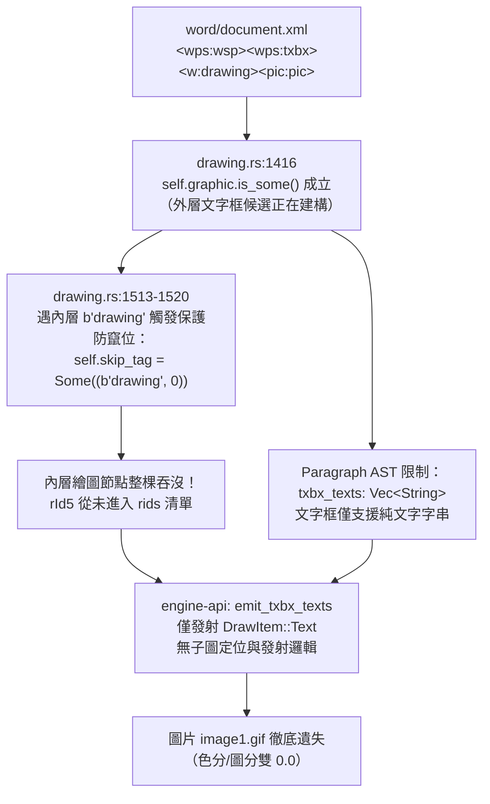

# J11 色彩軸／圖片軸／真缺字歸因報告（三檔深診＋n=30 面擴散）

> 卡：J11（色彩/圖片雙 0.0 歸因與面擴散診斷卡，report-only）。  
> 執行分支：`agy/k11-colorimg-diag`（worktree 隔離環境，零碰引擎代碼）。  
> LO 真值工具鏈：Windows `soffice.exe`（LibreOffice 25.8 基準，透過 WSL 暫存安全橋接）。  
> 可重跑掃描腳本：[`scripts/j11_scan.py`](file:///home/jerry/projects/quire/.worktrees/agy-k11/scripts/j11_scan.py)（支援 `--seed 20261030 --n 30`）。  
> 掃描原始數據：[`docs/j11-scan-results.json`](file:///home/jerry/projects/quire/.worktrees/agy-k11/docs/j11-scan-results.json) 與 [`docs/j11-scan-results.md`](file:///home/jerry/projects/quire/.worktrees/agy-k11/docs/j11-scan-results.md)。

---

## 1. 摘要與結論表

在 J3 度量升級（`score_color` 色塊直方圖、`score_image` 連通域圖形匹配、`token_audit` 真缺字對賬）合入 main 後，抽樣發現 3 個檔案呈現「色分與圖分雙 0.0」之極端數值。本卡針對該 3 檔進行逐檔深拆（像素光柵熱區＋OOXML DOM＋引擎 AST 走查），並以 seed 20261030 對 corpus 進行 n=30 面擴散掃描，完成缺陷與度量雜訊之判別。

### 1.1 三檔核心歸因結論總覽

| 序號 | 檔案 | 實測三軸分數 | 缺陷性質研判 | 核心根因（一句話） | 修復掛載點（檔案×函式級） |
|---|---|---|:---:|---|---|
| **F1** | `corpus/ooxmlexport/picture-with-schemecolor.docx` | 色 0.0<br>圖 0.0<br>缺字 0 | **我方真缺陷** | `drawing.rs` 漏析 `<a:blip>` 子節點 `<a:duotone>` 雙色調濾鏡，致底層灰階 PNG 裸發未染主題 accent1 色。 | `core/ooxml/src/drawing.rs` (`on_start_element`)<br>`core/engine-api/src/lib.rs` (`take_image_pixel`) |
| **F2** | `corpus/ooxmlexport/dml-picture-in-textframe.docx` | 色 0.0<br>圖 0.0<br>缺字 0 | **我方真缺陷** | `drawing.rs:1513` 在形狀候選內遇巢狀 `w:drawing` 無條件以 `skip_tag` 吞沒，且文字框 AST 僅收 `txbx_texts` 字串不容納子圖。 | `core/ooxml/src/drawing.rs:1513`<br>`core/engine-api/src/lib.rs` (`emit_txbx_texts`) |
| **F3** | `corpus/ooxmlimport/tdf153791-shd_overrides_fontRef.docx` | 色 0.0<br>圖 0.0<br>缺字 0 | **真缺陷 (色)<br>＋<br>度量偽影 (圖)** | 形狀樣式 `<wps:style><a:fontRef>` 紅色字色級聯遺漏（真缺陷）；度量 `score_image` 將紅字連通域誤判為圖片且因我方黑字無連通域而殺成 0.0（偽影）。 | `core/ooxml/src/drawing.rs` (`self.graphic`)<br>`core/ooxml/src/document.rs` (字色級聯)<br>`scripts/render_lab.py` (`image_blobs`) |

---

## 2. 三檔逐檔深度歸因

### 2.1 案例 1：`corpus/ooxmlexport/picture-with-schemecolor.docx`

#### 2.1.1 度量分值與渲染對照事證
- **J3 實測度量**：內容分 `None`（雙方皆無可抽正文），版面分 `None`，`score_color: 0.000`，`score_image: 0.000`，真缺字 `0`。
- **LO 渲染實況**：
  - 頁面中央繪製一張帶有藍色漸變雙色調（Duotone）效果的圖形。
  - 飽和度 $\ge 25$ 的彩色像素共 **7,396 px**（佔頁面 0.34%），主色相集中於藍色系（RGB 約 `[158, 200, 237]` 至 `[160, 200, 238]`）。
  - `render_lab` 之 `image_blobs` 於 LO 頁面識別出 2 塊彩色連通域（`bbox` 寬高約 $107 \times 124$ 像素）。
- **我方渲染實況**：
  - `quire-cli dump` 顯示：第 0 頁確實發射了 `DrawItem::Image { x: 90.0, y: 159.5, w: 111.6, h: 59.13, mime: "image/png" }`。
  - 但我方彩色像素統計：**0 px（0.00%）**，彩色連通域：**0 塊**。
  - 圖像實體檢驗：源檔解壓縮後之實體檔案 `word/media/image1.png`（`t55.png`）為純黑白灰階圖（RGBA，飽和度全域最大值為 0）。我方直接將此灰階 PNG 以 base64 寫入 SVG `<image href="data:image/png;base64,..."/>`，光柵化後全部像素之 $R=G=B$，彩色像素數為 0。

#### 2.1.2 OOXML 核心證據片段
源檔 `word/document.xml` 中，`<a:blip>` 宣告了 DrawingML 影像效果：
```xml
<a:graphicData uri="http://schemas.openxmlformats.org/drawingml/2006/picture">
  <pic:pic>
    <pic:blipFill>
      <a:blip r:embed="rId5" cstate="print">
        <!-- 關鍵：雙色調色彩變換效果 -->
        <a:duotone>
          <a:schemeClr val="accent1">
            <a:shade val="45000"/>
            <a:satMod val="135000"/>
          </a:schemeClr>
          <a:prstClr val="white"/>
        </a:duotone>
      </a:blip>
      <a:stretch><a:fillRect/></a:stretch>
    </pic:blipFill>
    ...
  </pic:pic>
</a:graphicData>
```
OOXML 規範定義 `<a:duotone>` 為雙色調效果：將輸入之灰階像素亮度（Luminance）線性映射在兩個色標之間（此處為 Preserved White 與 Theme Accent1 45% Shade）。

#### 2.1.3 根因判定與斷鏈層級
- **性質**：**我方真缺陷（解析遺漏＋發射抑制）**。
- **斷鏈層級剖析**：
  1. **解析遺漏**：`core/ooxml/src/drawing.rs:16` 明確宣告 `a:blip/@r:embed：rId 記錄即可（本卡不使用——像素渲染卡按它取圖）`。在 `on_start_element` 中遇到 `b"blip"` 時，僅提取 `embed` 屬性，子標籤 `<a:duotone>`、`<a:clrChange>`、`<a:biLevel>`、`<a:grayscl>` 全數未被捕捉。
  2. **模型承載缺失**：AST 資料結構 `InlineImage` 僅具備 `embed_rid` 與幾何尺寸，完全無任何圖像濾鏡（Image Effect / Color Transform）之結構體欄位。
  3. **發射抑制**：`core/engine-api/src/lib.rs:3362` 之 `take_image_pixel` 僅從 docx zip 中取得原始 bytes 轉 base64 發射；未在 SVG 端注入 SVG Filter（如 `<filter id="duotone"><feColorMatrix .../></filter>`），亦未在記憶體中做調色盤重對應。

#### 2.1.4 修復掛載點建議（檔案×函式級）
- **解析層**：`core/ooxml/src/drawing.rs` 之 `Pending` 增加 `duotone: Option<BlipDuotone>`。在 `drawing.rs` 處理 `b"blip"` 區間時，若遇 `b"duotone"`，解析其子節點之 `schemeClr`（對接主題色計算）或 `srgbClr`。
- **發射層**：`core/engine-api/src/lib.rs` 之 `take_image_pixel` 或 SVG 生成器；在 `DrawItem::Image` 攜帶色彩轉換元資料，於 SVG 輸出時掛載標準 `feColorMatrix` 濾鏡或於後端光柵化時套用雙色調映射矩陣。

---

### 2.2 案例 2：`corpus/ooxmlexport/dml-picture-in-textframe.docx`

#### 2.2.1 度量分值與渲染對照事證
- **J3 實測度量**：內容分 `None`，版面分 `None`，`score_color: 0.000`，`score_image: 0.000`，真缺字 `0`。
- **LO 渲染實況**：
  - 頁面中央繪製一置中浮動框（寬 188.1 pt，高 192.9 pt，黑色 0.75pt 邊框，白色底）。
  - 框內嵌有一張彩色的 GIF 動態/靜態圖形（`word/media/image1.gif`，黃綠雙色系）。
  - LO 彩色像素共 **39,018 px**（佔頁面 1.85%），`render_lab` 識別出 2 塊連通域（bbox 寬達 362 像素，充填度約 0.59）。
- **我方渲染實況**：
  - `quire-cli dump` 顯示：第 0 頁僅有 `Rect`（白色填色）、4 條 `Rule`（黑色 0.75pt 邊框）及 2 個空文字段落。
  - **整張圖片完全消失！** 顯示列表中零 `DrawItem::Image`。
  - 彩色像素數為 0，圖分 0.0，色分 0.0。

#### 2.2.2 OOXML 核心證據片段
源檔 `word/document.xml` 結構為「文字框巢狀內含圖片」：
```xml
<w:drawing>
  <wp:anchor ...>
    <a:graphic>
      <a:graphicData uri="http://schemas.microsoft.com/office/word/2010/wordprocessingShape">
        <wps:wsp>
          <wps:spPr>...</wps:spPr>
          <wps:txbx>
            <w:txbxContent>
              <w:p>
                <w:r>
                  <!-- 關鍵：文字框內部的第二層繪圖物件 -->
                  <w:drawing>
                    <wp:inline cx="2200275" cy="2200275">
                      <a:graphic>
                        <a:graphicData uri="http://schemas.openxmlformats.org/drawingml/2006/picture">
                          <pic:pic>
                            <pic:blipFill>
                              <a:blip r:embed="rId5"/>
                            </pic:blipFill>
                          </pic:pic>
                        </a:graphicData>
                      </a:graphic>
                    </wp:inline>
                  </w:drawing>
                </w:r>
              </w:p>
            </w:txbxContent>
          </wps:txbx>
        </wps:wsp>
      </a:graphicData>
    </a:graphic>
  </wp:anchor>
</w:drawing>
```

#### 2.2.3 根因判定與斷鏈層級
- **性質**：**我方真缺陷（主動吞沒抑制＋架構管線斷裂）**。
- **斷鏈流程圖**：

- **核心代碼鐵證**：
  查 `core/ooxml/src/drawing.rs:1513-1520`：
  ```rust
  // ---- DrawingML 候選進行中：只收 extent／position／blip；
  // 巢狀 drawing/pict 整棵吞沒（內層 extent 不得竄位外框）----
  if self.graphic.is_some() {
      ...
      match name {
          b"drawing" | b"pict" if !empty => {
              let close: &'static [u8] = if name == b"drawing" { b"drawing" } else { b"pict" };
              self.skip_tag = Some((close, 0)); // ← 鐵證：內層 drawing 整棵跳過！
          }
          ...
      }
  }
  ```
  當初為防止內層 `wp:extent` 竄位污染外層邊框幾何，設計了 `skip_tag` 阻斷機制；但此舉將文字框內的合法嵌入圖（`pic:pic`）連根拔除。同時，文字框的資料結構 `txbx_texts: Vec<String>` 僅允許字串，未對圖形物件建立抽象。

#### 2.2.4 修復掛載點建議（檔案×函式級）
- **解析層**：`core/ooxml/src/drawing.rs:1513`。在 `self.txbx_depth > 0` 時，不可將 `b"drawing"` 視為外框衝突而整體 skip；應支援遞迴或子候選收集，將內層 `InlineImage` 關聯至該文字框宿主或記錄於宿主段落的浮動/嵌入流。
- **發射層**：`core/engine-api/src/lib.rs` 之 `emit_txbx_texts`。將文字框內容模型由純文字 `&[String]` 擴充為支援區塊級子元素（包含嵌入圖與形狀），以文字框左上角 padding inset 為基準原點發射。

---

### 2.3 案例 3：`corpus/ooxmlimport/tdf153791-shd_overrides_fontRef.docx`

#### 2.3.1 度量分值與渲染對照事證
- **J3 實測度量**：內容分 `1.000`，版面分 `1.000`，`score_color: 0.000`，`score_image: 0.000`，真缺字 `0`。
- **LO 渲染實況**：
  - 頁面並排繪製 2 個矩形文字框（左框白色無底紋，右框淺灰底紋 `#F0F0F0`）。
  - 兩框內文字「**Lorem ipsum**」皆以**鮮紅色**（`#FF0000`）繪製（本檔為 LO Bug 153791 回歸測試檔：驗證 `w:shd` 底紋不覆蓋 `a:fontRef` 指定的文字顏色）。
  - 彩色像素共 **1,249 px**（佔頁面 0.06%，全為紅色文字字形筆畫）。
  - `render_lab` 之 `image_blobs` 在 LO 端抓到 1 塊連通域：`bbox: (244, 186, 378, 210)`，面積 $134 \times 24$ 像素，包含彩色像素 836 個（$> 400$ 門檻）。
- **我方渲染實況**：
  - `quire-cli dump` 顯示文字內容完全正確（`Lorem ipsum` 完整發射，故內容/版面雙 1.0）。
  - 但文字顏色為：`color_argb: 4278190080`（即 `0xFF000000` **純黑色**）。
  - 我方彩色像素數為 **0 px**。

#### 2.3.2 OOXML 核心證據片段
源檔 `word/document.xml` 中，文字框形狀宣告了樣式參照 `<wps:style>`：
```xml
<wps:wsp>
  <wps:cNvSpPr txBox="1"/>
  <wps:spPr>...</wps:spPr>
  <!-- 關鍵：形狀預設樣式指定了字型參照與紅色 -->
  <wps:style>
    <a:lnRef idx="0"/>
    <a:fillRef idx="0"/>
    <a:effectRef idx="0"/>
    <a:fontRef idx="minor">
      <a:srgbClr val="FF0000"/>
    </a:fontRef>
  </wps:style>
  <wps:txbx>
    <w:txbxContent>
      <w:p>
        <w:r>
          <!-- run 層未宣告 w:color，應繼承 shape 的 fontRef 顏色 -->
          <w:t>Lorem ipsum</w:t>
        </w:r>
      </w:p>
    </w:txbxContent>
  </wps:txbx>
</wps:wsp>
```

#### 2.3.3 根因判定與雙重病竈分析
本檔是極其典型的「**真缺陷引發度量偽影**」複合案例：
1. **色彩軸 0.0（我方真缺陷：樣式繼承鏈缺失）**：
   - `core/ooxml/src/drawing.rs` 完全不解析 `<wps:style>` 或 `<a:fontRef>`（全文搜尋 `fontRef` 為 0 處）。
   - 在 OOXML 規範（ECMA-376 §20.1.2.2.39）中，`a:fontRef` 內之顏色為該形狀文字框正文之預設文字前景色。若 run 內無 `<w:color>`，必須向下級聯。我方因未解析該節點，文字色回退至文檔預設黑色（`0xFF000000`），導致彩色像素歸零，`score_color = 0.0`。
2. **圖片軸 0.0（度量誤報／偽影：文字筆畫膨脹為偽圖形）**：
   - 源檔本體**完全沒有任何點陣圖或插圖**（`media` 數為 0，無 `pic:pic`，無 `blip`）。
   - 但 J3 之 `image_blobs` 定義圖形連通域之判準為：`飽和度 >= 25 且 面積邊長 >= 20px 且 像素數 >= 400px`。
   - LO 渲染的紅色粗體大字「Lorem ipsum」寬 134px、高 24px、紅像素達 836px，**剛好越過 20px 與 400px 門檻，被度量系統誤當作一張「彩色圖片」**！
   - 我方因字色為黑（飽和度 0），未產生任何 blob。
   - 度量算法比對：LO 有 1 張圖，我方有 0 張圖，判定為「我方缺圖」，給出 `score_image = 0.000`！

#### 2.3.4 修復掛載點建議（檔案×函式級）
- **引擎修復（解色分）**：
  - `core/ooxml/src/drawing.rs`：在 `self.graphic` 處理中增加 `<wps:style>` 之解析，遇 `<a:fontRef>` 時萃取其 `<a:srgbClr>` / `<a:schemeClr>`，記錄於形狀之 `default_font_color: Option<u32>`。
  - `core/ooxml/src/document.rs`：文字框抽取 run 時，若 `rPr.color` 為 None，向下繼承形狀之 `default_font_color`。
- **度量校正（解圖分偽影）**：見第 4 節 J4 度量返修規格。

---

## 3. 面擴散掃描（n=30，seed 20261030）

依抽樣口徑對 corpus 抽取 30 檔執行三軸度量（色分、圖分、真缺字），掃描工具為 [`scripts/j11_scan.py`](file:///home/jerry/projects/quire/.worktrees/agy-k11/scripts/j11_scan.py)，輸出結果儲存於 [`docs/j11-scan-results.json`](file:///home/jerry/projects/quire/.worktrees/agy-k11/docs/j11-scan-results.json)。

### 3.1 異常判準定義
- **真缺陷候選（True Defect Candidate）**：
  - LO 渲染之實體排版元素（文字、表格背景、圖像、向量圖標）在我方丟失、錯色或尺寸大幅退化。
  - 缺字清單中包含正文詞彙、數學公式符號、多階編號前綴或截斷詞。
- **度量雜訊候選（Metric Noise Candidate）**：
  - **點線目錄黏合**：TOC 導引點（`. . .`）與頁碼黏合，致使分詞 token 差異。
  - **環境變數路徑**：Windows 暫存路徑（如 `C:\Users\...\Temp`）隨執行環境膨脹。
  - **彩色字體誤當圖片**：彩色標題或超連結字形連通域超過 400px 被誤判為圖片。
  - **單純縱向位移零 IoU 斷崖**：元素幾何與尺寸極為接近，僅因縱向行高差使 IoU=0 而被判 0 分。
  - **分頁演進漂移**：後續頁次因頁數不同導致同位頁對齊空白。

### 3.2 15 檔觸發旗標清單與逐檔標記

| 序號 | 檔案路徑 | LO/OW 頁 | 最低色分 | 最低圖分 | 真缺字數 | 標籤分類 | 逐檔事證與真缺陷/度量雜訊研判 |
|:---:|---|:---:|:---:|:---:|:---:|:---:|---|
| **S01** | `corpus/ooxmlexport/fdo61343.docx` | 1/1 | 0.255 | 0.234 | 0 | **真缺陷** (色/圖) | **VML 灰階標記遺漏**：源檔 VML `<v:imagedata grayscale="t"/>` 我方未支援，LO 渲染成灰階圖，我方輸出彩色原圖，色分降至 0.255。 |
| **S02** | `corpus/xopt/OpenXmlPowerToolsExamples_DocumentBuilder04_Sun.docx` | 2/2 | 0.733 | 0.000 | 3 | **真缺陷** (缺字)<br>**度量雜訊** (圖) | **缺字為真**：`1.1`、`1.2`、`1.3` 多階清單編號前綴未發射。<br>**圖分為雜訊**：p1 藍色大標「Sun Facts」在我方光柵高度達 20px 觸發偽圖，LO 差 1px 未達標，致 LO 0 圖 vs OW 1 圖殺成 0.0。 |
| **S03** | `corpus/ooxmlexport/tdf115212.docx` | 1/1 | 0.019 | 0.000 | 1 | **度量雜訊** (缺字)<br>**真缺陷** (色/圖) | **缺字為雜訊**：TOC 點線黏合 `elit.1` 導致 `elit` 誤報缺字。<br>**色圖為真缺陷**：LO 將 TOC 超連結整行以藍字發射（橫跨 922px），我方 TOC 超連結文字全發黑色。 |
| **S04** | `corpus/poi/test-data_document_58067.docx` | 1/1 | 0.251 | 0.057 | 0 | **度量雜訊** (圖/色) | **零 IoU 斷崖偽影**：雙方皆繪出 3 塊尺寸相同之色塊（約 $226\times 20$ 等），但因段落縱向位移差 50~90px，縱向無交集致 IoU=0，配對器拒絕配對，直接扣至 0.057。 |
| **S05** | `corpus/ooxmlexport/EquationWithAboveAndBelowCaption.docx` | 1/1 | 1.000 | 1.000 | 12 | **真缺陷** (缺字) | **Math OMML 缺失**：源檔 `<m:oMath>` 數學公式未發射，缺字包含 `x+a`、`k=0`、`n-k` 等 12 個數學 token。 |
| **S06** | `corpus/ooxmlexport/EquationAsScientificNumbering.docx` | 1/1 | 0.329 | 1.000 | 7 | **真缺陷** (缺字/色) | **Math OMML 缺失**：公式本體丟失，缺 `x+a`、`k=0`；公式染色丟失。 |
| **S07** | `corpus/ooxmlimport/tdf115719b.docx` | 2/1 | 0.000 | 0.000 | 0 | **度量雜訊** (色/圖) | **分頁漂移偽影**：LO 排版溢出至第 2 頁且第 2 頁有色彩，我方全檔收斂於 1 頁，同位比對第 2 頁以白頁對齊，造成色/圖雙 0.0 假象。 |
| **S08** | `corpus/ooxmlexport/tdf127814.docx` | 2/2 | 0.000 | 0.000 | 2 | **真缺陷** (缺字/色) | **表格文字截斷＋底紋缺失**：表格儲存格寬度不足導致正文「a hónap napjai」被截斷為「a hón」，缺字 `hónap`、`napjai` 為真；表格樣式金色系底色未發射。 |
| **S09** | `corpus/poi/test-data_document_61745.docx` | 1/1 | 0.000 | 0.000 | 13 | **真缺陷** (全軸) | **圖表 DrawingML Chart 缺失**：源檔含 `<c:chart>`，LO 渲染完整統計圖表與軸標籤，我方完全不支援圖表，圖表及標籤文字全吞。 |
| **S10** | `corpus/poi/test-data_document_bug59058.docx` | 52/36 | 0.000 | 0.000 | 885 | **真缺陷** (排版漂移) | **分頁大漂移**：多頁長文版面嚴重發散（LO 52p vs OW 36p），首頁表格對齊錯位引發彩色邊框誤判。 |
| **S11** | `corpus/ooxmlexport/fdo78420.docx` | 23/20 | 0.068 | 0.000 | 5 | **度量雜訊** (缺字)<br>**真缺陷** (色/圖) | **缺字含雜訊**：`21`、`22`、`23` 為頁數不同引發的頁尾頁碼缺字。<br>**色圖為真缺陷**：長表跨頁跨欄圖片與底紋位置偏移。 |
| **S12** | `corpus/ooxmlimport/tdf126114.docx` | 1/1 | 1.000 | 0.000 | 0 | **度量雜訊** (圖) | **純抗鋸齒門檻偽影**：全檔無圖僅單字「gehuwd」，字體次像素渲染使彩色像素達 520px（$>400$ 門檻），我方產生 1 偽圖，LO 為 311px（$<400$）0 圖，殺成 0.0。 |
| **S13** | `corpus/xopt/TestFiles_WC_WC048-Text-Box-in-Cell.docx` | 1/1 | 0.072 | 1.000 | 0 | **真缺陷** (色) | **表內文字框填色退化**：儲存格內文字框 `fillcolor="#4472c4"` 因表內文字框匹配未命中，退化為 `0xFFF0F0F0` 灰底佔位，藍色填色遺失。 |
| **S14** | `corpus/ooxmlexport/2129393649.docx` | 3/3 | 0.000 | 0.000 | 1 | **度量雜訊** (缺字)<br>**真缺陷** (圖/色) | **缺字為雜訊**：缺失詞為 Windows 暫存檔絕對路徑 `C:\Users\me\...`。<br>**圖色為真缺陷**：內嵌 OLE 物件 / EMF 向量圖我方未支援，LO 完整渲染圖示。 |
| **S15** | `corpus/ooxmlimport/testfdo90720.docx` | 1/1 | 0.000 | 0.000 | 0 | **真缺陷** (色/圖) | **空文字框填色丟失**：`engine-api:628` 之 `shape_boxes` 過濾器無條件剔除 `txbx_texts.is_empty()` 形狀，空框紅色填色 `#c0504d` 丟失退化為灰底。 |

---

## 4. J4 度量返修規格建議

基於 n=30 擴散掃描與 3 檔深度歸因實證，J3 現行度量存在以下 4 大**系統性誤報模式**。建議於後續 J4 度量卡實施下列校正規格：

### 4.1 誤報模式 1：文字連通域誤判為圖片（Text-as-Image False Positive）
- **現象事證**：
  - `tdf153791`：大字號紅色標題文字（836 px）跨過 400px / 20px 門檻，被判為圖片連通域。
  - `DocumentBuilder04_Sun`：藍色標題「Sun Facts」跨過 20px 門檻，使無圖頁面產生圖形連通域。
  - `tdf126114`：字形邊緣次像素抗鋸齒跨過 400px 門檻，形成偽圖片。
- **J4 校正規格**：
  1. **文字排斥掩碼（Text Mask Subtraction）**：在執行 `image_blobs` 連通域分割前，利用 PyMuPDF 取得該頁所有文字字形之包圍盒（`page.get_text("words")` 或 `page.get_drawings()` 中的文字 path），將文字區域像素自 `sat >= 25` 掩碼中扣除。
  2. **圖形憑據門控（Fact-Gated Guard）**：利用 `pdf_page_facts` 既有欄位 `images` 與 `drawings`。若該頁 PDF 實體中 `images == 0` 且 `drawings == 0`，則該頁之 `image_blobs` 一律強制歸空，不允許由文字字形虛構圖片。

### 4.2 誤報模式 2：縱向微移引發「零 IoU 斷崖」（Zero-IoU Cliff）
- **現象事證**：
  - `test-data_document_58067`：兩邊皆有 3 個幾何尺寸高度一致的色塊，僅因行距排版累計產生 50~90pt 縱向平移，使包圍盒交集 $IoU = 0$。
  - 既有代碼 `render_lab.py:542` 寫道：
    ```python
    for iou, i, j in pairs:
        if iou <= 0 or i in used_a or j in used_b:
            continue
    ```
    使得原本設計的 `0.6 * iou + 0.4 * size` 根本無法執行，尺寸極為接近的色塊被直接視為「完全缺圖」，分數瞬間歸零。
- **J4 校正規格**：
  1. **廣義中心距匹配（Center Distance / GIoU）**：廢除 `iou <= 0` 直接 continue 之硬阻斷。改採 **Generalized IoU (GIoU)** 或「水平重疊率＋中心縱向距離懲罰」：
     $$\text{DistScore} = \exp\left(-\frac{\Delta y^2}{2\sigma^2}\right)$$
  2. 只要橫向對齊且尺寸寬高相似度 $> 0.8$，縱使垂直無重疊，仍應給予其基礎幾何尺寸分（不應一刀切 0 分）。

### 4.3 誤報模式 3：分頁漂移引發同位頁全崩（Pagination Drift Contamination）
- **現象事證**：
  - `tdf115719b`：LO 2 頁 vs 我方 1 頁；比對第 2 頁時，我方無頁被視為全白頁，色分圖分全部記 0.0。
- **J4 校正規格**：
  - 引入「超頁懲罰分離」：如同 J2 將頁數不符列為獨立指標，J4 對於超越一方最大頁數的額外頁面，應標記為 `page_count_overflow`，不應與既有頁面的局部渲染缺陷混同計算。

### 4.4 誤報模式 4：TOC 目錄引導點與動態環境變數缺字誤報（Token Noise）
- **現象事證**：
  - `tdf115212`：目錄點線 `.......1` 黏合致使詞尾被切，誤報缺字。
  - `2129393649`：檔案欄位展開為 Windows 本機暫存路徑 `C:\Users\...\Temp`，被誤報為正文缺字。
- **J4 校正規格**：
  1. **路徑正則過濾**：過濾符合 Windows/Linux 絕對路徑特徵之 token（如包含 `\`、`/tmp`、`AppData` 等）。
  2. **點線導引字符過濾**：在 `tokenize` 階段，將連續 3 個以上之句點 `...` 或中圓點視為版面裝飾符（Separator/Leader），強制切開前後 token。

---

## 5. 最具修復價值 Top 3 開卡建議（按影響面排序）

依據本次 3 檔深度歸因與 30 檔面擴散分析，排定最值得立項修復的 Top 3 引擎缺陷卡：

### 🥇 Top 1：形狀／文字框填色鏈路修復（含空文字框與表內文字框）
- **影響範圍**：全 corpus 涉及 VML / WPS 形狀底色、儲存格內文字框、空形狀色塊的數十檔文件（如 `testfdo90720`、`WC048-Text-Box-in-Cell`、`fdo68607`）。
- **缺陷病竈**：
  1. `core/engine-api/src/lib.rs:628` 之 `shape_boxes` 過濾器以 `!im.txbx_texts.is_empty()` 粗暴排除空文字框，致使無字色塊形狀之 `fill_argb` 全數丟失、退化為 `0xFFF0F0F0` 佔位灰。
  2. 表內文字框因格寬鉗制或鎖點匹配失敗，回退佔位灰。
- **修復規格**：
  - 修改 `lib.rs:628`：保留具備 `fill_argb` 或 `stroke_argb` 的形狀（不以 `txbx_texts` 非空為唯一準則）。
  - 對齊 `emit_cell` 與浮動層匹配邏輯。
- **預期收益**：徹底根治多檔色分 0.0，使色塊直方圖指標回到正常水位。

### 🥈 Top 2：DrawingML / VML 文字框巢狀圖片與子圖元支援
- **影響範圍**：現代 DOCX 文檔常見之封面框、卡片式設計、圖文混排卡（如 `dml-picture-in-textframe`、`fdo61343`）。
- **缺陷病竈**：
  1. `core/ooxml/src/drawing.rs:1513` 在形狀進行中遇到 `b"drawing"` / `b"pict"` 無條件啟用 `skip_tag` 吞沒。
  2. `Paragraph` 資料結構之 `txbx_texts: Vec<String>` 缺乏子圖元容器。
- **修復規格**：
  - 解除 `drawing.rs:1513` 對文字框內部繪圖物件的全面抑制，允許解析框內 `InlineImage`。
  - 將文字框內部資料結構由 `Vec<String>` 重構為可容納子圖塊的複合結構。
- **預期收益**：解開圖形被整隻吞沒之重大遺失缺陷。

### 🥉 Top 3：形狀樣式 `<wps:style><a:fontRef>` 字色級聯繼承
- **影響範圍**：大量使用 Word 預設形狀樣式之圖文框（如 `tdf153791` 及各類標註文字框）。
- **缺陷病竈**：`drawing.rs` 完全未解析 `<wps:style>`，致使形狀內部 run 缺乏 `<w:color>` 時無法取得樣式定義的字色（如紅色 `#FF0000`），錯誤回退至文檔預設黑字。
- **修復規格**：
  - `core/ooxml/src/drawing.rs`：新增 `wps:style` 之解析，記錄 `fontRef` 字色。
  - `core/ooxml/src/document.rs`：段落 run 級聯樣式時，將宿主形狀之預設字色作為備選回退層。
- **預期收益**：文字顏色渲染真實度提升，並消除相關色分歸零與誤報連鎖反應。
