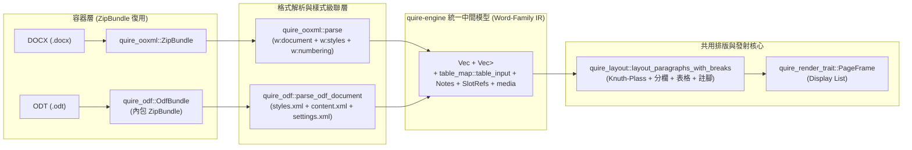
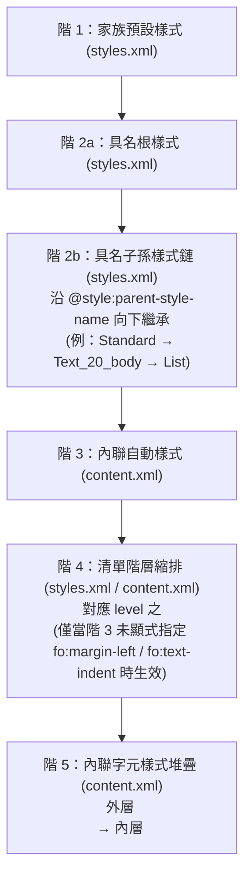

# ODF-DESIGN：`content.xml` → 既有排版核心的映射設計書

> **定位**：本文件為 `core/odf` 實作的唯一規格依據。實作者照書開工，無須自行考古 OASIS OpenDocument Format (ODF) 1.3 / 1.4 規格書。
> **戰略目標**：Word-Family 收斂戰略的第一塊設計地基——ODT 讀取模型必須投影並收斂進與 DOCX 線**完全相同**的 [`quire-engine`](../core/engine-api/src/lib.rs) 中間模型與 [`quire-layout`](../core/layout/src/lib.rs) Knuth-Plass 排版／Display List 核心，嚴禁平行重寫第二套排版器。
> **證據基底**：每條斷言均標註 OASIS ODF 1.3（Part 2: Packages / Part 3: OpenDocument Schema，結構與 ODF 1.4 草案一致）章節號，或由 LibreOffice 24.8.0.3（Windows x86_64，`meta.xml` 之 `meta:generator` 實字可查）Headless 實產之三份基準樣本（[`sample1_styles_list.odt`](odf-design/sample1_styles_list.odt)、[`sample2_table_frame.odt`](odf-design/sample2_table_frame.odt)、[`sample3_page_sect.odt`](odf-design/sample3_page_sect.odt)）的 `unzip` 可重放實證；未經實證處一律誠實標註「推測，待 ODF-2 實證」。
> **修訂紀錄（返修卡 t_baa65494）**：外部初稿之 104 條帶識別符代碼連結經逐條實測覆核後全面修正——所有指向既有代碼的連結改標真實檔案與真實行號（識別符一律用實際宣告名），`core/odf` 提議型別（`RunSpan`／`BlockAttrs`／`InlineDrawing`／`FloatingImage`／`DrawingShape`／`LayoutTable`→`TableInput`／`OdfError`／`OdfWarning` 等）一律明文標註「本卡提議，尚未存在」且不再掛代碼連結；`file:///…/.worktrees/argon-odfd/…` 絕對路徑全數改倉內相對連結（本檔位於 `docs/`，代碼用 `../core/…`）；基準樣本產製器版本出處依 `meta.xml` 實字改正為 LibreOffice 24.8.0.3。本段以下之「既有」皆指真實代碼，「提議」皆指本卡設計、ODF-2/3 落地時才建立。

---

## 1. OPC → ODF 容器差異與 `ZipBundle` 復用契約

ODF 容器（OpenDocument Package，規範定義於 OASIS ODF 1.3 Part 2: Packages）與 OOXML 所採用的 Open Packaging Conventions（OPC，ECMA-376 Part 2）同以 PKWARE ZIP 為底層實體容器，但在首條目魔術位元組約束、內部邏輯檔案職責分工、以及資源引用的定址機制上存在三項本質差異。本節逐一定義其差異，並給出 `core/odf` 如何直接復用 [`ZipBundle`](../core/ooxml/src/zip_struct.rs#L167-L180) 達成無損 `byte-identical round-trip` 的容器層契約。

### 1.1 `mimetype` 首 Entry 不壓縮規則（OASIS ODF 1.3 Part 2 §2.2.1 / §3.3）

在 OPC 容器中，`[Content_Types].xml` 可位於 ZIP 任意偏移位置且允許使用 `DEFLATE`（method `8`）壓縮；反觀 ODF Package 為支援作業系統與檔案管理員透過固定偏移量之「Magic Bytes」直接識別 MIME 類型，於 OASIS ODF 1.3 Part 2 §2.2.1 (D1) 與 §3.3 對名為 `mimetype` 的檔案施加了四條嚴格的二進位物理約束：

1. **首條目絕對位置（First Entry in Archive）**：`mimetype` 必須是整個 ZIP 封裝中的第一個 Local File Header，即其 `local_header_offset` 必須嚴格等於 `0`（檔案偏移量 `0..4` 為 `PK\x03\x04`）。
2. **禁止壓縮（Uncompressed / `METHOD_STORE`）**：Local File Header 與 Central Directory Header 的壓縮方法欄位（`compression_method`）必須為 `0`（`METHOD_STORE`），且 `compressed_size == uncompressed_size`。
3. **禁止 Extra Field（Zero Extra Field Length）**：Local File Header 的 `extra_field_length`（偏移量 `28..30`）必須為 `0`，確保檔名 `"mimetype"`（8 bytes，偏移量 `30..38`）結束後，檔案偏移量 `38` 起緊接著就是未壓縮的 ASCII MIME 字串本體。
4. **禁止前綴尾綴空白與換行**：`mimetype` 內容針對文字處理文件固定為 `application/vnd.oasis.opendocument.text`（39 bytes），不得包含 BOM、CR/LF 或尾隨空白。

我們對 LibreOffice 24.8.0.3 實產之 [`sample1_styles_list.odt`](odf-design/sample1_styles_list.odt) 執行 `zipinfo` 與前 77 bytes 標頭解剖，可重放驗證上述四條規則：

```bash
zipinfo docs/odf-design/sample1_styles_list.odt | head -n 5
python3 -c '
import struct
with open("docs/odf-design/sample1_styles_list.odt", "rb") as f:
    b = f.read(77)
sig, ver, flags, method, mtime, mdate, crc, csize, usize, nlen, elen = struct.unpack("<4sHHHHHIIIHH", b[:30])
print(f"sig={sig} method={method} flags=0x{flags:04x} csize={csize} usize={usize} nlen={nlen} elen={elen}")
print(f"name={b[30:38]!r} payload={b[38:77]!r}")
'
```

實測輸出如下（`stor` 代表 `METHOD_STORE = 0`、`elen=0`、偏移量 `38..77` 精確為 39 bytes 的 MIME 字串）：

```text
Archive:  docs/odf-design/sample1_styles_list.odt
Zip file size: 14169 bytes, number of entries: 17
-rw----     2.0 fat       39 b- stor 26-Nov-03 09:27 mimetype
-rw----     2.0 fat        0 b- stor 26-Nov-03 09:27 Configurations2/progressbar/
-rw----     2.0 fat        0 b- stor 26-Nov-03 09:27 Configurations2/menubar/
sig=b'PK\x03\x04' method=0 flags=0x0800 csize=39 usize=39 nlen=8 elen=0
name=b'mimetype' payload=b'application/vnd.oasis.opendocument.text'
```

### 1.2 核心 XML Streams 與 `META-INF/manifest.xml` 角色分工

依據 OASIS ODF 1.3 Part 2 §3.2、§4 與 Part 3 §2.2.1、§3.1.3.2–§3.1.3.5，一個標準 `.odt` 封裝將單一邏輯文件拆分為五個職責正交的頂層或清單 XML Stream（對比單檔 Flat ODF `<office:document>`）：

| ODF 封裝路徑 | 根元素（Root Element） | ODF 1.3 規範章節 | 核心職責與儲存內容 | 對照 OOXML (`.docx`) Part |
| :--- | :--- | :--- | :--- | :--- |
| `mimetype` | （純文字，無 XML） | Part 2 §3.3 | 39 bytes ASCII 字串 `application/vnd.oasis.opendocument.text`，提供偏移量 `38` 直讀識別。 | `[Content_Types].xml`（間接） |
| `META-INF/manifest.xml` | `<manifest:manifest>` | Part 2 §3.2 / §4.2 | 封裝清單：以 `<manifest:file-entry>` 窮舉根路徑 `"/"` 及各子檔案之 `manifest:full-path`、`manifest:media-type`，並承載加密條目之 `<manifest:encryption-data>`（Part 2 §4.4）。 | `[Content_Types].xml` + `_rels/.rels` |
| `content.xml` | `<office:document-content>` | Part 3 §3.1.3.2 | 文件主體內容（`<office:body><office:text>`）、主體使用之字臉宣告（`<office:font-face-decls>`），以及**僅供正文元素引用之內聯自動樣式**（`<office:automatic-styles>`，如 `P1`、`T1`、`Tbl1`、`Sect1`）。 | `word/document.xml` + `word/footnotes.xml` + `word/endnotes.xml` |
| `styles.xml` | `<office:document-styles>` | Part 3 §3.1.3.3 | 全域樣式表：包含家族預設樣式與具名共用樣式（`<office:styles>`，含 `<text:list-style>`、`<text:outline-style>`、`<text:notes-configuration>`）、**頁面版面與頁首頁尾專屬之自動樣式**（`<office:automatic-styles>` 內的 `<style:page-layout>` 如 `Mpm1`），以及主頁定義與頁首頁尾正文（`<office:master-styles>` 內的 `<style:master-page>`、`<style:header>`、`<style:footer>`）。 | `word/styles.xml` + `word/numbering.xml` + `word/header*.xml` + `word/footer*.xml` + `word/theme/theme1.xml` |
| `meta.xml` | `<office:document-meta>` | Part 3 §3.1.3.4 | 文件元資料：包含 `<office:meta>` 下之 `<meta:generator>`、Dublin Core 標題作者、以及 `<meta:document-statistic>`（頁數、段數、字數快取）。 | `docProps/core.xml` + `docProps/app.xml` |
| `settings.xml` | `<office:document-settings>` | Part 3 §3.1.3.5 | 應用程式檢視狀態（`ooo:view-settings`）與**排版相容性設定**（`ooo:configuration-settings`，如 `AddParaTableSpacing`、`AddParaTableSpacingAtStart`、`TabsRelativeToIndent`、`CollapseEmptyCellPara`）。 | `word/settings.xml`（尤其 `<w:compat>`） |

> [!IMPORTANT]
> **為何必須同時解析兩個 `<office:automatic-styles>`？**
> 根據 OASIS ODF 1.3 Part 3 §3.15.3，`content.xml` 與 `styles.xml` 各自擁有獨立命名空間的 `<office:automatic-styles>`：正文段落（`<office:text>`）引用的 `P1`、`T1` 定義於 `content.xml` 的 `<office:automatic-styles>`；而 `<style:master-page>` 所引用的頁面幾何 `<style:page-layout style:name="Mpm1">` 以及頁首頁尾（`<style:header>` / `<style:footer>`）內段落引用的自動樣式，則定義於 `styles.xml` 的 `<office:automatic-styles>`。`core/odf` 切勿將兩者混進同一張未分域的 `HashMap<String, Style>`，否則當 `content.xml` 與 `styles.xml` 同時生成名為 `P1` 的自動樣式時將發生名稱碰撞。

### 1.3 與 OPC Part / Relationship 模型的本質差異（無 `.rels`，內嵌 `xlink:href`）

在 OOXML (OPC) 架構下，任何 XML Part（例如 `word/document.xml`）**絕對不直接寫出目標資源的套件路徑或外部 URL**，而是寫入關係識別碼（如 `<a:blip r:embed="rId4"/>`、`<w:hyperlink r:id="rId5"/>`、`<w:headerReference r:id="rId6"/>`），再由解析器查詢同目錄下的 `word/_rels/document.xml.rels`（參見 [`core/ooxml/src/rels.rs`](../core/ooxml/src/rels.rs) 的 [`read_rels`](../core/ooxml/src/rels.rs#L27-L57)／[`resolve_relationship`](../core/ooxml/src/rels.rs#L62-L67)／[`Relationship`](../core/ooxml/src/rels.rs#L17-L23)）將 `rId` 解析為 `media/image1.png` 或外部網址。

ODF 則完全不採用 `.rels` 關係表間接層，而是遵循 W3C XLink 1.0 標準（OASIS ODF 1.3 Part 3 §4.3.2.12、§6.1.8、§10.4.4），將目標資源的套件內相對路徑或外部 URI **直接內嵌於使用該資源的 XML 元素屬性 `@xlink:href`**，並由 `META-INF/manifest.xml` 統一登記封裝內各實體檔案的 MIME 型別：

1. **封裝內嵌圖片（`<draw:image>`，ODF 1.3 Part 3 §10.4.4）**：直接在 `content.xml`（或 `styles.xml` 的頁首頁尾內）寫出 `@xlink:href="Pictures/<hash>.png"` 與 `@xlink:type="simple"`、`@xlink:show="embed"`、`@xlink:actuate="onLoad"`。以 [`sample2_table_frame.odt`](odf-design/sample2_table_frame.odt) 為證：
   - `content.xml` 內直接寫：`<draw:image xlink:href="Pictures/1000000000000002000000024497178A.png" xlink:type="simple" xlink:show="embed" xlink:actuate="onLoad" draw:mime-type="image/png">`
   - `META-INF/manifest.xml` 對應登記：`<manifest:file-entry manifest:full-path="Pictures/1000000000000002000000024497178A.png" manifest:media-type="image/png"/>`
2. **文字超連結（`<text:a>`，ODF 1.3 Part 3 §6.1.8）**：直接在 `<text:a>` 上寫出 `@xlink:href="https://example.org/spec"`（外部連結）或 `@xlink:href="#BookmarkName"`（文件內書籤／大綱錨點）。
3. **頁首與頁尾（`<style:header>` / `<style:footer>`，ODF 1.3 Part 3 §16.10 / §16.11）**：OOXML 將頁首頁尾拆為獨立的 `word/header1.xml` Part 並以 `.rels` 關聯；ODF 則將 `<style:header>`、`<style:header-left>`、`<style:header-first>`、`<style:footer>`、`<style:footer-left>`、`<style:footer-first>` **直接內嵌為 `styles.xml` 中 `<style:master-page>` 的子元素**，完全不經由外部檔案引用。
4. **註腳與尾註（`<text:note>`，ODF 1.3 Part 3 §6.3.2）**：OOXML 將註腳拆至 `word/footnotes.xml` 並以 `<w:footnoteReference w:id="1"/>` 跨 Part 關聯；ODF 則將 `<text:note text:id="ftn1" text:note-class="footnote"><text:note-citation>1</text:note-citation><text:note-body><text:p>...</text:p></text:note-body></text:note>` **直接內嵌在正文 `<text:p>` 的錨點位置**（見 [`sample1_styles_list.odt`](odf-design/sample1_styles_list.odt) `content.xml` 第 55–60 行）。

### 1.4 `core/odf` 復用 `quire_ooxml::ZipBundle` 的無損紀律與型別提案

在既有架構中，[`core/xlsx/src/lib.rs`](../core/xlsx/src/lib.rs#L62-L80) 的 [`XlsxBundle`](../core/xlsx/src/lib.rs#L62-L64) 已證明 [`ZipBundle`](../core/ooxml/src/zip_struct.rs#L167-L180) 與 OPC 解耦、可作為通用 ZIP 無損容器底座。檢視 [`core/ooxml/src/zip_struct.rs`](../core/ooxml/src/zip_struct.rs#L75-L180) 的內部實作，每一個 [`ZipEntry`](../core/ooxml/src/zip_struct.rs#L75-L102) 均完整保存：

- `local_raw: Vec<u8>`（原始 Local File Header 含檔名與原始 extra field bytes）
- `data_raw: Vec<u8>`（原始壓縮或未壓縮 payload bytes）
- `gap_raw: Vec<u8>`（緊隨 payload 之後的 Data Descriptor 或 padding bytes）
- `central_raw: Vec<u8>`（原始 Central Directory Header bytes）
- `local_header_offset: u32`（原始條目在檔案中的位元組偏移量）

當呼叫 [`ZipBundle::serialize`](../core/ooxml/src/zip_struct.rs#L453-L582) 時：
1. **無變更（`changes.is_empty() && extras.is_empty()`）**：直接依 `local_header_offset` 升冪拼接每個條目的 `local_raw + data_raw + gap_raw`，接著原封不動輸出每個條目的 `central_raw`（若偏移量未變）與 `eocd_raw`（EOCD 原始位元組），保證 **100% byte-identical round-trip**。
2. **局部修改（例如未來編輯器透過 `Change::Replace("content.xml", new_xml)` 回寫）**：[`ZipBundle::serialize`](../core/ooxml/src/zip_struct.rs#L453-L582) 以 `by_offset.sort_by_key(|&i| entries[i].local_header_offset)` 決定輸出順序。由於原始 `.odt` 的 `mimetype` 位於 `local_header_offset == 0` 且未被列入 `changes`，`mimetype` **必然維持在序列化輸出的第一個條目（offset `0`）**，且直接回寫其原始 `local_raw`（`method = 0`、`extra_len = 0`）與 `data_raw`（39 bytes），天然滿足 OASIS ODF 1.3 Part 2 §3.3 的所有二進位限制！
3. **未來從零新建 `.odt` 或修補非標準 `.odt` 時的防衛契約**：若輸入的病態 `.odt` 將 `mimetype` 壓縮或置於非首條目，讀取階段僅發出 `OdfWarning::NonCompliantMimetypeEntry`（見 §5.1）而不阻斷排版；未來若提供「正規化另存」API，只需確保 `mimetype` 以 `METHOD_STORE` 寫入首槽即可。

以下為 `core/odf/src/lib.rs` 容器層的擬議 Rust 介面（嚴格對齊 [`XlsxBundle`](../core/xlsx/src/lib.rs#L62-L80) 口徑）：

```rust
use quire_ooxml::zip_struct::{Change, ZipBundle, ZipError};
use std::collections::{BTreeMap, HashMap};

pub const ODT_MIMETYPE: &str = "application/vnd.oasis.opendocument.text";

#[derive(Debug, Clone)]
pub struct ManifestEntry {
    pub full_path: String,
    pub media_type: String,
    pub is_encrypted: bool,
}

pub struct OdfBundle {
    zip: ZipBundle,
    manifest: HashMap<String, ManifestEntry>,
    changes: BTreeMap<String, Change>,
    extras: BTreeMap<String, Vec<u8>>,
}

impl OdfBundle {
    /// 開啟 ODF (`.odt`) 封裝，驗證 `META-INF/manifest.xml` 並攔截封裝級加密條目。
    pub fn open(bytes: &[u8]) -> Result<Self, OdfError> {
        let zip = ZipBundle::open(bytes).map_err(OdfError::Zip)?;
        let manifest_bytes = zip
            .entry("META-INF/manifest.xml")
            .ok_or(OdfError::MissingManifest)?
            .decoded()
            .map_err(OdfError::Zip)?;
        let manifest = parse_manifest(&manifest_bytes)?;
        // 攔截 ODF 1.3 Part 2 §3.4 / §4.4 封裝層級加密（見 §5.4）
        for entry in manifest.values() {
            if entry.is_encrypted {
                return Err(OdfError::EncryptedEntry {
                    full_path: entry.full_path.clone(),
                });
            }
        }
        if zip.entry("content.xml").is_none() {
            return Err(OdfError::MissingContentXml);
        }
        Ok(Self {
            zip,
            manifest,
            changes: BTreeMap::new(),
            extras: BTreeMap::new(),
        })
    }

    /// 無損序列化：未變更條目維持原始壓縮流、Extra Field 與 Central Directory 順序。
    pub fn to_bytes(&self) -> Result<Vec<u8>, OdfError> {
        self.zip
            .serialize(&self.changes, &self.extras)
            .map_err(OdfError::Zip)
    }

    /// 讀取封裝內任意條目（如 `content.xml`、`styles.xml`、`Pictures/*`）之解壓位元組。
    pub fn read_entry(&self, name: &str) -> Result<Vec<u8>, OdfError> {
        let normalized = normalize_odf_path(name)?;
        self.zip
            .entry(&normalized)
            .ok_or_else(|| OdfError::MissingEntry { path: normalized })?
            .decoded()
            .map_err(OdfError::Zip)
    }
}
```

---

## 2. `content.xml` 讀取模型：對齊 `quire-engine` 中間模型的欄位級投影型錄

### 2.1 Word-Family 收斂架構與平鋪段落槽位不變量（Flat Paragraph Slot Indexing Invariant）

為確保 ODT 與 DOCX 共用同一套 Knuth-Plass 斷行、分欄、表格與分頁引擎，`core/odf` 讀取模型的輸出目標是直接建構 [`Engine`](../core/engine-api/src/lib.rs#L62-L129) 所需的平鋪結構（或將 [`quire_ooxml::OoxmlDoc`](../core/ooxml/src/lib.rs#L282-L297) 的公開資料結構提取為共用的 Word-Family IR，使 **`Engine::from_odf_bytes`**（本卡提議入口，尚未存在） 與 [`Engine::from_docx_bytes`](../core/engine-api/src/lib.rs#L212-L699) 共享 [`layout_paragraphs_with_breaks`](../core/layout/src/lib.rs#L465-L495)）。



在進入逐元素映射表之前，實作者必須嚴格遵守 [`quire-engine`](../core/engine-api/src/lib.rs) 與 [`quire-layout`](../core/layout/src/lib.rs) 賴以運作的**三條平鋪段落槽位不變量（Flat Paragraph Slot Invariants）**：

1. **正文與表格儲存格段落佔用連續平鋪槽位 `0..n_paras`**：`<office:body><office:text>` 下順流出現的頂層 `<text:p>`、`<text:h>`、`<text:list>` 項目內段落、`<text:section>` 內段落，以及 `<table:table-cell>` 內的段落，皆依文件順流次序推入頂層 `Vec<Paragraph>`。每個 [`TableCell`](../core/ooxml/src/table.rs#L416-L419) 以 `para_start..para_end` 半開區間指向此平鋪陣列中的槽位（既有平鋪槽位語義見 [`BodyTable::para_start`](../core/ooxml/src/table.rs#L456-L462)；儲存格為空（如 `<table:table-cell/>`）時合成一個空 `Paragraph` 槽位以維持 `para_start < para_end` **屬本卡提議**——既有 OOXML 線對空 `w:tc` 老實回空 `Vec`、不虚構段落，見 [`TableCell`](../core/ooxml/src/table.rs#L410-L419)）。
2. **圖框／文字框（`<draw:text-box>`）內段落嚴禁進入頂層平鋪槽位**：ODF 的文字框 `<draw:frame><draw:text-box><text:p>...</text:p></draw:text-box></draw:frame>` 內嵌於宿主 `<text:p>` 內（見 [`sample2_table_frame.odt`](odf-design/sample2_table_frame.odt) `content.xml` 第 159–163 行）。解析器在遇到 `<draw:text-box>` 時，**必須切換至框內緩衝區**，將框內 `<text:p>` 轉為宿主段落的 `Paragraph::txbx_texts` / `Paragraph::txbx_runs` 或 [`InlineImage`](../core/ooxml/src/drawing.rs#L225-L404) 的 `txbx_texts`，**絕對不可將框內 `<text:p>` 推入頂層 `Vec<Paragraph>`**（對齊 [`core/ooxml/src/lib.rs` 的 `txbx_depth` 隔離機制](../core/ooxml/src/lib.rs#L599)）。
3. **內聯註腳與尾註（`<text:note>`）內段落嚴禁進入頂層平鋪槽位**：與 OOXML 將註腳放在獨立 `word/footnotes.xml` 不同，ODF 將 `<text:note><text:note-body><text:p>...</text:p></text:note-body></text:note>` 直接嵌在正文 `<text:p>` 的字元流中（ODF 1.3 Part 3 §6.3.2）。解析器遇到 `<text:note-body>` 時，**必須將其內部 `<text:p>` 抽離至 [`Notes`](../core/ooxml/src/notes.rs#L174-L187)（`footnotes` 或 `endnotes`）**，而在宿主 `<text:p>` 的當前位置僅留下一筆 [`Anchor`](../core/engine-api/src/footnotes.rs#L180-L190)，否則註腳文字將直接混入正文段落排版！

### 2.2 區塊與段落層級投影表（`office:text` → `text:h` / `text:p` / `text:list` / `text:section`）

下表列出 `<office:body><office:text>` 下所有區塊與段落級 ODF 元素（含 OASIS ODF 1.3 Part 3 章節號）對應至 [`quire-engine`](../core/engine-api/src/lib.rs) 中間模型欄位，以及目前 DOCX 線產出相同語義的模組與函式：

| ODF 元素 / 屬性 | ODF 1.3 章節 | Quire 目標型別與欄位 | 語義與轉換規則 | 目前 DOCX 線產出者 |
| :--- | :--- | :--- | :--- | :--- |
| `<office:text>` | Part 3 §3.4 | [`Engine`](../core/engine-api/src/lib.rs#L62-L129) 頂層容器 | 文字文件主體根容器；其下依序包含 `<text:sequence-decls>`（忽略或留供欄位求值）、`<text:p>`、`<text:h>`、`<text:list>`、`<table:table>`、`<text:section>`、`<draw:frame>`（`anchor-type="page"`）。 | [`parse`](../core/ooxml/src/lib.rs#L354-L380) 處理 `<w:body>` |
| `<text:p>` | Part 3 §5.1.3 | [`Paragraph`](../core/ooxml/src/lib.rs#L215-L279) | 一般段落；佔用 1 個平鋪段落槽位 `slot_idx`，承載 `text: String` 與 `attrs`（本卡提議欄位，尚未存在；既有 [`Paragraph`](../core/ooxml/src/lib.rs#L215-L279) 以 `runs: Vec<Run>` 承載字元串）。 | [`parse_document_xml_with_fonts`](../core/ooxml/src/lib.rs#L569-L1233) + [`cascade_paragraphs`](../core/engine-api/src/lib.rs#L2834-L3083) |
| `<text:h>` + `@text:outline-level="N"` | Part 3 §5.1.2 / §19.848 | [`Paragraph`](../core/ooxml/src/lib.rs#L215-L279) + `BlockAttrs::role` | 標題段落；`N` 為 `1..=6` 時映射為 `"h1"`..`"h6"`（大於 6 鉗制為 `"h6"`，未標註時預設 `1` -> `"h1"`）。同時觸發 `<text:outline-style>` 第 `N` 階大綱編號解析（見 §3.4.3）。 | **`style_id_to_role`**（本卡提議函式，尚未存在：既有 styleId 查詢入口 [`StyleTable::effective_para`](../core/ooxml/src/styles.rs#L1200-L1243)）（解析 `Heading1`..`Heading6`） |
| `@text:style-name`（於 `text:p` / `text:h`） | Part 3 §19.880 | 驅動 **`BlockAttrs`**（本卡提議，尚未存在：段落級屬性投影，擴充既有 [`ParaStyle`](../core/ooxml/src/styles.rs#L216-L228)） 欄位與預設 **`RunSpan`**（本卡提議，尚未存在：run 級格式投影，擴充既有 [`Run`](../core/ooxml/src/lib.rs#L78-L153)） | 先查 `content.xml` 之 `<office:automatic-styles>`（`family="paragraph"`），若無再查 `styles.xml` 之 `<office:styles>`，並沿 `@style:parent-style-name` 展開級聯（見 §3.1）。 | [`StyleTable::effective_para`](../core/ooxml/src/styles.rs#L1200-L1243) |
| `@text:cond-style-name` | Part 3 §19.781 | 條件覆寫 **`BlockAttrs`**（本卡提議，尚未存在：段落級屬性投影，擴充既有 [`ParaStyle`](../core/ooxml/src/styles.rs#L216-L228)） | 指向含有 `<style:map>` 子元素的段落樣式；依當前段落所在脈絡（清單階層、表格儲存格、表頭、區段、大綱階層）選取 `@style:apply-style-name` 覆寫屬性（見 §3.4.1）。 | OOXML 無對應（僅表格有 `w:cnfStyle`） |
| `<text:list>` + `@text:style-name` + `@text:continue-numbering` | Part 3 §5.3.1 / §5.3.2 | **`Paragraph::list_format`**（本卡提議欄位，尚未存在）（**`ListFormat`**（本卡提議，尚未存在：既有對應物 [`ListMarker`](../core/engine-api/src/lists.rs#L35-L40)））+ `BlockAttrs::list_level` / `list_num_fmt` / `list_num_id` | 清單容器，以巢狀深度決定 `level`（外層 `<text:list>` 為 `level = 0`，對應 ODF `@text:level="1"`；每向內巢狀一層 `<text:list>` 遞增 1）。若內層 `<text:list>` 省略 `@text:style-name`，繼承外層 `<text:list>` 的清單樣式名稱（或取段落樣式上的 `@style:list-style-name`，見 [`sample1_styles_list.odt`](odf-design/sample1_styles_list.odt) `content.xml` 第 26、63–72 行）。 | [`numbering::label`](../core/engine-api/src/numbering.rs#L28-L35) + [`compute_markers`](../core/engine-api/src/lists.rs#L45-L146) |
| `<text:list-item>` + `@text:start-value` | Part 3 §5.3.4 / §19.873 | [`ListMarker::text`](../core/engine-api/src/lists.rs#L35-L40) | 清單項容器；其下**第一個** `<text:p>` 或 `<text:h>` 產生編號／項目符號 `marker`（如 `"1."`、`"\u{2022}"`），同一個 `<text:list-item>` 下的後續 `<text:p>` 繼承清單縮排但不輸出 `marker`。 | [`compute_markers`](../core/engine-api/src/lists.rs#L45-L146) |
| `<text:list-header>` | Part 3 §5.3.3 | [`Paragraph`](../core/ooxml/src/lib.rs#L215-L279)（`list_format = None`） | 無編號之清單標題項；套用該清單階層的縮排（`indent_left_pt` / `indent_first_line_pt`），但不遞增計數器、不產生 `marker`。 | OOXML 無獨立元素（以移除 `w:numPr` 實現） |
| `<text:numbered-paragraph>` | Part 3 §5.3.6 | **`Paragraph::list_format`**（本卡提議欄位，尚未存在） | 獨立編號段落（不包在 `<text:list>` 內），直接由 `@text:level`（預設 1）與 `@text:style-name` 決定清單格式。 | 對齊 OOXML 段落直接掛 `<w:numPr>` |
| `<text:section>` + `@text:style-name` | Part 3 §5.4 | 段落對應之 [`SectionSpec`](../core/ooxml/src/sectpr.rs#L111-L115)（[`SectionCols`](../core/ooxml/src/sectpr.rs#L61-L71)） | 頁內區塊／分欄容器；將其 `<style:section-properties><style:columns>` 的欄數（`fo:column-count`）、欄距（`fo:column-gap`）與不等寬欄設定（`<style:column>`）合成至區段內各段落的 `SectionGeometry { cols, continuous: true, .. }`（詳見 §4.2）。 | [`read_sections_per_paragraph`](../core/ooxml/src/sectpr.rs#L228-L261) 處理 `<w:sectPr><w:cols>` |

### 2.3 內聯與 Run 層級投影表（`text:span` / `text:s` / `text:tab` / `text:line-break` / `text:a` / `text:note`）

ODF 段落（`<text:p>` 與 `<text:h>`）屬於 XML Mixed Content（混合內容模型，OASIS ODF 1.3 Part 3 §5.1.3）：字元資料（`#PCDATA`）可直接出現在 `<text:p>` 下，也可包裹在任意深度巢狀的 `<text:span>` 或 `<text:a>` 內。這與 OOXML 強制將所有文字包在平鋪 `<w:r><w:t>` 內的結構截然不同。

> [!NOTE]
> **ODF 空白字元正規化規則（OASIS ODF 1.3 Part 3 §6.1.2）**：
> 在 `<text:p>` 與 `<text:h>` 內，XML 原始碼中的連續 ASCII 空白字元（Space `0x20`、Tab `0x09`、CR `0x0D`、LF `0x0A`）依規範**必須摺疊（collapse）為單一空白 `' '`**；若文件作者輸入了第 2 個以上的連續空白，產生器會輸出 `<text:s text:c="N"/>`（見 [`sample1_styles_list.odt`](odf-design/sample1_styles_list.odt) `content.xml` 第 43 行：`段落內聯 <text:s text:c="2"/>空白`）。因此 `core/odf` 解析器在讀取 XML 縮排排版的空白節點時，必須遵循 §6.1.2 空白摺疊規則，並將顯式空白完全交由 `<text:s>`、`<text:tab/>` 與 `<text:line-break/>` 產出。

| ODF 內聯元素 / 屬性 | ODF 1.3 章節 | Quire 目標型別與欄位 | 語義與轉換規則 | 目前 DOCX 線產出者 |
| :--- | :--- | :--- | :--- | :--- |
| `<text:p>` / `<text:h>` 直接 `#PCDATA` | Part 3 §5.1.3 / §6.1.2 | [`Run::text`](../core/ooxml/src/lib.rs#L78-L153) + **`RunSpan`**（本卡提議，尚未存在：run 級格式投影，擴充既有 [`Run`](../core/ooxml/src/lib.rs#L78-L153)） | 套用該段落樣式已解析之 `<style:text-properties>` 預設字元屬性，寫入 `Run.text` 並建立對應 `start..end`（UTF-8 byte offset）的 `RunSpan`。 | [`cascade_paragraphs`](../core/engine-api/src/lib.rs#L2834-L3083) 合併段落預設 `rPr` |
| `<text:span text:style-name="...">`（支援多重巢狀） | Part 3 §6.1.7 | **`RunSpan`**（本卡提議，尚未存在：run 級格式投影，擴充既有 [`Run`](../core/ooxml/src/lib.rs#L78-L153)） | 解析器維護 `Vec<ResolvedTextProps>` 屬性堆疊：進入 `<text:span>` 時 clone 棧頂屬性並以 `@text:style-name` 指向之 `family="text"` 樣式覆寫後 push，離開時 pop；葉節點文字依當前棧頂屬性壓平為單一 `RunSpan`（實證見 [`sample1_styles_list.odt`](odf-design/sample1_styles_list.odt) `content.xml` 第 49–51 行 `<text:span text:style-name="Emphasis"><text:span text:style-name="T1">`）。 | [`parse_rpr_body`](../core/ooxml/src/styles.rs#L512)（OOXML `w:r` 不巢狀） |
| `<text:s>` + `@text:c="N"` | Part 3 §6.1.3 / §19.776 | [`Run::text`](../core/ooxml/src/lib.rs#L78-L153)（追加 `N` 個 `' '`） | `@text:c` 省略時預設 `N = 1`；向當前 `Run.text` 與當前 `RunSpan`（提議）追加 `N` 個 ASCII Space（`0x20`）。 | `<w:t xml:space="preserve">` |
| `<text:tab/>` | Part 3 §6.1.4 | [`Run::text`](../core/ooxml/src/lib.rs#L78-L153)（追加 `'\t'`） | 向當前 `Run.text` 追加 `'\t'`；由 `quire-layout` 斷行層（`core/layout/src/kp.rs`）依既有 [`Run::tab`](../core/ooxml/src/lib.rs#L78-L153) 旗標（＋`tab_count`／`ptab`）展開製表位跳躍與前導字元。 | [`apply_break_tab_tag`](../core/ooxml/src/lib.rs#L429-L477) 處理 `<w:tab/>` |
| `<text:line-break/>` | Part 3 §6.1.5 | [`Run::text`](../core/ooxml/src/lib.rs#L78-L153)（追加 `'\n'`） | 軟換行（Manual Line Break）：向當前 `Run.text` 追加 `'\n'`，在同一段落內強制斷行但不產生段間距與首行縮排。 | [`handle_br_tag`](../core/ooxml/src/lib.rs#L1294-L1325) 處理 `<w:br/>`（無 `type` 或 `textWrapping`） |
| `<text:soft-page-break/>` | Part 3 §5.6 | 診斷記錄（**不**產生硬分頁） | 產生器（如 LibreOffice）在存檔時寫入的上次排版軟分頁位置快取（配合 `<office:text text:use-soft-page-breaks="true">`）。Quire 由 Knuth-Plass 自主計算軟分頁，故**嚴禁將 `<text:soft-page-break/>` 當作硬分頁**，但可記錄其字元偏移量供 K5 分頁診斷腳本比對（見 §4.4）。 | OOXML `<w:lastRenderedPageBreak/>`（忽略） |
| `<text:a xlink:href="...">` + `@text:style-name` | Part 3 §6.1.8 | **`RunSpan`**（本卡提議，尚未存在：run 級格式投影，擴充既有 [`Run`](../core/ooxml/src/lib.rs#L78-L153)） | 超連結容器；將 `@text:style-name`（如 `Internet_20_link`）壓入字元屬性堆疊（預設賦予底線與超連結色），內部文字與 `<text:span>` 照常產出 `RunSpan`（見 [`sample1_styles_list.odt`](odf-design/sample1_styles_list.odt) `content.xml` 第 53 行）。 | [`parse_document_xml_with_fonts`](../core/ooxml/src/lib.rs#L569-L1233) 展開 `<w:hyperlink>` 內 `<w:r>` |
| `<text:note text:note-class="footnote\|endnote">` | Part 3 §6.3.2 | **`Paragraph::footnote_refs`**（本卡提議欄位，尚未存在）（[`Anchor`](../core/engine-api/src/footnotes.rs#L180-L190)）+ [`Notes`](../core/ooxml/src/notes.rs#L174-L187) | 1. 讀取 `<text:note-citation>` 文字作為 `marker`（如 `"1"`），於宿主段落當前 `text.len()` 推入 `FootnoteRef { byte_offset, id, marker }`，並依 `<text:notes-configuration>` 的 `@text:citation-body-style-name`（如 `Footnote_20_anchor` 上標 `super 58%`）在宿主段落插入上標引用 Run。<br>2. 將 `<text:note-body>` 內的 `<text:p>` 抽離至 `Notes::footnotes`（當 `note-class="footnote"`）或 `Notes::endnotes`（當 `note-class="endnote"`）。 | [`Notes::from_parts`](../core/ooxml/src/notes.rs#L197-L231) + [`collect_anchors`](../core/engine-api/src/footnotes.rs#L196-L198) |
| `<text:page-number>` / `<text:page-count>` | Part 3 §7.3.4 / §7.5.18.2 | [`SectionHeaderFooter`](../core/ooxml/src/sectpr.rs#L132-L142) 頁碼動態欄位佔位符 `\x01` / `\x02` | 出現在 `<style:header>` / `<style:footer>` 內時（見 [`sample3_page_sect.odt`](odf-design/sample3_page_sect.odt) `styles.xml` `<style:master-page style:name="Standard">`），將 `<text:page-number>` 映射為 `\x01`（`PAGE` 佔位符）、`<text:page-count>` 映射為 `\x02`（`NUMPAGES` 佔位符），交由 [`quire-layout`](../core/layout/src/lib.rs) 在每頁繪製頁首頁尾時替換為實際頁碼；若出現在正文內則保留元素快取文字。 | [`classify_field_instr`](../core/ooxml/src/lib.rs#L175-L185) 解析 `PAGE` / `NUMPAGES` 欄位 |
| `<text:bookmark>` / `<text:bookmark-start>` / `<text:bookmark-end>` | Part 3 §6.2.1 | 錨點索引（不產生字元） | 空元素標記，不向 `Run.text` 輸出任何字元。 | `<w:bookmarkStart>` / `<w:bookmarkEnd>` |

### 2.4 表格模型投影表（`table:table` → `Table` / `table_map` / `TableInput`）

> **命名校準說明**：任務卡第 2 點提及之 `text:table` 在 OASIS ODF 1.3 規範中的正式 XML QName 為 `table:table`（命名空間 `urn:oasis:names:tc:opendocument:xmlns:table:1.0`，定義於 OASIS ODF 1.3 Part 3 §9.1.2，可直接作為 `<office:text>` 的子元素，實證見 [`sample2_table_frame.odt`](odf-design/sample2_table_frame.odt) `content.xml` 第 124 行）。

ODF 表格模型與 OOXML `<w:tbl>` 的最大結構差異在於：ODF 使用 `@table:number-columns-repeated` 壓縮重複欄定義，並以首格的 `@table:number-rows-spanned="R"` 搭配後續 `R-1` 列同欄位置的 `<table:covered-table-cell/>` 表達跨列合併（而 OOXML 使用 `<w:vMerge w:val="restart"/>` 與後續列的 `<w:vMerge/>`）。下表定義完整欄位級對照：

| ODF 表格元素 / 屬性 | ODF 1.3 章節 | Quire 目標型別與欄位 | 語義與轉換規則 | 目前 DOCX 線產出者 |
| :--- | :--- | :--- | :--- | :--- |
| `<table:table>` + `@table:style-name` | Part 3 §9.1.2 | [`Table`](../core/ooxml/src/table.rs#L423-L429) → [`TableInput`](../core/layout/src/table.rs#L207-L240) | 表格根容器；由 `@table:style-name`（`family="table"`）之 `<style:table-properties>` 讀取 `@style:width`（表格總寬）、`@table:align`（`"left"` / `"center"` / `"right"` / `"margins"`）與 `@fo:margin-left`（`tbl_indent_pt`）。 | [`read_body_tables`](../core/ooxml/src/table.rs#L1259-L1261) + [`table_map::table_input`](../core/engine-api/src/table_map.rs#L757) |
| `<table:table-column>` + `@table:number-columns-repeated="K"` | Part 3 §9.1.6 / §19.671 | [`Table`](../core/ooxml/src/table.rs#L423-L429) 之 `grid: Vec<GridCol>` | 由 `@table:style-name`（`family="table-column"`）之 `<style:table-column-properties>` 讀取 `@style:column-width`（絕對寬度，如 `"5.667cm"` → `160.64pt`）。若未給絕對寬度而僅給 `@style:rel-column-width="21845*"`，則按表格總寬依比例分配；將該欄寬重複推入 `grid`（[`GridCol`](../core/ooxml/src/table.rs#L52-L55)）共 `K` 次（預設 `K = 1`，見 [`sample2_table_frame.odt`](odf-design/sample2_table_frame.odt) `content.xml` 第 93–95、125 行）。 | [`read_body_tables`](../core/ooxml/src/table.rs#L1259-L1261) 解析 `<w:tblGrid><w:gridCol>` |
| `<table:table-header-rows>` | Part 3 §9.1.7 | [`RowProps`](../core/ooxml/src/table.rs#L341-L356) 之 `header = true` | 包裹在此容器內的所有 `<table:table-row>` 標記 `is_header = true`，供跨頁重複表頭使用（見 [`sample2_table_frame.odt`](odf-design/sample2_table_frame.odt) `content.xml` 第 126–136 行）。 | `<w:trPr><w:tblHeader/>` |
| `<table:table-row>` + `@table:style-name` | Part 3 §9.1.3 | [`TableRow`](../core/ooxml/src/table.rs#L407-L410) | 由 `family="table-row"` 之 `<style:table-row-properties>` 解析：<br>- `@style:min-row-height` → `height_pt: Some(v)` 且 `height_exact = false`<br>- `@style:row-height` → `height_pt: Some(v)` 且 `height_exact = true`<br>- `@fo:keep-together="always"` → `cant_split = true` | [`read_body_tables`](../core/ooxml/src/table.rs#L1259-L1261) 解析 `<w:trPr>` |
| `<table:table-cell>` + `@table:number-columns-spanned="C"` | Part 3 §9.1.4 / §19.672 | [`TableCell`](../core/ooxml/src/table.rs#L416-L419) 之 `grid_span: u16` | 水平跨欄數：`grid_span = C.unwrap_or(1)`。注意在 ODF 中，若某格宣告 `table:number-columns-spanned="2"`，同一列緊隨其後會出現 `C - 1` 個 `<table:covered-table-cell/>`（見 [`sample2_table_frame.odt`](odf-design/sample2_table_frame.odt) 第 128–131 行）；解析器必須略過被水平跨欄覆蓋的 `<table:covered-table-cell/>`，以免重複推入 `TableRow::cells`！ | `<w:tcPr><w:gridSpan w:val="C"/>` |
| `@table:number-rows-spanned="R"` + 後續列 `<table:covered-table-cell/>` | Part 3 §9.1.5 / §19.673 | **`CellMerge`**（本卡提議，尚未存在）：既有狀態以 [`CellProps::vmerge`](../core/ooxml/src/table.rs#L360-L374) raw 如實存放 | **跨列合併狀態機**：解析器維護每欄剩餘跨列計數 `active_row_spans: Vec<(usize, u16)>`（記錄 `(v_span_remaining, grid_span)`）：<br>1. 當 `<table:table-cell>` 具 `R > 1` 時，設 `v_merge = CellMerge::Restart`，並在該格涵蓋的網格欄設定 `v_span_remaining = R - 1`。<br>2. 當後續列在 `v_span_remaining > 0` 的欄遇到 `<table:covered-table-cell/>` 時，推入一筆含 1 個空段落槽位且 `v_merge = CellMerge::Continue`、`grid_span` 同起始格的 [`TableCell`](../core/ooxml/src/table.rs#L416-L419)，並將 `v_span_remaining` 減 1。 | `<w:tcPr><w:vMerge w:val="restart"/>` 與 `<w:vMerge/>` |
| `<style:table-cell-properties>`（於 `family="table-cell"`） | Part 3 §17.18 / §20.181 / §20.217 / §20.396 | [`TableCell`](../core/ooxml/src/table.rs#L416-L419) 邊框、底色、內距、垂直對齊 | - `@fo:background-color="#rrggbb"` → `shading_rgb: Option<u32>`<br>- `@fo:border` / `@fo:border-top\|bottom\|left\|right`（CSS 語法如 `"0.5pt solid #000000"`，見 [`sample2_table_frame.odt`](odf-design/sample2_table_frame.odt) 第 100 行）→ [`Border`](../core/ooxml/src/table.rs#L76-L94) (`width_pt`, `color_rgb`, `is_double`)<br>- `@fo:padding` / `@fo:padding-top\|bottom\|left\|right` → `pad_top_pt`、`pad_bottom_pt`、`pad_left_pt`、`pad_right_pt`<br>- `@style:vertical-align`（`"top"` / `"middle"` / `"bottom"`）→ [`CellProps`](../core/ooxml/src/table.rs#L360-L374)（`valign` 欄） | [`read_body_tables`](../core/ooxml/src/table.rs#L1259-L1261) 解析 `<w:tcPr>` |

### 2.5 繪圖與框架模型投影表（`draw:frame` → `InlineDrawing` / `FloatingImage` / `DrawingShape`）

在 ODF 中，無論是圖片（`<draw:image>`）還是文字框（`<draw:text-box>`），皆統一包裹在 `<draw:frame>` 容器（OASIS ODF 1.3 Part 3 §10.4.2）內，並透過 `@text:anchor-type`（Part 3 §19.761）區分「行內（Inline）」與「浮動（Floating）」，而幾何繞排與對齊基準則存放於 `@draw:style-name` 指向的 `family="graphic"` 樣式（`<style:graphic-properties>`，Part 3 §17.21）中：

| ODF 繪圖元素 / 屬性 | ODF 1.3 章節 | Quire 目標型別與欄位 | 語義與轉換規則 | 目前 DOCX 線產出者 |
| :--- | :--- | :--- | :--- | :--- |
| `<draw:frame text:anchor-type="as-char">` + `<draw:image>` | Part 3 §10.4.2 / §10.4.4 / §19.761 | **`Paragraph::inline_drawings`**（本卡提議欄位，尚未存在）（**`InlineDrawing`**（本卡提議，尚未存在：既有對應物 [`InlineImage`](../core/ooxml/src/drawing.rs#L225-L404)） → [`ImageBand`](../core/layout/src/lib.rs#L765-L781)） | 行內圖片（錨定為字元，見 [`sample2_table_frame.odt`](odf-design/sample2_table_frame.odt) `content.xml` 第 165–169 行）：<br>- `char_offset` = 當前 `Paragraph::text.len()`<br>- `width_pt` = `@svg:width`、`height_pt` = `@svg:height`<br>- `embed_rid` = `@xlink:href` 正規化後之套件路徑（如 `"Pictures/1000000000000002000000024497178A.png"`），同時將影像原始 bytes 載入 `Document::media` | [`read_images`](../core/ooxml/src/drawing.rs#L3327-L3329) 處理 `<wp:inline>` |
| `<draw:frame text:anchor-type="paragraph\|char\|page\|frame">` + `<draw:image>` | Part 3 §10.4.2 / §10.4.4 | **`Paragraph::floating_images`**（本卡提議欄位，尚未存在）（**`FloatingImage`**（本卡提議，尚未存在：既有對應物 [`InlineImage`](../core/ooxml/src/drawing.rs#L225-L404)，以 `floating`／`pos_x_*`／`pos_y_*` 欄位承載） → [`PageFloatingImage`](../core/layout/src/lib.rs#L830-L839)） | 浮動圖片：<br>- `x_pt = @svg:x`、`y_pt = @svg:y`、`width_pt = @svg:width`、`height_pt = @svg:height`<br>- 若 `anchor-type="page"`，掛載於對應頁首段或文件首段並強制設 `x_rel = HRelFrom::Page`、`y_rel = VRelFrom::Page`。 | [`read_images`](../core/ooxml/src/drawing.rs#L3327-L3329) 處理 `<wp:anchor>` |
| `<draw:frame>` + `<draw:text-box>` | Part 3 §10.4.3 | **`Paragraph::drawing_shapes`**（本卡提議欄位，尚未存在）（**`DrawingShape`**（本卡提議，尚未存在：既有對應物 [`InlineImage`](../core/ooxml/src/drawing.rs#L225-L404)，以 `txbx_texts` 承載框內文字））+ `txbx_texts` / `txbx_runs` | 浮動或行內文字框（見 [`sample2_table_frame.odt`](odf-design/sample2_table_frame.odt) `content.xml` 第 159–163 行）：框內 `<text:p>` 解析為 `DrawingShape::paragraphs` 與宿主段落之 `txbx_texts`，高度若由 `@fo:min-height` 指定則支援自動長高。 | [`read_images`](../core/ooxml/src/drawing.rs#L3327-L3329) 處理 `<wps:wsp><wps:txbx>` |
| `<draw:rect>` / `<draw:ellipse>` / `<draw:line>` / `<draw:custom-shape>` | Part 3 §10.3.2–§10.6.1 | **`DrawingShape`**（本卡提議，尚未存在：既有對應物 [`InlineImage`](../core/ooxml/src/drawing.rs#L225-L404)，以 `txbx_texts` 承載框內文字）（**`ShapeGeom`**（本卡提議，尚未存在）） | 向量幾何圖形：映射為 `ShapeGeom::Rect`、`Ellipse`、`Line` 等，並由 `family="graphic"` 讀取 `@draw:fill-color`（`fill_rgb`）、`@svg:stroke-color`（`stroke_rgb`）、`@svg:stroke-width`（`stroke_width_pt`）。 | [`read_images`](../core/ooxml/src/drawing.rs#L3327-L3329) |
| `<style:graphic-properties>` 之定位與繞排屬性 | Part 3 §20.200 / §20.201 / §20.346 / §20.398 / §20.405 / §20.406 | **`WrapKind`**（本卡提議，尚未存在）、**`HRelFrom`**（本卡提議，尚未存在：既有對應 `InlineImage::pos_x_rel`，見 [`InlineImage`](../core/ooxml/src/drawing.rs#L225-L404)）、**`VRelFrom`**（本卡提議，尚未存在：既有對應 `InlineImage::pos_y_rel`，見 [`InlineImage`](../core/ooxml/src/drawing.rs#L225-L404)）、`behind_doc` | - `@style:wrap`：`"none"` → `WrapKind::TopBottom`；`"left"` / `"right"` / `"parallel"` / `"biggest"` / `"dynamic"` → `WrapKind::Square`（若含 `<draw:contour-polygon>` 則為 `WrapKind::Tight`）；`"run-through"` → `WrapKind::None`（並由 `@style:run-through="background"` 決定 `behind_doc = true`）<br>- `@style:horizontal-rel`：`"page"` / `"page-start-margin"` → `HRelFrom::Page`；`"page-content"` → `HRelFrom::Margin`；`"paragraph"` / `"paragraph-content"` / `"char"` → `HRelFrom::Column`<br>- `@style:vertical-rel`：`"page"` → `VRelFrom::Page`；`"page-content"` → `VRelFrom::Margin`；`"paragraph"` / `"paragraph-content"` → `VRelFrom::Paragraph`；`"line"` / `"char"` → `VRelFrom::Line`<br>- `@fo:margin-top\|bottom\|left\|right` → `dist_t_pt`、`dist_b_pt`、`dist_l_pt`、`dist_r_pt` | [`read_images`](../core/ooxml/src/drawing.rs#L3327-L3329) |

---

## 3. 樣式鏈（Style Cascade）設計

### 3.1 三層容器與五階樣式級聯優先序（OASIS ODF 1.3 Part 3 §3.15 / §16.2 / §16.4）

ODF 的樣式解析模型分散於 `styles.xml` 與 `content.xml` 兩份 XML 的三個容器（`<office:styles>`、`<office:automatic-styles>`、`<office:master-styles>`）。當 `core/odf` 為某個正文段落 `<text:p text:style-name="P1">` 及其內部 `<text:span text:style-name="T1">` 計算最終排版屬性（**`BlockAttrs`**（本卡提議，尚未存在：段落級屬性投影，擴充既有 [`ParaStyle`](../core/ooxml/src/styles.rs#L216-L228)） 與 **`RunSpan`**（本卡提議，尚未存在：run 級格式投影，擴充既有 [`Run`](../core/ooxml/src/lib.rs#L78-L153)））時，必須嚴格依照以下**由底向上、後者覆蓋前者**的五階優先序展開（見下圖）：



1. **階 1 — 家族預設樣式（`<style:default-style>`，ODF 1.3 Part 3 §16.4）**：位於 `styles.xml` 的 `<office:styles>` 內，依 `@style:family`（`"paragraph"`、`"text"`、`"table"`、`"table-row"`、`"graphic"`）提供全域基底值。例如在 [`sample1_styles_list.odt`](odf-design/sample1_styles_list.odt) 的 `styles.xml` 中，`<style:default-style style:family="paragraph">` 定義了 `fo:line-height="115%"`、`fo:margin-bottom="0.199cm"`、`style:tab-stop-distance="0.741cm"` 以及預設字體 `style:font-name="Liberation Serif"`、`style:font-name-asian="Noto Serif TC"`、`fo:font-size="12pt"`。這是所有未顯式指定屬性的最終回退基底。
2. **階 2 — 具名共用樣式繼承鏈（`styles.xml` `<office:styles><style:style>`，Part 3 §16.2 / §19.510）**：每個 `<style:style>` 以 `(@style:family, @style:name)` 為唯一鍵，並透過 `@style:parent-style-name` 指向同家族的父樣式（例如 `List` → `Text_20_body` → `Standard`）。解析時先建立從根樣式到目標具名樣式的路徑，依序將子樣式有宣告的屬性覆寫到父樣式之上。
3. **階 3 — 內聯自動樣式（`content.xml` `<office:automatic-styles><style:style>`，Part 3 §3.15.3）**：當使用者在 LibreOffice 中直接對某個段落設定置中、粗體或分頁時，ODF **不會**像 OOXML 在 `<w:p>` 內直接放 `<w:pPr>`，而是於 `content.xml` 的 `<office:automatic-styles>` 生成一筆自動樣式（如 `<style:style style:name="P1" style:family="paragraph" style:parent-style-name="Standard">`），並讓 `<text:p text:style-name="P1">` 引用它。解析器查得 `P1` 後，先遞迴解析其 `@style:parent-style-name="Standard"`（走完階 1 與階 2），再套用 `P1` 自身的 `<style:paragraph-properties>` 與 `<style:text-properties>`。
4. **階 4 — 清單階層縮排與標記（`<text:list-style>`，Part 3 §16.30）**：若段落位於 `<text:list>` 內或樣式帶有 `@style:list-style-name`（如 `P2` 帶有 `style:list-style-name="L1"`），該清單階層 `<style:list-level-label-alignment>` 的 `fo:margin-left` 與 `fo:text-indent` 會提供清單段落的左縮排與首行凸排；但若段落自身的自動樣式（階 3）已顯式宣告 `fo:margin-left` 或 `fo:text-indent`，則以段落自身屬性為準（ODF 1.3 Part 3 §17.20）。
5. **階 5 — 內聯字元樣式堆疊（`<text:span>` / `<text:a>`，Part 3 §6.1.7）**：段落樣式（階 1–3）中的 `<style:text-properties>` 構成該段落所有字元的基底；當進入 `<text:span text:style-name="Emphasis">`（定義於 `styles.xml` `<office:styles>`，`family="text"`）再進入巢狀 `<text:span text:style-name="T1">`（定義於 `content.xml` `<office:automatic-styles>`，`family="text"`）時，依序沿各 `family="text"` 樣式的 `@style:parent-style-name` 展開並逐層覆蓋至棧頂。
6. **頁面與主頁鏈（`<office:master-styles>` → `<style:page-layout>`，Part 3 §16.5 / §16.9）**：頁面幾何獨立於段落繼承鏈之外——段落或表格樣式透過屬性 `@style:master-page-name="LandscapePage"`（若無則文件首段預設綁定名為 `"Standard"` 或 `<office:master-styles>` 的第一個 `<style:master-page>`）指向 `styles.xml` `<office:master-styles>` 中的 `<style:master-page>`，再由 `<style:master-page>` 的 `@style:page-layout-name="Mpm2"` 指向 `styles.xml` `<office:automatic-styles>` 中的 `<style:page-layout>`（實證見 [`sample3_page_sect.odt`](odf-design/sample3_page_sect.odt) `styles.xml`）。

### 3.2 長度單位與百分比解析契約（OASIS ODF 1.3 Part 3 §18.3.18 / §18.3.23）

OOXML 將長度儲存為無單位整數（如 `dxa` = $\frac{1}{20}\text{ pt}$、`half-points` = $\frac{1}{2}\text{ pt}$、`EMU` = $\frac{1}{12700}\text{ pt}$），而 ODF 所有尺寸屬性（`fo:font-size`、`fo:margin-*`、`fo:text-indent`、`fo:line-height`、`svg:width` 等）皆採用 XSL-FO / SVG 帶單位字串（`length` 或 `percent`）。`core/odf` 必須提供統一的純函式 `parse_odf_length_pt(raw: &str) -> Result<f32, OdfWarning>`，精確轉換為 `quire-engine` 使用的 `pt`（PostScript Point，$\frac{1}{72}\text{ inch}$）：

| ODF 單位後綴 | 意義 | 換算為 `pt`（`f32`）之精確公式 | 實檔範例（引自 `sample1..3`） |
| :--- | :--- | :--- | :--- |
| `pt` | 點（Point，$\frac{1}{72}\text{ in}$） | $v \times 1.0$ | `fo:font-size="14pt"` → `14.0` |
| `in` | 英吋（Inch） | $v \times 72.0$ | `fo:margin-left="0.5in"` → `36.0` |
| `cm` | 公分（Centimeter） | $v \times \frac{72.0}{2.54} \approx v \times 28.346457$ | `fo:page-width="21.001cm"` → `595.304pt` |
| `mm` | 公釐（Millimeter） | $v \times \frac{72.0}{25.4} \approx v \times 2.8346457$ | `fo:margin-bottom="2.5mm"` → `7.087pt` |
| `pc` | 派卡（Pica，$12\text{ pt}$） | $v \times 12.0$ | `1pc` → `12.0` |
| `px` | CSS 像素（96 DPI） | $v \times \frac{72.0}{96.0} = v \times 0.75$ | `96px` → `72.0` |
| `%` | 相對百分比 | 父樣式同屬性值 $\times \frac{p}{100.0}$（用於 `fo:font-size`）；或行高乘數 $\frac{p}{100.0}$（用於 `fo:line-height="115%"` → `1.15`） | `fo:line-height="115%"` → `LineSpacing::Multiple(1.15)` |

### 3.3 `<style:text-properties>` 與 `<style:paragraph-properties>` 映射總表

#### 3.3.1 `<style:text-properties>`（ODF 1.3 Part 3 §16.29.28）→ **`RunSpan`**（本卡提議，尚未存在：run 級格式投影，擴充既有 [`Run`](../core/ooxml/src/lib.rs#L78-L153)）

| ODF `<style:text-properties>` 屬性 | ODF 1.3 章節 | **`RunSpan`**（本卡提議，尚未存在：run 級格式投影，擴充既有 [`Run`](../core/ooxml/src/lib.rs#L78-L153)） 目標欄位 | 轉換規則與 `<office:font-face-decls>` 間接解析 | 對照 OOXML `w:rPr` |
| :--- | :--- | :--- | :--- | :--- |
| `@style:font-name` / `@fo:font-family` | §20.268 / §20.190 | `font_family: Option<String>` | 先以 `@style:font-name` 查詢 `<office:font-face-decls>` 中對應 `<style:font-face style:name="...">` 的 `@svg:font-family`（並剝除首尾單引號，如 `'Liberation Serif'` → `"Liberation Serif"`，見 [`sample1_styles_list.odt`](odf-design/sample1_styles_list.odt) `content.xml` 第 11–14 行）；若無宣告則直接取 `@fo:font-family` 或 `@style:font-name`。 | `w:rFonts/@w:ascii` + `@w:hAnsi` |
| `@style:font-name-asian` / `@style:font-family-asian` | §20.269 / §20.260 | `east_asia_font: Option<String>` | 同上，透過 `<office:font-face-decls>` 解析 CJK 字族名稱（如 `'Noto Serif TC'` → `"Noto Serif TC"`）。 | `w:rFonts/@w:eastAsia` |
| `@style:font-name-complex` | §20.270 | （預留 CTL 回退） | 複雜語系字體，當 `font_family` 未設且字元屬 CTL 區段時回退。 | `w:rFonts/@w:cs` |
| `@fo:font-size` / `@style:font-size-asian` | §20.192 / §20.284 | `font_size_pt: Option<f32>` | 支援絕對長度（如 `"14pt"` → `14.0`）或相對父樣式百分比（如 `"120%"` → `parent_pt * 1.2`）。若 CJK 字級 `@style:font-size-asian` 與西文 `@fo:font-size` 不同（見 [`sample3_page_sect.odt`](odf-design/sample3_page_sect.odt) `styles.xml` 第 226 行：西文 `12pt`、亞洲 `10.5pt`），在 CJK 字元區段以 `@style:font-size-asian` 拆分 `RunSpan`（或取主字級，待 ODF-2 實證校準）。 | `w:sz` / `w:szCs` |
| `@fo:font-weight` / `@style:font-weight-asian` | §20.194 / §20.288 | `bold: bool` | 值為 `"bold"` 或數值 `>= 600`（`"600"`..`"900"`）時為 `true`；`"normal"` 或 `< 600` 時為 `false`。 | `w:b` / `w:bCs` |
| `@fo:font-style` / `@style:font-style-asian` | §20.193 / §20.286 | `italic: bool` | 值為 `"italic"` 或 `"oblique"` 時為 `true`；`"normal"` 時為 `false`。 | `w:i` / `w:iCs` |
| `@style:text-underline-style` + `@style:text-underline-type` | §20.391 / §20.392 | `underline: bool` | 當 `@style:text-underline-style` 存在且不為 `"none"`（例如 `"solid"`、`"dotted"`、`"dash"`、`"wave"`）時為 `true`；為 `"none"` 時顯式取消繼承之底線（`false`）。 | `w:u/@w:val` |
| `@style:text-line-through-style` + `@style:text-line-through-type` | §20.377 / §20.379 | `strikethrough: bool` | 當 `@style:text-line-through-style` 存在且不為 `"none"` 時為 `true`；為 `"none"` 時為 `false`。 | `w:strike` / `w:dstrike` |
| `@fo:color` + `@style:use-window-font-color` | §20.185 / §20.395 | `color_rgb: Option<u32>` | 解析 `#RRGGBB` 十六進位字串為 `0x00RRGGBB`（如 `"#008000"` → `Some(0x008000)`）；若 `@style:use-window-font-color="true"` 且無顯式 `@fo:color`，設為 `None`（預設黑色）。 | `w:color/@w:val` |
| `@fo:background-color` / `@loext:char-shading-value` | §20.181 | `highlight_rgb: Option<u32>` | 值不為 `"transparent"` 時解析 `#RRGGBB` 為 `Some(0x00RRGGBB)`；`"transparent"` 時為 `None`。 | `w:highlight` / `w:shd` |
| `@style:text-position` | §20.384 | `vert_align: VertAlign` | 格式為 `"<pos> [<height>%]"`（如 `"super 58%"`、`"sub 58%"`、`"0% 100%"`）：首 token 為 `"super"` 或正百分比（`> 0%`）→ `VertAlign::Superscript`；為 `"sub"` 或負百分比（`< 0%`）→ `VertAlign::Subscript`；`"0%"` → `VertAlign::Baseline`。 | `w:vertAlign` (`superscript` / `subscript`) |
| `@fo:letter-spacing` | §20.204 | `char_spacing_pt: f32` | `"normal"` → `0.0`；長度字串（如 `"0.5pt"`、 `"-0.02cm"`）→ 換算為 `pt`。 | `w:spacing/@w:val` |

#### 3.3.2 `<style:paragraph-properties>`（ODF 1.3 Part 3 §16.29.27）→ **`BlockAttrs`**（本卡提議，尚未存在：段落級屬性投影，擴充既有 [`ParaStyle`](../core/ooxml/src/styles.rs#L216-L228)） / [`Paragraph`](../core/ooxml/src/lib.rs#L215-L279)

| ODF `<style:paragraph-properties>` 屬性 / 子元素 | ODF 1.3 章節 | **`BlockAttrs`**（本卡提議，尚未存在：段落級屬性投影，擴充既有 [`ParaStyle`](../core/ooxml/src/styles.rs#L216-L228)） / [`Paragraph`](../core/ooxml/src/lib.rs#L215-L279) 目標欄位 | 轉換規則與級聯互動 | 對照 OOXML `w:pPr` |
| :--- | :--- | :--- | :--- | :--- |
| `@fo:text-align` | §20.223 | `BlockAttrs::align: TextAlign` | - `"start"` / `"left"` → `TextAlign::Left`<br>- `"center"` → `TextAlign::Center`<br>- `"end"` / `"right"` → `TextAlign::Right`<br>- `"justify"` → `TextAlign::Justify` | `w:jc/@w:val` |
| `@fo:margin`（四邊簡寫） | §20.205 | 同時設定 `space_before_pt`、`space_after_pt`、`indent_left_pt`、`indent_right_pt` | 若為長度值，同時賦予四邊；若為百分比（如 `"100%"`），代表繼承父樣式之對應邊距（ODF 1.3 Part 3 §20.205），**若同元素上有顯式 `@fo:margin-left` 等單邊屬性，以單邊屬性覆寫之**。 | 無（OOXML 分拆為 `w:spacing` 與 `w:ind`） |
| `@fo:margin-top` / `@fo:margin-bottom` | §20.209 / §20.206 | `space_before_pt: f32` / `space_after_pt: f32` | 長度換算為 `pt`；若為百分比則乘以父樣式之 `space_before_pt` / `space_after_pt`。 | `w:spacing/@w:before` / `@w:after` |
| `@fo:margin-left` / `@fo:margin-right` | §20.207 / §20.208 | `indent_left_pt: f32` / `indent_right_pt: f32` | 長度換算為 `pt`。注意：當段落掛載清單且未在自動樣式顯式覆寫 `@fo:margin-left` 時，由清單階層的 `<style:list-level-label-alignment>` 提供（見 §3.1 階 4）。 | `w:ind/@w:left` / `@w:right` |
| `@fo:text-indent` | §20.225 | `indent_first_line_pt: f32` | 長度換算為 `pt`。正值代表首行縮排（如 `"0.499cm"` → `+14.14pt`）；**負值代表首行凸排／懸掛縮排**（如清單階層常見之 `fo:text-indent="-0.635cm"` → `-18.0pt`，直接對應 `quire_layout` 的負 `indent_first_line_pt` 約定，不需再像 OOXML 將 `w:hanging` 取負號！）。 | `w:ind/@w:firstLine`（正） / `-@w:hanging`（負） |
| `@fo:line-height` | §20.204 | `Paragraph::line_spacing: LineSpacing` | - `"normal"` → `LineSpacing::Multiple(1.0)`<br>- 百分比 `"P%"`（如 `"115%"`）→ `LineSpacing::Multiple(P / 100.0)`<br>- 長度值（如 `"18pt"`）→ `LineSpacing::Exact(18.0)`（固定行高） | `w:spacing/@w:lineRule="auto"` 或 `"exact"` |
| `@style:line-height-at-least` | §20.317 | `Paragraph::line_spacing: LineSpacing` | 長度值（如 `"16pt"`）→ `LineSpacing::AtLeast(16.0)`（最小行高）。 | `w:spacing/@w:lineRule="atLeast"` |
| `@style:line-spacing` | §20.319 | `Paragraph::line_spacing: LineSpacing` | ODF 特有之「行間額外間距（Leading Addition）」模式：在單倍字體自然行高之上額外加上該長度值。由於 `LineSpacing` 目前僅有 `Multiple` / `Exact` / `AtLeast` 三變體，映射為 `LineSpacing::AtLeast(base_line_h + extra_pt)`（推測，待 ODF-2 實證是否有語料使用 `@style:line-spacing`）。 | 無直接對應 |
| `<style:tab-stops><style:tab-stop>` | §17.8 / §19.476 / §19.509 / §19.519 | `Paragraph::tab_stops: Vec<TabStop>` | - `@style:position` → 換算為 `pos_pt: f32`（**重要座標差異**：依據 ODF 1.3 Part 3 §19.509 與 `settings.xml` 之 `TabsRelativeToIndent`，當 `TabsRelativeToIndent == true`（預設）時，ODF 的 `@style:position` 是相對於**段落左縮排 `fo:margin-left`** 計算；而 `quire_layout` 與 OOXML 的 `w:tab/@w:pos` 是相對於**欄位左邊界**計算！因此當 `TabsRelativeToIndent == true` 時，必須在投影時加上該段落的 `indent_left_pt`：`pos_pt = raw_pos_pt + indent_left_pt`）<br>- `@style:type`：`"left"`（預設）→ `TabAlign::Left`；`"center"` → `TabAlign::Center`；`"right"` → `TabAlign::Right`；`"char"` → `TabAlign::Decimal`<br>- `@style:leader-style` / `@style:leader-text`：當 `@style:leader-style != "none"` 時，取 `@style:leader-text` 首字元（預設 `'.'`，見 [`sample1_styles_list.odt`](odf-design/sample1_styles_list.odt) `content.xml` 第 21 行）填入 `leader: Option<char>`。 | [`parse_ppr`](../core/ooxml/src/styles.rs#L533) 解析 `<w:tabs><w:tab>` |
| `@fo:background-color` | §20.181 | `Paragraph::shading_rgb: Option<u32>` | 非 `"transparent"` 時解析 `#RRGGBB` 為 `Some(0x00RRGGBB)`。 | `w:pPr/w:shd/@w:fill` |
| `@fo:border` / `@fo:border-bottom` / `@fo:border-top` / `@fo:padding-*` | §20.183 / §20.217 | `Paragraph::border_bottom` / `border_top` (`Option<ParaBorder>`) | 解析 `"<width> <style> <#RRGGBB>"` 為 **`ParaBorder`**（本卡提議，尚未存在：既有文字框段落邊框為 [`ShapeBorder`](../core/ooxml/src/drawing.rs#L172-L178)）（`width_pt`、`space_pt` 取對應 `@fo:padding-top\|bottom`、`color_rgb`、`is_double: style == "double"`）。 | `<w:pBdr><w:top/>` / `<w:bottom/>` |
| `@fo:keep-with-next` | §20.203 | `Paragraph::keep_next: bool` | `"always"` → `true`；`"auto"` → `false`。 | `<w:keepNext/>` |
| `@fo:keep-together` | §20.202 | `Paragraph::keep_lines: bool` | `"always"` → `true`；`"auto"` → `false`。 | `<w:keepLines/>` |
| `@fo:orphans` / `@fo:widows` | §20.215 / §20.228 | `Paragraph::widow_control: bool` | 當 `@fo:orphans >= 2` 或 `@fo:widows >= 2` 時設為 `true`；若顯式設為 `"0"` 或 `"1"` 則為 `false`。 | `<w:widowControl/>` |
| `@fo:break-before` / `@fo:break-after` | §20.184 / §20.183 | `Paragraph::page_break_before` / `column_break_before` | 詳見 §4.1 分頁與分欄斷點轉譯規則。 | `<w:pageBreakBefore/>` / `<w:br w:type="page\|column"/>` |
| `@style:contextual-spacing` | §20.258 | `Paragraph::contextual_spacing: bool` | `"true"` → 同樣式相鄰段落間抑制段後與段前間距；`"false"` → 正常保留段距。 | `<w:contextualSpacing/>` |

### 3.4 與 OOXML `w:rPr` / `w:pPr` 的語義重疊與不可直接映射項逐條剖析

除 §3.3 可直接一對一或經簡單換算映射至 `quire-engine` 的屬性外，ODF 樣式模型有五項與 OOXML `w:rPr` / `w:pPr` 語義不對稱或不可直接映射的設計，實作者必須按以下規定處理：

1. **條件段落樣式 `<style:map>`（任務卡稱 `text:cond-list-style`，規範正式元素為 `<style:style>` 子元素 `<style:map>`，OASIS ODF 1.3 Part 3 §16.3 / §19.470 / §19.472）**：
   - **機制**：在 ODF 中，一個 `family="paragraph"` 的樣式可包含多個 `<style:map style:condition="..." style:apply-style-name="..."/>` 子元素；段落透過 `@text:cond-style-name`（或直接透過 `@text:style-name`）引用該樣式時，若當前段落所處結構位置滿足 `@style:condition`，則必須改用（或疊加）`@style:apply-style-name` 指定的目標段落樣式。
   - **規範支援之 6 種條件語法（Part 3 §19.472）**：
     - `list-level()=N`（`N` 為 `1..=10`）：段落位於第 `N` 層 `<text:list>` 內（此即任務卡所指之 `text:cond-list-style` 清單層級條件樣式）。
     - `outline-level()=N`（`N` 為 `1..=10`）：標題位於第 `N` 層大綱。
     - `table()` / `table-header()`：段落位於 `<table:table-cell>` 或 `<table:table-header-rows>` 內。
     - `section()` / ` header()` / `footer()` / `footnote()` / `endnote()`：段落位於對應容器內。
   - **收斂方案**：不需修改 `quire_layout`！`core/odf` 在走訪 `content.xml` 時本來就維護當前結構脈絡（`list_depth`、`in_table`、`in_table_header`、`in_section`、`outline_level`），因此在解析段落樣式（§3.1 階 2/3）時，直接根據當前脈絡評估 `<style:map>`，將命中的 `@style:apply-style-name` 展開為最終 **`BlockAttrs`**（本卡提議，尚未存在：段落級屬性投影，擴充既有 [`ParaStyle`](../core/ooxml/src/styles.rs#L216-L228)） 即可。
2. **清單樣式雙軌定位模式（`label-alignment` vs `label-width-and-position`，ODF 1.3 Part 3 §16.30–§16.33 / §19.832）**：
   - **現代模式（`text:list-level-position-and-space-mode="label-alignment"`，ODF 1.2+ 預設，見 [`sample1_styles_list.odt`](odf-design/sample1_styles_list.odt) `styles.xml` 第 125–127 行）**：使用子元素 `<style:list-level-label-alignment text:label-followed-by="listtab|space|nothing" text:list-tab-stop-position="1.27cm" fo:text-indent="-0.635cm" fo:margin-left="1.27cm"/>`。此模式與 OOXML `<w:lvl>` 的 `w:ind` + `w:suff` **100% 同構**：`indent_left_pt = fo:margin-left`、`indent_first_line_pt = fo:text-indent`（負值即懸掛縮排）、標記後綴由 `text:label-followed-by` 決定。
   - **舊版相容模式（`text:list-level-position-and-space-mode="label-width-and-position"` 或省略該屬性，ODF 1.0/1.1 遺留）**：直接在 `<style:list-level-properties>` 上標註 `@text:space-before`（標記前空白）、`@text:min-label-width`（標記最小寬度）、`@text:min-label-distance`（標記與正文最小間距）。`core/odf` 必須將其轉譯為等效的 `quire_layout` 段落縮排：
     $$\text{indent\_left\_pt} = \text{space\_before} + \text{min\_label\_width}, \quad \text{indent\_first\_line\_pt} = -\text{min\_label\_width}$$
3. **大綱編號 `<text:outline-style>` 與 `<text:h>` 的隱式綁定（ODF 1.3 Part 3 §16.34）**：
   - 在 OOXML 中，標題若要自動編號，必須像普通清單一樣掛載 `<w:numPr><w:numId>`；但在 ODF 中，`<text:h text:outline-level="N">` **自動綁定** `styles.xml` `<office:styles>` 內的唯一 `<text:outline-style>` 中對應 `@text:level="N"` 的 `<text:outline-level-style>`！
   - 若該階 `<text:outline-level-style>` 的 `@style:num-format` 為空字串 `""`（如 [`sample1_styles_list.odt`](odf-design/sample1_styles_list.odt) `styles.xml` 第 72 行 `<text:outline-level-style text:level="1" style:num-format="">`），則不顯示大綱編號（`list_format = None`）；若 `@style:num-format` 非空（如 `"1"`、`"I"`、`"一"`），則由大綱計數器依 `@text:display-levels` 與 `@style:num-prefix` / `@style:num-suffix` 生成 **`ListFormat`**（本卡提議，尚未存在：既有對應物 [`ListMarker`](../core/engine-api/src/lists.rs#L35-L40)）。
4. **自動首行縮排 `@style:auto-text-indent="true"`（ODF 1.3 Part 3 §20.256）**：
   - ODF 允許段落不寫死 `fo:text-indent` 長度，而是設 `@style:auto-text-indent="true"`，由排版器按該段落字級（`font_size_pt`）與行高自動計算約 2 個字元的縮排量（LibreOffice Writer 內部約取 `2 * font_size_pt * 0.8` 或依字體平均字寬，推測，待 ODF-2 實證校準）。若 `@style:auto-text-indent="false"`（如 [`sample1_styles_list.odt`](odf-design/sample1_styles_list.odt) `content.xml` 第 19 行），則直接使用 `@fo:text-indent`。
5. **裝飾線獨立色彩 `@style:text-underline-color` 與字型獨立行高 `@style:font-independent-line-spacing`**：
   - ODF 允許底線顏色 `@style:text-underline-color` 設為 `"font-color"` 或獨立 `#RRGGBB`；目前 **`RunSpan`**（本卡提議，尚未存在：run 級格式投影，擴充既有 [`Run`](../core/ooxml/src/lib.rs#L78-L153)） 的底線繪製統一跟隨文字 `color_rgb`。在 ODF-2 階段先忽略獨立底線色（跟隨 `color_rgb`），若 ODF-C1 語料出現顯著 `color_mae` 差異再於 `RunSpan` 擴充 `underline_color_rgb: Option<u32>`。

---

## 4. 分頁模型（Pagination Model）與 LibreOffice 實證校準契約

分頁與段距是 Quire 與 LibreOffice Headless 對齊的主戰場。ODF 的分頁、分欄與頁面幾何模型與 OOXML 的 `<w:sectPr>` 存在根本性的結構分拆：在 OOXML 中，「紙張尺寸／邊距」、「頁首頁尾」與「頁內多欄（`<w:cols>`）」全部綁定在單一 `<w:sectPr>` 上；而在 ODF 中，**「紙張尺寸／邊距／頁首頁尾」由 `<style:master-page>` 搭配 `<style:page-layout>` 控制，而「頁內多欄」則由正文內的 `<text:section>` 容器控制**。本節定義如何將這兩套正交機制無損收斂至 [`quire-layout`](../core/layout/src/lib.rs) 既有的 [`SectionSpec`](../core/ooxml/src/sectpr.rs#L111-L115) 與段落斷點模型。

### 4.1 顯式分頁與分欄斷點（`fo:break-before` / `fo:break-after` vs `page_break_before`）

依據 OASIS ODF 1.3 Part 3 §20.184（`fo:break-before`）與 §20.183（`fo:break-after`），分頁或分欄斷點可宣告於 `family="paragraph"` 的 `<style:paragraph-properties>`、或 `family="table"` 的 `<style:table-properties>`、或 `family="table-row"` 的 `<style:table-row-properties>` 上，合法值為 `"auto"`、`"page"`、`"column"`、`"even-page"`、`"odd-page"`。

由於 [`layout_paragraphs_with_breaks`](../core/layout/src/lib.rs#L465-L495) 統一在**段落起始處**消費斷點位置清單（OOXML 線以 [`Paragraph::page_breaks`](../core/ooxml/src/lib.rs#L215-L279) `Vec<usize>` 表達；布林欄位 `page_break_before`／`column_break_before` 為本卡提議、尚未存在），`core/odf` 在順流掃描 `content.xml` 時必須執行以下**斷點正規化狀態機（Break Normalization State Machine）**：

1. **段前斷點（`@fo:break-before`）**：
   - 當段落（或表格本身／表格首列）解析後的樣式含有 `fo:break-before="page"`、`"even-page"` 或 `"odd-page"` 時（見 [`sample3_page_sect.odt`](odf-design/sample3_page_sect.odt) `content.xml` 第 189、218 行：`P1` 帶有 `fo:break-before="page"`），直接設定該段落（或該表格首列首格的第一個段落）之 `page_break_before = true`。
   - 當含有 `fo:break-before="column"` 時，設定 `column_break_before = true`（若當前處於單欄模式且 `settings.xml` 中 `TreatSingleColumnBreakAsPageBreak == true`，則升格為 `page_break_before = true`）。
2. **段後斷點前推（`@fo:break-after` Carry-Forward）**：
   - 解析器維護兩個布林暫存旗標 `pending_page_break: bool` 與 `pending_col_break: bool`。
   - 當段落 $i$（或表格 $T$）的樣式含有 `fo:break-after="page"`（或 `"column"`）時，在段落 $i$ 結束時將 `pending_page_break = true`（或 `pending_col_break = true`）。
   - 當下一個順流正文段落 $i+1$（或下一個表格的首格首段）建立時，將 `pending_page_break` 寫入段落 $i+1$ 的 `page_break_before |= true` 並清零暫存旗標。若直到文件結尾都沒有後續段落，則依 ODF 規範捨棄尾隨的 `break-after`，避免無中生有產出空白尾頁（對齊 [`docs/k25-empty-page-diag.md`](k25-empty-page-diag.md) 口徑）。

### 4.2 主頁切換（`@style:master-page-name`）與分欄區段（`<text:section>`）合成 [`SectionSpec`](../core/ooxml/src/sectpr.rs#L111-L115) 演算法

在 [`core/ooxml/src/sectpr.rs`](../core/ooxml/src/sectpr.rs#L91-L115) 與 [`quire-layout`](../core/layout/src/lib.rs) 中，每個平鋪段落槽位 `slot_idx` 皆對應一筆 `Option<SectionSpec>`：當相鄰兩個段落的 `SectionSpec::id` 改變時，若新 `SectionSpec` 的 `geo.continuous == false` 則觸發換頁並切換紙張幾何與頁首頁尾；若 `geo.continuous == true` 則在同一頁內結算當前分欄並切換為新欄數。

ODF 透過以下兩條正交軸線驅動 [`SectionSpec`](../core/ooxml/src/sectpr.rs#L111-L115) 的合成：

1. **軸線 A：主頁與頁面版面（`<style:master-page>` + `<style:page-layout>`，ODF 1.3 Part 3 §16.9 / §16.5）**：
   - 文件起始處預設啟用名為 `"Standard"`（或 `styles.xml` `<office:master-styles>` 中第一個）的 `<style:master-page>`。
   - **主頁切換觸發器**：當任何頂層段落或頂層表格所引用的自動樣式或具名樣式宣告了**非空**的 `@style:master-page-name="M"`（例如 [`sample3_page_sect.odt`](odf-design/sample3_page_sect.odt) `content.xml` 第 191、219 行：`P2` 宣告 `style:master-page-name="LandscapePage"`）時：
     - 即使該樣式**沒有**寫 `fo:break-before="page"`，依據 OASIS ODF 1.3 Part 3 §19.501，只要段落或表格顯式指定了 `@style:master-page-name`，**必然觸發強制換頁**（即使目標主頁名稱與當前主頁名稱相同亦然），因此必須同時設 `page_break_before = true` 且將當前活躍主頁切換為 `M`（`continuous = false`）。
     - 讀取 `M` 的 `@style:page-layout-name`（如 `"Mpm2"`），從 `styles.xml` 的 `<office:automatic-styles>` 取出 `<style:page-layout style:name="Mpm2"><style:page-layout-properties>`，填入 [`SectionGeometry`](../core/ooxml/src/sectpr.rs#L91-L107)：
       - `page_width_pt = @fo:page-width`（如 `"29.7cm"` → `841.89pt`）
       - `page_height_pt = @fo:page-height`（如 `"21.001cm"` → `595.30pt`）
       - `margin_top_pt = @fo:margin-top`、`margin_bottom_pt = @fo:margin-bottom`、`margin_left_pt = @fo:margin-left`、`margin_right_pt = @fo:margin-right`（注意：若該主頁含有非空的 `<style:header>` 或 `<style:footer>`，依據 ODF 1.3 Part 3 §17.2，ODF 的頁首頁尾位於頁面邊距之**內**，即正文區會被頁首頁尾的 `@fo:min-height` 與 `@fo:margin-bottom|top` 向下或向上推擠；這與 OOXML 將頁首頁尾置於 `w:pgMar` 邊距之內的幾何計算需對齊 `header_dist_pt` / `footer_dist_pt`，詳見 §4.4 校準項）。
       - 若該段落樣式帶有 `@style:page-number="N"`（如 `P2` 帶有 `style:page-number="1"`，Part 3 §20.328），記錄起始頁碼重設值。
   - **主頁自翻頁鏈（`@style:next-style-name` on `<style:master-page>`，Part 3 §19.505）**：若某個 `<style:master-page style:name="First_20_Page" style:next-style-name="Standard">` 指定了下一頁主頁，則可映射為 `SectionGeometry::title_pg = true`（提議欄位，`SectionGeometry` 現行無此欄，本卡提議新增），將 `First_20_Page` 的 `<style:header>` / `<style:footer>` 放入 `HeaderFooterMap::headers_first` / `footers_first`，並將 `Standard` 的頁首頁尾放入 `headers_default` / `footers_default`（若奇偶頁版面本身不同，則待 ODF-3 擴充主頁鏈轉移，標記為「推測，待 ODF-2 實證」）。
2. **軸線 B：頁內多欄區段（`<text:section>`，ODF 1.3 Part 3 §5.4 / §17.12 / §17.13）**：
   - 當解析器進入 `<text:section text:style-name="Sect1">`（見 [`sample3_page_sect.odt`](odf-design/sample3_page_sect.odt) `content.xml` 第 194–202、214–217 行）時，查詢 `Sect1`（`family="section"`）下的 `<style:section-properties><style:columns>`：
     - `@fo:column-count="K"` → [`SectionCols`](../core/ooxml/src/sectpr.rs#L61-L71) 之 `num = K`
     - 若為等寬欄：取 `@fo:column-gap` → [`SectionCols`](../core/ooxml/src/sectpr.rs#L61-L71) 之 `space_pt`（在 `sample3_page_sect.odt` 中，LibreOffice 針對等寬雙欄同時輸出了 `fo:column-gap="0.758cm"` 與兩個帶 `fo:end-indent="0.379cm"` / `fo:start-indent="0.379cm"` 的 `<style:column style:rel-width="32767*"/>`；解析時若各 `<style:column>` 的 `@style:rel-width` 相差不超過 1 個單位，視為 `equal_width = true`，總欄間距即為 `@fo:column-gap` 或相鄰兩欄 `end_indent + start_indent` 之和 `0.379cm + 0.379cm = 0.758cm = 21.49pt`）。
     - 若為不等寬欄：按各 `<style:column>` 的 `@style:rel-width` 比例乘以可用淨寬（扣除各欄 `start-indent` 與 `end-indent`）填入 [`SectionCols`](../core/ooxml/src/sectpr.rs#L61-L71) 的 `col_w_pt` 與 `col_space_pt`，並設 `equal_width = false`。
   - **關鍵分頁差異**：`<text:section>` **預設不換頁**！進入與離開 `<text:section>` 時，新產生的 `SectionSpec` 繼承當前活躍 `<style:master-page>` 的紙張尺寸與邊距，但將 `SectionGeometry::continuous` 設為 **`true`**，使 [`quire-layout`](../core/layout/src/lib.rs) 在同頁內切換為雙欄排版、離開 `</text:section>` 時在同頁內切回單欄（對齊 [`docs/l1-columns-report.md`](l1-columns-report.md) 之連續分節模型）。

### 4.3 `<text:p>` 的 `fo:margin` 與 `quire_layout` 段距模型差異

在 [`quire-layout`](../core/layout/src/lib.rs) 現行實作（對齊 [`docs/k5-diag-pagination.md`](k5-diag-pagination.md)）與 ODF / LibreOffice Writer 之間，段落上下邊距（`fo:margin-top` / `fo:margin-bottom`）有四處行為契約必須精確對齊：

| 段距情境 | ODF 1.3 規範與 `settings.xml` 控制項 | LibreOffice Writer 預設行為（實證自 `sample1` `settings.xml`） | `core/odf` 投影與 `quire_layout` 對齊策略 |
| :--- | :--- | :--- | :--- |
| **1. 相鄰段落間距計算（疊加 vs 摺疊）** | `settings.xml` 之 `AddParaTableSpacing`（boolean） | 原生 ODT 預設 `AddParaTableSpacing = true`：上一段的 `fo:margin-bottom` 與下一段的 `fo:margin-top` **直接相加（Summing）**；若為 Word 轉檔或舊檔設為 `false`，則取 $\max(\text{margin\_bottom}, \text{margin\_top})$。 | `quire_layout` 現行段距模型需支援依文件級旗標（或於 `core/odf` 投影階段在 `AddParaTableSpacing == false` 時預先將相鄰兩段之有效間距正規化）處理，避免累積高度漂移。 |
| **2. 同樣式相鄰段落間距抑制** | `<style:paragraph-properties>` 之 `@style:contextual-spacing`（Part 3 §20.258） | 當相鄰兩段具有相同具名樣式且 `@style:contextual-spacing="true"` 時，兩段之間的 `margin-bottom` 與 `margin-top` 均歸零。 | **`Paragraph::contextual_spacing`**（本卡提議欄位，尚未存在）：現行 `quire-layout` 尚未實作同樣式抑制，須隨 ODF-2 斷行層一併落地。 |
| **3. 頁首／欄首第一段之 `fo:margin-top`** | `settings.xml` 之 `AddParaTableSpacingAtStart`（boolean） | 原生 ODT 預設 `AddParaTableSpacingAtStart = true`：文件第一頁首段及硬分頁（`fo:break-before="page"`）後首段**保留** `fo:margin-top`；而自然軟分頁推到下一頁首段時則**吃掉（suppress）** `fo:margin-top`。 | 對齊 [`quire-layout`](../core/layout/src/lib.rs) 現行對 `page_break_before` 首段與軟分頁首段之處理；`AddParaTableSpacingAtStart` 差異列為 §4.4 實證校準項。 |
| **4. 表格儲存格內段落間距** | `settings.xml` 之 `AddParaSpacingToTableCells` 與 `CollapseEmptyCellPara` | 預設均為 `true`：儲存格內段落的 `fo:margin-top` / `fo:margin-bottom` 計入儲存格高度，但尾部空段落摺疊。 | 對齊 [`docs/k18-lo-rowgrow-calibration.md`](k18-lo-rowgrow-calibration.md) 既有列高成長規則。 |

### 4.4 禁拍常數鐵律與 `corpus-odt` 實證校準計畫（沿用 `render_lab.py` 口徑）

> [!WARNING]
> **禁拍常數鐵律（Zero Magic Constants Rule）**：
> `core/odf` 的實作者**嚴禁**在程式碼中自行拍腦袋硬編碼任何未經語料實證的經驗常數（例如「預設行高一律乘 1.15」、「頁首預設扣 20pt」、「自動首行縮排固定 24pt」）。所有涉及排版幾何與 LibreOffice 對齊的參數，必須透過 [`scripts/render_lab.py`](../scripts/render_lab.py) 在 `corpus-odt/` 語料庫上實測校準！

當 `ODF-C1` 語料卡完成 `corpus-odt/` 建置、且 `ODF-2/3` 接通渲染管線後，必須使用 [`scripts/render_lab.py`](../scripts/render_lab.py#L103-L135)（嚴格遵守獨立 `-env:UserInstallation=...` 設定檔與 `kill_own_lo(needle)` 自殺清理口徑，絕不誤殺宿主 LibreOffice 行程）對以下**四項必校準維度**執行實證校準，並以四軸指標（`page_exact`、`text_F1`、`image_F1`、`color_mae`）驗收：

1. **維度一：`fo:line-height="normal"` 與百分比行高下的字族行高因子（對齊 [`docs/k6-lineheight-calibration.md`](k6-lineheight-calibration.md)）**：
   - **問題本質**：在 DOCX 中，Word 的單倍行距基準由 `w:docGrid` 與字體 `OS/2` / `hhea` 度量加上 Word 特有領距構成（由 [`face_line_factor`](../core/engine-api/src/lib.rs#L2493-L2511) 校準）；而在 ODT 中，LibreOffice Writer 原生模板（見 [`sample1_styles_list.odt`](odf-design/sample1_styles_list.odt) `styles.xml` 第 28 行）在 `<style:default-style style:family="paragraph">` 中顯式寫出 `fo:line-height="115%"`（或 `normal`），且受 `settings.xml` 的 `AddExternalLeading` 與 `UseFormerLineSpacing` 控制。
   - **校準方法**：必須檢查當 ODF 傳入 `LineSpacing::Multiple(1.15)` 時，若再乘上 `quire_layout` 原為 DOCX `LineSpacing::Multiple(1.0)` 校準的 `face_line_factor`（如 `Liberation Serif = 1.155`），是否會造成 $1.15 \times 1.155 = 1.328$ 的**雙重放大（Double-Counting）**！實作者必須在 `ODF-2` 以 `sample1_styles_list.odt` 與 `corpus-odt/` 量測 LibreOffice PDF 的逐行基線 $\Delta y$，確認 ODF 的 `fo:line-height="115%"` 是直接乘在 `font_size_pt` 上（即 $1.15 \times \text{font\_size\_pt}$）還是乘在字體自然單倍行高（`ascent - descent + leading`）上，據此決定 ODF 模式下 `LineSpacing::Multiple` 的基準定義（推測，待 ODF-2 實證）。
2. **維度二：頁面邊距內嵌頁首頁尾之淨高扣除公式（Header / Footer Margin Intrusion）**：
   - **問題本質**：如 §4.2 所述，ODF 的 `<style:page-layout-properties fo:margin-top="2cm">` 包含頁首區域；當 `<style:master-page>` 定義了非空的 `<style:header>` 時，正文區頂端座標並非 `2cm`（`56.69pt`），而是 `fo:margin-top + max(header_actual_height, header_fo_min_height) + header_fo_margin_bottom`。
   - **校準方法**：以 [`sample3_page_sect.odt`](odf-design/sample3_page_sect.odt)（含頁首與頁尾）透過 `render_lab.py` 比對第一頁首段文字 bbox 的頂端 $Y$ 座標，驗證 `margin_top_pt` 與 `header_dist_pt` 的合成公式是否與 LibreOffice 零誤差對齊。
3. **維度三：`settings.xml` 相容性旗標（`AddParaTableSpacing` / `TabsRelativeToIndent`）在真實語料的分布與影響**：
   - **問題本質**：原生 LibreOffice 建立的 `.odt` 與由 MS Word 另存為 `.odt` 的檔案，在 `settings.xml` 中的 `AddParaTableSpacing`、`AddParaTableSpacingAtStart`、`TabsRelativeToIndent` 取值往往相反。
   - **校準方法**：在 `corpus-odt/` 全量掃描這三個旗標的真值分布，對照 `page_exact` 與 `text_F1` 座標軸驗證讀取 `settings.xml` 前後的得分提升。
4. **維度四：軟分頁標記 `<text:soft-page-break/>` 快取對照診斷**：
   - **校準方法**：ODF 檔案若帶有 `<office:text text:use-soft-page-breaks="true">`，會在每一頁斷頁處留下 `<text:soft-page-break/>`。`core/odf` 解析時記錄這些軟分頁所在的 `(slot_idx, byte_offset)`，即可在不啟動 LibreOffice 渲染的情況下，直接於單元測試中比對 `quire_layout` 算出的每頁起訖段落是否與存檔時的軟分頁位置一致！

---

## 5. 病態容錯口徑（Pathological Fault Tolerance）

嚴格對齊 [`core/xlsx/src/model.rs`](../core/xlsx/src/model.rs#L1-L26) 與 [`docs/xlsx-styles-design.md`](xlsx-styles-design.md) 的**「不猜、不 panic、不虛構」三原則**：

- **不猜（No Guessing）**：當樣式引用缺失、單位畸形或外部資源不可達時，絕不依樣式名稱字串（如看到名稱含 `"Bold"` 就猜粗體）臆測語義，一律回退至明確定義的家族預設值並留下結構化告警。
- **不 Panic（Zero Panic on Malformed Input）**：`core/odf` 生產路徑全面禁止 `.unwrap()` / `.expect()` / 無界切片索引 `slice[i]` 與無上限 `vec![x; repeat_count]` 配置。
- **不虛構（No Fabricated Content）**：缺圖、外部連結或加密條目絕不偽造替代文字混入正文 `Paragraph::text`，必須透過型別系統誠實標記。

### 5.1 錯誤與誠實標記型別設計（`OdfError` vs `OdfWarning`）

我們將異常分為兩級：**致命容器錯誤（`OdfError`）**代表封裝本身無法作為未加密 ODF 文字文件讀取，由 `OdfBundle::open` 或 `parse_odf_document` 直接回傳 `Err(OdfError)`；**可降級結構告警（`OdfWarning`）**代表局部樣式、資源或屬性異常，解析器依下表執行安全降級，並將告警推入 `OdfDocument::warnings: Vec<OdfWarning>` 供呼叫端與診斷工具檢視：

```rust
#[derive(Debug)]
pub enum OdfError {
    /// 底層 ZIP 結構損毀或觸發傳統 ZIP bit 0 加密 (`ZipError::Encrypted`)
    Zip(quire_ooxml::zip_struct::ZipError),
    /// 缺少 `META-INF/manifest.xml`（違反 ODF 1.3 Part 2 §3.2）
    MissingManifest,
    /// `META-INF/manifest.xml` 內含 `<manifest:encryption-data>` 封裝級加密條目（Part 2 §3.4 / §4.4）
    EncryptedEntry { full_path: String },
    /// 缺少核心主體 `content.xml`（Part 3 §2.2.1）
    MissingContentXml,
    /// `content.xml` 或 `META-INF/manifest.xml` 發生無法恢復之 XML 語法損毀
    XmlMalformed { part: &'static str, detail: String },
    /// 呼叫端要求之封裝內條目不存在（`read_entry` 未命中；與解析層缺圖告警
    /// `OdfWarning::MissingPackageEntry` 區分——後者是告警，本者是請求錯誤）
    MissingEntry { path: String },
}

#[derive(Debug, Clone, PartialEq, Eq)]
pub enum OdfWarning {
    /// `mimetype` 缺失、非首條目、被壓縮或內容非 `application/vnd.oasis.opendocument.text`
    NonCompliantMimetypeEntry { detail: String },
    /// 缺少 `styles.xml`（僅有 `content.xml`）
    MissingStylesXml,
    /// 引用了未定義的樣式名稱（段落、文字、表格、清單、主頁或字臉）
    UndefinedStyleRef { family: String, name: String },
    /// `@style:parent-style-name` 或 `@style:next-style-name` 形成繼承環路或超過深度上限 (64)
    CyclicStyleInheritance { family: String, start_name: String },
    /// `@xlink:href` 指向外部 URI (`http://`, `https://`, `file://`) 或含路徑穿越 (`../`) 之嵌入資源
    ExternalResourceIgnored { element: &'static str, href: String },
    /// `@xlink:href` 指向封裝內不存在的相對路徑（如缺損的 `Pictures/foo.png`）
    MissingPackageEntry { path: String },
    /// 長度、百分比或色彩屬性字串格式畸形無法解析
    MalformedAttribute { attr: &'static str, raw: String },
    /// `table:number-columns-repeated` 或 `table:number-rows-repeated` 超過安全上限而被鉗制
    ExcessiveRepeatClamped { element: &'static str, requested: u32, clamped: u32 },
}
```

### 5.2 病態情境逐條處置表

| 病態情境 | 觸發條件與規範依據 | 誠實標記（`OdfError` / `OdfWarning`） | 安全降級與恢復行為（不猜、不 panic、不虛構） |
| :--- | :--- | :--- | :--- |
| **1. 未定義 Style 引用** | `<text:p text:style-name="Ghost">`、`<text:span text:style-name="NoSuch">`、`<text:list text:style-name="MissingL">`、`<style:style style:parent-style-name="MissingParent">` 或 `@style:master-page-name="MissingPage"` 查無定義。 | `OdfWarning::UndefinedStyleRef { family, name }` | - 段落／文字樣式缺失：回退至同家族 `<style:default-style>`（若亦無則使用 [`ParaStyle`](../core/ooxml/src/styles.rs#L216-L228) / [`RunStyle`](../core/ooxml/src/styles.rs#L111-L130)），文字內容照常輸出。<br>- 父樣式缺失：停止向上追溯，保留子樣式已宣告屬性。<br>- 主頁樣式缺失：忽略該次主頁切換，維持當前頁面幾何。<br>- 清單樣式缺失：不產生虛構編號 `marker`，按普通段落排版。 |
| **2. 樣式繼承環路** | `A -> B -> A` 自指或繼承鏈深度 `> 64`。 | `OdfWarning::CyclicStyleInheritance { family, start_name }` | 解析器以固定大小位元集合或 `SmallVec<[&str; 16]>` 追蹤當前查詢鏈已造訪之 `style:name`；一旦重入或達 64 層即刻截斷，以目前已累積之屬性回傳，絕不無窮遞迴導致 stack overflow。 |
| **3. `xlink:href` 外部引用與路徑穿越** | (a) `<draw:image xlink:href="https://...">` 或 `"file:///etc/passwd"` 或 `"../secret.png"`；<br>(b) `<text:section><text:section-source xlink:href="..."/></text:section>`；<br>(c) `<text:a xlink:href="https://...">`。 | - 對 (a)(b)：推入 `OdfWarning::ExternalResourceIgnored { element, href }`<br>- 對封裝內缺檔：推入 `OdfWarning::MissingPackageEntry { path }`<br>- 對 (c) 文字超連結：合法正常行為，不發告警。 | - **嚴禁發起任何網路請求或讀取宿主檔案系統**。<br>- `normalize_odf_path` 拒絕任何含 `://`、前導 `/`、`\` 或正規化後含 `..` 的路徑。<br>- 針對缺圖或外部 `<draw:image>`：保留 `<draw:frame>` 宣告之 `@svg:width` × `@svg:height` 幾何空間（使版面折行與分頁位置不崩潰），但 `Document::media` 不載入該鍵，由渲染層繪製空白透明佔位框。<br>- 針對 `<text:section-source>`：直接渲染 `<text:section>` 內嵌的快取 `<text:p>` 子節點。 |
| **4. 加密 Entry（雙層攔截）** | **層級 A（ZIP 標頭加密）**：Local Header `flags & 0x0001 != 0`。<br>**層級 B（ODF 封裝級加密，ODF 1.3 Part 2 §3.4 / §4.4）**：ODF 標準加密將 `content.xml` 用 AES-256-CBC 或 Blowfish 加密後，以 **`METHOD_STORE (0)` 且 `flags = 0`（未設 ZIP bit 0！）** 存入 ZIP，並在 `META-INF/manifest.xml` 的 `<manifest:file-entry>` 下掛載 `<manifest:encryption-data>`！ | - 層級 A：`Err(OdfError::Zip(ZipError::Encrypted))`<br>- 層級 B：`Err(OdfError::EncryptedEntry { full_path })` | **關鍵防呆**：若只靠 `ZipBundle::open` 檢查 ZIP bit 0，ODF 標準加密檔會直接通過 ZIP 檢查，隨後在將密文當作 UTF-8 XML 餵給 `content.xml` 解析器時爆出莫名其妙的 XML 語法錯誤！因此 `OdfBundle::open` **必須**在解析 `META-INF/manifest.xml` 時檢查是否存在 `<manifest:encryption-data>`，一旦發現立即回傳 `Err(OdfError::EncryptedEntry)` 誠實攔截。 |
| **5. 缺 `styles.xml`** | 封裝內有 `content.xml` 但無 `styles.xml`（ODF 1.3 Part 2 §2.2.1 允許最小封裝僅含 `content.xml`）。 | `OdfWarning::MissingStylesXml` | 不視為致命錯誤！以內建最小預設值（A4 直式 `595.28pt × 841.89pt`、四邊距 `56.69pt (2cm)`、預設字級 `12pt`、單倍行高）初始化 `StyleSheet`，繼續解析 `content.xml` 內的 `<office:automatic-styles>` 與 `<office:body>`。 |
| **6. 惡意重複計數炸彈（Repeat Bomb）** | 病態檔案在 `<table:table-column table:number-columns-repeated="1048576"/>` 或 `<table:table-row table:number-rows-repeated="1048576"/>` 寫入超大重複數（常見於 Calc 轉貼至 Writer 的表格）。 | `OdfWarning::ExcessiveRepeatClamped { element, requested, clamped }` | 1. 先剔除表格最右側連續全空的重複欄與最底部連續全空的重複列（Trailing Empty Repeat Stripping）。<br>2. 對有效欄數施加硬上限 `MAX_ODF_TABLE_COLS = 128`、單次列重複施加硬上限 `MAX_ODF_ROW_REPEAT = 1000`，杜絕 OOM。 |

---

## 6. 給 ODF-2 / ODF-3 的實作切片建議與重放驗收

### 6.1 實作切片拓撲與紅燈驗收定義

為確保後續實作卡（`ODF-2`、`ODF-3`）能以小步快跑、每片皆可獨立編譯與自動化測試的方式推進，建議將 `core/odf` 拆分為四個依序遞進的垂直切片：


| 切片代號 | 負責範疇與核心交付物 | 紅燈測試定義（Red-Light Test Definition：實作前必敗、實作後必過之斷言） | 候選考卷檔名（含本設計書隨附樣本與 `ODF-C1` 語料路徑） |
| :--- | :--- | :--- | :--- |
| **ODF-2A**<br>容器與無損往返 | 1. 新增 `core/odf` crate，封裝 `OdfBundle::open` / `to_bytes` / `read_entry`。<br>2. 解析 `META-INF/manifest.xml`，攔截 `<manifest:encryption-data>`。<br>3. 實作 `OdfError` 與 `OdfWarning` 基礎設施。 | 1. **無損往返紅燈**：對三份基準樣本執行 `OdfBundle::open(&bytes)?.to_bytes()?`，斷言輸出 `out_bytes == bytes`（100% byte-identical），且偏移量 `0..77` 滿足 `mimetype` `METHOD_STORE` 零 Extra Field 規定。<br>2. **局部替換首條目保持紅燈**：對 `content.xml` 執行 `Change::Replace` 後序列化，斷言 `mimetype` 仍位於 offset `0` 且 `method == 0`。<br>3. **封裝級加密攔截紅燈**：構造在 `META-INF/manifest.xml` 含 `<manifest:encryption-data>` 的測試封裝，斷言 `OdfBundle::open` 回傳 `Err(OdfError::EncryptedEntry { .. })`。 | - [`docs/odf-design/sample1_styles_list.odt`](odf-design/sample1_styles_list.odt)<br>- [`docs/odf-design/sample2_table_frame.odt`](odf-design/sample2_table_frame.odt)<br>- [`docs/odf-design/sample3_page_sect.odt`](odf-design/sample3_page_sect.odt)<br>- `corpus-odt/` 全量 smoke |
| **ODF-2B**<br>樣式鏈與段落／清單投影 | 1. 實作 `parse_odf_length_pt` 與 `styles.xml` + `content.xml` 五階樣式鏈。<br>2. 解析 `<text:h>`、`<text:p>`、`<text:span>`（含巢狀）、`<text:s>`、`<text:tab>`、`<text:line-break>`、`<text:a>`、`<text:list>`。<br>3. 在 [`quire-engine`](../core/engine-api/src/lib.rs) 接通 `Engine::from_odf_bytes`（本卡提議，尚未存在）。 | 1. **段落與巢狀 Span 紅燈**：載入 `sample1_styles_list.odt`，斷言平鋪段落數為 `4`（`h1` + `P1` + 2 個清單項 `P2`，註腳 `<text:note-body>` 內段落**不**混入正文槽位），且第 2 段內 `"粗斜底刪綠字"` 的 `RunSpan` 同時具備 `italic == true`（繼承自外層 `Emphasis`）與 `color_rgb == Some(0x008000)`、`underline == true`、`strikethrough == true`（來自內層 `T1`）。<br>2. **空白與製表位紅燈**：斷言 `P1` 的 `<text:s text:c="2"/>` 展開為連續空白、`<text:tab/>` 配合 `14cm` 右對齊前導點 `.` 產出 `TabStop`。<br>3. **雙層清單紅燈**：斷言第 3、4 段的 `ListFormat::marker` 分別為 `"1."`（`indent_left_pt = 36.0`）與 `"\u{2022}"`（`indent_left_pt = 54.0`）。 | - [`docs/odf-design/sample1_styles_list.odt`](odf-design/sample1_styles_list.odt)<br>- `corpus-odt/` 內純文字／樣式／清單類樣本（待 `ODF-C1` 落地後依 `corpus-odt/manifest.json` 綁定） |
| **ODF-3A**<br>表格模型投影 | 1. 解析 `<table:table>`、`<table:table-column>`（含 `@table:number-columns-repeated`）、`<table:table-header-rows>`、`<table:table-row>`、`<table:table-cell>` 與 `<table:covered-table-cell>`。<br>2. 實作跨欄（`grid_span`）與跨列（`CellMerge::Restart` / `Continue`）狀態機。<br>3. 解析儲存格邊框、底色 `#d9e1f2` 與內距。 | 1. **表格結構與合併紅燈**：載入 `sample2_table_frame.odt`，斷言 `tables.len() == 1`、`col_widths_pt` 長度為 `3`（由 `number-columns-repeated="3"` 展開，每欄約 `160.6pt`）、總列數為 `3`、首列 `is_header == true`。<br>2. **水平與垂直合併紅燈**：斷言首列有 `2` 個有效 `TableCell`（首格 `grid_span == 2`，被覆蓋的 `<table:covered-table-cell/>` 已正確略過）；第 2 列首格 `v_merge == CellMerge::Restart`；第 3 列首格（由 `<table:covered-table-cell/>` 轉化）`v_merge == CellMerge::Continue` 且佔用 1 個合成空段落槽位。 | - [`docs/odf-design/sample2_table_frame.odt`](odf-design/sample2_table_frame.odt)<br>- `corpus-odt/` 內含複雜表格與跨頁表頭之樣本 |
| **ODF-3B**<br>圖框、分頁、頁首頁尾與註腳 | 1. 解析 `<draw:frame>`（區分 `as-char` 行內圖片與 `paragraph`/`page` 浮動圖框／文字框），嚴守 `<draw:text-box>` 槽位隔離不變量。<br>2. 解析 `<style:master-page>` + `<style:page-layout>` + `<text:section>`，合成 `SectionSpec` 與頁首頁尾 `\x01`/`\x02` 頁碼欄位。<br>3. 接通 `<text:note>` 註腳排版。 | 1. **文字框與圖片槽位隔離紅燈**：載入 `sample2_table_frame.odt`，斷言 `<draw:text-box>` 內的 `"框內段落文字，不佔正文槽位。"` 位於宿主段落的 `drawing_shapes` / `txbx_texts` 中，未增加頂層段落數；且 `Pictures/1000000000000002000000024497178A.png` 已載入 `media` 並產出 `InlineDrawing`。<br>2. **三頁分頁與橫直向切換紅燈**：載入 `sample3_page_sect.odt`，斷言排版總頁數 `page_count() == 3`：第 1 頁為直式 A4（`595.3pt × 841.9pt`）且中間兩段為連續雙欄（`cols.count == 2, continuous == true`）；第 2 頁由 `P1` 的 `fo:break-before="page"` 觸發換頁；第 3 頁由 `P2` 的 `style:master-page-name="LandscapePage"` 觸發換頁且頁面幾何切換為橫向 A4（`841.9pt × 595.3pt`）。 | - [`docs/odf-design/sample2_table_frame.odt`](odf-design/sample2_table_frame.odt)<br>- [`docs/odf-design/sample3_page_sect.odt`](odf-design/sample3_page_sect.odt)<br>- `corpus-odt/` 全語料 `render_lab.py` 對齊驗收 |

### 6.2 三條可重放 `unzip` 實檔證據（附完整指令與輸出）

本節提供三條自抽之可重放 `unzip` / `zipinfo` 指令及其逐字輸出，直接驗證本設計書第 1 至第 5 節關於 `mimetype` 首條目無壓縮、自動樣式與巢狀 `<text:span>`、雙層 `<text:list>`、內嵌 `<text:note>`、`<table:table>` 跨欄跨列合併、`<draw:frame>` 雙錨點模式，以及 `<text:section>` + `fo:break-before="page"` + `@style:master-page-name` 的所有斷言。

#### 證據一：`sample1_styles_list.odt` 容器條目、`office:automatic-styles`、巢狀 `text:span`、`text:list` 與 `text:note`

重放指令（於 repo 根目錄執行）：

```bash
zipinfo docs/odf-design/sample1_styles_list.odt
unzip -p docs/odf-design/sample1_styles_list.odt content.xml | python3 -c "import sys, xml.dom.minidom as m; print(m.parseString(sys.stdin.read()).toprettyxml(indent='  ').strip())"
```

可重放完整輸出：

```xml
Archive:  docs/odf-design/sample1_styles_list.odt
Zip file size: 14169 bytes, number of entries: 17
-rw----     2.0 fat       39 b- stor 26-Nov-03 09:27 mimetype
-rw----     2.0 fat        0 b- stor 26-Nov-03 09:27 Configurations2/progressbar/
-rw----     2.0 fat        0 b- stor 26-Nov-03 09:27 Configurations2/menubar/
-rw----     2.0 fat        0 b- stor 26-Nov-03 09:27 Configurations2/popupmenu/
-rw----     2.0 fat        0 b- stor 26-Nov-03 09:27 Configurations2/statusbar/
-rw----     2.0 fat        0 b- stor 26-Nov-03 09:27 Configurations2/toolbar/
-rw----     2.0 fat        0 b- stor 26-Nov-03 09:27 Configurations2/images/Bitmaps/
-rw----     2.0 fat        0 b- stor 26-Nov-03 09:27 Configurations2/floater/
-rw----     2.0 fat        0 b- stor 26-Nov-03 09:27 Configurations2/toolpanel/
-rw----     2.0 fat        0 b- stor 26-Nov-03 09:27 Configurations2/accelerator/
-rw----     2.0 fat      899 bl defN 26-Nov-03 09:27 manifest.rdf
-rw----     2.0 fat    18563 bl defN 26-Nov-03 09:27 styles.xml
-rw----     2.0 fat      791 bl defN 26-Nov-03 09:27 meta.xml
-rw----     2.0 fat    12199 bl defN 26-Nov-03 09:27 settings.xml
-rw----     2.0 fat     5589 bl defN 26-Nov-03 09:27 content.xml
-rw----     2.0 fat     4935 b- stor 26-Nov-03 09:27 Thumbnails/thumbnail.png
-rw----     2.0 fat     1061 bl defN 26-Nov-03 09:27 META-INF/manifest.xml
17 files, 44076 bytes uncompressed, 12073 bytes compressed:  72.6%
<?xml version="1.0" ?>
<office:document-content xmlns:office="urn:oasis:names:tc:opendocument:xmlns:office:1.0" xmlns:ooo="http://openoffice.org/2004/office" xmlns:fo="urn:oasis:names:tc:opendocument:xmlns:xsl-fo-compatible:1.0" xmlns:xlink="http://www.w3.org/1999/xlink" xmlns:dc="http://purl.org/dc/elements/1.1/" xmlns:meta="urn:oasis:names:tc:opendocument:xmlns:meta:1.0" xmlns:style="urn:oasis:names:tc:opendocument:xmlns:style:1.0" xmlns:text="urn:oasis:names:tc:opendocument:xmlns:text:1.0" xmlns:rpt="http://openoffice.org/2005/report" xmlns:draw="urn:oasis:names:tc:opendocument:xmlns:drawing:1.0" xmlns:dr3d="urn:oasis:names:tc:opendocument:xmlns:dr3d:1.0" xmlns:svg="urn:oasis:names:tc:opendocument:xmlns:svg-compatible:1.0" xmlns:chart="urn:oasis:names:tc:opendocument:xmlns:chart:1.0" xmlns:table="urn:oasis:names:tc:opendocument:xmlns:table:1.0" xmlns:number="urn:oasis:names:tc:opendocument:xmlns:datastyle:1.0" xmlns:ooow="http://openoffice.org/2004/writer" xmlns:oooc="http://openoffice.org/2004/calc" xmlns:of="urn:oasis:names:tc:opendocument:xmlns:of:1.2" xmlns:xforms="http://www.w3.org/2002/xforms" xmlns:tableooo="http://openoffice.org/2009/table" xmlns:calcext="urn:org:documentfoundation:names:experimental:calc:xmlns:calcext:1.0" xmlns:drawooo="http://openoffice.org/2010/draw" xmlns:xhtml="http://www.w3.org/1999/xhtml" xmlns:loext="urn:org:documentfoundation:names:experimental:office:xmlns:loext:1.0" xmlns:field="urn:openoffice:names:experimental:ooo-ms-interop:xmlns:field:1.0" xmlns:math="http://www.w3.org/1998/Math/MathML" xmlns:form="urn:oasis:names:tc:opendocument:xmlns:form:1.0" xmlns:script="urn:oasis:names:tc:opendocument:xmlns:script:1.0" xmlns:formx="urn:openoffice:names:experimental:ooxml-odf-interop:xmlns:form:1.0" xmlns:dom="http://www.w3.org/2001/xml-events" xmlns:xsd="http://www.w3.org/2001/XMLSchema" xmlns:xsi="http://www.w3.org/2001/XMLSchema-instance" xmlns:grddl="http://www.w3.org/2003/g/data-view#" xmlns:css3t="http://www.w3.org/TR/css3-text/" xmlns:officeooo="http://openoffice.org/2009/office" office:version="1.3">
  <office:scripts/>
  <office:font-face-decls>
    <style:font-face style:name="Arial" svg:font-family="Arial" style:font-family-generic="swiss"/>
    <style:font-face style:name="Arial1" svg:font-family="Arial" style:font-family-generic="system" style:font-pitch="variable"/>
    <style:font-face style:name="Liberation Sans" svg:font-family="'Liberation Sans'" style:font-family-generic="swiss" style:font-pitch="variable"/>
    <style:font-face style:name="Liberation Serif" svg:font-family="'Liberation Serif'" style:font-family-generic="roman" style:font-pitch="variable"/>
    <style:font-face style:name="Noto Sans TC" svg:font-family="'Noto Sans TC'" style:font-family-generic="system" style:font-pitch="variable"/>
    <style:font-face style:name="Noto Serif TC" svg:font-family="'Noto Serif TC'" style:font-family-generic="system" style:font-pitch="variable"/>
    <style:font-face style:name="OpenSymbol" svg:font-family="OpenSymbol" style:font-charset="x-symbol"/>
  </office:font-face-decls>
  <office:automatic-styles>
    <style:style style:name="P1" style:family="paragraph" style:parent-style-name="Standard">
      <style:paragraph-properties fo:margin-left="1cm" fo:margin-right="1cm" fo:text-align="center" style:justify-single-word="false" fo:text-indent="0.499cm" style:auto-text-indent="false">
        <style:tab-stops>
          <style:tab-stop style:position="14cm" style:type="right" style:leader-style="dotted" style:leader-text="."/>
        </style:tab-stops>
      </style:paragraph-properties>
      <style:text-properties fo:font-size="14pt" fo:font-weight="bold"/>
    </style:style>
    <style:style style:name="P2" style:family="paragraph" style:parent-style-name="Standard" style:list-style-name="L1"/>
    <style:style style:name="T1" style:family="text">
      <style:text-properties fo:color="#008000" loext:opacity="100%" style:text-line-through-style="solid" style:text-line-through-type="single" style:text-underline-style="solid" style:text-underline-width="auto" style:text-underline-color="font-color"/>
    </style:style>
  </office:automatic-styles>
  <office:body>
    <office:text>
      <text:sequence-decls>
        <text:sequence-decl text:display-outline-level="0" text:name="Illustration"/>
        <text:sequence-decl text:display-outline-level="0" text:name="Table"/>
        <text:sequence-decl text:display-outline-level="0" text:name="Text"/>
        <text:sequence-decl text:display-outline-level="0" text:name="Drawing"/>
        <text:sequence-decl text:display-outline-level="0" text:name="Figure"/>
      </text:sequence-decls>
      <text:h text:style-name="Heading_20_1" text:outline-level="1">第一章 ODF 樣式與段落測試</text:h>
      <text:p text:style-name="P1">
        段落內聯 
        <text:s text:c="2"/>
        空白與
        <text:tab/>
        製表位以及
        <text:line-break/>
        軟換行與
        <text:span text:style-name="Emphasis">
          <text:span text:style-name="T1">粗斜底刪綠字</text:span>
        </text:span>
        與
        <text:a xlink:type="simple" xlink:href="https://example.org/spec" text:style-name="Internet_20_link" text:visited-style-name="Visited_20_Internet_20_Link">超連結</text:a>
        及註腳
        <text:note text:id="ftn1" text:note-class="footnote">
          <text:note-citation>1</text:note-citation>
          <text:note-body>
            <text:p text:style-name="Standard">第一條頁底註腳內容。</text:p>
          </text:note-body>
        </text:note>
        。
      </text:p>
      <text:list text:style-name="L1">
        <text:list-item>
          <text:p text:style-name="P2">第一層清單項目甲</text:p>
          <text:list>
            <text:list-item>
              <text:p text:style-name="P2">第二層子項目一</text:p>
            </text:list-item>
          </text:list>
        </text:list-item>
      </text:list>
    </office:text>
  </office:body>
</office:document-content>
```

#### 證據二：`sample2_table_frame.odt` 之 `META-INF/manifest.xml`、`table:table` 跨欄跨列與 `draw:frame` 結構

重放指令（於 repo 根目錄執行）：

```bash
unzip -p docs/odf-design/sample2_table_frame.odt META-INF/manifest.xml
unzip -p docs/odf-design/sample2_table_frame.odt content.xml | python3 -c "import sys, xml.dom.minidom as m; print(m.parseString(sys.stdin.read()).toprettyxml(indent='  ').strip())"
```

可重放完整輸出：

```xml
<?xml version="1.0" encoding="UTF-8"?>
<manifest:manifest xmlns:manifest="urn:oasis:names:tc:opendocument:xmlns:manifest:1.0" manifest:version="1.3" xmlns:loext="urn:org:documentfoundation:names:experimental:office:xmlns:loext:1.0">
 <manifest:file-entry manifest:full-path="/" manifest:version="1.3" manifest:media-type="application/vnd.oasis.opendocument.text"/>
 <manifest:file-entry manifest:full-path="Configurations2/" manifest:media-type="application/vnd.sun.xml.ui.configuration"/>
 <manifest:file-entry manifest:full-path="manifest.rdf" manifest:media-type="application/rdf+xml"/>
 <manifest:file-entry manifest:full-path="styles.xml" manifest:media-type="text/xml"/>
 <manifest:file-entry manifest:full-path="meta.xml" manifest:media-type="text/xml"/>
 <manifest:file-entry manifest:full-path="settings.xml" manifest:media-type="text/xml"/>
 <manifest:file-entry manifest:full-path="content.xml" manifest:media-type="text/xml"/>
 <manifest:file-entry manifest:full-path="Thumbnails/thumbnail.png" manifest:media-type="image/png"/>
 <manifest:file-entry manifest:full-path="Pictures/1000000000000002000000024497178A.png" manifest:media-type="image/png"/>
</manifest:manifest><?xml version="1.0" ?>
<office:document-content xmlns:office="urn:oasis:names:tc:opendocument:xmlns:office:1.0" xmlns:ooo="http://openoffice.org/2004/office" xmlns:fo="urn:oasis:names:tc:opendocument:xmlns:xsl-fo-compatible:1.0" xmlns:xlink="http://www.w3.org/1999/xlink" xmlns:dc="http://purl.org/dc/elements/1.1/" xmlns:meta="urn:oasis:names:tc:opendocument:xmlns:meta:1.0" xmlns:style="urn:oasis:names:tc:opendocument:xmlns:style:1.0" xmlns:text="urn:oasis:names:tc:opendocument:xmlns:text:1.0" xmlns:rpt="http://openoffice.org/2005/report" xmlns:draw="urn:oasis:names:tc:opendocument:xmlns:drawing:1.0" xmlns:dr3d="urn:oasis:names:tc:opendocument:xmlns:dr3d:1.0" xmlns:svg="urn:oasis:names:tc:opendocument:xmlns:svg-compatible:1.0" xmlns:chart="urn:oasis:names:tc:opendocument:xmlns:chart:1.0" xmlns:table="urn:oasis:names:tc:opendocument:xmlns:table:1.0" xmlns:number="urn:oasis:names:tc:opendocument:xmlns:datastyle:1.0" xmlns:ooow="http://openoffice.org/2004/writer" xmlns:oooc="http://openoffice.org/2004/calc" xmlns:of="urn:oasis:names:tc:opendocument:xmlns:of:1.2" xmlns:xforms="http://www.w3.org/2002/xforms" xmlns:tableooo="http://openoffice.org/2009/table" xmlns:calcext="urn:org:documentfoundation:names:experimental:calc:xmlns:calcext:1.0" xmlns:drawooo="http://openoffice.org/2010/draw" xmlns:xhtml="http://www.w3.org/1999/xhtml" xmlns:loext="urn:org:documentfoundation:names:experimental:office:xmlns:loext:1.0" xmlns:field="urn:openoffice:names:experimental:ooo-ms-interop:xmlns:field:1.0" xmlns:math="http://www.w3.org/1998/Math/MathML" xmlns:form="urn:oasis:names:tc:opendocument:xmlns:form:1.0" xmlns:script="urn:oasis:names:tc:opendocument:xmlns:script:1.0" xmlns:formx="urn:openoffice:names:experimental:ooxml-odf-interop:xmlns:form:1.0" xmlns:dom="http://www.w3.org/2001/xml-events" xmlns:xsd="http://www.w3.org/2001/XMLSchema" xmlns:xsi="http://www.w3.org/2001/XMLSchema-instance" xmlns:grddl="http://www.w3.org/2003/g/data-view#" xmlns:css3t="http://www.w3.org/TR/css3-text/" xmlns:officeooo="http://openoffice.org/2009/office" office:version="1.3">
  <office:scripts/>
  <office:font-face-decls>
    <style:font-face style:name="Arial" svg:font-family="Arial" style:font-family-generic="swiss"/>
    <style:font-face style:name="Arial1" svg:font-family="Arial" style:font-family-generic="system" style:font-pitch="variable"/>
    <style:font-face style:name="Liberation Sans" svg:font-family="'Liberation Sans'" style:font-family-generic="swiss" style:font-pitch="variable"/>
    <style:font-face style:name="Liberation Serif" svg:font-family="'Liberation Serif'" style:font-family-generic="roman" style:font-pitch="variable"/>
    <style:font-face style:name="Noto Sans TC" svg:font-family="'Noto Sans TC'" style:font-family-generic="system" style:font-pitch="variable"/>
    <style:font-face style:name="Noto Serif TC" svg:font-family="'Noto Serif TC'" style:font-family-generic="system" style:font-pitch="variable"/>
  </office:font-face-decls>
  <office:automatic-styles>
    <style:style style:name="Tbl1" style:family="table">
      <style:table-properties style:width="17cm" table:align="margins"/>
    </style:style>
    <style:style style:name="Tbl1.A" style:family="table-column">
      <style:table-column-properties style:column-width="5.667cm" style:rel-column-width="21845*"/>
    </style:style>
    <style:style style:name="Tbl1.1" style:family="table-row">
      <style:table-row-properties style:min-row-height="0.801cm" fo:keep-together="always"/>
    </style:style>
    <style:style style:name="Tbl1.A1" style:family="table-cell">
      <style:table-cell-properties fo:background-color="#d9e1f2" fo:padding="0.101cm" fo:border="0.5pt solid #000000">
        <style:background-image/>
      </style:table-cell-properties>
    </style:style>
    <style:style style:name="P1" style:family="paragraph">
      <loext:graphic-properties draw:fill="none"/>
    </style:style>
    <style:style style:name="gr1" style:family="graphic">
      <style:graphic-properties fo:min-height="1.998cm" loext:decorative="false" style:run-through="background" style:wrap="none" style:vertical-pos="from-top" style:vertical-rel="paragraph" style:horizontal-pos="from-left" style:horizontal-rel="paragraph" draw:wrap-influence-on-position="once-concurrent" loext:allow-overlap="true" style:flow-with-text="false"/>
      <style:paragraph-properties style:writing-mode="lr-tb"/>
    </style:style>
    <style:style style:name="gr2" style:family="graphic">
      <style:graphic-properties draw:stroke="none" draw:fill="none" style:mirror="none" loext:decorative="false" style:run-through="background" style:wrap="none" style:vertical-pos="from-top" style:horizontal-pos="from-left" style:horizontal-rel="paragraph" draw:wrap-influence-on-position="once-concurrent" loext:allow-overlap="true" style:flow-with-text="false"/>
    </style:style>
  </office:automatic-styles>
  <office:body>
    <office:text>
      <text:sequence-decls>
        <text:sequence-decl text:display-outline-level="0" text:name="Illustration"/>
        <text:sequence-decl text:display-outline-level="0" text:name="Table"/>
        <text:sequence-decl text:display-outline-level="0" text:name="Text"/>
        <text:sequence-decl text:display-outline-level="0" text:name="Drawing"/>
        <text:sequence-decl text:display-outline-level="0" text:name="Figure"/>
      </text:sequence-decls>
      <table:table table:name="Tbl1" table:style-name="Tbl1">
        <table:table-column table:style-name="Tbl1.A" table:number-columns-repeated="3"/>
        <table:table-header-rows>
          <table:table-row table:style-name="Tbl1.1">
            <table:table-cell table:style-name="Tbl1.A1" table:number-columns-spanned="2" office:value-type="string">
              <text:p text:style-name="Standard">跨兩欄表頭</text:p>
            </table:table-cell>
            <table:covered-table-cell/>
            <table:table-cell table:style-name="Tbl1.A1" office:value-type="string">
              <text:p text:style-name="Standard">表頭三</text:p>
            </table:table-cell>
          </table:table-row>
        </table:table-header-rows>
        <table:table-row table:style-name="Tbl1.1">
          <table:table-cell table:style-name="Tbl1.A1" table:number-rows-spanned="2" office:value-type="string">
            <text:p text:style-name="Standard">跨兩列格</text:p>
          </table:table-cell>
          <table:table-cell table:style-name="Tbl1.A1" office:value-type="string">
            <text:p text:style-name="Standard">B2</text:p>
          </table:table-cell>
          <table:table-cell table:style-name="Tbl1.A1" office:value-type="string">
            <text:p text:style-name="Standard">C2</text:p>
          </table:table-cell>
        </table:table-row>
        <table:table-row table:style-name="Tbl1.1">
          <table:covered-table-cell table:style-name="Tbl1.A1"/>
          <table:table-cell table:style-name="Tbl1.A1" office:value-type="string">
            <text:p text:style-name="Standard">B3</text:p>
          </table:table-cell>
          <table:table-cell table:style-name="Tbl1.A1" office:value-type="string">
            <text:p text:style-name="Standard">C3</text:p>
          </table:table-cell>
        </table:table-row>
      </table:table>
      <text:p text:style-name="Standard">
        <draw:frame text:anchor-type="paragraph" draw:z-index="1" draw:name="Box1" draw:style-name="gr1" svg:width="6cm" svg:height="1.999cm" svg:x="1cm" svg:y="0.499cm">
          <draw:text-box>
            <text:p>框內段落文字，不佔正文槽位。</text:p>
          </draw:text-box>
        </draw:frame>
        內嵌圖片與浮動文字框：
        <draw:frame text:anchor-type="as-char" svg:y="0cm" draw:z-index="0" draw:name="Img1" draw:style-name="gr2" draw:text-style-name="P1" svg:width="1.999cm" svg:height="1.5cm">
          <draw:image xlink:href="Pictures/1000000000000002000000024497178A.png" xlink:type="simple" xlink:show="embed" xlink:actuate="onLoad" draw:mime-type="image/png">
            <text:p/>
          </draw:image>
        </draw:frame>
      </text:p>
    </office:text>
  </office:body>
</office:document-content>
```

#### 證據三：`sample3_page_sect.odt` 之 `text:section` 雙欄、`fo:break-before="page"` 與 `style:master-page` 橫直向頁面幾何

重放指令（於 repo 根目錄執行）：

```bash
unzip -p docs/odf-design/sample3_page_sect.odt content.xml | python3 -c "import sys, xml.dom.minidom as m; print(m.parseString(sys.stdin.read()).toprettyxml(indent='  ').strip())"
unzip -p docs/odf-design/sample3_page_sect.odt styles.xml | python3 -c "import sys, xml.dom.minidom as m; dom = m.parseString(sys.stdin.read()); print('\n'.join(n.toprettyxml(indent='  ').strip() for n in dom.documentElement.childNodes if n.nodeType == 1 and n.tagName in ('office:automatic-styles', 'office:master-styles')))"
```

可重放完整輸出：

```xml
<?xml version="1.0" ?>
<office:document-content xmlns:office="urn:oasis:names:tc:opendocument:xmlns:office:1.0" xmlns:ooo="http://openoffice.org/2004/office" xmlns:fo="urn:oasis:names:tc:opendocument:xmlns:xsl-fo-compatible:1.0" xmlns:xlink="http://www.w3.org/1999/xlink" xmlns:dc="http://purl.org/dc/elements/1.1/" xmlns:meta="urn:oasis:names:tc:opendocument:xmlns:meta:1.0" xmlns:style="urn:oasis:names:tc:opendocument:xmlns:style:1.0" xmlns:text="urn:oasis:names:tc:opendocument:xmlns:text:1.0" xmlns:rpt="http://openoffice.org/2005/report" xmlns:draw="urn:oasis:names:tc:opendocument:xmlns:drawing:1.0" xmlns:dr3d="urn:oasis:names:tc:opendocument:xmlns:dr3d:1.0" xmlns:svg="urn:oasis:names:tc:opendocument:xmlns:svg-compatible:1.0" xmlns:chart="urn:oasis:names:tc:opendocument:xmlns:chart:1.0" xmlns:table="urn:oasis:names:tc:opendocument:xmlns:table:1.0" xmlns:number="urn:oasis:names:tc:opendocument:xmlns:datastyle:1.0" xmlns:ooow="http://openoffice.org/2004/writer" xmlns:oooc="http://openoffice.org/2004/calc" xmlns:of="urn:oasis:names:tc:opendocument:xmlns:of:1.2" xmlns:xforms="http://www.w3.org/2002/xforms" xmlns:tableooo="http://openoffice.org/2009/table" xmlns:calcext="urn:org:documentfoundation:names:experimental:calc:xmlns:calcext:1.0" xmlns:drawooo="http://openoffice.org/2010/draw" xmlns:xhtml="http://www.w3.org/1999/xhtml" xmlns:loext="urn:org:documentfoundation:names:experimental:office:xmlns:loext:1.0" xmlns:field="urn:openoffice:names:experimental:ooo-ms-interop:xmlns:field:1.0" xmlns:math="http://www.w3.org/1998/Math/MathML" xmlns:form="urn:oasis:names:tc:opendocument:xmlns:form:1.0" xmlns:script="urn:oasis:names:tc:opendocument:xmlns:script:1.0" xmlns:formx="urn:openoffice:names:experimental:ooxml-odf-interop:xmlns:form:1.0" xmlns:dom="http://www.w3.org/2001/xml-events" xmlns:xsd="http://www.w3.org/2001/XMLSchema" xmlns:xsi="http://www.w3.org/2001/XMLSchema-instance" xmlns:grddl="http://www.w3.org/2003/g/data-view#" xmlns:css3t="http://www.w3.org/TR/css3-text/" xmlns:officeooo="http://openoffice.org/2009/office" office:version="1.3">
  <office:scripts/>
  <office:font-face-decls>
    <style:font-face style:name="Arial" svg:font-family="Arial" style:font-family-generic="swiss"/>
    <style:font-face style:name="Arial1" svg:font-family="Arial" style:font-family-generic="system" style:font-pitch="variable"/>
    <style:font-face style:name="Liberation Sans" svg:font-family="'Liberation Sans'" style:font-family-generic="swiss" style:font-pitch="variable"/>
    <style:font-face style:name="Liberation Serif" svg:font-family="'Liberation Serif'" style:font-family-generic="roman" style:font-pitch="variable"/>
    <style:font-face style:name="Noto Sans TC" svg:font-family="'Noto Sans TC'" style:font-family-generic="system" style:font-pitch="variable"/>
    <style:font-face style:name="Noto Serif TC" svg:font-family="'Noto Serif TC'" style:font-family-generic="system" style:font-pitch="variable"/>
  </office:font-face-decls>
  <office:automatic-styles>
    <style:style style:name="P1" style:family="paragraph" style:parent-style-name="Standard">
      <style:paragraph-properties fo:margin-top="0.499cm" fo:margin-bottom="0.25cm" style:contextual-spacing="false" fo:break-before="page"/>
    </style:style>
    <style:style style:name="P2" style:family="paragraph" style:parent-style-name="Standard" style:master-page-name="LandscapePage">
      <style:paragraph-properties style:page-number="1"/>
    </style:style>
    <style:style style:name="Sect1" style:family="section">
      <style:section-properties fo:background-color="transparent" style:editable="false">
        <style:columns fo:column-count="2" fo:column-gap="0.758cm">
          <style:column style:rel-width="32767*" fo:start-indent="0cm" fo:end-indent="0.379cm"/>
          <style:column style:rel-width="32768*" fo:start-indent="0.379cm" fo:end-indent="0cm"/>
        </style:columns>
        <style:background-image/>
      </style:section-properties>
    </style:style>
  </office:automatic-styles>
  <office:body>
    <office:text text:use-soft-page-breaks="true">
      <text:sequence-decls>
        <text:sequence-decl text:display-outline-level="0" text:name="Illustration"/>
        <text:sequence-decl text:display-outline-level="0" text:name="Table"/>
        <text:sequence-decl text:display-outline-level="0" text:name="Text"/>
        <text:sequence-decl text:display-outline-level="0" text:name="Drawing"/>
        <text:sequence-decl text:display-outline-level="0" text:name="Figure"/>
      </text:sequence-decls>
      <text:p text:style-name="Standard">第一頁首段（直式 A4）。</text:p>
      <text:section text:style-name="Sect1" text:name="Sec1">
        <text:p text:style-name="Standard">雙欄區塊第一段，同頁續排不換頁。</text:p>
        <text:p text:style-name="Standard">雙欄區塊第二段。</text:p>
      </text:section>
      <text:p text:style-name="P1">顯式 fo:break-before=page 後的第二頁段落。</text:p>
      <text:p text:style-name="P2">透過 style:master-page-name 切換至橫向頁（LandscapePage）的第三頁段落。</text:p>
    </office:text>
  </office:body>
</office:document-content>
<office:automatic-styles>
  <style:page-layout style:name="Mpm1">
    <style:page-layout-properties fo:page-width="21.001cm" fo:page-height="29.7cm" style:num-format="1" style:print-orientation="portrait" fo:margin-top="2cm" fo:margin-bottom="2cm" fo:margin-left="2cm" fo:margin-right="2cm" style:writing-mode="lr-tb" style:layout-grid-color="#c0c0c0" style:layout-grid-lines="20" style:layout-grid-base-height="0.706cm" style:layout-grid-ruby-height="0.353cm" style:layout-grid-mode="none" style:layout-grid-ruby-below="false" style:layout-grid-print="false" style:layout-grid-display="false" style:footnote-max-height="0cm" loext:margin-gutter="0cm">
      <style:footnote-sep style:width="0.018cm" style:distance-before-sep="0.101cm" style:distance-after-sep="0.101cm" style:line-style="solid" style:adjustment="left" style:rel-width="25%" style:color="#000000"/>
    </style:page-layout-properties>
    <style:header-style>
      <style:header-footer-properties fo:min-height="0.499cm" fo:margin-left="0cm" fo:margin-right="0cm" fo:margin-bottom="0cm"/>
    </style:header-style>
    <style:footer-style>
      <style:header-footer-properties fo:min-height="0.499cm" fo:margin-left="0cm" fo:margin-right="0cm" fo:margin-top="0cm"/>
    </style:footer-style>
  </style:page-layout>
  <style:page-layout style:name="Mpm2">
    <style:page-layout-properties fo:page-width="29.7cm" fo:page-height="21.001cm" style:num-format="1" style:print-orientation="landscape" fo:margin-top="1.499cm" fo:margin-bottom="1.499cm" fo:margin-left="2.499cm" fo:margin-right="2.499cm" style:writing-mode="lr-tb" style:layout-grid-color="#c0c0c0" style:layout-grid-lines="20" style:layout-grid-base-height="0.706cm" style:layout-grid-ruby-height="0.353cm" style:layout-grid-mode="none" style:layout-grid-ruby-below="false" style:layout-grid-print="false" style:layout-grid-display="false" style:footnote-max-height="0cm" loext:margin-gutter="0cm">
      <style:footnote-sep style:width="0.018cm" style:distance-before-sep="0.101cm" style:distance-after-sep="0.101cm" style:line-style="solid" style:adjustment="left" style:rel-width="25%" style:color="#000000"/>
    </style:page-layout-properties>
    <style:header-style/>
    <style:footer-style/>
  </style:page-layout>
  <style:style style:name="Mdp1" style:family="drawing-page">
    <style:drawing-page-properties draw:background-size="full"/>
  </style:style>
</office:automatic-styles>
<office:master-styles>
  <style:master-page style:name="Standard" style:page-layout-name="Mpm1" draw:style-name="Mdp1">
    <style:header>
      <text:p text:style-name="Header">
        頁首標題 — 第 
        <text:page-number text:select-page="current">0</text:page-number>
        <text:s/>
        / 
        <text:page-count>3</text:page-count>
        <text:s/>
        頁
      </text:p>
    </style:header>
    <style:footer>
      <text:p text:style-name="Footer">頁尾資訊</text:p>
    </style:footer>
  </style:master-page>
  <style:master-page style:name="LandscapePage" style:page-layout-name="Mpm2" draw:style-name="Mdp1"/>
</office:master-styles>
```
