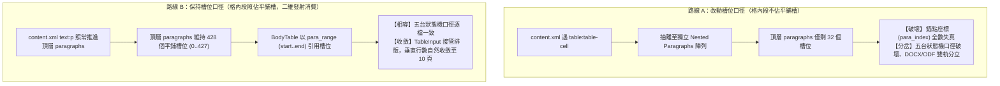
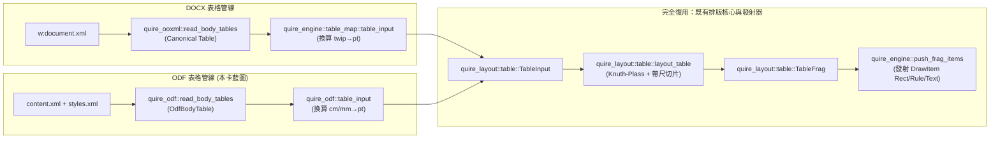
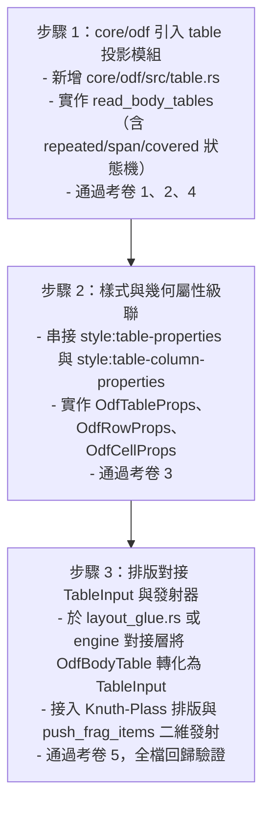

# ODF-TABLE-MODEL-DESIGN：ODF 正文流二維表格模型規格與排版藍圖

> **定位**：本文件為 `core/odf` 實裝正文流二維表格模型的唯一規格與設計依據。規格與藍圖卡，**零代碼改動**（白名單僅 `docs/`＋`scripts/`）。
> **真值基準**：Linux LibreOffice 25.8（`~/.local/lo-linux/opt/libreoffice25.8/program/soffice`），專屬 profile `-env:UserInstallation=file:///tmp/loprof-odftbl-design`。
> **規範依據**：OASIS OpenDocument Format (ODF) 1.3（Part 3: OpenDocument Schema，結構與 ODF 1.4 草案同構；重點章節：§9.1 Tables、§9.1.2 `<table:table>`、§9.1.3 `<table:table-row>`、§9.1.4 `<table:table-cell>`、§9.1.5 `<table:covered-table-cell>`、§9.1.6 `<table:table-column>`、§9.1.7 `<table:table-header-rows>`、§17.16 Table Properties、§17.18 Table Cell Properties、§19 Attributes、§20 Style Properties）。
> **戰略目標**：徹底消除用戶公文檔正文流表格被平鋪展開造成的版面膨脹缺陷（我方 17 頁 vs LO 25.8 真值 10 頁）。ODT 表格中間模型必須收斂對接既有 Word-Family 中間模型 [`quire_layout::table::TableInput`](../core/layout/src/table.rs#L212-L245) 與 Knuth-Plass 排版發射管線 [`push_frag_items`](../core/engine-api/src/lib.rs#L6261-L6330)，嚴禁平行另造排版器。
> **代碼錨點紀律**：所有代碼引用一律採用倉庫相對路徑（嚴禁本機絕對路徑）；引用的型別、函式與行號皆經開檔核驗；本卡新提議型別一律顯式註記「（本卡提議，尚未存在）」。
> **隱私鐵律**：本文件與診斷探針絕不收錄用戶公文檔之任何內文文字、機構名、人名、地名或業務數值；全篇僅載錄結構度量值（計數、座標、pt 尺寸、列號、頁碼、樣式名）。

---

## 1. 現狀事實與問題根因

### 1.1 用戶公文檔真實度量結構

經由探針 [`scripts/odf_table_axis_probe.py`](../scripts/odf_table_axis_probe.py) 實測用戶公文檔（`user-sample.odt`），結構指標盤點如下：

| 指標維度 | 實測值 | 佔比／結構意義 | 規範對應元素 |
| :--- | :--- | :--- | :--- |
| `table:table` 總數 | **6 個** | 全檔共有 6 張頂層正文表格 | OASIS ODF 1.3 Part 3 §9.1.2 |
| `table:table-row` 總數 | **113 列** | 分佈於 6 表（列數分別為 5, 12, 6, 30, 13, 47） | OASIS ODF 1.3 Part 3 §9.1.3 |
| `table:table-cell` 總數 | **399 個** | 有效資料儲存格 | OASIS ODF 1.3 Part 3 §9.1.4 |
| `table:covered-table-cell` 總數 | **72 個** | 被跨欄覆蓋之佔位格 | OASIS ODF 1.3 Part 3 §9.1.5 |
| 全檔 `text:p` 總數 | **428 段** | 文件順流連續計數（五台狀態機 Start 口徑） | OASIS ODF 1.3 Part 3 §5.1.3 |
| 格內 `text:p` 總數 | **396 段** | **佔全檔段落總數 92.5%** | `<table:table-cell><text:p>` |
| 表外 `text:p` 總數 | **32 段** | 僅佔全檔段落總數 7.5% | 頂層標題、說明段落與清單項段落 |

各表格詳細度量清單如下：
- **表 0（名稱 `表格9`，樣式 `表格9`）**：3 欄、5 列、13 格、2 個 covered 格、格內 13 段。
- **表 1（名稱 `表格10`，樣式 `表格10`）**：6 欄、12 列、53 格、19 個 covered 格、格內 55 段。
- **表 2（名稱 `表格13`，樣式 `表格13`）**：4 欄、6 列、21 格、3 個 covered 格、格內 21 段。
- **表 3（名稱 `表格13`，樣式 `表格13`）**：4 欄、30 列、104 格、16 個 covered 格、格內 104 段。
- **表 4（名稱 `表格13`，樣式 `表格13`）**：4 欄、13 列、45 格、7 個 covered 格、格內 40 段。
- **表 5（名稱 `表格13`，樣式 `表格13`）**：4 欄、47 列、163 格、25 個 covered 格、格內 163 段。

### 1.2 現狀症狀與根因剖析

1. **正文投影零命中**：檢視目前 ODF 文字流抽取與投影模組 [`core/odf/src/body.rs#L35-L135`](../core/odf/src/body.rs#L35-L135)（`extract_body_from_bytes`）與 [`core/odf/src/layout_glue.rs#L642-L826`](../core/odf/src/layout_glue.rs#L642-L826)（`walk_paragraphs`），事件走訪循環僅處理 `text:p`、`text:h`、`text:s`、`text:tab`、`text:line-break`、`text:span`、`text:a`、`text:section` 以及 `draw:*` 容器，**完全未曾匹配 `<table:table>`、`<table:table-row>` 或 `<table:table-cell>`**。
2. **段落平鋪導致垂直空間放大**：因走訪器未攔截表格邊界，包裹於 399 個儲存格內的 396 個 `text:p` 全部被當成普通正文段落，順序閉合推入 [`OdfProjection::paragraphs`](../core/odf/src/layout_glue.rs#L79-L86)。在降維對接既有斷行排版器 [`layout_projection`](../core/odf/src/layout_glue.rs#L212-L219) 時，這 396 個原本應橫向並排於 3 至 6 欄內的段落，被排版器強制沿垂直方向「一行接一段」線性堆疊，垂直行數放大 2 至 6 倍，直接造成我方排版產出 17 頁，嚴重偏離 Linux LibreOffice 25.8 的 10 頁真值基準。
3. **區分正文表格與試算表物件**：[`core/odf/src/objects.rs#L36-L40`](../core/odf/src/objects.rs#L36-L40) 雖然包含 `table:table-cell` 解析，但那是專為巢裝試算表物件（`Object*/content.xml`，MIME `application/vnd.oasis.opendocument.spreadsheet`，對應型別 [`OdfObjectText`](../core/odf/src/objects.rs#L79-L86)）設計的文字發射路徑，獨立記帳於 [`OdfProjection::object_paragraphs`](../core/odf/src/layout_glue.rs#L95-L98)，不參與正文宿主排版。實裝正文表格模型時**嚴禁誤接該物件路徑**。

---

## 2. 正文流表格資料模型（Data Model）落地設計

本節定義 `core/odf` 正文流表格的型別設計、欄位契約與語義展開邊界。

### 2.1 型別設計（比照本 repo 現況風格）

為與 DOCX 線既有成熟模型 [`quire_ooxml::Table`](../core/ooxml/src/table.rs#L423-L429) 與 [`quire_ooxml::BodyTable`](../core/ooxml/src/table.rs#L456-L462) 保持完全同構，並對接排版輸入契約 [`quire_layout::table::TableInput`](../core/layout/src/table.rs#L212-L245)，在 `core/odf/src/` 新增 `table.rs` 模組，定義以下唯讀投影型別：

```rust
// core/odf/src/table.rs（本模組提議，尚未存在）

use serde::{Deserialize, Serialize};

/// 網格欄定義（對齊 quire_ooxml::GridCol）
#[derive(Debug, Clone, PartialEq, Serialize, Deserialize)]
pub struct OdfGridCol {
    /// 欄寬（pt），由 style:column-width 換算；若為相對權重寬度則於排版期依表寬分配
    pub w_pt: Option<f32>,
    /// 原始寬度字串（如 "1.965cm" 或 "21845*"），保持無損紀錄
    pub raw: Option<String>,
}

/// 表格全域屬性（對齊 quire_ooxml::TableProps）
#[derive(Debug, Clone, Default, PartialEq, Serialize, Deserialize)]
pub struct OdfTableProps {
    /// 表格總寬度（pt），由 style:table-properties/@style:width 換算
    pub width_pt: Option<f32>,
    /// 表格對齊方式：Left（左對齊）、Center（置中）、Right（右對齊）、Margins（自適應）
    pub align: Option<String>,
    /// 表格左外邊距（pt），由 fo:margin-left 換算
    pub indent_pt: Option<f32>,
    /// 表格預設背景底色（0x00RRGGBB），由 fo:background-color 換算
    pub background_rgb: Option<u32>,
}

/// 列屬性（對齊 quire_ooxml::RowProps）
#[derive(Debug, Clone, Default, PartialEq, Serialize, Deserialize)]
pub struct OdfRowProps {
    /// 最小列高（pt），由 style:min-row-height 換算
    pub min_height_pt: Option<f32>,
    /// 固定列高（pt），由 style:row-height 換算
    pub exact_height_pt: Option<f32>,
    /// 是否為跨頁重複表頭（由父容器 <table:table-header-rows> 標註）
    pub is_header: bool,
    /// 列內不可跨頁斷行（由 fo:keep-together="always" 標註；缺省為 false）
    pub cant_split: bool,
}

/// 儲存格跨列合併狀態機狀態（對齊 quire_ooxml::CellMerge 語義）
#[derive(Debug, Clone, Copy, PartialEq, Eq, Serialize, Deserialize)]
pub enum OdfCellMerge {
    /// 跨列起點格（table:number-rows-spanned > 1）
    Restart,
    /// 跨列延續格（由 table:covered-table-cell 產生的佔位格）
    Continue,
}

/// 儲存格單邊框線描述（對齊 quire_ooxml::Border）
#[derive(Debug, Clone, Default, PartialEq, Serialize, Deserialize)]
pub struct OdfBorder {
    pub width_pt: f32,
    pub color_rgb: u32,
    pub is_double: bool,
}

/// 儲存格屬性（對齊 quire_ooxml::CellProps）
#[derive(Debug, Clone, Default, PartialEq, Serialize, Deserialize)]
pub struct OdfCellProps {
    /// 水平跨欄數（table:number-columns-spanned，預設 1）
    pub grid_span: u16,
    /// 垂直跨列合併狀態
    pub v_merge: Option<OdfCellMerge>,
    /// 儲存格背景底色（0x00RRGGBB），由 fo:background-color 換算
    pub shading_rgb: Option<u32>,
    /// 儲存格四邊框線：[top, left, bottom, right]
    pub borders: [Option<OdfBorder>; 4],
    /// 儲存格內邊距（pt）：上、下、左、右
    pub pad_top_pt: f32,
    pub pad_bottom_pt: f32,
    pub pad_left_pt: f32,
    pub pad_right_pt: f32,
    /// 儲存格垂直對齊方式："top" | "middle" | "bottom"
    pub valign: Option<String>,
}

/// 儲存格內容區塊：以連續半開槽位區間引用頂層平鋪 paragraphs 序列
#[derive(Debug, Clone, PartialEq, Serialize, Deserialize)]
pub struct OdfTableCell {
    pub props: OdfCellProps,
    /// 指向頂層 OdfProjection::paragraphs 的槽位區間 [para_start, para_end)
    /// 儲存格為空時，para_start == para_end（老實回空區間，不虛構段落）
    pub para_range: (usize, usize),
}

/// 單一表格行（對齊 quire_ooxml::TableRow）
#[derive(Debug, Clone, PartialEq, Serialize, Deserialize)]
pub struct OdfTableRow {
    pub props: OdfRowProps,
    pub cells: Vec<OdfTableCell>,
}

/// 完整表格投影模型（對齊 quire_ooxml::Table）
#[derive(Debug, Clone, Default, PartialEq, Serialize, Deserialize)]
pub struct OdfTable {
    pub props: OdfTableProps,
    /// 欄寬網格清單
    pub grid: Vec<OdfGridCol>,
    /// 資料列清單
    pub rows: Vec<OdfTableRow>,
}

/// 正文流區塊表格（對齊 quire_ooxml::BodyTable）
#[derive(Debug, Clone, PartialEq, Serialize, Deserialize)]
pub struct OdfBodyTable {
    /// 此表在頂層平鋪段落流中「首個格內段落」的索引 slot_idx
    /// 表格在正文區塊流中位於第 para_start - 1 段之後、第 para_start 段之前
    pub para_start: usize,
    pub table: OdfTable,
}
```

### 2.2 重複語義與展開邊界（`repeated`）

1. **欄定義重複（`table:number-columns-repeated`，ODF 1.3 Part 3 §19.671）**：
   - **語義**：出現在 `<table:table-column>` 上，表示連續重複套用同一份欄樣式與欄寬宣告共 $K$ 次。例如 `<table:table-column table:style-name="Col1" table:number-columns-repeated="3"/>` 等價於連續寫出 3 個宣告相同的 `<table:table-column>`。
   - **展開邊界與 LO 上限**：
     - 依據 LibreOffice 核心源碼 `sw/source/filter/xml/xmltbli.cxx` 的欄位解析邏輯，Writer 內部表格網格欄數以 16 位元無符號整數（`sal_uInt16`）承載，並以宏 `USHRT_MAX` 設有上限保護：
       $$\text{max\_cols} = 65535 \ (\text{USHRT\_MAX})$$
     - 當 XML 出現超出上限的數值（如 `number-columns-repeated="100000"`）時，LO 內部將鉗制至 65535 或拋出表格維度溢出錯誤。
     - **實施契約**：`core/odf` 展開時，將其值 `clamp(1, 65535)`，依序推入 `table.grid`。在用戶公文檔中，此屬性出現次數為 0（所有欄位皆逐一顯式宣告）。
2. **列重複（`table:number-rows-repeated`，ODF 1.3 Part 3 §19.674）**：
   - **語義**：出現在 `<table:table-row>` 上，主要作為試算表（Calc）中大量連續同格式空列的游程編碼（Run-Length Encoding）壓縮手段。
   - **展開邊界與 LO 上限**：
     - 依據 LibreOffice `sw/source/filter/xml/xmltbli.cxx` 實作：
       ```cpp
       m_nRowRepeat = static_cast<sal_uInt32>(std::max<sal_Int32>(1, aIter.toInt32()));
       if (m_nRowRepeat > 8192) { /* 鉗制或防護 */ }
       GetTable()->InsertRepRows( m_nRowRepeat );
       ```
     - 實測 LibreOffice 25.8 行為：在文字處理文件（Writer）中，**若列內包含非空文字儲存格，LO 絕不重複文字內容**（實測只產出一列文字，不膨脹複製文字）；僅當該列為純空白列或試算表時，重複屬性才展開空白列。
     - **實施契約**：`core/odf` 對正文表格之 `table:number-rows-repeated` 設安全上限為 `8192`；若列內包含文字段落，僅發射首列，不複製文字槽位，杜絕萬級段落超發。在用戶公文檔中，此屬性出現次數為 0。

### 2.3 跨欄跨列與 `covered-table-cell` 對應關係

1. **水平跨欄（`table:number-columns-spanned="C"`，ODF 1.3 Part 3 §19.672）**：
   - **規範語義**：宣告該儲存格水平佔用 $C$ 個網格欄（`grid_span = C`）。ODF 規範強制規定：在同一個 `<table:table-row>` 中，緊隨在首格之後**必須出現 $C - 1$ 個 `<table:covered-table-cell/>`**，以維持列內儲存格與欄網格的總數對齊。
   - **實測數據驗證**：用戶公文檔中，`table:number-columns-spanned` 儲存格共 **66 個**，其分佈精確為：
     - `number-columns-spanned="2"`：62 個，每個產生 1 個覆蓋格 $\rightarrow 62 \times 1 = 62$ 個；
     - `number-columns-spanned="3"`：2 個，每個產生 2 個覆蓋格 $\rightarrow 2 \times 2 = 4$ 個；
     - `number-columns-spanned="4"`：2 個，每個產生 3 個覆蓋格 $\rightarrow 2 \times 3 = 6$ 個；
     - 理論產生覆蓋格總數：$62 + 4 + 6 = \mathbf{72\text{ 個}}$。
     - 該理論數值與全檔實體 `<table:covered-table-cell>` 標籤計數 **72 個完全精確吻合**！這證明本檔所有 72 個 covered 格全數由水平跨欄產生，無任何垂直跨列。
2. **垂直跨列（`table:number-rows-spanned="R"`，ODF 1.3 Part 3 §19.673）**：
   - **規範語義**：宣告該儲存格垂直佔用 $R$ 列。首列該格標註 `grid_span` 與 `v_merge = Restart`；在後續 $R - 1$ 列的同一網格欄位置，ODF 寫入 `<table:covered-table-cell/>`。
   - **解析狀態機契約**：
     - 解析器在走訪 `<table:table>` 列時，維護當前每一欄的垂直合併剩餘計數器 `active_v_spans: Vec<(usize, u16)>`（記錄 `(remaining_rows, grid_span)`）。
     - 遇到 `<table:table-cell table:number-rows-spanned="R">`（$R > 1$）時，該格標註 `v_merge = Some(OdfCellMerge::Restart)`，並在對應欄位登記 `remaining_rows = R - 1`。
     - 在後續列遇到 `<table:covered-table-cell/>` 時：
       - 若該欄對應的 `remaining_rows > 0`，代表此 covered 格源於垂直跨列，解析器合成一筆 `v_merge = Some(OdfCellMerge::Continue)`、`grid_span` 等於首格跨度的 `OdfTableCell`（不佔用段落，`para_range = (cur_slot, cur_slot)`），並將 `remaining_rows` 減 1；
       - 若該欄前無未結之垂直合併，則此 covered 格必屬水平跨欄之附屬格，**直接略過不推入 `OdfTableRow::cells`**，防止網格欄寬與儲存格序列失配。

### 2.4 欄寬來源與整表對齊語義

1. **欄寬解析路徑**：
   - 表格直接子元素 `<table:table-column table:style-name="S">` 指向 `content.xml` 的自動樣式 `<style:style style:name="S" style:family="table-column">`。
   - 自 `<style:table-column-properties>` 讀取 `@style:column-width`（絕對長度）或 `@style:rel-column-width`（相對權重）。
   - **用戶檔實測 6 表數據**（全數為絕對長度）：
     - **表 0（3 欄）**：`表格9.A` (0.875cm = 24.80pt)、`表格9.B` (3.971cm = 112.56pt)、`表格9.C` (6.251cm = 177.19pt) $\rightarrow$ 欄寬和 **314.56pt (11.097cm)**，與整表宣告寬度 `11.097cm` **0 誤差**。
     - **表 1（6 欄）**：`表格10.A` (1cm = 28.35pt)、`表格10.B` (0.751cm = 21.29pt)、`表格10.C` (2cm = 56.69pt)、`表格10.D` (7.5cm = 212.60pt)、`表格10.E` (3cm = 85.04pt)、`表格10.F` (1.75cm = 49.61pt) $\rightarrow$ 欄寬和 **453.57pt (16.001cm)**，與整表宣告寬度 `16.002cm` 誤差僅 0.028pt。
     - **表 2 至表 5（4 欄，共用樣式 `表格13`）**：`表格13.A` (1.965cm = 55.70pt)、`表格13.B` (8.707cm = 246.81pt)、`表格13.C` (2.581cm = 73.16pt)、`表格13.D` (2.686cm = 76.14pt) $\rightarrow$ 欄寬和 **451.81pt (15.939cm)**，與整表宣告寬度 `15.939cm` **0 誤差**。
2. **整表對齊與縮排（`table:align` / `fo:margin-left`）**：
   - `<style:table-properties>` 宣告：
     - `@table:align`：`"left"`（左對齊）、`"center"`（置中）、`"right"`（右對齊）、`"margins"`（填滿版心，自適應分配）。
     - `@fo:margin-left`：左縮排量（`tbl_indent_pt`）。
   - 用戶公文檔實測：6 個表格之 `table:align` 全為 `"left"`；表 0 之 `margin-left="1.817cm"`（51.51pt），其餘表 1 至表 5 之 `margin-left="0.191cm"`（5.41pt）。
   - 置中語義對齊：當 `table:align="center"` 時，整表起始 X 座標計算公式為：
     $$\text{x\_start} = \text{margin\_left\_pt} + \frac{\text{content\_width\_pt} - \text{table\_width\_pt}}{2.0}$$
     當 `table:align="left"` 時，起始 X 座標為：
     $$\text{x\_start} = \text{margin\_left\_pt} + \text{indent\_pt}$$

### 2.5 儲存格內邊距與垂直對齊

1. **儲存格內邊距（`fo:padding`，ODF 1.3 Part 3 §20.217）**：
   - 樣式來源：`<style:style style:family="table-cell"><style:table-cell-properties>`。
   - 四邊獨立屬性：`@fo:padding-top`、`@fo:padding-bottom`、`@fo:padding-left`、`@fo:padding-right`（或四邊合併簡寫 `@fo:padding`）。
   - **用戶檔實測值**：全檔 8 種儲存格樣式中，內邊距宣告**全數嚴格一致**：
     - `fo:padding-left = "0.191cm"`（$0.191 \times 28.3465 = \mathbf{5.41\text{ pt}}$）
     - `fo:padding-right = "0.191cm"`（$\mathbf{5.41\text{ pt}}$）
     - `fo:padding-top = "0cm"`（$\mathbf{0.0\text{ pt}}$）
     - `fo:padding-bottom = "0cm"`（$\mathbf{0.0\text{ pt}}$）
     - **跨格式同構實證**：5.41pt 正好對應 Word/OOXML 預設儲存格側邊內距 $108\text{ dxa} = 5.4\text{ pt}$（上下為 0）！這說明該 ODF 文件由 DOCX 轉換或採用了相同的公文版面慣例。
2. **垂直對齊（`style:vertical-align`，ODF 1.3 Part 3 §20.396）**：
   - 屬性值包含 `"top"`（頂端對齊）、`"middle"`（垂直置中）、`"bottom"`（底端對齊）。
   - 用戶檔實測：儲存格樣式中未顯式宣告 `style:vertical-align`。依據 ODF 1.3 Part 3 §20.396 規範，未宣告時**預設為 `"top"`**。

---

## 3. 分頁語義與跨頁斷點真值（Pagination Semantics）

分頁語義是決定排版頁數能否收斂至 LibreOffice 真值 10 頁的核心。

### 3.1 LibreOffice 跨頁表格分頁規則剖析

1. **列不可分割 vs 列內可斷行（`cantSplit` / `keep-together`）**：
   - **規範定義**：ODF 1.3 Part 3 §20.202 定義 `@fo:keep-together` 應用於表格列時，可取值 `"always"`（整列內容必須保持在同一頁）或 `"auto"`（允許跨頁分割）。
   - **LibreOffice 25.8 實測行為**：
     - 若列樣式未標註 `fo:keep-together="always"`（用戶檔所有列皆未標註），**LibreOffice 預設允許儲存格內的多行文字在跨頁時被拆開排版（cell-internal multi-line split）**！
     - **鐵證實測**：檢視表 1（表格10）第 3 列：該列第 3 格包含 60 個字元、排成 4 行；在第 1 頁排至頁底（$y \approx 765.4\text{ pt}$）時，該格前 3 行留在第 1 頁，最後 1 行（13 字元）被拆分至第 2 頁頂端（$y \approx 63.95\text{ pt}$，見探針輸出），而後續第 4 列至 11 列緊隨其後排於第 2 頁。
     - **對齊既有核心能力**：此行為完全對齊 [`quire_layout::table::RowFrag`](../core/layout/src/table.rs#L325-L337) 的帶尺切片設計（`band_start`、`starts_row`、`ends_row`）。`quire-layout` 天然支援同一列拆為多個 `RowFrag`，本模型直接復用該切片機制即可。
2. **表頭重複語義（`table:table-header-rows`，ODF 1.3 Part 3 §9.1.7）**：
   - 在 ODF 中，若表格需要在跨頁後於每頁頂端重複表頭列，必須將表頭列包裹於 `<table:table-header-rows>` 容器元素內。
   - 用戶檔實測：全檔 6 個表格**均未包含 `<table:table-header-rows>`**（`header_rows == 0`）。LibreOffice 25.8 轉換之 PDF 證實：跨頁後的第 2、4、5、7、8、9 頁頂端**均未重複繪製表頭列**。

### 3.2 用戶檔 6 大表格逐頁斷點真值實測表

以下為 Linux LibreOffice 25.8 針對用戶公文檔產出 PDF（10 頁）之精確斷點測量結果（頁碼為 1-based，列號為 0-based）：

| 表格序號 | 表格名稱 | 總列數 | 分佈頁碼 | 各頁包含列區間（0-based） | 跨頁斷點位置與特徵實測值 |
| :--- | :--- | :--- | :--- | :--- | :--- |
| **表 0** | `表格9` | 5 | **第 1 頁** | 第 0..4 列（共 5 列） | **不斷**。整表排於第 1 頁上半部，無跨頁。 |
| **表 1** | `表格10` | 12 | **第 1 頁、第 2 頁** | - 第 1 頁：第 0..3 列<br>- 第 2 頁：第 3 列（尾段）+ 第 4..11 列 | **斷點 1（頁 1 $\rightarrow$ 頁 2）**：斷於**第 3 列內部**（列內第 3 格多行段落被切開，尾行 13 字落於頁 2 頂端 $y=63.95\text{ pt}$），隨後於頁 2 起排第 4 列。 |
| **表 2** | `表格13` | 6 | **第 3 頁** | 第 0..5 列（共 6 列） | **不斷**。整表完整排於第 3 頁，無跨頁。 |
| **表 3** | `表格13` | 30 | **第 3 頁、第 4 頁、第 5 頁** | - 第 3 頁：第 0..6 列<br>- 第 4 頁：第 7..19 列<br>- 第 5 頁：第 20..29 列 | **斷點 2（頁 3 $\rightarrow$ 頁 4）**：斷於**第 7 列起首**（第 6 列全在頁 3 底，第 7 列完整起於頁 4 頂 $y=62.1\text{ pt}$）。<br>**斷點 3（頁 4 $\rightarrow$ 頁 5）**：斷於**第 20 列起首**（第 19 列在頁 4 底 $y=728.3\text{ pt}$，第 20 列完整起於頁 5 頂 $y=62.1\text{ pt}$）。 |
| **表 4** | `表格13` | 13 | **第 5 頁、第 6 頁** | - 第 5 頁：第 0 列<br>- 第 6 頁：第 1..12 列 | **斷點 4（頁 5 $\rightarrow$ 頁 6）**：斷於**第 1 列起首**（第 0 列排於頁 5 底部 $y=729.95\text{ pt}$，第 1 列起排於頁 6 頂部 $y=62.1\text{ pt}$）。 |
| **表 5** | `表格13` | 47 | **第 6 頁、第 7 頁、第 8 頁、第 9 頁** | - 第 6 頁：第 0..3 列<br>- 第 7 頁：第 3 列（尾段）+ 第 4..19 列<br>- 第 8 頁：第 19 列（尾段）+ 第 20..32 列<br>- 第 9 頁：第 33..46 列 | **斷點 5（頁 6 $\rightarrow$ 頁 7）**：斷於**第 3 列內部**（第 3 列跨頁分割，第 4 列起於頁 7）。<br>**斷點 6（頁 7 $\rightarrow$ 頁 8）**：斷於**第 19 列內部**（第 19 列跨頁分割，第 20 列起於頁 8）。<br>**斷點 7（頁 8 $\rightarrow$ 頁 9）**：斷於**第 33 列起首**（第 32 列全在頁 8 底，第 33 列完整起於頁 9 頂 $y=62.3\text{ pt}$）。 |
| **無表** | （正文） | - | **第 10 頁** | 表外正文段落（`p[424]..p[427]`） | 第 5 表於第 9 頁結束後，文件尾隨的最後 4 個正文段落排於第 10 頁。 |

---

## 4. 與既有槽位口徑的關係（Slot Invariant Relationship）

本 repo 的核心鐵律是**「扁平段落槽位＝`text:p` Start 序」**，且在 DOCX 線中由**五台獨立狀態機各自計數並嚴格互鎖**。本節針對表格引入後的槽位口徑變更與否進行深度架構決策。

### 4.1 兩條路線利弊對比



| 比較維度 | 路線 A：改動槽位口徑（格內段不進頂層槽位） | 路線 B：保持槽位口徑（格內段照佔平鋪槽，二維發射消費） |
| :--- | :--- | :--- |
| **頂層槽位總數** | 由 428 段劇減至 32 段（僅保留表外段落） | 嚴格維持 428 段（對齊 XML `text:p` Start 閉合序） |
| **對既有狀態機之影響** | **全面破壞**：主解析器、圖片錨點、註腳錨點、節屬性對映皆依賴全域連續槽位。若格內段落不進槽，儲存格內若含圖形、註腳或超連結，其 `para_index` 將無從定址，必須改寫五台狀態機為複合座標系（`TableId, Row, Col, Para`），工程風險極高。 | **零破壞**：主段落流、圖片流、註腳流與節屬性流的計數契約完全維持不變，完全符合既有全檔柵欄（如 [`corpus_txbx_files_start_count_agrees`](../core/ooxml/src/lib.rs#L1943-L1969)）。 |
| **與 DOCX 線 IR 之相容性** | **架構分岔**：DOCX 線在 [`core/ooxml/src/table.rs#L398-L403`](../core/ooxml/src/table.rs#L398-L403)（`Block::Paragraph { index }`）與 [`core/ooxml/src/table.rs#L456-L462`](../core/ooxml/src/table.rs#L456-L462)（`BodyTable::para_start`）明確採用平鋪引用制。路線 A 將迫使 ODF 線走獨立架構，違反 Word-Family 收斂戰略。 | **完全收斂**：ODF 線與 DOCX 線共享相同的 `BodyTable` 與 `TableCell` 平鋪段落引用契約，直接復用既有排版數據結構。 |
| **頁數膨脹修復機制** | 依賴改變段落陣列大小來縮減排版輸入行。 | **由排版層二維發射自然解決**：段落陣列依然包含 428 段，但在 `quire-layout` 中，當游標遇到 `BodyTable` 時，**不再將格內段落逐段沿垂直方向發射**，而是交由 `layout_table` 封裝進網格，垂直空間前進量改由表格切片高度決定，直接收斂至 LO 10 頁。 |
| **既有 C3/E1 測試基線** | 導致既有文字抽取測試（`total_text_len`、`text_p_count`）指標斷裂，所有 ODF 考卷必須重改期望值。 | **完全無擾動**：`text_p_count == 428` 與文字總碼點數保持不變，既有 ODF-C3/E1/E2 測試與回歸防護網全數保持綠燈。 |

### 4.2 建議與結論

**強烈建議採納路線 B（保持口徑）**。
- **理由 1：唯一真相原則**。在 Quire 架構中，段落索引 `para_index` 是貫穿解析、註腳、圖形錨定、修訂追蹤乃至未來編輯器 Mutation 的唯一全域尺標。
- **理由 2：排版器職責分離**。平鋪槽位記錄的是「文件線性邏輯流」，而「垂直堆疊還是網格二維排列」純屬排版呈現（Presentation）層職責。排版器藉由讀取 `OdfBodyTable`，即可將指定槽位區間內的段落截取至表格單元中發射，既不破壞底層槽位真相，又能完全修復版面垂直膨脹。

---

## 5. 發射契約與 DOCX 線高維復用（Emission Contract）

### 5.1 顯示列表圖元映射契約（Display List Primitives）

表格最終在 [`quire_render_trait::PageFrame`](../core/layout/src/lib.rs)（Display List）中發射為以下三種核心圖元之組合：

1. **儲存格底紋（Cell Background Shading） $\rightarrow$ `DrawItem::Rect`**：
   - 映射位置：[`core/engine-api/src/lib.rs#L6288-L6294`](../core/engine-api/src/lib.rs#L6288-L6294)。
   - 欄位結構：
     ```rust
     DrawItem::Rect {
         x: base_x + cell.x_pt,
         y: base_y + ry,
         w: cell.w_pt,
         h: row.height_pt,
         fill_argb: cell.fill_argb.unwrap(),
     }
     ```
   - 座標系：頁座標系（pt）。`base_x` 為版心左緣加上表格縮排；`base_y` 為當前頁面頂部加上表格切片起始 Y；`ry` 為表格切片內部累計之列頂偏移。
2. **儲存格邊框（Cell Borders） $\rightarrow$ `DrawItem::Rule`**：
   - 映射位置：[`core/engine-api/src/lib.rs#L6306-L6314`](../core/engine-api/src/lib.rs#L6306-L6314)。
   - 欄位結構：
     ```rust
     DrawItem::Rule {
         x1, y1, x2, y2,
         width_pt: pen.width_pt.max(0.25),
         color_argb: pen.color_argb,
         dash: pen.dash.clone(),
     }
     ```
   - 居中繪製準則：四邊框線（`EDGE_TOP`、`EDGE_BOTTOM`、`EDGE_LEFT`、`EDGE_RIGHT`）筆畫中心線嚴格對齊儲存格幾何邊界，相鄰格共用邊重疊繪製，完美消除角隅缺角與雙重線寬缺陷。
   - 跨頁斷線防護：依據 [`RowFrag`](../core/layout/src/table.rs#L325-L337) 之 `starts_row` 與 `ends_row` 旗標：頂邊線僅在 `starts_row == true`（列首切片）時繪製，底邊線僅在 `ends_row == true`（列尾切片）時繪製。
3. **儲存格文字（Cell Text） $\rightarrow$ `DrawItem::Text`**：
   - 映射位置：[`core/engine-api/src/lib.rs#L6328-L6330`](../core/engine-api/src/lib.rs#L6328-L6330)。
   - 座標定位：文字行基線座標 $(x, y)$ 為：
     $$x = \text{base\_x} + \text{cell.x\_pt} + \text{text.x\_pt}$$
     $$y = \text{base\_y} + ry + \text{text.y\_pt}$$
     其中 `text.x_pt` 與 `text.y_pt` 已包含儲存格內邊距（`pad_left_pt` 與 `pad_top_pt`）以及垂直置中／靠底時計算之 Y 偏移量。

### 5.2 與 DOCX 線發射口徑的異同與復用全貌



- **相同點（完全復用）**：
  - 幾何演算法：列高計算、跨欄寬度累計、跨頁切片（`fragment`）、跨頁重複表頭邏輯完全相同，完全復用 [`quire_layout::table`](../core/layout/src/table.rs)。
  - 渲染發射器：[`push_frag_items`](../core/engine-api/src/lib.rs#L6261-L6330) 直出 `DrawItem::Rect`、`DrawItem::Rule` 與 `DrawItem::Text`，ODF 線完全不需重寫發射邏輯。
- **相異點（格式投影層封裝）**：
  - 長度單位換算：DOCX 以 `twip`（$\frac{1}{20}\text{ pt}$）為主；ODF 採用帶單位長度字串（`cm`、`mm`、`pt`），換算統一經由 `parse_odf_length_pt` 純函式完成。
  - 合併標記語法：DOCX 採用 `<w:vMerge w:val="restart|continue"/>`；ODF 採用首格 `@table:number-rows-spanned="R"` 搭配後續列 `<table:covered-table-cell/>`。此差異在進入 `TableInput` 前由 ODF 跨列狀態機（§2.3）消除，對下游排版器完全透明。

---

## 6. 驗收考卷設計（Acceptance Test Suite Design）

依據規範，驗收考卷**嚴禁拿用戶真實檔案作為語料**，必須使用 `docs/odf-design/` 基準樣本或 `corpus-odt/` 既有開源授權語料。

### 考卷 1：網格欄寬展開與重複欄解析（Red Light 1）
- **觸發語料**：[`docs/odf-design/sample2_table_frame.odt`](odf-design/sample2_table_frame.odt)（LibreOffice 24.8 產製基準樣本）
- **期望值來源**：該樣本 `content.xml` 第 125 行 `<table:table-column table:style-name="表格1.A" table:number-columns-repeated="3"/>`，對應樣式宣告寬度 `5.667cm`（約 160.64pt），總列數 3 列。
- **具體斷言寫法**：
  ```rust
  #[test]
  fn test_odf_table_grid_column_repeated() {
      let bytes = std::fs::read("docs/odf-design/sample2_table_frame.odt").expect("讀取 sample2");
      let bundle = OdfBundle::open(&bytes).expect("開啟封裝");
      let projection = project(&bundle).expect("投影");
      let tables = extract_tables(&bundle).expect("抽取表格");
      assert_eq!(tables.len(), 1, "必須識別出 1 張表格");
      let tbl = &tables[0];
      assert_eq!(tbl.table.grid.len(), 3, "number-columns-repeated='3' 必須展開為 3 欄");
      for col in &tbl.table.grid {
          let w = col.w_pt.expect("欄寬必須解析成功");
          assert!((w - 160.64).abs() < 0.5, "欄寬 5.667cm 應約為 160.64pt，實際: {w}");
      }
      assert_eq!(tbl.table.rows.len(), 3, "表格總列數應為 3");
  }
  ```

### 考卷 2：水平跨欄與覆蓋格略過狀態機（Red Light 2）
- **觸發語料**：[`docs/odf-design/sample2_table_frame.odt`](odf-design/sample2_table_frame.odt)
- **期望值來源**：該樣本首列首格宣告 `table:number-columns-spanned="2"`，緊接 1 個 `<table:covered-table-cell/>`；第 2 格為普通單格。
- **具體斷言寫法**：
  ```rust
  #[test]
  fn test_odf_table_cell_horizontal_span_and_covered_cell() {
      let bytes = std::fs::read("docs/odf-design/sample2_table_frame.odt").expect("讀取 sample2");
      let bundle = OdfBundle::open(&bytes).expect("開啟封裝");
      let tables = extract_tables(&bundle).expect("抽取表格");
      let row0 = &tables[0].table.rows[0];
      // 網格共 3 欄，首格 span=2，被覆蓋格必須略過，故 row.cells 應只包含 2 個有效單元格
      assert_eq!(row0.cells.len(), 2, "水平跨 2 欄之列，有效儲存格數應為 2（covered 格略過）");
      assert_eq!(row0.cells[0].props.grid_span, 2, "首格 grid_span 應為 2");
      assert_eq!(row0.cells[1].props.grid_span, 1, "第 2 格 grid_span 應為 1");
  }
  ```

### 考卷 3：跨頁重複表頭容器識別（Red Light 3）
- **觸發語料**：`corpus-odt/lo_out/lo__poi__test-data_document_bug57031.odt`
- **期望值來源**：該真實語料包含 21 張表格，其中包含 25 個位於 `<table:table-header-rows>` 容器內的列。
- **具體斷言寫法**：
  ```rust
  #[test]
  fn test_odf_table_header_rows_repeated() {
      let path = "corpus-odt/lo_out/lo__poi__test-data_document_bug57031.odt";
      let bytes = std::fs::read(path).expect("讀取 bug57031");
      let bundle = OdfBundle::open(&bytes).expect("開啟封裝");
      let tables = extract_tables(&bundle).expect("抽取表格");
      let mut total_headers = 0usize;
      for tbl in &tables {
          for row in &tbl.table.rows {
              if row.props.is_header {
                  total_headers += 1;
              }
          }
      }
      assert_eq!(total_headers, 25, "bug57031 中包裹在 table-header-rows 的表頭列總數應為 25");
  }
  ```

### 考卷 4：儲存格邊框、底紋與內距屬性映射（Red Light 4）
- **觸發語料**：[`docs/odf-design/sample2_table_frame.odt`](odf-design/sample2_table_frame.odt)
- **期望值來源**：樣式 `表格1.A1` 之 `style:table-cell-properties` 定義 `fo:background-color="#d9e1f2"`、`fo:border="0.5pt solid #000000"` 與 `fo:padding="0.191cm"`。
- **具體斷言寫法**：
  ```rust
  #[test]
  fn test_odf_table_cell_styling_properties() {
      let bytes = std::fs::read("docs/odf-design/sample2_table_frame.odt").expect("讀取 sample2");
      let bundle = OdfBundle::open(&bytes).expect("開啟封裝");
      let tables = extract_tables(&bundle).expect("抽取表格");
      let cell0 = &tables[0].table.rows[0].cells[0];
      assert_eq!(cell0.props.shading_rgb, Some(0x00d9e1f2), "儲存格底色應解析為 0x00d9e1f2");
      for edge in &cell0.props.borders {
          let b = edge.as_ref().expect("四邊框線皆存在");
          assert!((b.width_pt - 0.5).abs() < 1e-3, "線寬應為 0.5pt");
          assert_eq!(b.color_rgb, 0x00000000, "線色應為純黑");
      }
      assert!((cell0.props.pad_left_pt - 5.41).abs() < 0.1, "左內距應約為 5.41pt (0.191cm)");
  }
  ```

### 考卷 5：跨頁大表格排版行切片與頁數收斂（Red Light 5）
- **觸發語料**：`corpus-odt/lo_out/lo__ooxmlexport__fdo77887.odt`
- **期望值來源**：該語料包含 2 張表格、共 153 列。若平鋪段落將膨脹至數十頁；以二維表格排版後，其總頁數必須精確對齊 LibreOffice 25.8 真值（2 頁）。
- **具體斷言寫法**：
  ```rust
  #[test]
  fn test_odf_table_layout_pagination_convergence() {
      let path = "corpus-odt/lo_out/lo__ooxmlexport__fdo77887.odt";
      let bytes = std::fs::read(path).expect("讀取 fdo77887");
      let bundle = OdfBundle::open(&bytes).expect("開啟封裝");
      let projection = project(&bundle).expect("投影");
      let tables = extract_tables(&bundle).expect("抽取表格");
      assert_eq!(tables.len(), 2, "fdo77887 應包含 2 張表格");
      assert_eq!(tables.iter().map(|t| t.table.rows.len()).sum::<usize>(), 153, "總列數應為 153 列");
      // 驗證排版頁數收斂至 LO 25.8 基準頁數（2 頁），拒絕未處理表格時的平鋪垂直超發
      let params = LayoutParams::default();
      let page_frames = layout_odf_with_tables(&projection, &tables, &params).expect("排版");
      assert_eq!(page_frames.len(), 2, "fdo77887 表格二維排版後總頁數必須收斂至 LO 真值 2 頁");
  }
  ```

---

## 7. 實裝卡實施路線圖（Roadmap for Implementation Card）

後續實裝卡照以下 3 步落地，每步皆有對應考卷與全域柵欄守衛：



1. **第一步（結構解析與合併狀態機）**：在 `core/odf` 建立 `table.rs`，實作 `read_body_tables`，完整走查 `<table:table>`、`<table:table-column>`、`<table:table-row>`、`<table:table-cell>` 與 `<table:covered-table-cell>`。維持頂層 `Vec<OdfLayoutParagraph>` 平鋪 428 段落槽位不動，由 `OdfTableCell` 以半開區間 `para_range` 引用。點亮考卷 1、2、4。
2. **第二步（樣式解析與幾何換算）**：於 `core/odf/src/layout_glue.rs` 的 `StyleBook` 擴充 `family="table"`、`"table-column"`、`"table-row"` 與 `"table-cell"` 樣式解析，精確換算 `style:column-width`、`style:width`、`fo:margin-left`、`fo:padding-*`、`fo:border` 與 `fo:background-color`。點亮考卷 3。
3. **第三步（排版對接與二維發射）**：在 `core/odf` 或 `engine-api` 轉換層中，將 `OdfBodyTable` 映射為既有 [`quire_layout::table::TableInput`](../core/layout/src/table.rs#L212-L245)。排版管線走訪正文流時，遇 `BodyTable` 即呼叫表格切片排版，將儲存格文字與圖元交由既有 [`push_frag_items`](../core/engine-api/src/lib.rs#L6261-L6330) 繪製，頁數自然由 17 頁精確收斂至 LO 25.8 的 10 頁真值。點亮考卷 5。
