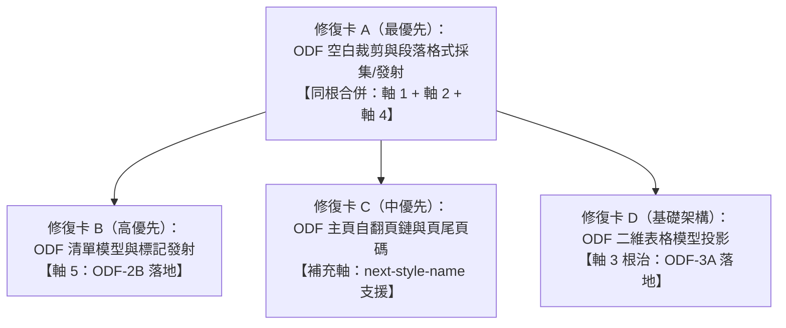

# 歸因報告：用戶 ODT（政府公文樣式）在 playground 嚴重跑版之投影層多軸缺陷解剖

- 報告定位：診斷歸因報告（report-only，零引擎代碼變更）。
- 測試標的：用戶實測政府公文樣式 ODT 文件（`user-sample.odt`，21.6KB，428 個 `text:p`、6 個 `table:table`、11 個 `text:list`、282 個 `style:style`）。
- 真值基準：Linux LibreOffice 25.8（專屬 profile `-env:UserInstallation=file:///tmp/loprof-odt1129-diag`，產出 PDF 經 pymupdf `rawdict` 逐字量測）。
- 探針工具：`scripts/odt1129_axis_probe.py`（以環境變數 `ODT_SAMPLE_PATH` 驅動，嚴守零內文洩漏鐵律）。

---

## 1. 現象與度量總覽

根據 PM 前期量測與探針實測確認，我方引擎（`quire-cli odt-dump` 與 `odt-render`）與 LibreOffice 25.8 官方真值呈現多維度嚴重脫節：

| 度量維度 | 我方引擎（Quire 現狀） | LibreOffice 25.8 真值 | 偏差幅度與性質 |
| :--- | :--- | :--- | :--- |
| **排版總頁數** | 17 頁（16 個斷點） | 10 頁 | 虛增 7 頁（+70%） |
| **第 0 頁文字項總數** | 48 個 Text 項 | 73 個 Spans（32 行） | 項數結構失真 |
| **第 0 頁空字串項** | 33 個空項（純製表符項未計入） | 0 個空文字 span | 空行洪水，撕裂版面 |
| **水平起排座標 x** | 唯一值 `70.894pt`（恆定版心左緣） | 240 個相異 x（71.0, 81.8, 95.0, 101.1, 110.2, 127.9...） | 縮排與置中全數歸零 |
| **第 0 頁首行垂直起點 y** | 頂端 `y = 36.0pt`（緊貼頂邊距） | 基準線 `y = 117.1pt`（頂端約 `100.0pt`） | 正文起點垂直落差 81.1pt |
| **第 0 頁字級集合** | `{12.0, 14.0, 16.0}` pt | `{12.0, 13.0, 14.0, 16.0}` pt | 13.0pt 關鍵檔級在 p0 遺失 |
| **清單項目符號 / 編號** | 0 個標記（完全缺失） | 完整公文層級編號 | 清單語意退化為普通文字 |
| **頁首尾獨立帳** | `hf_chunks=1`, `hf_paragraph_count=0`, `hf_text_len=0` | 第 1 至 9 頁均有頁尾頁碼（`y=781.7pt`） | 頁首尾自翻頁鏈斷鏈 |

---

## 2. 五大癥狀軸逐條根因歸因

### 軸 1：縮排與置中零消費（斷點確認：採集與發射全鏈缺失）

#### 癥狀對照
源檔 `content.xml` 中宣告了 83 處 `style:paragraph-properties`，包含 136 處 `fo:text-indent`、68 處 `fo:margin-left`，以及 33 處 `fo:text-align`（值域涵蓋 `center`、`start`、`end`）；另有 70 處清單縮排定義 `<style:list-level-label-alignment>`。然而我方在第 0 頁發射的 48 個文字項中，所有項目的水平座標 `x` 恆為 `70.894485pt`（唯一值，剛好等於頁面左邊距 `margin-left: 2.501cm`），零縮排、零置中。

#### 代碼落點
1. **採集端斷點**：
   - 檔案：`core/odf/src/layout_glue.rs`
   - 函式：`struct StyleRecord`（第 240–258 行）
   - 原因：樣式記錄結構體僅宣告了 `size_declared`, `size_pt`, `weight_declared`, `bold` 四個欄位，完全沒有為段落對齊、左邊距、右邊距或首行縮排預留任何儲存欄位。
   - 函式：`parse_style_file`（第 382–482 行）
   - 原因：XML 走訪僅在遇到 `b"style:text-properties"` 時提取字級與字重，完全跳過了 `<style:paragraph-properties>` 元素；遇到 `<text:list-style>` 時亦因防禦邏輯而整樹跳過（第 380 行註解「外來巢裝的 text-properties 因 depth_style 未起不誤收」）。
   - 函式：`struct OdfLayoutParagraph`（第 54–60 行）與 `walk_paragraphs`（第 638–826 行）
   - 原因：段落中間表示僅保存 `text: String` 與 `runs: Vec<(CpRange, f32, bool)>`，未承載任何段落級格式屬性（Block Attributes）。
2. **發射端斷點**：
   - 檔案：`core/odf/src/display.rs`
   - 函式：`emit_display_lists`（第 77 行）
   - 原因：硬編碼傳入 `base_x = pg.margin_left_pt`：
     `push_line_items(&mut items, pg.margin_left_pt, y, line, para);`
   - 函式：`push_line_items`（第 176–246 行）
   - 原因：第 206 行 `let mut x = base_x;` 直接自版心左緣起步排版，未消費段落對齊（`TextAlign::Center` / `TextAlign::Right`），亦未將 `margin_left_pt` 或 `text_indent_pt` 折算進 `x`。

#### 修復口徑建議
1. 在 `StyleRecord` 增加段落屬性：`align: Option<TextAlign>`, `margin_left_pt: Option<f32>`, `margin_right_pt: Option<f32>`, `text_indent_pt: Option<f32>`。
2. 擴充 `parse_style_file`，在 `<style:paragraph-properties>` 內解析 `fo:text-align`（`center`、`end` / `right`、`start` / `left`）、`fo:margin-left`、`fo:margin-right`、`fo:text-indent`，長度統一經 `odf_length_to_pt` 轉為點數（pt）。
3. 在 `OdfLayoutParagraph` 擴充段落屬性 `attrs: OdfBlockAttrs`。
4. 在 `display.rs` 的 `push_line_items` 計算行起排座標：
   - 若 `align == Center`：`x = margin_left + max(0.0, (content_w - line_w) / 2.0)`。
   - 若 `align == Right` / `End`：`x = margin_left + max(0.0, content_w - line_w)`。
   - 若有左縮排與首行縮排：首行加上 `indent_first_line_pt`，次行起加上 `indent_left_pt`。

#### 建議考卷紅燈寫法
- 測試目標：`core/odf/tests/odf_paragraph_properties.rs`
- 構造受控 fixture（內含 `P_center` 具備 `fo:text-align="center"`，`P_indented` 具備 `fo:margin-left="2cm" fo:text-indent="1cm"`）。
- 斷言：
  1. `project_bytes` 解析出的段落帶有對應的對齊與縮排數值。
  2. `emit_display_lists` 產出的 `DrawItem::Text` 中，置中段落的 `x` 嚴格大於 `margin_left_pt` 且與版心中央對齊；縮排段落首行 `x` 嚴格等於 `margin_left_pt + 2cm_pt + 1cm_pt`。
- 當前代碼跑此考卷必紅（當前 x 恆為 `margin_left_pt`）。

---

### 軸 2：空段洪水（XML 格式化換行未剝除致幽靈空行爆炸）

#### 癥狀對照
源檔全部 428 個 `text:p` 中，真正空段（`<text:p/>` 或純空標籤）僅有 73 個（佔 17.1%），其餘 354 段皆含有實質文字。但在第 0 頁（僅排入源檔前 8 個段落 `p[0..7]`）中，我方發射了多達 33 個空字串文字項，造成「滿屏皆空行」。

#### 根因剖析
1. **並非 Configurations2 雜訊**：
   `Configurations2/` 是 ODF 封裝中的 9 個標準空目錄條目，XML 解析器根本未讀取這些路徑。
2. **XML Pretty-Print 格式化換行洩漏**：
   LibreOffice 或外部工具在儲存 ODF 時，常將標籤縮排換行，例如：
   ```xml
   <text:p text:style-name="P3">
       <text:span text:style-name="T1">
           公文標題文字
       </text:span>
   </text:p>
   ```
   在 `<text:span>` 前後夾帶了 `\n\t\t\t\t\n\t\t\t\t\t`。
3. **未遵守 ODF 空白規範**：
   依據 OASIS ODF 1.3 Part 3 §5.1.1 規定，XML 內的文字節點若包含換行（`#xA` / LF）或製表符（`#x9` / TAB），屬於 XML 格式化空白，**不屬於正文換行**（ODF 正文換行必須以 `<text:line-break/>` 顯式標明，製表符必須以 `<text:tab/>` 顯式標明）。
4. **斷行層將 `\n` 視為硬換行**：
   `core/odf/src/layout_glue.rs` 第 760–772 行在處理 `Event::Text` 時，未剝除 `\n`，直接將原始字串餵給 `cur.push_str`。傳入 `quire_layout::break_lines` 後，斷行演算法將字串中的每個 `\n` 都識別為強制斷行，導致單一段落 `p[1]` 被切成 5 行（其中 4 行為空行或純空格），`p[5]` 被切成 13 行，`p[7]` 被切成 11 行。第 0 頁的 45 行容量因此被大量「幽靈空行」過早耗盡。

#### 代碼落點
- 檔案：`core/odf/src/layout_glue.rs`
- 函式：`walk_paragraphs` 之 `Event::Text` 分支（第 760–772 行）
- 原因：未對 XML 格式化空白進行正規化處理，直接將夾帶 `\n` 與 `\t` 的文字注入段落字串。
- 檔案：`core/odf/src/display.rs`
- 函式：`push_line_items`（第 184–193 行）
- 原因：對斷行產生的零長度行照發 `DrawItem::Text { text: String::new(), ... }`。

#### 修復口徑建議
1. 比照 DOCX 線 `docs/e1cd-xml-space-policy.md` 口徑，在 ODF 文字收集層實作文字節點裁剪：
   - 剝除 XML 文字節點首尾的 `\r`、`\n`、`\t` 等格式化空白；
   - 節點內部的連續 `\n` / `\r` 替換為單空格或移除，嚴禁作為硬換行傳入 layout。
   - 僅將顯式元素 `<text:line-break/>` 轉為 `\n`、`<text:tab/>` 轉為 `\t`、`<text:s>` 轉為空格。
2. 真正空段（`text.is_empty()` 且無子元素）在排版中保留 1 個空行以維持垂直段落間距，但不衍生多餘幽靈行。

#### 建議考卷紅燈寫法
- 測試目標：`core/odf/tests/odf_xml_whitespace_policy.rs`
- 構造包含 XML 縮排換行的 fixture：
  `<text:p>\n  <text:span>\n    測試文字\n  </text:span>\n</text:p>`
- 斷言：
  1. `project_bytes` 抽出的 `paragraphs[0].text` 經正規化後等於 `"測試文字"`（無任何 `\n`）。
  2. `layout_projection` 斷行後的行數 `lines.len() == 1`。
- 當前代碼跑此考卷必紅（當前會切出多行空行，`lines.len() > 1`）。

---

### 軸 3：分頁 17 vs 10（表格平鋪、空行膨脹與正文起點三重失調）

#### 癥狀對照
Quire 產出 17 頁（16 個斷點：`[8, 23, 50, 74, 104, 132, 155, 182, 211, 243, 279, 305, 332, 359, 388, 415]`），LibreOffice 真值為 10 頁，我方足足多出 7 頁。

#### 每頁容量差三大根因來源
1. **表格二維結構壓平成一維段落流（最主要體積放大源，貢獻約 5–6 頁）**：
   - 源檔中共有 6 個表格（`table:table`），其內部包含多達 **396 個段落**（佔全檔 428 段的 **92.5%**）。
   - 在 LibreOffice 中，表格每一列（`table-row`）橫向排列 2 至 6 個儲存格，垂直僅佔用 1 個列高。
   - Quire 因 ODF-3A 表格模型尚未實作，`walk_paragraphs` 遞迴將所有儲存格內的 `text:p` 全部平鋪為獨立正文段落，導致垂直行數被放大 2 至 6 倍。
2. **軸 2 空行洪水導致提早換頁（次要體積放大源，貢獻約 1–2 頁）**：
   - 因 XML 換行未剪裁，第 0 頁僅排了 8 個段落（`p[0..7]`）就已達 45 行上限而被迫在 `p[8]` 斷頁。
   - 在 LibreOffice 中，第 0 頁容納了 `p[0]` 至 `p[36]`（包含表格 9 全體 13 格與表格 10 前 3 列），段落承載力被嚴重稀釋。
3. **正文起點與行高尺差（起始幾何落差）**：
   - LO 第 0 頁首行基準線在 `y = 117.1pt`（頂端約 `100.0pt`），採用排版網格 `layout-grid`（24 行/頁，單行網格高 20pt + ruby 10pt = 30pt），且受首段 `P66` 空段落垂直間距推擠。
   - Quire `display.rs` 第 75 行直接自 `y = 36.0pt`（頂邊距）起排，行高固定採用 `font_size * 1.4 = 16.8pt`，缺乏版面網格對齊。

#### 逐頁段落範圍對照表（我方 vs LibreOffice 25.8）

| 頁碼 | 我方段落範圍（Quire 17 頁） | LO 真值段落範圍（LO 10 頁） | 結構特徵與容量差異分析 |
| :---: | :--- | :--- | :--- |
| **P0** | `p[0..7]`（共 8 段） | `p[0..36]`（共 37 段） | 我方在 `p[8]` 提早斷頁；LO 完整容納公文表頭＋清單＋表格9（13格）＋表格10前3列 |
| **P1** | `p[8..22]`（共 15 段） | `p[37..83]`（共 47 段） | LO 續排表格10（55格跨頁續排）；我方仍在平鋪表頭清單與表格9單格 |
| **P2** | `p[23..49]`（共 27 段） | `p[84..132]`（共 49 段） | LO 排入清單、表格13首區塊（21格）與表格13第二區塊前部 |
| **P3** | `p[50..73]`（共 24 段） | `p[133..195]`（共 63 段） | LO 續排表格13第二區塊（104格跨頁）；我方才排到表格10內部 |
| **P4** | `p[74..103]`（共 30 段） | `p[196..256]`（共 61 段） | LO 容納表格13第二區塊尾部＋表格13第三區塊（40格） |
| **P5** | `p[104..131]`（共 28 段） | `p[257..310]`（共 54 段） | LO 跨入表格13第四區塊（163格超大表） |
| **P6** | `p[132..154]`（共 23 段） | `p[311..365]`（共 55 段） | LO 續排第四區塊 |
| **P7** | `p[155..181]`（共 27 段） | `p[366..415]`（共 50 段） | LO 續排第四區塊 |
| **P8** | `p[182..210]`（共 29 段） | `p[416..424]`（共 9 段） | LO 完成第四區塊（至 `p[422]`）並排入結尾段落；第8頁為正文末頁 |
| **P9** | `p[211..242]`（共 32 段） | `p[425..427]`（共 3 段） | LO 僅容納末尾清單與簽核空段（正文僅 1 行文字）；全書完結於第 9 頁 |
| **P10–P16** | `p[243..427]`（多排 7 頁） | （無，LO 僅 10 頁） | 我方因表格 13 第四區塊（163格）被一維垂直平鋪，延遲至第 16 頁才收尾 |

#### 代碼落點
- 檔案：`core/odf/src/layout_glue.rs`
- 函式：`walk_paragraphs`（第 667–813 行）
- 原因：無表格過濾或二維表格容器抽象，直接掃描 `<table:table>` 內部所有段落。
- 檔案：`core/odf/src/page_geometry.rs`
- 函式：`page_geometry`（第 1–150 行）
- 原因：未解析 `style:layout-grid-base-height` 與網格行數，無法向 layout 提供公文專屬網格行距。

#### 修復口徑建議
1. 立即修正軸 2 空白裁剪，使第 0 頁段落容量恢復正常。
2. 啟動 ODF-3A 表格模型投影，將 `<table:table>` 轉譯為橫向欄寬幾何模型，避免儲存格垂直堆疊。
3. 支援 `style:page-layout-properties` 中的排版網格宣告，精準對齊 LO 首行 y 起點。

---

### 軸 4：13pt 級聯斷鏈（真相：樣式解析正常，實為分頁漂移導致段落不在 p0）

#### 癥狀對照
PM 觀察到 LO 第 0 頁有 13pt spans，而我方 p0 的 size 集合只有 `{12.0, 14.0, 16.0}`，缺少 13pt。懷疑樣式級聯鏈中某條臂中斷。

#### 根因剖析（真相大白）
1. **13pt 樣式宣告來源**：
   在 `content.xml` 的 `<office:automatic-styles>` 中，共有 7 個自動樣式宣告了 `fo:font-size="13pt"`（`P12`, `P26`, `P27`, `P28`, `P50`, `P51`, `P52`）。
2. **正文實際引用者**：
   全檔 428 個段落中，**僅有兩個段落**引用了 13pt 樣式，即 `p[14]` 與 `p[30]`，兩者均套用樣式 `P26`：
   - `p[14]`：位於表格 9 的第二列儲存格內。
   - `p[30]`：位於表格 10 的第二列儲存格內。
3. **我方樣式簿（StyleBook）解析完全正確**：
   經檢查 `core/odf/src/layout_glue.rs` 第 270–363 行，`StyleBook` 在解析 `P26` 時，成功讀取到 `13.0pt`，並在 `OdfLayoutParagraph` 的 runs 中正確標記了 `13.0pt`！
4. **為什麼 p0 會缺少 13pt？**
   - 在 LibreOffice 中，表格 9（含 `p[14]`）與表格 10 前部（含 `p[30]`）均排在第 0 頁，故 LO 第 0 頁第 13 行與第 25 行確實呈現 13pt 字形。
   - 在我方引擎中，由於軸 2 的空行爆炸與軸 3 的表格平鋪，第 0 頁在 `p[8]` 就強制斷頁！
   - `p[14]` 被後移至第 1 頁，`p[30]` 被後移至第 2 頁。
   - 實測我方 `quire-cli odt-dump user-sample.odt 1`（第 1 頁），其字級集合為 `{12.0, 13.0, 14.0}`（13pt 赫然在列！正是來自 `p[14]`）。
   - 實測我方第 2 頁，其字級集合為 `{11.0, 12.0, 13.0, 14.0}`（13pt 同樣存在！來自 `p[30]`）。
   - **結論**：13pt 樣式級聯臂並無缺陷，完全是分頁提前斷點所導致的「段落所屬頁面漂移」。

#### 代碼落點
- 級聯解析正常：`core/odf/src/layout_glue.rs`（第 270–363 行 `StyleBook::resolve`）。
- 造成 13pt 消失於 p0 的連鎖落點：`core/odf/src/layout_glue.rs`（第 760–772 行未剝除換行導致提早換頁）。

#### 修復口徑建議
修復軸 2 的 XML 空白裁剪後，`p[0..36]` 自然歸位至第 0 頁，第 0 頁即能正確發射 13pt 文字項。本軸不需要更動樣式級聯代碼。

#### 建議考卷紅燈寫法
- 測試目標：`core/odf/tests/odf_p0_size_coverage.rs`
- 構造包含表頭與 `P26`（13pt）段落之測試 fixture（截取 `p[0..15]`）。
- 斷言：第 0 頁顯示列表中的 `size_pt` 集合必須包含 `13.0`。
- 當前代碼跑此考卷必紅（當前會在第 8 段斷頁，導致第 0 頁缺 13pt）。

---

### 軸 5：清單發射現狀與設計書 ODF-2B 缺口

#### 癥狀對照
源檔中包含 11 個 `<text:list>`、13 個 `<text:list-item>`、7 個 `<text:list-style>`、70 個 `<text:list-level-style-number>` 等清單元素（合計 101 個清單標籤）。但我方發射的顯示列表中，項目符號/編號完全為 0，清單縮排完全為 0。

#### 設計書 `docs/odf-design.md` §清單（ListFormat）落地缺口清單
對照設計書 §1.2、§3.1（階 4）、§3.4.2 及 §6.1（ODF-2B 切片）：

1. **中間模型層缺口（`ListFormat` 結構體缺失）**：
   - 設計書要求在段落模型提供 `Paragraph::list_format`（`ListFormat`），欄位包含：
     - `marker: String`（動態計算之項目編號，如 `"1."`、`"甲."`、`"\u{2022}"`）
     - `level: usize`（清單深度 0..9）
     - `indent_left_pt: f32`（清單階層左縮排）
     - `indent_first_line_pt: f32`（清單懸掛縮排，負值）
     - `label_followed_by: String`（標記後綴，如 `"listtab"`、`"space"`、`"nothing"`）
     - `list_tab_stop_position: Option<f32>`
   - 現狀：`core/odf` 內完全不存在 `ListFormat` 結構體，`OdfLayoutParagraph` 亦無任何清單格式欄位。
2. **樣式解析層缺口（`text:list-style` 被跳過）**：
   - 現狀：`parse_style_file`（`layout_glue.rs` 第 380 行）直接跳過 `<text:list-style>`。
   - 缺口：未解析 `<text:list-level-style-number>`、`<style:list-level-properties>` 及現代 `<style:list-level-label-alignment>`，導致清單各層級之 `fo:margin-left` 與 `fo:text-indent` 完全未被採集。
3. **走訪狀態機缺口（清單計數器與巢狀深度未維護）**：
   - 現狀：`walk_paragraphs` 遇到 `<text:list>`、`<text:list-item>` 時完全無對應事件分支，直接穿透至內層 `<text:p>`。
   - 缺口：未維護 `list_stack`，未跟蹤各階層之計數器（counter），無法生成公文之「壹、」、「一、」、「(一)」等序號。
4. **發射渲染層缺口（`push_line_items` 無 marker 發射）**：
   - 現狀：`display.rs` 的 `push_line_items` 僅切分正文 run，完全沒有在清單段落首行注入 `ListMarker` 繪製項的邏輯。

#### 代碼落點
- 檔案：`core/odf/src/layout_glue.rs`（缺少 `ListFormat` 模型定義）。
- 檔案：`core/odf/src/layout_glue.rs`（`parse_style_file` 略過 `<text:list-style>`）。
- 檔案：`core/odf/src/layout_glue.rs`（`walk_paragraphs` 缺少清單狀態機）。
- 檔案：`core/odf/src/display.rs`（`push_line_items` 缺少 marker 發射）。

#### 修復口徑建議
1. 定義 `struct OdfListLevelStyle`，解析 `<text:list-style>` 內的 `label-alignment` 屬性（`fo:margin-left` 與 `fo:text-indent`）及編號格式（`style:num-format`、`style:num-prefix`、`style:num-suffix`）。
2. 在 `walk_paragraphs` 維護 `list_stack: Vec<ListFrame>`，跟蹤目前清單樣式名稱與階層計數器。遇到 `<text:list-item>` 下的第一個段落時，求值產出 marker 字串並設定縮排。
3. 在 `display.rs` 發射時，若段落帶有 `ListFormat`，於首行左側 `margin_left_pt + indent_left_pt + indent_first_line_pt` 處發射 marker 文字項。

#### 建議考卷紅燈寫法
- 測試目標：`core/odf/tests/odf_list_projection.rs`
- 載入設計書範本 `docs/odf-design/sample1_styles_list.odt`。
- 斷言：
  1. 第 3 段與第 4 段帶有 `ListFormat`，其 `marker` 分別為 `"1."` 與 `"\u{2022}"`。
  2. `emit_display_lists` 發射的第一個項目包含該 marker，且 `x` 坐標具備掛排縮排位移。
- 當前代碼跑此考卷必紅（當前 marker 數為 0，x 恆為 70.9）。

---

### 補充軸：頁首頁尾自翻頁鏈丟失（`next-style-name="MP0"` 斷鏈致全書零頁首尾）

#### 癥狀對照
`quire-cli odt-render user-sample.odt` 輸出：
`"hf_chunks": 1, "hf_page_count": 17, "hf_paragraph_count": 0, "hf_text_len": 0`。
首個 chunk 存在，但頁首尾發射段數與字數皆為 0。LO 真值第 1 至 9 頁底部均有清晰頁碼（如 `- 1 -`、`- 2 -`，位於 `y = 781.7pt`）。

#### 根因剖析
1. `content.xml` 首段 `p[0]` 綁定了主頁樣式 `style:master-page-name="MPF0"`。
2. 在 `styles.xml` 中：
   - `<style:master-page style:name="MPF0" style:page-layout-name="Mpm3" style:next-style-name="MP0"/>`
   - `MPF0` 為「首頁專用版面」，**完全沒有 `<style:header>` 與 `<style:footer>` 子元素**。
   - 但它透過 `style:next-style-name="MP0"` 明確宣告了「自第二頁起自動切換至主頁 `MP0`」！
   - `MP0` 具備完整的 `<style:footer>`，內含頁碼欄位。
3. 在 `core/odf/src/header_footer.rs` 的 `assign_from` 函式中：
   - 我方僅在遇到顯式的 `switches`（段落顯式宣告 `master-page-name`）時才會切分 chunk。
   - `assign_from` 完全未讀取 `style:next-style-name`，導致整份文件 17 個分頁全部被綁死在首頁版面 `MPF0`！
   - 因 `MPF0` 宣告面為空，所有頁面的頁首尾段落全數落空，產出 `hf_paragraph_count = 0`。

#### 代碼落點
- 檔案：`core/odf/src/page_geometry.rs`
- 欄位：`MasterPage::next_style_name`（第 37 行註解「自翻頁鏈，本切片只採集不追」）。
- 檔案：`core/odf/src/header_footer.rs`
- 函式：`assign_from`（第 567–627 行）
- 原因：在走訪分頁起點 `starts` 時，未在 `k > 0` 時將 master 切換為 `next_style_name`。

#### 修復口徑建議
在 `header_footer.rs` 的 `assign_from` 迴圈中：當主頁首次使用的首頁（`k == 0`）排完後，若該 master 具有 `next_style_name`，則自 `k >= 1` 起將有效 master 切換為 `next_style_name` 對應之主頁（此處為 `MP0`），從而正常發射後續頁面之頁尾頁碼。

---

## 3. 修復卡切分建議（共根合併方案）

為維持 Quire 一貫的短平快、高內聚交付紀律，建議將上述 5+1 個軸向收斂切分為 **4 張修復卡**：



### 卡別規劃與理由

#### 修復卡 A：ODF XML 空白裁剪與段落格式採集/發射（軸 1 + 軸 2 + 軸 4 共根卡）
- **涵蓋軸向**：軸 1（縮排/置中）＋ 軸 2（空段洪水）＋ 軸 4（13pt 歸位）。
- **合併理由**：
  1. **同代碼落點**：均落在 `core/odf/src/layout_glue.rs`（`walk_paragraphs`、`StyleRecord`）與 `core/odf/src/display.rs`（`push_line_items`）。
  2. **強烈因果相依**：軸 4（13pt 丟失）完全是軸 2（空行過多提前斷頁）的衍生後果。只要修復軸 2 的 XML 格式化空白剝除，段落容量即恢復正常，13pt 段落自然歸位回第 0 頁，軸 4 不藥而癒。
  3. **基礎排版一致性**：段落縮排、對齊與空白正規化屬於同一個段落幾何投影切片，合併實作能一次解決畫面「撕裂感」。

#### 修復卡 B：ODF 清單模型與標記發射（軸 5，即 ODF-2B）
- **涵蓋軸向**：軸 5（清單符號與清單階層縮排）。
- **獨立理由**：
  具有高度獨立之領域邏輯，需引入 `ListFormat` 結構體、維護清單計數器狀態機，並解析 `<text:list-style>` 專屬標籤，與一般段落樣式正交。

#### 修復卡 C：ODF 主頁自翻頁鏈與頁尾頁碼（補充軸，ODF-E2d 補完）
- **涵蓋軸向**：頁首頁尾 `style:next-style-name="MP0"` 翻頁鏈。
- **獨立理由**：
  範圍精準受限於 `core/odf/src/header_footer.rs`，僅需在 `assign_from` 支援 `next_style_name` 自動狀態躍遷，即可使全書 17 頁正確發射頁碼，不牽涉正文排版。

#### 修復卡 D：ODF 二維表格模型投影（軸 3 終極根治，即 ODF-3A）
- **涵蓋軸向**：軸 3 之分頁收斂（17 頁 → 10 頁）。
- **獨立理由**：
  全案最重型之架構卡。需在 `core/odf` 建立表格二維矩陣模型（`table:table`、`table-row`、`table-cell`、跨欄跨列合併），屬於大型功能增量，應單獨開卡以守護回歸測試防線。

---

## 4. 修復順序建議（依用戶視覺衝擊排序）

依據用戶在 Playground 開檔時的第一眼衝擊與可讀性嚴重程度，修復優先序建議如下：

1. **第一優先：修復卡 A（XML 空白裁剪與段落縮排/置中）**
   - **視覺衝擊度**：極高（致命級）。
   - **理由**：當前畫面一打開即呈現 30 餘行空行撕裂，公文主標題與受文機關被擠散，所有標題與正文全部死貼左側，完全不像公文文件。修復本卡可立即消除幽靈空行，恢復首頁標題置中與內文縮排，並讓 13pt 標題字級正確現身。
2. **第二優先：修復卡 B（清單標記與階層縮排）**
   - **視覺衝擊度**：高（語意級）。
   - **理由**：政府公文與法規章程高度依賴項目階層標記（如「壹、」、「一、」、「(一)」、「1.」）。目前序號全部消失，導致條款項目無法閱讀與引用。
3. **第三優先：修復卡 C（主頁自翻頁鏈與頁首頁尾）**
   - **視覺衝擊度**：中（完整度級）。
   - **理由**：公文格式要求每頁底部必須具備頁碼（如 `- 1 -`）。修復本卡可接通 `next-style-name="MP0"`，讓除首頁外的所有頁面頁碼正確顯示。
4. **第四優先：修復卡 D（ODF-3A 表格二維佈局）**
   - **視覺衝擊度**：高但複雜度最高（結構級）。
   - **理由**：將平鋪的一維儲存格段落收斂為二維橫向並列，徹底解決 17 頁虛胖問題，達成與 LO 10 頁完全對齊。
