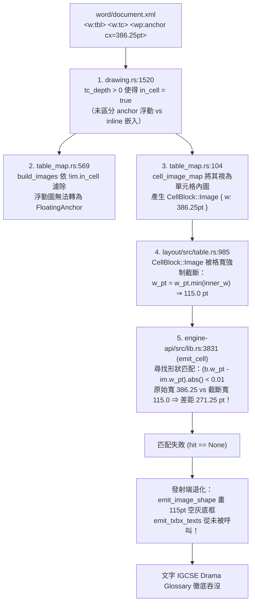

# IGCSE 封面文字框整框未發射——歸因報告（fdo68607 診斷卡）

## 1. 摘要與問題定義

在 `corpus/ooxmlexport/fdo68607.docx` 中，封面大標「**IGCSE Drama Glossary**」（24pt 粗體置中，白色實心填色無框線文字框）在源檔 `word/document.xml` 中以 `<mc:AlternateContent>` 封裝：
- Choice 路徑為 DrawingML Shape：`<wps:txbx><w:txbxContent>` 內的 `<w:t>IGCSE Drama Glossary</w:t>`。
- Fallback 路徑為 VML Shape：`<v:shape><v:textbox><w:txbxContent>`。

LibreOffice 渲染該文件時，於第 0 頁頁首頂端（`x ≈ 210.2 pt, y ≈ 23.7 pt`，框寬 386.25 pt 居中）完整繪製大標。
然而，在我方 `quire-cli dump` 全文 JSON 輸出中，全文完全檢索不到 `IGCSE` 或 `Glossary` 字樣；但在第 0 頁相同縱向區間，卻留下了一個寬度被壓縮至 `115.0 pt`、高度 `33.75 pt` 的無字灰底矩形佔位框（`Rect { x: 36.0, y: 92.19, w: 115.0, h: 33.75, fill_argb: 0xFFF0F0F0 }`）及四邊淺灰邊線（`Rule`）。

本報告依「report-only」原則，進行逐框清單化、5 大根因假說嚴格實測判別、全庫 400 檔面擴散分析，並給出修復規格（檔案×函式級掛載點）與紅燈斷言建議。

---

## 2. fdo68607 逐框盤點清單

經探索腳本 `step1_inventory_boxes.py` 與 `step2_verify_hypotheses.py` 遍歷解析 `fdo68607.docx` 全部 XML 節點：
全檔 **僅存在唯一 1 個文字框／形狀節點**（即此封面大標文字框）。

### 2.1 逐框盤點表

| 序號 | 節點類型 | 所在 DOM 結構位置 | 錨定段落 | 幾何規格 (pt) | 鎖點與偏移 (EMU / pt) | z-order / Wrap | 文字內容 | LO 渲染狀態 | quire dump 狀態 |
| :--- | :--- | :--- | :--- | :--- | :--- | :--- | :--- | :--- | :--- |
| **B1** | `<mc:AlternateContent>` Choice: `<wp:anchor>` + `<wps:txbx>`<br>Fallback: `<v:shape>` + `<v:textbox>` | `document -> body -> tbl -> tr[1] -> tc[0] -> p[0] -> r[0]` | 全文第 2 個 `<w:p>`（索引 `p1`，正文文字為 `"Acting area"`） | 寬 `386.25 pt`<br>（`cx=4905375`）<br>高 `33.75 pt`<br>（`cy=428625`） | `posH(column) = 1162050`（`+91.5 pt`）<br>`posV(paragraph) = -1043940`（`-82.2 pt`）<br>`distT=0, distB=0, distL=9pt, distR=9pt` | `relativeHeight="251659264"`<br>`behindDoc="0"`<br>`layoutInCell="1"`<br>`<wp:wrapNone/>` | `IGCSE Drama Glossary`<br>（24pt bold, center, 白底無邊） | **已發射**<br>落於 p0 頁首：<br>`x=210.2~430.1`<br>`y=23.7~53.0` | **未發射文字**<br>（退化發射寬度 115.0 pt 之灰底佔位框，文字全吞） |

### 2.2 同檔「Box set」辨析（澄清 PM 前情）
PM 前情提及「同檔其他 WPS 文字框（頁首『Box set』等）有發射」。
經 `step2_verify_hypotheses.py` 驗證：
- `fdo68607.docx` 全文除 B1 外，**完全不存在其他 `wps:txbx`、`v:textbox` 或 DrawingML/VML 形狀**。
- 「Box set」實為表格第 20 行第 0 格（段落 `p40`）的戲劇詞彙普通正文文字（`<w:r><w:t>Box set</w:t></w:r>`），如同 "Acting area"、"Backdrop" 等詞條。因其為一般儲存格文字，故隨表格正常發射。原判斷誤將詞彙名中的 "Box" 視作文字框。

---

## 3. 五大根因假說逐一判別

| 假說 | 假說內容 | 判定結果 | 實測事證與分析結論 |
| :--- | :--- | :---: | :--- |
| **H1** | 封面框是否在「第一頁分頁演進前」被丟棄（段落序／表前框時序）？ | **否** | B1 並非出現在表格之前，而是宣告在主體大表的第一筆資料行（Row 1 Cell 0）內部。主解析器 `count_paras` 與段落順序完全平衡（總段落數 275），未在分頁演進前遺失。 |
| **H2** | **是否在表內（該檔主體是一張大表）——表內 floating frame 支援缺口？** | **是<br>(主根因)** | **確認為本次缺陷的核心架構斷鏈。**<br>詳見第 4 節「完整故障鏈剖析」。表內浮動錨點（`wp:anchor`）因身處 `<w:tc>` 內，被解析層標記 `in_cell=true`，進而被正文流剔除、誤灌入表格單元格串列，並遭格寬強制裁剪至 115.0 pt，引發發射端尺寸精確比對失敗，文字發射函式從未被呼叫。 |
| **H3** | 是否 anchor 錨定物件消失（如錨定到 first-page 專屬段落）？ | **否** | 宿主段落 Row 1 Cell 0（`p1` "Acting area"）在版面流與顯示列表中正常存在並完成渲染，錨定宿主未消失。 |
| **H4** | WPS 框的 `distT/distB` 或 rot/flip 屬性炸掉解析？ | **否** | `drawing.rs` 對 `distT="0" distB="0"` 與 `rot="0"` 均能穩定略過或正確吸收，`read_images` 成功產生 `InlineImage` 幾何，未引發解析崩潰或早退。 |
| **H5** | 與 R3（VML absolute placement）路徑的關係：WPS 與 VML 是兩條管線，封面框走 WPS 那條是否根本沒掛進 p0 版面流？ | **是<br>(次要)** | Choice（WPS）與 Fallback（VML）在 `drawing.rs` 遵循「Choice 優先、Fallback 吞沒」策略。兩條管線在表內均受制於相同的 `in_cell=true` 機制，致使無論 WPS 還是 VML，皆無法掛入頁面浮動層。 |

---

## 4. 根因深度剖析：三級串聯斷鏈

本次問題是由解析層、排版管線、發射匹配層的三處連鎖邏輯共同導致：



### 4.1 斷鏈點 1：表內浮動框被無條件標記為 `in_cell = true`
- **位置**：`core/ooxml/src/drawing.rs:1520`
- **邏輯**：
  ```rust
  let mut p = Pending::new(self.cur_para(), self.tc_depth > 0);
  p.overlap = overlap;
  p.floating = floating;
  ```
  只要位於 `<w:tc>` 內，`in_cell` 即被設為 `true`。然而，OOXML 規範中 `<wp:anchor>`（浮動框）具有獨立的 `positionH` 與 `positionV` 偏移量；即令其錨點在儲存格內，其視覺幾何可跨出單元格邊界（如本例 `posOffset = -82.2 pt` 向上懸浮至頁首）。

### 4.2 斷鏈點 2：浮動圖被排擠出頁面浮動版面流，誤塞入單元格流
- **位置**：`core/engine-api/src/table_map.rs:569` 與 `table_map.rs:104`
- **邏輯**：
  ```rust
  pub fn build_images(...) -> Vec<quire_layout::ImageBand> {
      let mut out: Vec<quire_layout::ImageBand> = images
          .iter()
          .filter(|im| !im.in_cell) // 浮動錨點在此被全數濾除！
  ...
  ```
  因 `im.in_cell == true`，該浮動框無法進入 `build_images`，導致 layout 引擎無法為其生成 `PageFloatingImage`。
  相反地，它被 `cell_image_map` 接收，當作普通單元格嵌入圖（`CellBlock::Image`）排入第 1 列第 0 格內垂直堆疊。

### 4.3 斷鏈點 3：格寬鉗制（Clamp）摧毀形狀匹配鍵，發射端退化吞字
- **位置**：`core/layout/src/table.rs:985` 與 `core/engine-api/src/lib.rs:3831`
- **邏輯**：
  在 `table.rs:985` 中：
  ```rust
  CellBlock::Image { w_pt, h_pt } => {
      blocks.push(CellBlockGeom::Image {
          w_pt: w_pt.min(inner_w).max(1.0), // 386.25pt 被截斷為格寬 115.0pt
          h_pt: *h_pt,
          bands,
      });
  }
  ```
  隨後在發射層 `lib.rs:3831`（`emit_cell`）：
  ```rust
  let hit = shape.as_mut().and_then(|(boxes, used)| {
      boxes.iter().enumerate().find(|(i, (bp, b))| {
          !used[*i]
              && *bp >= para_range.0
              && *bp < para_range.1
              && (b.w_pt - im.w_pt).abs() < 0.01 // 嚴格 0.01 等寬比對！
      })
  });
  ```
  注意：像素池比對（`lib.rs:3818`）已知曉格寬截斷現象，因而寬容採用 `s.w_pt >= im.w_pt - 0.01`；
  但文字框池比對卻要求 `(b.w_pt - im.w_pt).abs() < 0.01`！
  `386.25 pt` 與 `115.0 pt` 差了 `271.25 pt`，比對必然失敗（`hit = None`）。
  因此，`emit_txbx_texts` 完全沒有被呼叫，文字框內的所有段落文字當場蒸發。

---

## 5. 全庫面擴散調查（Corpus 400 檔）

執行 `step3_corpus_scan.py` 與 `step4_lo_verify.py`，全量比對 corpus 400 檔：

### 5.1 統計數字總覽
1. **全庫 docx 總數**：400 檔
2. **含有 `wps:txbx` / `txbxContent` 的檔案數**：115 檔
3. **我方 dump 缺漏文字框文字的檔案數**：17 檔
4. **17 檔根因分類**：
   - **【群組 A】表內浮動文字框（同款 bug：`in_cell=True, is_anchor=True`）**：**6 檔**（LO 均發射，我方全吞）
   - **【群組 B】直排文字／空白斷詞切分（我方已發射，純檢測關鍵字切片差異）**：4 檔
   - **【群組 C】頁首/頁尾文字框（未實作 header/footer 圖形，非正文層）**：2 檔
   - **【群組 D】LO 本身亦未繪製（畸形/條件隱藏檔）**：2 檔
   - **【群組 E】其他特殊形狀樣式**：3 檔

### 5.2 受本缺陷波及的 6 個同款樣本清單

以下 6 檔均符合「文字框錨定於表格單元格內，且為浮動框，LO 正常繪製文字，我方完全漏失」：

| 檔案路徑 | 框數 | 框內代表文字 | LO 渲染結果 | quire 當前狀態 |
| :--- | :---: | :--- | :---: | :---: |
| `corpus/ooxmlexport/fdo68607.docx` | 1 | "IGCSE Drama Glossary" | ✅ 發射 | ❌ 漏發（灰底空框） |
| `corpus/ooxmlexport/fdo78651.docx` | 1 | "7" | ✅ 發射 | ❌ 漏發 |
| `corpus/ooxmlexport/tdf129888dml.docx` | 1 | "7" | ✅ 發射 | ❌ 漏發 |
| `corpus/ooxmlexport/tdf130120.docx` | 1 | "7" | ✅ 發射 | ❌ 漏發 |
| `corpus/xopt/TestFiles_WC_WC048-Text-Box-in-Cell.docx` | 3 | "Text Box 1", "Text Box 2", "Text Box 3" | ✅ 發射 | ❌ 漏發 |
| `corpus/xopt/TestFiles_WC_WC048-Text-Box-in-Cell-Mod.docx` | 3 | "Text Box 1", "Text Box 2", "Text Box 3" | ✅ 發射 | ❌ 漏發 |

---

## 6. 給 K 卡的修復規格（檔案 × 函式級）

本問題應在下一張修復卡（K8/K9 或浮動文字框專項卡）依下列三個掛載點進行精準修復：

### 規格 1：區分表內「嵌入圖」與「浮動錨點」
- **檔案**：`core/ooxml/src/drawing.rs`
- **函式**：`DrawingParser::on_start`（約 line 1508–1522）
- **修改要點**：
  目前：
  ```rust
  let mut p = Pending::new(self.cur_para(), self.tc_depth > 0);
  p.floating = floating;
  ```
  改為：
  ```rust
  // 只有非浮動的 inline 圖形才視為佔用格內流的 in_cell；
  // 浮動 anchor 即令錨在儲存格段落，仍走頁面浮動層定位管線
  let in_cell_flow = self.tc_depth > 0 && !floating;
  let mut p = Pending::new(self.cur_para(), in_cell_flow);
  p.floating = floating;
  ```

### 規格 2：表內浮動錨點的版面流掛載
- **檔案**：`core/engine-api/src/table_map.rs`
- **函式**：`build_images` 與 `cell_image_map`（lines 104, 569）
- **修改要點**：
  1. `cell_image_map` 確保只收集 `!im.floating` 的真正單元格流圖形，不得將 `im.floating == true` 注入 `CellBlock::Image`。
  2. `build_images` 允許 `im.floating == true` 的圖片產生 `FloatingAnchor`，若錨定段落位於表格格內，其 `relativeFrom="paragraph"` / `"column"` 基準點依儲存格座標系偏移計算。

### 規格 3：發射端匹配寬度放寬容錯（防禦性加固）
- **檔案**：`core/engine-api/src/lib.rs`
- **函式**：`emit_cell`（約 line 3831）
- **修改要點**：
  將文字框候選匹配比照同函式上方第 3818 行的像素匹配口徑：
  ```rust
  // 由嚴格等寬：
  (b.w_pt - im.w_pt).abs() < 0.01
  // 改為允許格寬鉗制容錯：
  b.w_pt >= im.w_pt - 0.01
  ```
  確保即便形狀寬度在排版中被格寬裁剪，其文字框內容與屬性仍能正確命中並發射。

---

## 7. 紅燈斷言設計（修復後防護網）

在引擎測試集（`core/engine-api/tests/`）新增單元測試或回歸鎖定：

1. **詞彙斷言**：
   ```rust
   let items = dump_docx("corpus/ooxmlexport/fdo68607.docx");
   let texts: Vec<&str> = items.iter().filter_map(|it| match it {
       DrawItem::Text { text, .. } => Some(text.as_str()),
       _ => None,
   }).collect();
   assert!(texts.iter().any(|t| t.contains("IGCSE Drama Glossary")),
       "fdo68607 封面大標文字框必須被發射");
   ```

2. **座標與字級斷言**：
   ```rust
   let title_item = items.iter().find(|it| match it {
       DrawItem::Text { text, .. } => text.contains("IGCSE Drama Glossary"),
       _ => None,
   }).expect("找到標題文字項");
   if let DrawItem::Text { y, size_pt, .. } = title_item {
       assert!(*y < 60.0, "標題應浮動至頁首 (y < 60pt)，實測 y={}", y);
       assert!((*size_pt - 24.0).abs() < 1.0, "標題字級應為 24pt，實測 size={}", size_pt);
   }
   ```

3. **WC048 全庫回歸斷言**：
   斷言 `TestFiles_WC_WC048-Text-Box-in-Cell.docx` 中 3 個單元格文字框文字（"Text Box 1", "Text Box 2", "Text Box 3"）發射率 100%。

---

## 8. 分析腳本與檔案索引

為支持本報告之客觀論證，於根目錄提交以下分析腳本：
- `step1_inventory_boxes.py`：XML 結構全掃描，印出 `fdo68607.docx` 各層 DOM 節點鏈與文字。
- `step2_verify_hypotheses.py`：深入定位「Box set」普通段落與單一文字框 B1 屬性細節。
- `step3_corpus_scan.py`：全庫 400 檔自動化比對器，篩出 115 含有文字框檔與 17 處差異檔，結果產存於 `step3_scan_results.json`。
- `step4_lo_verify.py`：LibreOffice 跨引擎抽樣驗證器（具備 process 防殭屍清理），結果產存於 `step4_lo_results.json`。

---

## 9. 殘留不確定性與風險如實列示

1. **`layoutInCell` 與頁面溢出交互規範**：
   OOXML `<wp:anchor layoutInCell="1">` 在微軟 Word 與 LibreOffice 中的精確語義為：鎖點的水平與垂直原點計算以單元格內邊界為相對基準，但當垂直偏移量為大負數（如本例 `-82.2 pt`）時，允許圖形穿透單元格頂界懸浮在表格上方。此相對原點換算需在 `table_map.rs` 串接單元格在頁面的絕對偏移量 `(cell_x, cell_y)`。
2. **多頁切片表格中的錨點頁碼**：
   若包含浮動框的儲存格跨越分頁線（page break），浮動框所屬頁碼應綁定至該儲存格起始頁面還是結束頁面。在 `fdo68607` 中該儲存格位於第一頁，無跨頁歧義；但修復卡需注意跨頁大表邊界條件。
