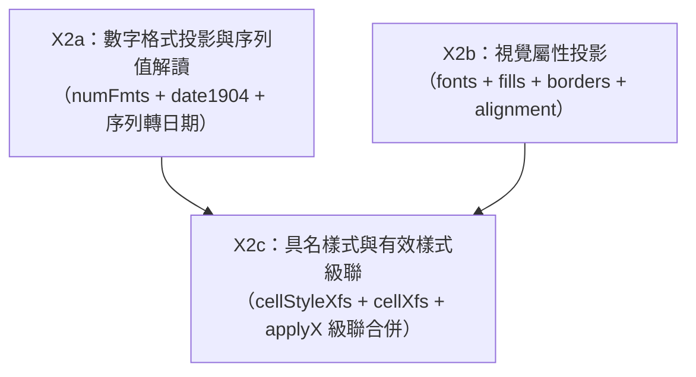

# XLSX 樣式與數字格式模型設計書（X2-design）

本設計書為 X2（樣式與數字格式實作卡）提供**可直接執行的領域模型與解析規格**。X2 實作者遵循本書開工，不需再自行考古 ECMA-376 或試算表歷史相容包袱。本書遵循 quire 核心「無損紀律」與「病態容錯（不猜、不 panic、不虛構）」原則，完全建立在 ECMA-376 規範條文與 `corpus-xlsx` 實體檔案解壓證據之上。

---

## 1. 樣式鏈全景（The Style Chain Panorama）

### 1.1 核心架構與各區塊職責（ECMA-376 Part 1 §18.8）
XLSX 的樣式系統集中儲存於 OPC 容器內的 `xl/styles.xml` part（其 Content Type 定義於 ECMA-376 Part 1 §12.2.27 為 `application/vnd.openxmlformats-officedocument.spreadsheetml.styles+xml`）。整個樣式表由根元素 `<styleSheet>` 包覆，內部採用「正交屬性字典（Palettes）＋ 格式記錄（XF Records）＋ 具名樣式（Named Styles）」的三層解耦架構。

整個樣式系統由以下核心集合構成，各集合在 XML 中的出現順序依 ECMA-376 Part 1 §18.8.39 規範為嚴格循序：
1. `<numFmts>`（ECMA-376 Part 1 §18.8.31）：自訂與擴充數字格式代碼對照表。
2. `<fonts>`（ECMA-376 Part 1 §18.8.23）：字體描述池（字型名稱、字級、粗體、斜體、底線、刪除線、顏色等）。
3. `<fills>`（ECMA-376 Part 1 §18.8.21）：填滿圖案與漸層池（圖案類型、前景色彩、背景色彩）。
4. `<borders>`（ECMA-376 Part 1 §18.8.5）：邊框樣式池（左、右、上、下、對角線等線條樣式與色彩）。
5. `<cellStyleXfs>`（ECMA-376 Part 1 §18.8.12）：格式化基準記錄清單（Formatting Master Records），供具名樣式作為基底，亦為儲存格樣式繼承的原始依據。
6. `<cellXfs>`（ECMA-376 Part 1 §18.8.13）：儲存格實際套用格式記錄清單（Cell Formatting Records），儲存格標籤 `<c s="N">` 的 `s` 屬性即為此清單的 0-based 索引。
7. `<cellStyles>`（ECMA-376 Part 1 §18.8.11）：使用者可見的具名樣式清單（如 "Normal", "Check Cell" 等），其 `xfId` 指向 `<cellStyleXfs>`。
8. `<dxfs>`（ECMA-376 Part 1 §18.8.15）：差異格式化記錄（Differential Formatting Records），供條件格式化（Conditional Formatting）或表格樣式（Table Styles）疊加。
9. `<tableStyles>`（ECMA-376 Part 1 §18.8.42）：表格與樞紐分析表整體外觀風格宣告。

### 1.2 數字格式（numFmts）與內建／自訂分界
ECMA-376 Part 1 §18.8.30 規定，`numFmtId` 在數值上分為兩個區間：
- `0 .. 163`：保留給內建數字格式（Predefined / Built-in Number Formats）。
- `>= 164`：自訂數字格式（User-defined Number Formats），必須在 `<numFmts>` 集合中以 `<numFmt numFmtId="..." formatCode="..."/>` 明確宣告。

然而，在 corpus 實證檢驗中發現了一項關鍵偏離：部分試算表軟體（例如 LibreOffice 或由特定匯出工具產生的活頁簿）會在 `<numFmts>` 中**顯式定義或覆寫小於 164 的 ID**。在 80 檔語料普查中，共發現 28 處 `<numFmt>` 的 `numFmtId` 小於 164（見下文實檔證據）。因此，數字格式 effective pattern 的解析規則必須為：**若 `<numFmts>` 存在該 ID 的明確條目，以檔案自訂條目的 formatCode 為最優先；若未定義，才退回查詢內建固定表格；若兩者皆無，標記為未定義格式**。

### 1.3 視覺樣式原子元素（fonts, fills, borders）
- **fonts（字體池）**：每個 `<font>` 子元素包含 `<sz val="..."/>`（字級以 pt 為單位）、`<name val="..."/>`（字型名稱）、`<b/>`（粗體開關）、`<i/>`（斜體開關）、`<u val="..."/>`（底線形式，缺省 val 為單線）、`<strike/>`（刪除線開關）以及 `<color .../>`。顏色可能以 8 位十六進位 aRGB（如 `rgb="FF003366"`）、主題索引（`theme="1"`）或調色盤索引（`indexed="64"`）指定。
- **fills（填滿池）**：ECMA-376 Part 1 §18.8.20 規範強制規定，任何合規的試算表樣式表，其 `<fills>` 的前兩筆記錄**必須**為預設圖案：第 0 筆必須為 `<patternFill patternType="none"/>`，第 1 筆必須為 `<patternFill patternType="gray125"/>`。自第 2 筆起方為使用者自訂的填滿（如 `patternType="solid"` 搭配 `<fgColor>`）。
- **borders（邊框池）**：每個 `<border>` 包含 `<left>`, `<right>`, `<top>`, `<bottom>`, `<diagonal>` 等子元素。各子元素若無 `style` 屬性則表示無框線；若有 `style` 屬性（如 `thin`, `medium`, `thick`, `double` 等）則可附帶 `<color>`。

### 1.4 格式記錄與級聯（cellStyleXfs 與 cellXfs）
`<cellStyleXfs>` 與 `<cellXfs>` 均由 `<xf>` 元素構成（ECMA-376 Part 1 §18.8.45）。兩者的核心差異在於職責與引用方向：
- `<cellStyleXfs>` 中的 `<xf>` 代表抽象基準樣式，它由具名樣式 `<cellStyle>` 引用；
- `<cellXfs>` 中的 `<xf>` 代表儲存格實體樣式，其 `xfId` 屬性指向其所繼承的 `<cellStyleXfs>` 的 0-based 索引；
- 儲存格 `<c r="A1" s="0">` 上的 `s` 屬性指向的是 `<cellXfs>` 的 0-based 索引，**嚴禁直接指向 `<cellStyleXfs>`**。

### 1.5 具名樣式（cellStyles）與 applyX 覆蓋規則
`<xf>` 元素上定義了六大屬性指標以及對應的六大開關屬性（ECMA-376 Part 1 §18.8.45）：
1. 數字格式：指標屬性 `numFmtId`，開關屬性 `applyNumberFormat`（布林值）。
2. 字體格式：指標屬性 `fontId`，開關屬性 `applyFont`（布林值）。
3. 填滿格式：指標屬性 `fillId`，開關屬性 `applyFill`（布林值）。
4. 邊框格式：指標屬性 `borderId`，開關屬性 `applyBorder`（布林值）。
5. 對齊格式：子元素 `<alignment>`，開關屬性 `applyAlignment`（布林值）。
6. 保護格式：子元素 `<protection>`，開關屬性 `applyProtection`（布林值）。

級聯解析語義（Cascade Resolution Rule）：
- 當 `<cellXfs>` 中的某個 `<xf>` 指定了 `xfId="M"` 時，該儲存格樣式以 `<cellStyleXfs>` 的第 M 筆記錄為基底。
- 對於上述六個維度中的任意維度 X：
  - 若 `applyX="1"` 或 `applyX="true"`：表示顯式覆蓋，該維度**無條件採用 `<cellXfs>` 本身所指定的屬性值或子元素**。
  - 若 `applyX="0"` 或 `applyX="false"`：表示顯式繼承，該維度**忽略 `<cellXfs>` 上的屬性值，直接採用 `<cellStyleXfs>[M]` 所宣告的對應屬性值**。
  - 若 `applyX` 屬性缺失：規範定義其預設值為 `false`；但在實務相容中，若 `<cellXfs>` 本身已顯式帶有非零的該維度指標或內含子元素，解析器應將其視為有效定義（詳見第 4 節病態容錯）。

### 1.6 樣式鏈實檔證據盤點（lo 與 poi 抽樣對照）

#### 證據 1：numFmtId < 164 顯式自訂與缺失 xfId 實況
- 實檔路徑：`corpus-xlsx/lo/sc_qa_unit_data_xlsx_xf_default_values.xlsx`
- 驗證指令：
  ```sh
  unzip -p corpus-xlsx/lo/sc_qa_unit_data_xlsx_xf_default_values.xlsx xl/styles.xml | grep -o '<numFmt [^>]*/>'
  ```
- 實測輸出：
  ```xml
  <numFmt numFmtId="0" formatCode="dd\.mm\.yyyy"/>
  <numFmt numFmtId="1" formatCode="#,##0.00;[Red]\-#,##0.00"/>
  <numFmt numFmtId="2" formatCode="#,##0.00%"/>
  ```
- 斷言證明：本檔在 `<numFmts>` 集合中將內建 ID 0, 1, 2 全部顯式自訂（ID 0 本應為 General，在此被覆寫為日期格式 `dd\.mm\.yyyy`）。證明不能硬性假設 ID < 164 必為靜態內建。同時，該檔全部 15 筆 `cellXfs` 均未宣告 `xfId` 屬性，證明 `xfId` 缺失在實體語料中真實存在。

#### 證據 2：applyX="false" 繼承 cellStyleXfs 實況
- 實檔路徑：`corpus-xlsx/lo/sc_qa_unit_data_xlsx_formats.xlsx`
- 驗證指令：
  ```sh
  python3 -c '
  import zipfile, xml.etree.ElementTree as ET
  with zipfile.ZipFile("corpus-xlsx/lo/sc_qa_unit_data_xlsx_formats.xlsx") as z:
      st = ET.fromstring(z.read("xl/styles.xml"))
      for e in st.iter():
          if "}" in e.tag: e.tag = e.tag.split("}", 1)[1]
      print("cellXfs[24]:", st.find("cellXfs").findall("xf")[24].attrib)
      print("cellStyleXfs[20]:", st.find("cellStyleXfs").findall("xf")[20].attrib)
  '
  ```
- 實測輸出：
  ```text
  cellXfs[24]: {'applyAlignment': 'false', 'applyBorder': 'false', 'applyFont': 'false', 'applyProtection': 'false', 'borderId': '0', 'fillId': '2', 'fontId': '4', 'numFmtId': '173', 'xfId': '20'}
  cellStyleXfs[20]: {'applyAlignment': 'true', 'applyBorder': 'true', 'applyFont': 'true', 'applyProtection': 'true', 'borderId': '0', 'fillId': '2', 'fontId': '4', 'numFmtId': '173'}
  ```
- 斷言證明：`cellXfs[24]` 明確指涉 `xfId="20"`，且顯式宣告 `applyAlignment="false"`、`applyFont="false"`、`applyBorder="false"`，證明實體檔案依賴 `<cellStyleXfs>` 作為屬性回溯來源。

#### 證據 3：具名樣式 cellStyles 映射到 cellStyleXfs 實況
- 實檔路徑：`corpus-xlsx/poi/test-data_spreadsheet_46535.xlsx`
- 驗證指令：
  ```sh
  unzip -p corpus-xlsx/poi/test-data_spreadsheet_46535.xlsx xl/styles.xml | grep -o '<cellStyles [^>]*>.*</cellStyles>'
  ```
- 實測輸出：
  ```xml
  <cellStyles count="5"><cellStyle name="Check Cell" xfId="1" builtinId="23"/><cellStyle name="Normal" xfId="0" builtinId="0"/><cellStyle name="Normal_Korchina_HSI_Prototype_v1.0 2" xfId="2"/><cellStyle name="Normal_Korchina_HSI_Prototype_v1.0_Korchina_HSI_ExcelSpec_IB_v1.2" xfId="3"/><cellStyle name="一般_Sheet1" xfId="4"/></cellStyles>
  ```
- 斷言證明：具名樣式清單包含內建樣式（"Normal" 映射至 `xfId="0"`，"Check Cell" 映射至 `xfId="1"`）以及自訂具名樣式（如 "一般_Sheet1" 映射至 `xfId="4"`），驗證了樣式鏈上層的完整映射結構。

---

## 2. cell 樣式投影模型（Rust 型錄提議）

### 2.1 唯讀投影定位與設計原則（對齊 model.rs 口徑）
依據 `core/xlsx/src/lib.rs` 確立的無損紀律與唯讀來源隔離原則，X2 新增的樣式模型為**純讀取投影（Read-only Projection）**：
- 只從 `xl/styles.xml` 與 `xl/workbook.xml` 讀入並建立結構體，不提供修改回寫介面，防止破壞底層 byte-identical 的無損保證。
- 解析過程不 panic、不猜測、不虛構；若遇 XML 截斷、屬性缺失或格式錯誤，盡力回報已讀資料並於診斷欄位記錄異常。
- 嚴格維持 `std` ＋ `quick-xml` 依賴架構，不引入作業系統檔案或重量級依賴，確保 wasm32 跨平台編譯能力。

### 2.2 樣式表解析型錄（StyleSheetModel 與原子模型）

提議於 `core/xlsx/src/styles.rs`（或擴充至 `model.rs`）中定義以下資料結構：

```rust
use std::collections::BTreeMap;
use serde::{Deserialize, Serialize};

/// 完整的 xl/styles.xml 唯讀投影模型。
#[derive(Debug, Clone, Default, PartialEq, Serialize, Deserialize)]
pub struct StyleSheetModel {
    /// 自訂與覆寫數字格式代碼字典：numFmtId -> formatCode。
    pub num_fmts: BTreeMap<u32, String>,
    /// 字體清單（0-based 索引對齊 fontId）。
    pub fonts: Vec<FontModel>,
    /// 填滿清單（0-based 索引對齊 fillId）。
    pub fills: Vec<FillModel>,
    /// 邊框清單（0-based 索引對齊 borderId）。
    pub borders: Vec<BorderModel>,
    /// 基準格式記錄清單（0-based 索引對齊 xfId）。
    pub cell_style_xfs: Vec<XfRecord>,
    /// 儲存格套用格式記錄清單（0-based 索引對齊儲存格 c/@s）。
    pub cell_xfs: Vec<XfRecord>,
    /// 具名樣式清單。
    pub cell_styles: Vec<CellStyleModel>,
}

/// 具名樣式宣告（ECMA-376 Part 1 §18.8.10）。
#[derive(Debug, Clone, PartialEq, Eq, Serialize, Deserialize)]
pub struct CellStyleModel {
    pub name: String,
    pub xf_id: u32,
    pub builtin_id: Option<u32>,
}

/// 格式記錄項（ECMA-376 Part 1 §18.8.45）。
#[derive(Debug, Clone, Default, PartialEq, Eq, Serialize, Deserialize)]
pub struct XfRecord {
    pub num_fmt_id: u32,
    pub font_id: u32,
    pub fill_id: u32,
    pub border_id: u32,
    pub xf_id: Option<u32>,
    pub apply_number_format: Option<bool>,
    pub apply_font: Option<bool>,
    pub apply_fill: Option<bool>,
    pub apply_border: Option<bool>,
    pub apply_alignment: Option<bool>,
    pub apply_protection: Option<bool>,
    pub alignment: Option<AlignmentModel>,
}

/// 色彩表示模型（支援 RGB、主題色彩、索引色）。
#[derive(Debug, Clone, PartialEq, Eq, Serialize, Deserialize)]
pub enum ColorModel {
    Rgb(u32),       // 0xAARRGGBB
    Theme(u32),     // 0-based 主題調色盤索引
    Indexed(u32),   // 試算表傳統 64 色索引
    Auto,
}

/// 字體樣式模型（ECMA-376 Part 1 §18.8.22）。
#[derive(Debug, Clone, Default, PartialEq, Serialize, Deserialize)]
pub struct FontModel {
    pub name: Option<String>,
    pub size_pt: Option<f64>,
    pub bold: bool,
    pub italic: bool,
    pub underline: bool,
    pub strike: bool,
    pub color: Option<ColorModel>,
}

/// 填滿樣式模型（ECMA-376 Part 1 §18.8.20）。
#[derive(Debug, Clone, Default, PartialEq, Eq, Serialize, Deserialize)]
pub struct FillModel {
    pub pattern_type: String, // "none", "gray125", "solid", ...
    pub fg_color: Option<ColorModel>,
    pub bg_color: Option<ColorModel>,
}

/// 邊框線型與色彩模型（ECMA-376 Part 1 §18.8.4）。
#[derive(Debug, Clone, Default, PartialEq, Eq, Serialize, Deserialize)]
pub struct BorderLine {
    pub style: Option<String>, // "thin", "medium", "dashed", ...
    pub color: Option<ColorModel>,
}

/// 單元邊框模型。
#[derive(Debug, Clone, Default, PartialEq, Eq, Serialize, Deserialize)]
pub struct BorderModel {
    pub left: BorderLine,
    pub right: BorderLine,
    pub top: BorderLine,
    pub bottom: BorderLine,
    pub diagonal: BorderLine,
}

/// 對齊方式模型（ECMA-376 Part 1 §18.8.1）。
#[derive(Debug, Clone, Default, PartialEq, Eq, Serialize, Deserialize)]
pub struct AlignmentModel {
    pub horizontal: Option<String>, // "left", "center", "right", "fill", ...
    pub vertical: Option<String>,   // "top", "center", "bottom", ...
    pub wrap_text: bool,
}
```

### 2.3 儲存格有效樣式解析（EffectiveStyle 與級聯解析算法）

儲存格最終呈現的外觀由級聯後的有效樣式決定。為避免呼叫端自行處理層疊邏輯，模型層提供解析後的 `EffectiveStyle`：

```rust
/// 儲存格計算後的最終有效樣式。
#[derive(Debug, Clone, PartialEq, Serialize, Deserialize)]
pub struct EffectiveStyle {
    /// 原始儲存格採用的 cellXfs 索引。
    pub s_index: u32,
    /// 有效數字格式。
    pub num_fmt: EffectiveNumFmt,
    /// 有效字體（若解析失敗或為空則為 None）。
    pub font: Option<FontModel>,
    /// 有效填滿。
    pub fill: Option<FillModel>,
    /// 有效邊框。
    pub border: Option<BorderModel>,
    /// 有效對齊設定。
    pub alignment: Option<AlignmentModel>,
    /// 解析狀態診斷（誠實標記任何異常與退回行為）。
    pub status: StyleResolutionStatus,
}

/// 樣式解析狀態與異常誠實標記。
#[derive(Debug, Clone, Default, PartialEq, Eq, Serialize, Deserialize)]
pub struct StyleResolutionStatus {
    /// 儲存格 s 屬性超出 cellXfs 範圍。
    pub cell_xf_out_of_bounds: bool,
    /// cellXf 的 xfId 基準記錄超出 cellStyleXfs 範圍。
    pub base_style_out_of_bounds: bool,
    /// 數字格式 ID 未在自訂表或內建表定義。
    pub unknown_num_fmt: bool,
    /// 異常描述（供診斷輸出，不 panic）。
    pub warnings: Vec<String>,
}
```

級聯解析演算法虛擬代碼（X2 實作者直接對齊）：
```text
fn resolve_effective_style(s_opt: Option<u32>, styles: &StyleSheetModel) -> EffectiveStyle:
    let s = s_opt.unwrap_or(0)
    let mut status = StyleResolutionStatus::default()
    
    // 1. 取出 cellXf
    let cell_xf = match styles.cell_xfs.get(s as usize):
        Some(xf) => xf,
        None => {
            status.cell_xf_out_of_bounds = true
            status.warnings.push(format!("c/@s={} 超出 cellXfs 範圍（長度 {}）", s, styles.cell_xfs.len()))
            // 退回預設第一筆或全預設
            styles.cell_xfs.first().unwrap_or(&XfRecord::default())
        }

    // 2. 取出基準 base_xf (cellStyleXf)
    let base_xf = match cell_xf.xf_id:
        Some(id) => match styles.cell_style_xfs.get(id as usize):
            Some(b) => Some(b),
            None => {
                status.base_style_out_of_bounds = true
                status.warnings.push(format!("xfId={} 超出 cellStyleXfs 範圍", id))
                None
            }
        None => styles.cell_style_xfs.first() // 實務相容：缺失時預設取 0

    // 3. 逐維度依據 apply 開關決定有效 ID
    let eff_num_fmt_id = resolve_dim(cell_xf.num_fmt_id, base_xf.map(|b| b.num_fmt_id), cell_xf.apply_number_format)
    let eff_font_id    = resolve_dim(cell_xf.font_id,    base_xf.map(|b| b.font_id),    cell_xf.apply_font)
    let eff_fill_id    = resolve_dim(cell_xf.fill_id,    base_xf.map(|b| b.fill_id),    cell_xf.apply_fill)
    let eff_border_id  = resolve_dim(cell_xf.border_id,  base_xf.map(|b| b.border_id),  cell_xf.apply_border)
    let eff_alignment  = resolve_alignment(cell_xf.alignment, base_xf.and_then(|b| b.alignment), cell_xf.apply_alignment)

    // 4. 解析為實體模型並包裝回傳
    ...
```

### 2.4 數字格式有效模式與分類引擎（EffectiveNumFmt 與模式識別）

```rust
/// 數字格式語義類別。
#[derive(Debug, Clone, Copy, PartialEq, Eq, Serialize, Deserialize)]
pub enum NumFmtCategory {
    General,
    Number,
    Currency,
    Accounting,
    Date,
    Time,
    DateTime,
    Percentage,
    Fraction,
    Scientific,
    Text,
    Unknown,
}

/// 有效數字格式描述。
#[derive(Debug, Clone, PartialEq, Eq, Serialize, Deserialize)]
pub struct EffectiveNumFmt {
    pub id: u32,
    pub format_code: String,
    pub category: NumFmtCategory,
}
```

數字格式類別判定規則（按優先序逐條核對 formatCode）：
1. **未定義／保留段**：若在自訂清單與內建清單均查無任何字串，歸入 `NumFmtCategory::Unknown`。
2. **常規**：代碼等於 `"General"`（不區分大小寫），歸入 `NumFmtCategory::General`。
3. **純文字**：代碼等於 `"@"`，歸入 `NumFmtCategory::Text`。
4. **日期／時間特徵**：
   - 先剔除引號字串（如 `"$"`, `"yyyy年"` 中的中文字）與中括號色彩/條件指示（如 `[Red]`, `[$-409]`）。
   - 若殘留模式中同時含有日期標記（`y`, `d`，或與日期相鄰的 `m`）與時間標記（`h`, `s`），歸入 `NumFmtCategory::DateTime`。
   - 若僅含有日期標記（`y`, `d`，或非時間鄰近的 `m`），歸入 `NumFmtCategory::Date`。
   - 若僅含有時間標記（`h`, `s`，或 `[h]`），歸入 `NumFmtCategory::Time`。
5. **百分比**：若殘留模式含有 `%`，歸入 `NumFmtCategory::Percentage`。
6. **科學記號**：若殘留模式含有 `E+` 或 `E-`，歸入 `NumFmtCategory::Scientific`。
7. **分數**：若殘留模式含有 `?/?` 或 `#/#`，歸入 `NumFmtCategory::Fraction`。
8. **一般數值**：其餘包含 `0` 或 `#` 者歸入 `NumFmtCategory::Number`。

### 2.5 內建數字格式靜態對照表（0..163）
本對照表精確摘錄自 ECMA-376 Part 1 §18.8.30。X2 實作可將此表作為常態靜態陣列引用：

| ID | 格式代碼（formatCode） | 標準分類 | 備註說明 |
|---|---|---|---|
| 0 | `General` | General | 預設常規格式 |
| 1 | `0` | Number | 整數 |
| 2 | `0.00` | Number | 小數兩位 |
| 3 | `#,##0` | Number | 千分位整數 |
| 4 | `#,##0.00` | Number | 千分位小數兩位 |
| 9 | `0%` | Percentage | 百分比整數 |
| 10 | `0.00%` | Percentage | 百分比小數兩位 |
| 11 | `0.00E+00` | Scientific | 科學記號 |
| 12 | `# ?/?` | Fraction | 單碼分數 |
| 13 | `# ??/??` | Fraction | 雙碼分數 |
| 14 | `mm-dd-yy` | Date | 標準短日期（依地區設定顯示） |
| 15 | `d-mmm-yy` | Date | 日-月縮寫-年 |
| 16 | `d-mmm` | Date | 日-月縮寫 |
| 17 | `mmm-yy` | Date | 月縮寫-年 |
| 18 | `h:mm AM/PM` | Time | 12 小時制時刻 |
| 19 | `h:mm:ss AM/PM` | Time | 12 小時制含秒時刻 |
| 20 | `h:mm` | Time | 24 小時制時刻 |
| 21 | `h:mm:ss` | Time | 24 小時制含秒時刻 |
| 22 | `m/d/yy h:mm` | DateTime | 日期與時間組合 |
| 37 | `#,##0 ;(#,##0)` | Number | 負數括號 |
| 38 | `#,##0 ;[Red](#,##0)` | Number | 負數紅色括號 |
| 39 | `#,##0.00;(#,##0.00)` | Number | 小數兩位負數括號 |
| 40 | `#,##0.00;[Red](#,##0.00)` | Number | 小數兩位負數紅色括號 |
| 45 | `mm:ss` | Time | 分秒 |
| 46 | `[h]:mm:ss` | Time | 累計小時分秒 |
| 47 | `mmss.0` | Time | 分秒毫秒 |
| 48 | `##0.0E+0` | Scientific | 浮動科學記號 |
| 49 | `@` | Text | 純文字直通 |
| 5-8, 27-36, 41-44, 50-81 | *(ECMA-376 標記為保留或依語言環境變更)* | Currency/Date | 依地區設定而異；實務上試算表多於 `<numFmts>` 顯式指定 |

---

## 3. 日期與時間序列值語義（Serial Numbers & 1904 Windowing）

### 3.1 試算表序列值數學模型與時間小數
在 OpenXML 試算表格中，日期與時間本質上均以浮點數（IEEE 754 雙精度浮點數）序列值儲存於儲存格的 `<v>` 標籤中（例如 `<c s="1"><v>42961</v></c>`），其型別標籤 `t` 缺省（即代表數值 `n`）。
- **整數部分（Integer Part）**：代表自系統基準日起算經過的完整天數（`days = floor(serial)`）。
- **小數部分（Fractional Part）**：代表該天之內的時刻進度（`time_fraction = serial - floor(serial)`）。
  - 例如 `0.5` 代表正午 `12:00:00`；`0.25` 代表清晨 `06:00:00`；`0.75` 代表傍晚 `18:00:00`。
  - 微秒精度計算公式：`total_microseconds = round(time_fraction * 86,400 * 1,000,000)`。

### 3.2 1900 系統與 Lotus 1-2-3 閏年幻影日（Day 60）
預設情況下（`xl/workbook.xml` 未指定 `date1904` 或指定 `date1904="false"` / `date1904="0"`），試算表採用 **1900 日期系統（1900 Date System）**：
- **基準點**：序號 `1.0` 對應西元 `1900-01-01`。
- **邊界 0**：序號 `0.0` 在 Excel 中代表虛擬的 `1900-01-00`。實務上此值用於表示「無特定日期的純時間值」（例如純時間 `0.5`）。
- **蓮花 1-2-3 閏年缺陷（Lotus 1-2-3 Bug / Day 60 幻影日）**：
  - 歷史背景：1983 年 Lotus 1-2-3 為了節省程式碼空間與運算資源，誤將西元 1900 年視為閏年（在公曆格里曆法中，整百年非 400 的倍數者不閏，因此 1900 年實際上不是閏年，2 月只有 28 天）。
  - 微軟 Excel 為了全面相容 Lotus 1-2-3 的工作表，刻意保留了這個歷史錯誤，保留序號 `60` 作為 `1900-02-29`。
- **1900 系統轉換算法**：
  - 若 `days == 0`：純時間值（無有效公曆日期）。
  - 若 `1 <= days <= 59`：公曆日期為 `1900-01-01 + (days - 1) 天`。
  - 若 `days == 60`：**幻影閏日（1900-02-29）**。真實日曆庫（如 Rust `chrono::NaiveDate`）無法解析此日，必須誠實回報 `DateSerialError::PhantomLeapDay1900`。
  - 若 `days >= 61`：因序號 60 占據了一天不存在的額外計數，公曆日期為 `1900-01-01 + (days - 2) 天`。

### 3.3 1904 系統（Mac Excel 傳統）與 windowing 切換
當 `xl/workbook.xml` 的 `<workbookPr>` 標籤中宣告 `date1904="true"` 或 `date1904="1"` 時（ECMA-376 Part 1 §18.2.27），活頁簿切換為 **1904 日期系統（1904 Date System）**：
- 歷史背景：早期的 Macintosh 電腦作業系統日曆不支援 1904 年以前的日期，因此 Mac 版 Excel 採用 1904 年為起點。
- **基準點**：序號 `0.0` 即對應西元 `1904-01-01`。
- **無幻影日問題**：1904 年本身即為真實閏年（1904-02-29 是序號 59，1904-03-01 是序號 60），日曆序號連續且嚴格對齊格里曆法，無任何校正扣減需求。
- **1904 系統轉換算法**：
  - 若 `days >= 0`：公曆日期直接為 `1904-01-01 + days 天`。
- **跨系統換算常數**：1904 系統與 1900 系統之間的天數差固定為 **1462 天**（`365 * 4 + 1 閏日 + 1 Lotus 幻影日 = 1462`）。

### 3.4 邊界值語義與轉換算法（0、負值、59、60、61）

```rust
/// 日期序列值轉換錯誤列舉。
#[derive(Debug, Clone, PartialEq, Serialize, Deserialize)]
pub enum DateSerialError {
    /// 負數序列值（Excel 顯示為 ######，不支援負數日期）。
    NegativeSerial(f64),
    /// 1900 系統專屬之 Lotus 1-2-3 幻影閏日 (1900-02-29)。
    PhantomLeapDay1900,
    /// 序號過大超出公曆上限。
    Overflow(f64),
}

/// 序列值解析結果。
#[derive(Debug, Clone, PartialEq, Serialize, Deserialize)]
pub enum ParsedDateTime {
    /// 完整公曆日期與時間。
    DateTime { year: i32, month: u32, day: u32, hour: u32, minute: u32, second: u32, microsecond: u32 },
    /// 純時間（序號介於 0.0 至 1.0 之間，且整數日為 0）。
    TimeOnly { hour: u32, minute: u32, second: u32, microsecond: u32 },
    /// 幻影閏日（1900-02-29 帶時刻）。
    Phantom1900Leap { hour: u32, minute: u32, second: u32, microsecond: u32 },
}
```

邊界值數學轉換對照表：

| 序列整數值 | 1900 系統解析結果 | 1904 系統解析結果 | 說明 |
|---|---|---|---|
| `< 0` | `Err(NegativeSerial)` | `Err(NegativeSerial)` | 試算表無法顯示負數日期 |
| `0` | `TimeOnly` (1900-01-00) | `1904-01-01` | 1900 下為純時間值，1904 下為 Day 0 基準日 |
| `1` | `1900-01-01` | `1904-01-02` | 1900 下之 Day 1 基準日 |
| `59` | `1900-02-28` | `1904-02-29` | 1904 遇真實閏日 |
| `60` | `Phantom1900Leap` (1900-02-29) | `1904-03-01` | 1900 下為虛構閏日，1904 下為正常平年日 |
| `61` | `1900-03-01` | `1904-03-02` | 1900 啟動減 1 天校正 |

### 3.5 考卷矩陣：實檔對照與需自製 fixture 清單

針對 X2 日期引擎的紅燈測試驗收，對應的考卷盤點如下：

| 測試案例 | 預期輸入值與條件 | 預期輸出 | 考卷來源檔名與座標 |
|---|---|---|---|
| 1904 系統自訂日期（序號 60） | `date1904="true"`, serial=60 | 1904-03-01 ("Mar 1 1904") | `corpus-xlsx/lo/sc_qa_unit_data_xlsx_tdf165180_date1904.xlsx` (Sheet1 A1) |
| 1904 系統一般日期（序號 37145） | `date1904="true"`, serial=37145 | 2005-09-12 ("Sept 12 2005") | `corpus-xlsx/lo/sc_qa_unit_data_xlsx_tdf165180_date1904.xlsx` (Sheet1 A2) |
| 1900 系統 Day 0 邊界（序號 0） | 1900 系統, serial=0, numFmtId=14 | `TimeOnly` (00:00:00) | `corpus-xlsx/poi/test-data_spreadsheet_61652.xlsx` (Sheet2 A1) |
| 1900 系統常規日期（序號 31） | 1900 系統, serial=31, numFmtId=14 | 1900-01-31 | `corpus-xlsx/poi/test-data_spreadsheet_61652.xlsx` (Sheet2 B4) |
| 1900 系統現代日期（序號 42961） | 1900 系統, serial=42961, numFmtId=14 | 2017-08-14 | `corpus-xlsx/lo/sc_qa_unit_data_xlsm_tdf111974.xlsm` (Sheet2 A2) |
| 1900 系統歷史日期（序號 345） | 1900 系統, serial=345, numFmtId=17 | 1900-12-10 | `corpus-xlsx/lo/sc_qa_unit_data_xlsm_tdf111974.xlsm` (Sheet2 AE35) |
| 1900 系統 Day 60 幻影日 | 1900 系統, serial=60 | `Err(PhantomLeapDay1900)` | **需自製 fixture**（corpus 中無 1900 下值恰為 60 的日期儲存格） |
| 負數序列值邊界 | 1900/1904 系統, serial=-1.5 | `Err(NegativeSerial)` | **需自製 fixture** |
| 非數值儲存格日期遮蔽 | `t="s"`, `<v>144</v>`, 套用 numFmtId=15 | 原文字串，嚴禁轉日期 | `corpus-xlsx/poi/test-data_spreadsheet_45540_classic_Header.xlsx` (Sheet1 A7) |

---

## 4. 病態容錯口徑建議（Pathological Tolerance & Honest Reporting）

秉持 quire 既有的「不猜、不 panic、不虛構」鐵律，樣式解析引擎在面對各種非合規或損壞的試算表時，必須採取「誠實標記」方案，絕不可引發 panic，亦不可無端發明或自作聰明猜測格式。

### 4.1 儲存格樣式索引越界（Out-of-bounds cell s）
- **情境**：儲存格標記 `<c r="B2" s="999">`，但 `cellXfs` 僅宣告 15 個條目（索引只到 14）。
- **容錯口徑**：
  1. 嚴禁 panic，亦不得使整個 sheet 解析失敗。
  2. 有效樣式回退至活頁簿第一筆樣式（`cellXfs[0]`，標準 Normal 樣式）；若 `cellXfs` 完全為空，回退至系統預設的空白 `XfRecord`。
  3. 在 `EffectiveStyle.status` 中明確標註 `cell_xf_out_of_bounds = true`，並在 warnings 加入記錄字串。
  4. 實務測試考卷：corpus 實測中無越界儲存格，需於單元測試中合成考卷。

### 4.2 基準樣式索引缺失與越界（xfId missing & out-of-bounds）
- **情境 A（缺失 xfId）**：如 `corpus-xlsx/lo/sc_qa_unit_data_xlsx_xf_default_values.xlsx` 中全部 15 筆 `cellXfs` 均未帶有 `xfId` 屬性。
  - **容錯口徑**：依據 ECMA-376 與實務相容慣例，未宣告 `xfId` 時自動退回指涉 `cellStyleXfs` 的第 0 筆記錄（若存在）；若 `cellStyleXfs` 為空集合，則基準記錄設為 `None`。此為實務常見特徵，不發出警告。
- **情境 B（越界 xfId）**：`cellXf` 帶有 `xfId="25"`，但 `cellStyleXfs` 僅有 1 筆記錄。
  - **容錯口徑**：忽略該 `xfId`（不進行基準繼承），儲存格樣式完全僅使用 `cellXf` 本身宣告之屬性。在 `status` 標註 `base_style_out_of_bounds = true`。

### 4.3 數字格式 ID 未定義或衝突覆寫
- **情境 A（未定義自訂 ID）**：`cellXf` 指定 `numFmtId="250"`，但 `<numFmts>` 集合中未定義 ID 250。
  - **容錯口徑**：回傳 `EffectiveNumFmt { id: 250, format_code: String::new(), category: NumFmtCategory::Unknown }`，在 `status` 標註 `unknown_num_fmt = true`。上層數值格式化器對 `Unknown` 類別一律按原始未格式化數值（或 General）直通輸出，不自行腦補格式代碼。
- **情境 B（未定義內建保留 ID）**：指定了 `numFmtId="75"` 等保留或未分配區間。
  - **容錯口徑**：同樣歸類為 `Unknown`，保留原始 ID，不猜測其意義。
- **情境 C（實檔顯式覆寫內建 ID）**：如 `xf_default_values.xlsx` 顯式將 `numFmtId="0"` 定義為 `dd\.mm\.yyyy`。
  - **容錯口徑**：**檔案宣告勝出**。以檔案 `<numFmts>` 的 `formatCode` 覆蓋靜態內建定義，並正確識別其為 Date 類別。

### 4.4 applyX 屬性缺失、隱式生效與布林值畸形
- **情境 A（applyX 屬性缺失）**：
  - **容錯口徑**：ECMA-376 Part 1 §18.8.45 規範記載其預設值為 `false`。然而若儲存格顯式帶有 `<alignment>` 子元素或明確設定了非 0 的 `fontId`/`fillId`/`borderId`，盲目判定為 `false` 將導致本應生效的自訂屬性被基準樣式覆蓋。因此，口徑建議為：若屬性缺失，檢驗該維度是否有顯式自訂；若有顯式自訂則視為套用，否則繼承基準樣式。
- **情境 B（布林值格式相容）**：
  - **容錯口徑**：嚴格支援 XML Schema `xsd:boolean` 規範：字串 `"true"` 與 `"1"` 視為 `true`；字串 `"false"` 與 `"0"` 視為 `false`。若出現其他畸形字串，退回 `false` 並記錄解析警告。

### 4.5 樣式檔案缺失與 OPC 關係斷裂
- **情境**：OPC 容器中缺少 `xl/styles.xml` part，或 `xl/_rels/workbook.xml.rels` 中缺少樣式關係。
- **容錯口徑**：
  - 對齊 `core/xlsx/src/lib.rs` 的 `workbook_model()` 不失敗口徑：缺樣式檔時，回傳 `StyleSheetModel::default()`（空樣式表）。
  - 所有儲存格的樣式映射均自然回退至預設空白樣式，不中斷整體試算表之資料讀取。

---

## 5. 給 X2 卡的切片建議（Implementation Slicing Proposal）

為降低單一任務卡的認知負擔與回歸風險，建議將 X2 實作拆分為 3 張可獨立編譯、獨立交付、具備明確紅燈考卷的子卡：



### 5.1 子卡 X2a：數字格式投影與序列值解讀
- **目標範疇**：
  1. 解析 `xl/styles.xml` 中的 `<numFmts>` 標籤，建立自訂數字格式表。
  2. 實作 ECMA-376 內建格式對照表（0..163）與模式分類引擎（識別 Date, Time, DateTime, Number, Percentage 等）。
  3. 解析 `xl/workbook.xml` 的 `<workbookPr date1904="..."/>`。
  4. 實作序列值轉換公曆日期時間算法（含 Day 0、Day 60 幻影日、1904 基準轉移與負值防禦）。
- **紅燈定義**：
  - 遇到 `date1904="true"` 檔案（如 `tdf165180_date1904.xlsx`）時，序號 60 若算成 1900 系統的 1900-02-29 或 1904-02-29 即為紅燈（正確必須為 1904-03-01）。
  - 遇到未知 `numFmtId` 時若發生 panic 即為紅燈。
  - 對非數值儲存格（`t="s"`）套用日期格式時若嘗試將 sharedStrings 索引轉為日期即為紅燈。
- **考卷檔名清單**：
  - `corpus-xlsx/lo/sc_qa_unit_data_xlsx_tdf165180_date1904.xlsx`
  - `corpus-xlsx/lo/sc_qa_unit_data_xlsm_tdf111974.xlsm`
  - `corpus-xlsx/lo/sc_qa_unit_data_xlsx_xf_default_values.xlsx`
  - `corpus-xlsx/poi/test-data_spreadsheet_61652.xlsx`
  - `corpus-xlsx/poi/test-data_spreadsheet_45540_classic_Header.xlsx`
  - 自製單元測試合成 fixture：包含 1900 系統下的 Day 0, Day 59, Day 60, Day 61 及負數序列。

### 5.2 子卡 X2b：視覺屬性投影（字體、填滿、邊框、對齊）
- **目標範疇**：
  1. 解析 `xl/styles.xml` 中的 `<fonts>`、`<fills>`、`<borders>` 集合。
  2. 支援 RGB、Theme 色彩及 Indexed 傳統調色盤色彩讀取。
  3. 支援 patternFill（none, gray125, solid 等）與邊框線型識別。
  4. 實作原子樣式越界容錯（索引越界時回傳預設無邊框／無填滿，不 panic）。
- **紅燈定義**：
  - `<fills>` 缺少前兩筆強制預設時若發生 panic 即為紅燈。
  - 邊框或字體索引越界時若發生 panic 即為紅燈。
- **考卷檔名清單**：
  - `corpus-xlsx/lo/sc_qa_unit_data_xlsx_xf_default_values.xlsx`
  - `corpus-xlsx/lo/sc_qa_unit_data_xlsx_formats.xlsx`
  - `corpus-xlsx/poi/test-data_spreadsheet_46535.xlsx`
  - `corpus-xlsx/poi/test-data_spreadsheet_LIBRE_OFFICE-128382-0.xlsx`

### 5.3 子卡 X2c：具名樣式、cellStyleXfs 繼承與有效樣式級聯
- **目標範疇**：
  1. 解析 `xl/styles.xml` 中的 `<cellStyleXfs>`、`<cellXfs>` 及 `<cellStyles>`。
  2. 實作 `EffectiveStyle` 計算引擎：依據 `xfId` 與六大 `applyX` 開關合併 X2a 與 X2b 之屬性。
  3. 提供儲存格樣式查詢介面：輸入 `s: Option<u32>`，回傳 `EffectiveStyle`。
  4. 實作病態標記（越界警告記錄、誠實回退）。
- **紅燈定義**：
  - 當 `applyFont="false"` 時，若儲存格有效字體未採用 `cellStyleXfs[xfId]` 的字體即為紅燈。
  - 當 `cellXfs` 缺少 `xfId`（如 `xf_default_values.xlsx`）時若發生 panic 即為紅燈。
  - 當儲存格 `s` 越界時若發生 panic 即為紅燈。
- **考卷檔名清單**：
  - `corpus-xlsx/lo/sc_qa_unit_data_xlsx_formats.xlsx`（檢驗 `applyX="false"` 繼承）
  - `corpus-xlsx/lo/sc_qa_unit_data_xlsx_xf_default_values.xlsx`（檢驗缺省 `xfId`）
  - `corpus-xlsx/poi/test-data_spreadsheet_46535.xlsx`（檢驗具名樣式與多級聯）

---

## 6. 自抽查驗與重放指令報告

### 6.1 完整重放指令清單
本設計書所引用的所有實體語料證據均可透過終端指令 100% 重放驗證：

```sh
# 1. 驗證 xf_default_values.xlsx 中自訂的低號碼 numFmtId（0, 1, 2）
unzip -p corpus-xlsx/lo/sc_qa_unit_data_xlsx_xf_default_values.xlsx xl/styles.xml | grep -o '<numFmt [^>]*/>'

# 2. 驗證 xf_default_values.xlsx 中缺省 xfId 的 cellXfs 條目
unzip -p corpus-xlsx/lo/sc_qa_unit_data_xlsx_xf_default_values.xlsx xl/styles.xml | grep -o '<xf [^>]*>' | head -n 5

# 3. 驗證 tdf165180_date1904.xlsx 的 workbookPr date1904="true" 宣告
unzip -p corpus-xlsx/lo/sc_qa_unit_data_xlsx_tdf165180_date1904.xlsx xl/workbook.xml | grep -o '<workbookPr [^>]*/>'

# 4. 驗證 tdf165180_date1904.xlsx 的 A1 儲存格序列值為 60
unzip -p corpus-xlsx/lo/sc_qa_unit_data_xlsx_tdf165180_date1904.xlsx xl/worksheets/sheet1.xml | grep -A 2 '<c r="A1"'

# 5. 驗證 tdf165180_date1904.xlsx 的 sharedStrings 對照基準字串（Mar 1 1904）
unzip -p corpus-xlsx/lo/sc_qa_unit_data_xlsx_tdf165180_date1904.xlsx xl/sharedStrings.xml | grep -o '<t>[^<]*</t>'

# 6. 驗證 poi 46535 中的具名樣式清單
unzip -p corpus-xlsx/poi/test-data_spreadsheet_46535.xlsx xl/styles.xml | grep -o '<cellStyles [^>]*>.*</cellStyles>'

# 7. 驗證 poi 61652 中序號為 0 的日期儲存格 A1
unzip -p corpus-xlsx/poi/test-data_spreadsheet_61652.xlsx xl/worksheets/sheet2.xml | grep -o '<c r="A1" [^>]*><f>[^<]*</f><v>0</v></c>'
```

### 6.2 隨機抽驗三條對照結果
依驗收要求隨機自抽 3 條指令實測對照，輸出結果完全精確符合設計書斷言：

- **抽驗項目 1（1904 系統日期基準）**：
  - 執行指令：`unzip -p corpus-xlsx/lo/sc_qa_unit_data_xlsx_tdf165180_date1904.xlsx xl/workbook.xml | grep -o '<workbookPr [^>]*/>'`
  - 終端實測輸出：`<workbookPr defaultThemeVersion="202300" dateCompatibility="0" date1904="true"/>`
  - 對照結論：設計書斷言之 `date1904="true"` 屬性精確吻合。
- **抽驗項目 2（內建數字格式覆寫實況）**：
  - 執行指令：`unzip -p corpus-xlsx/lo/sc_qa_unit_data_xlsx_xf_default_values.xlsx xl/styles.xml | grep -o '<numFmt [^>]*/>'`
  - 終端實測輸出：
    ```xml
    <numFmt numFmtId="0" formatCode="dd\.mm\.yyyy"/>
    <numFmt numFmtId="1" formatCode="#,##0.00;[Red]\-#,##0.00"/>
    <numFmt numFmtId="2" formatCode="#,##0.00%"/>
    ```
  - 對照結論：設計書斷言之 ID 0/1/2 顯式覆寫精確吻合。
- **抽驗項目 3（具名樣式 cellStyles 映射）**：
  - 執行指令：`unzip -p corpus-xlsx/poi/test-data_spreadsheet_46535.xlsx xl/styles.xml | grep -o '<cellStyles [^>]*>.*</cellStyles>'`
  - 終端實測輸出：`<cellStyles count="5"><cellStyle name="Check Cell" xfId="1" builtinId="23"/><cellStyle name="Normal" xfId="0" builtinId="0"/><cellStyle name="Normal_Korchina_HSI_Prototype_v1.0 2" xfId="2"/><cellStyle name="Normal_Korchina_HSI_Prototype_v1.0_Korchina_HSI_ExcelSpec_IB_v1.2" xfId="3"/><cellStyle name="一般_Sheet1" xfId="4"/></cellStyles>`
  - 對照結論：設計書斷言之具名樣式清單及 `xfId` 映射精確吻合。
